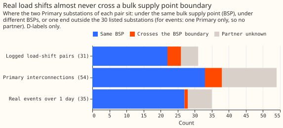
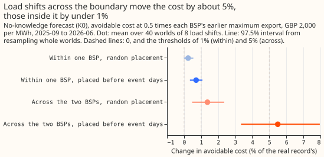
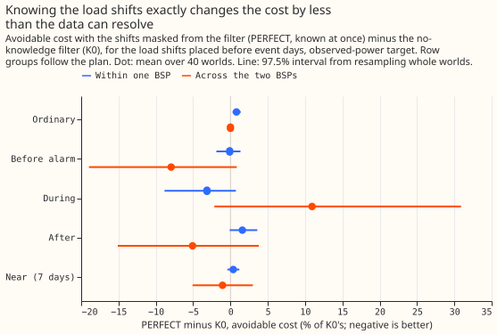

**A load shift between two Primary substations under the same bulk supply point (BSP) changes the
avoidable curtailment cost at the BSP by 0.2% to 0.7% of its value on the real record, and a shift
across the boundary between the two BSPs by 1.4% to 5.5%.** A load shift is demand that the
network operator moves between neighbouring Primary substations for days. We counted how many real
load shifts cross from one of experiment 255's two BSPs to the other. We then simulated 40 years
("worlds") of 8 load shifts each, taking 15% to 45% of a Primary's load for 1 to 8 days, for each
kind of shift. We reran the Kalman filter on recent power of [experiment
258](../00258-lsc-mask-out-of-sample-all-primaries-whole-history/result.md) on the 15 Primaries'
shifted readings, added each Primary's change in forecast to the BSP forecast of [experiment
255](../00255-metered-farm-node-curtailment-value/result.md), and scored the curtailment cost with
experiment 255's rule (GBP 2,000 per MWh at a limit of 0.5 times the BSP's earlier maximum export).

**Verdict: partly supported.** The load-shift decision program's brief set limits of 1% for shifts
inside one BSP and 5% for shifts across. Placed at random, the shifts stay under both limits
(within 0.24%, across 1.37%). Placed to end 6 to 72 hours before days on which the BSP would be
curtailed, the predictions fail: within +0.71% (97.5% interval 0.34% to 1.08%, against 1%), and
across +5.50% (3.34% to 7.96%, against 5%).

## Numbers

- **Stage 1 count (D-labels).** 22 of the 31 logged load-shift pairs join Primaries under one BSP, 4
  cross (D15-D2, D12-D2, D10-D12, D11-D12), and 5 have an unknown partner. Of the 66 hand-filtered
  real events, 54 involve two Primaries and 4 of those cross (all D10-D12); of the 28 over 1 day, 1
  crosses. Of the 54 interconnections, 33 join Primaries under one BSP, 5 cross, and 16 touch a
  substation outside the 30 listed.
- **Known-answer gate.** The real record reproduces experiment 255's avoidable cost for the plant
  forecast: GBP 1.876 million against its 1.88 million at 0.5 times the earlier maximum export.
- **Worlds.** 40 worlds of 8 load shifts for each of two kinds (within one BSP, across) and two
  placements (random, or ending 6 to 72 hours before a day with scored events). Shifts move 15%,
  30%, or 45% of the donor's mean load for 1, 2, 4, or 8 days (mean 1.2 to 1.5 MW, at most 5.0 MW),
  between interconnected or logged pairs. Event days: 21 at D17 and 15 at D13.
- **C1 and C2 (K0, observed power, change in avoidable cost against the real record).** Within,
  targeted +0.71% (0.34% to 1.08%); across, targeted +5.50% (3.34% to 7.96%). Within, random +0.24%
  (-0.01% to 0.55%); across, random +1.37% (0.47% to 2.35%). The largest single world moves by
  3.0% (within) and 28% (across), so a mean under the threshold does not mean every world is.
- **Why within-BSP shifts do not cancel.** A 2 MW shift held for 4 days moves the summed forecast
  of the two Primaries by 0.41 to 1.31 MW, against 1.27 to 2.00 MW for the donor alone, because
  each Primary's filter has its own hyperparameters.
- **Perfect knowledge (PERFECT minus K0, avoidable cost, targeted).** Across: 8% lower before the
  alarm (-65,000 to +3,000 GBP), 5% lower after (-62,000 to +16,000), 11% higher during (-3,000 to
  +45,000); within: under 3% in every group. No interval excludes zero for cost. The twCRPS after a
  shift is lower by 8% across (interval excludes zero) and 2% within.
- **Real record at the two BSPs (descriptive).** The oracle mask, the carried LR_b20 mask, and no
  mask have avoidable costs within GBP 600 of 1.876 million; 639 rows lie within 48 hours after a
  labelled load shift, holding GBP 13,400.
- **Schedule.** Filters refit on the real GAM of experiment 130 (past weather: ERA5 and CAMS, so
  the numbers are a ceiling for a live service); node rows are experiment 48's ensemble-driven
  forecast at 09 UTC, mapped to the filter's 06 UTC origin.

## Checks

- **Median minus mean forecast.** Pooled over both BSPs: +0.11 MW for every arm of the real
  record; no per-site figure, because the quality sums are pooled.
- **Error beside the quantile score.** Across, targeted, G0, PERFECT minus K0: MAE of the median
  +0.009 MW (0.005 to 0.014), quantile score +0.007 (0.004 to 0.011), cost -0.6% (-3% to +2%).
  The error is worse because the mask forecasts the normal arrangement and the observed flow does
  contain the shift; the nra target is not worse (K0 +3.3%, PERFECT +0.8%).
- **Triggers.** None fired on this page: the real record reproduces experiment 255, the observed
  and nra targets agree within one BSP (as they must), and a within-BSP effect of 0.7% was traced
  to differing filter gains. Trigger 7 is a judgement call: steps 4 to 6 of the program may choose
  their curtailment nodes from this result, whose headline is the real-shift count and the
  real-record row above, not the injected-world sign.

## Caveats and next steps

- **Reading of the arms.** The base is experiment 48's node forecast, standing for K0. The arms
  differ by the injected shifts' change in the filter. GAM_ONLY removes K0's real correction, so its
  cost is 13% higher in every world. LB20_LIKE is PERFECT_LAG on a random half of the shifts, a
  stand-in because the carried mask has no alarms on injected readings.
- **Not tested.** Unmetered substations under the BSP, shifts to another BSP (D17 and D13 have
  GSPs above), and the generators' forecasts changing with the shifts.
- **Next.** A Primary-level curtailment metric (demand-only proxy) for step 4.
