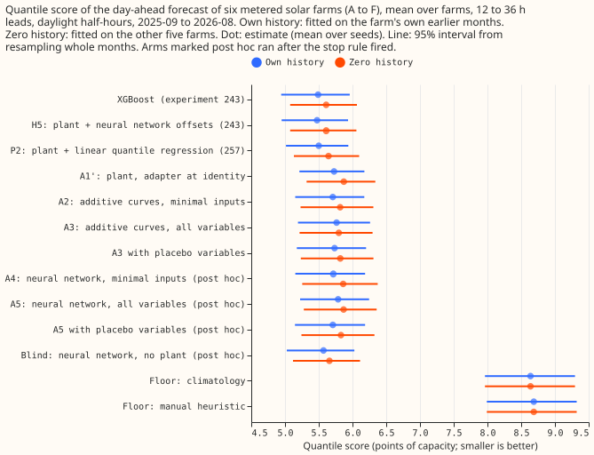
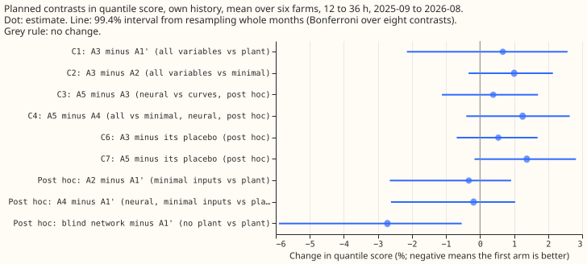
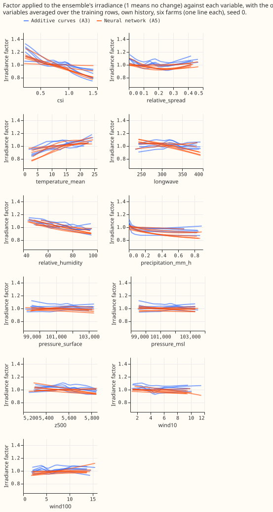

**Extra ensemble weather variables gave no detectable gain in the solar-farm power forecast when
they entered as a learned correction to the plant (the physical model that turns a weather forecast
into farm power).** The National Grid Electricity Distribution (NGED) meters six solar farms,
labelled A to F. The plant takes the ensemble weather forecast (51 members from the European Centre
for Medium-Range Weather Forecasts) and returns the farm's power. We added a learned correction in
front of the plant that scales the forecast irradiance and shifts the cell temperature, using eight
further variables from the same forecast (downward longwave radiation, relative humidity,
precipitation, surface pressure, mean-sea-level pressure, 10 m and 100 m wind speed, and 500 hPa
geopotential height). The correction starts at no change, so it can improve the forecast only if the
variables carry information. We tried two forms: summed one-variable curves (an additive model, in
effect a generalised additive model, GAM) and a small neural network. The design follows the [plant
of experiment 218](../00218-metered-solar-farm-plant-fit/result.md) and the folds of [experiment
243](../00243-metered-farm-architecture-comparison/result.md) and [experiment
257](../00257-metered-farm-fair-plant-arm/result.md), which found that a linear fit on the farm's
power one day earlier (the lagged power) and the spread of the ensemble members recovers 90% of the
gain of a neural head.

**The prediction (a 1% to 2% gain) failed, and the pre-registered stop rule fired: the extra
variables did not improve the forecast at the 99.4% familywise level.** The score is the quantile
score, twice the mean pinball loss over 11 quantile levels, in points of capacity (smaller is
better). In own history (each farm fitted on its own earlier months), the additive curves on all
variables (A3) score 5.765 against 5.726 for the plant with the correction at no change (A1'), which
is 0.67% higher (95% interval -1.2% to +2.1%). At none of the six farms does A3 score at least 0.5%
below the plant, so we stopped before the neural arms. The neural arms ran afterwards, labelled post
hoc, because they take little computing time. The neural network on all variables (A5) scores 1.06%
higher than the plant. A placebo copy of the extra variables (the values from another day of the
same month and cloud band) scores about the same as the real variables for the additive curves (C6
+0.54%, interval -0.34% to +1.40%). For the neural network, the placebo scores 1.4% lower than the
real variables (C7 +1.37%, 95% interval +0.23% to +2.44%), and that interval includes zero at the
99.4% level. Curves and network on the three minimal inputs (clear-sky index, relative spread of the
ensemble members, and temperature) score 0.33% and 0.19% lower than the plant, and both intervals
include zero.

## Numbers

- **Quantile score** (twice the mean pinball loss over 11 levels, points of capacity, mean over six
  farms; own history, then zero history): H5 5.475 and 5.610, XGBoost 5.490 and 5.610, P2 5.500 and
  5.645, blind network (post hoc) 5.570 and 5.658, A2 5.707 and 5.817, A4 (post hoc) 5.715 and
  5.862, A1' (the plant) 5.726 and 5.871, A3 5.765 and 5.798, A5 (post hoc) 5.787 and 5.869. Floors:
  climatology 8.638, manual heuristic 8.687.
- **Contrasts, own history** (percent change in quantile score, 95% interval; 99.4% familywise
  interval in the figure): C1 (A3 minus A1') +0.67% (-1.2 to +2.1); C2 (A3 minus A2) +1.00% (+0.07
  to +1.87); C3 (A5 minus A3, post hoc) +0.39% (-0.68 to +1.37); C4 (A5 minus A4, post hoc) +1.25%
  (+0.05 to +2.30); C6 (A3 minus its placebo) +0.54% (-0.34 to +1.40); C7 (A5 minus its placebo,
  post hoc) +1.37% (+0.23 to +2.44). C5 (adapter plus head) and the alternating-update check were
  not run, because the stop rule fired.
- **Decision rule.** C3 is not below zero, so the neural network is not preferred. C2 and C4 are
  above zero, so neither extra variable set is kept. C8: the share of the gap from the plant
  (fraction of sunny-half-hour output fitted by the median, mean over farms 0.9276) to experiment
  218's 0.973 that A3 closes is -6% (A3 0.9247) and A5's is -12% (0.9222). The plant's fraction is
  0.9276 on these rows against 0.91 in experiment 218, because the definition of sunny differs, so
  the shares are indicative only.
- **Post hoc contrasts, own history:** A2 minus A1' -0.33% (-1.8 to +0.6); A4 minus A1' -0.19% (-1.7
  to +0.8); the blind network (no plant; the raw inputs, lagged power and the extra variables) minus
  A1' -2.72% (-4.8 to -1.1), with the 0.99-quantile pinball loss 16.0% lower (-19.6 to -12.8) and
  the 0.01-quantile pinball loss 9.8% higher (-0.3 to +24.1).
- **Zero history.** A3 minus A1' is -1.25% (-3.4 to +0.6), because the adapter can correct the
  borrowed plant scale; A5 and A4 are not better than the plant.
- **Per farm, own history** (A3 minus A1', percent): A +1.8, B +0.3, C -0.04, D -0.1, E +2.0, F
  -0.2.
- **Tails, own history** (pinball loss at 0.01 and 0.99, coverage of the 0.01 and 0.99 quantiles):
  A1' 0.372 and 0.418 (0.034, 0.984); A3 0.382 and 0.420 (0.036, 0.984); A5 0.382 and 0.433 (0.038,
  0.982); blind 0.409 and 0.351 (0.051, 0.977).
- **Fitted curves** (Figure 3). The clear-sky-index curve lowers the irradiance factor from about
  1.2 at low index to 0.8 at high index in both forms, so the correction mostly flattens the
  forecast's irradiance response. Temperature raises the factor and humidity lowers it. The
  pressure, wind, and 500 hPa height curves are flat. The stronger of the two penalties won in 18 of
  18 additive fits and in 24 of 30 neural fits.
- **Monotonicity** (share of irradiance steps where power falls as irradiance rises): additive
  curves 0.6% on average in own history (3.8% at the worst farm), neural network 0.15%; in zero
  history 1.8% and 1.1%. The 1% pass level is not met at every farm.
- **Quantile crossing.** The offset table is built from per-bin residual quantiles, so no adapter's
  unsorted quantiles cross (crossing rate 0 for every arm run).

## Checks

- **Median minus mean forecast** (mean of the 11 quantiles; points of capacity, mean over farms, own
  history): A1' 0.87, A2 0.86, A3 0.55, A4 0.84, A5 0.66, blind 0.29. Experiment 243's H5 is 0.78.
- **Mean-forecast error beside each contrast.** The mean absolute error of the mean forecast for A3
  is 1.6% below A1' (95% interval -3.4% to -0.04%), while its quantile score is 0.67% above and its
  median error 1.4% above. The two disagree in direction, so audit trigger 3 fires. The extra
  variables may sharpen the mean forecast and still spoil the quantile score, because the table of
  quantile offsets is fitted on the plant's own residual spread.
- **Triggers that fired.** Trigger 1 (a control moves the wrong way: the placebo of the neural
  network beats the real variables, C7). Trigger 2 (the result contradicts its prediction). Trigger
  3 (above). Trigger 5 (A2 beats A3 although A3 holds A2's inputs). A fresh Sonnet auditor
  re-derived the scores and checked the method; its findings follow in "Audit".
- **The row set** is experiment 257's, and every half-hour of it has all extra variables, so no row
  was dropped. A1' reproduces experiment 243's plant to the digit (5.7263), which confirms that the
  torch plant, the table, and the pairing match.

## Audit

A fresh Sonnet auditor re-derived the scores from the stored predictions (they match to 0.001), and
found no leakage in the join, standardisation, offset-table refit, or placebo permutation. Findings
and triage:

- **"Worse" overstated the result** (accepted). No contrast excludes zero (C1 95% interval -1.2% to
  +2.1%), so the page says no detectable gain.
- **Averaging order** (accepted, noted). Averaging quantiles over seeds before scoring gives A5
  +0.37% and A3 +0.58% against A1'; this page averages per-row losses over seeds (A3 +0.67%, A5
  +1.06%). A5's seeds range from 5.756 to 5.837, so part of its 1.06% is seed noise.
- **Per-farm effects are mixed** (accepted; already listed): A and E drive the mean, and C, D, and F
  improve slightly.
- **The adapters learn** (accepted). On farm A the training loss falls 5% to 7% and the validation
  loss about 1%, so the adapters overfit the tuning period, not fail to learn.
- **A5 touches the irradiance bound** (accepted): the largest |g| is 0.399 against 0.4 on farm A.
  The conclusion does not depend on it, because A3 does not touch the bound.
- **Validation set of two summer months** (accepted as a caveat): selection of penalty and epoch
  rests on about 1,650 rows, so differences between arms are within noise.
- **The mean-forecast error improves** for A2 (-1.8%, interval -3.3% to -0.6%) and A3 (-1.6%): the
  adapters may help the central estimate slightly while the quantile score does not improve.

## Departures and post hoc changes

- **Post hoc, before the stop rule was read.** The first run fitted the offset table on the two
  validation months (2025-07 and 2025-08) only, as the amended plan said, and scored A1' 5.857
  against 5.726 for experiment 243's plant: a table from two summer months does not describe the
  year. Every arm now fits the table, by the same code, on all tuning months. The first run also
  found the stop rule satisfied, so this change did not create the result.
- **Post hoc.** A4, A5, the blind network, and both placebo arms ran after the stop rule fired.
  A3's shuffled and alternating controls, A6, and the heads did not run.
- **From the brief.** One fit on the tuning months and no weekly refits; the curves are not convex
  and are fitted by gradient descent; quantiles are sorted and the crossing rate is zero; the
  store serves no cloud layers or visibility, so the cloud-layer variables of the brief were not
  run, and longwave radiation and humidity stand in. The weather source at every input is the
  ECMWF ensemble 00 UTC run, available at forecast time, at the store's 3-hourly step.

## What the next experiment should answer

- **The blind network beats the plant by 2.7% but does not beat P2, the linear fit of experiment
  257, so test the blind network and P2 together.** The blind network gains most at the 0.99
  quantile (-16%), the tail that matters for curtailment, and it loses at the 0.01 quantile. A
  blend of the two by quantile could take both gains.
- **The extras may still help through a different route**, such as the farm's availability, but the
  placebo result says the present route does not use them.

## Design

- **Background.** [Experiment 218](../00218-metered-solar-farm-plant-fit/result.md) found a better
  plant barely helps (fraction of output fitted 0.950 to 0.953) while the ensemble irradiance caps
  the fit at 0.91 on sunny half-hours against 0.973 with observed weather. [Experiment
  243](../00243-metered-farm-architecture-comparison/result.md) found a neural head on the plant
  4.4% better than the plant, and [experiment 257](../00257-metered-farm-fair-plant-arm/result.md)
  found a linear fit on the lagged power and the ensemble spread gets 90% of that gain. [Experiment
  248](../00248-metered-farm-architecture-ukv-inputs/result.md) found Met Office UKV columns worth
  about 1%. This experiment asks whether other ensemble variables, entering through a correction to
  the plant's inputs, do better than those heads, which correct the plant's output.
- **Rows and fits.** Experiment 257's rows and folds. One fit on the tuning months before 2025-09,
  none in the scored year (screening schedule, 4 CPU cores), the schedule of experiments 243 and
  257, so the contrasts against their stored arms pair on the same half-hours. Own-history (fitted
  on the scored farm's tuning months) and zero-history (leave-one-farm-out, fitted on the other five
  farms) settings. Weekly refits are not run, which departs from the brief; the contrasts here are
  between arms sharing one schedule.
- **Weather sources (all exist at forecast time).** ECMWF ensemble, 00 UTC run, nearest 0.25 degree
  cell. Minimal inputs: clear-sky index of ensemble-mean irradiance, relative ensemble spread of
  irradiance, and ensemble-mean temperature. Full list adds downward longwave flux (a cloud proxy),
  relative humidity from temperature and dew point, precipitation, surface pressure, mean-sea-level
  pressure, 10 m and 100 m wind speed, and 500 hPa geopotential height, taken at the store's
  3-hourly step holding each half-hour (the `extra_<farm>.parquet` files of experiment 270). The
  store serves no cloud layers or visibility, so the brief's cloud-layer variables are not run. No
  UKV variable is used.
- **The plant and the correction.** The plant is experiment 243's fleet-shape plant in torch with
  the per-farm scale and ceiling (the median of the other five farms' values in zero history),
  frozen. Effective beam and diffuse irradiance equal the ensemble values times exp(g(x)), and cell
  temperature is raised by h(x), with g bounded to +-0.4 and h to +-4 K. Both are zero at
  initialisation, so every adapter starts as the plant. The adapter's quantiles are its power plus a
  table of 11 offsets per bin of the unadapted plant forecast. The table is trained jointly with the
  adapter so the training loss is the quantile loss, and then replaced for every arm, by the same
  code, with the per-bin residual quantiles of the frozen arm on all tuning rows (the plan said the
  two validation months only; see the departures). Quantiles are sorted, and the crossing rate
  before sorting is reported per arm.
- **Selection and tuning.** Every choice (epoch, penalty strength, which of A3 and A5 goes into A6,
  which arm gets the alternating and blind controls) is made on the validation months only, with the
  same budget for every adapter: the same 60 epochs with early stopping on validation, and two
  penalty strengths (a second-difference penalty of 1e-3 or 1e-2 for the curves, weight decay of
  1e-4 or 1e-2 for the network). Input standardisation uses tuning rows only. The final fit includes
  the validation months for no arm.
- **Arms.** A1' plant at identity with the shared table (stored plant of experiment 243 kept as a
  benchmark). A2 additive curves on the minimal inputs. A3 additive curves on the full list: one
  piecewise-linear curve with 8 knots per variable for g and another for h, summed, 3 seeds. A4
  neural network on the minimal inputs. A5 neural network on the full list, two hidden layers of 32
  units, zero-initialised last layer, 5 seeds. A6 the better of A3 and A5 on validation, with
  experiment 243's H5 head (11 corrections from the lagged power, ensemble spread and the other H5
  inputs, with the adapted power in place of the plant forecast) on the frozen adapter, against the
  same head on the identity adapter. Controls: shuffled (the extra variables, not the minimal ones,
  permuted across rows within farm and split) and placebo (the extra variables permuted within farm,
  split, calendar month, and clear-sky-index band, so other days of the same season and cloud
  class), both with the arms retrained on the permuted columns; blind (the same network with no
  plant, on the raw inputs plus the full list); an alternating-update check (the plant's scale
  unfrozen for two rounds) on the better arm.
- **Rows.** Every half-hour of experiment 257's rows has all extra variables (checked), so the row
  set is unchanged. The observed-weather plant is not re-run, so the 0.973 reference in C8 is
  experiment 218's, from other rows, and the share closed is indicative.
- **Departures from the brief.** The additive curves are trained by gradient descent through the
  non-linear plant, so the fit is not convex and backfitting is not used. Monotonicity in irradiance
  is measured after the fit, and passes if under 1% of grid steps fall as irradiance rises.
  Quantiles are sorted after the fact, with the crossing rate reported, and not built from
  cumulative non-negative offsets. The minimal inputs add temperature to irradiance and spread.
  Cloud layers and visibility are not served. The interval level is 99.4%, not 98.75%, because eight
  contrasts are planned. The extras are held from the store's 3-hourly step. One fit is made on the
  tuning months (no weekly refits).
- **Report.** Quantile score and MAE per arm with intervals, share of the 0.91 to 0.973 gap closed
  (fraction of sunny-half-hour output fitted by the median), tail calibration through
  `studies.tail_calibration`, the crossing rate of the unsorted quantiles per arm, the fitted curves
  of A3 beside the neural network's factor on the same variable, and the Checks bullets of the
  `ml-experiment` skill.
- **Reviews.** A Sonnet plan review before any fit, a Sonnet audit of the results and the method
  (which read the code for leakage; there was no separate code review), and a Sonnet prose review
  before the merge. No Opus was used.
