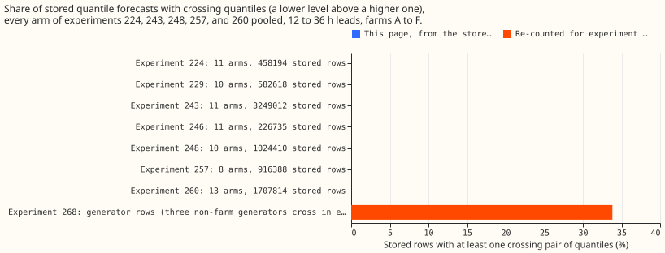

**The stored forecasts of seven metered-farm experiments have no crossing quantiles, because their
fit scripts already sorted the 11 quantiles, so sorting again changes nothing and no verdict
moves.** National Grid Electricity Distribution (NGED) meters six solar farms, labelled A to F.
Experiments [224](../00224-metered-farm-dayahead-two-number/result.md),
[229](../00229-metered-farm-ens-ukv-blend/result.md),
[243](../00243-metered-farm-architecture-comparison/result.md),
[246](../00246-metered-farm-ens-ukv-icond2-blend/result.md),
[248](../00248-metered-farm-architecture-ukv-inputs/result.md),
[257](../00257-metered-farm-fair-plant-arm/result.md), and
[260](../00260-metered-farm-quantile-combination/result.md) each forecast a farm's output 12 to 36
hours ahead as 11 quantiles per half-hour. A pair of quantiles crosses when a lower level is above a
higher one. Experiment 268 reported 26,344 crossing rows among its 77,897 generator-forecast rows.
Sorting the 11 quantiles of a row never raises its pinball loss (the quantile loss the scores are
built from), so crossing would make a stored score too high. We therefore asked whether the seven
earlier experiments' scores were too high for the same reason. We counted the crossing rows in every
stored prediction, then scored each arm (one forecasting method or ablation) as stored and with the
quantiles sorted in each row, using each experiment's own scoring method for the five experiments
that have a quantile-score table here (224, 243, 248, 257, and 260). For experiments 229 and 246 we
only counted crossing rows.

**Sorting changes every score by less than 1e-13%, and no headline contrast, interval, or verdict
changes.** Every arm of every experiment has 0 crossing rows. The fit and combine scripts of all
seven experiments already sort or constrain the quantiles before writing them, so the stored scores
are scores of monotone forecasts. The crossing rate before that sort cannot be recovered without
refitting, and no refit was run.

## Numbers

- **Every arm of every experiment has 0 crossing rows, in all 10 adjacent quantile pairs.** Arms and
  stored rows per experiment: 224 has 11 arms and 458,194 rows; 229 has 10 arms and 582,618 rows
  (finite rows only); 243 has 11 arms and 3,249,012 rows; 246 has 11 arms and 226,735 rows (finite
  rows only); 248 has 10 arms and 1,024,410 rows; 257 has 8 arms and 916,388 rows; 260 has 13 arms
  and 1,707,814 rows. A row is one farm, half-hour, and seed on experiment 224's common daylight
  half-hours, so the reference arms repeat across the tables.
- **Ties are not crossings.** The plant's output is clamped at zero and at the farm's ceiling, so
  equal neighbouring quantiles occur in up to 38% of rows (H5, the plant plus 11 neural-network
  offsets, with zero history). XGBoost has ties in 4% to 13% of rows. Ties do not change the pinball
  loss, and sorting leaves them alone.
- **The stored scores reproduce.** The scores below are quantile scores (twice the mean pinball loss
  over the 11 levels, in points of capacity), scored on each farm's own history at 12 to 36 hour
  leads in 2025-09 to 2026-08, with 95% intervals: H5 5.475 (4.95 to 5.92); XGBoost 5.490 (4.94 to
  5.95); the blend C2 of experiment 260 5.358; the linear quantile regression P2 of experiment 257
  5.500; the two-number plant of experiment 224 5.642 (5.15 to 6.07).
- **Every headline contrast matches its page, and the sorted score equals the stored score to 13
  decimal places.** H5 minus XGBoost is -0.27% (-1.17% to +0.83%) in 243. C2 minus H5 is -2.13%
  (-2.80% to -1.58%) in 260. H5 with UKV (Met Office high-resolution weather model) columns minus H5
  is -1.10% (-2.24% to -0.07%) in 248. The share of the members' gain that the two-number plant
  keeps is 0.95 (0.84 to 1.02) in 224. P2 minus H5 is +0.45% (-0.36% to +1.69%) in 257, where the
  original page quotes the same contrast as H5 minus P2, with the interval -1.7% to +0.4%.
- **The H5 against XGBoost comparison (5.48 against 5.49) is unchanged.** The scores are 5.475 and
  5.490 in both columns, and H5's pinball loss at the 0.01 and 0.99 quantiles is 9.5% and 29.1%
  lower.
- **Experiment 268's crossing rows come from three generators that are not solar farms.** Their
  stored forecasts hold 9 quantiles (0.05 to 0.95). [Experiment
  255](../00255-metered-farm-node-curtailment-value/result.md) padded the missing 0.01 and 0.99
  quantiles with nulls, and its cap at each generator's capacity (`pl.min_horizontal`) turned each
  null into the capacity, so the 0.01 quantile sat above the 0.05 quantile in all 26,344 rows of those
  generators. The 51,553 solar-farm rows have none. We rebuilt experiment 268's generator frames to
  trace this.

## Checks

- **The median and mean forecasts per farm were not recomputed, because no forecast changed.** The
  values on the five original pages stand.
- **The error of the mean forecast beside each quantile-score contrast was not recomputed, for the
  same reason.**
- **No audit trigger fired.** Every stored score reproduces, which is the control, and sorting is a
  deterministic operation that needs no placebo.
- **The page covers only the stored 12 to 36 hour rows of farms A to F.** The arms are monotone by
  construction in two ways: most end in `np.sort` or `torch.sort`, the pure neural network uses
  cumulative offsets, and the seed-averaged arms of experiment 260 average monotone rows.

## What to try next

- **Constrain the quantiles of every new farm head to be monotone** with cumulative non-negative
  offsets from the median, so that no sort is needed. This applies to future briefs for the metered
  farms.
- **Fill a missing 0.01 or 0.99 quantile from the 0.05 or 0.95 quantile** before capping, instead of
  padding with nulls, in any scorer that reads the three non-farm generators' forecasts.
