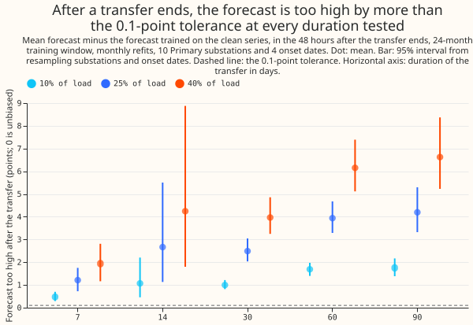
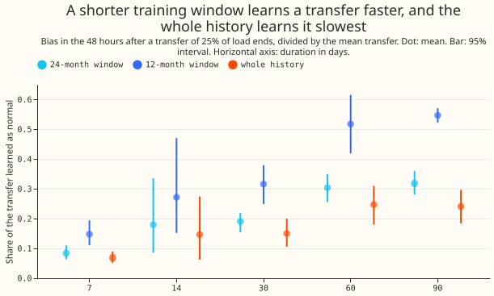
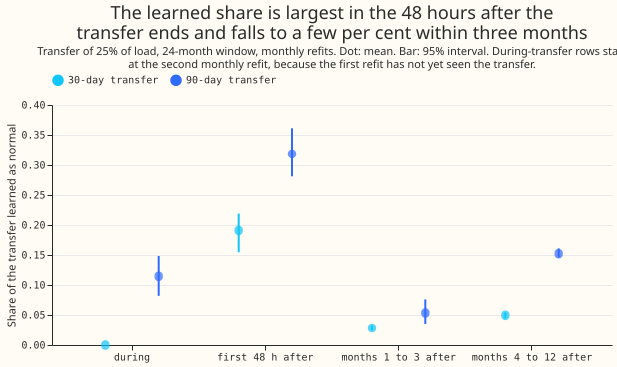
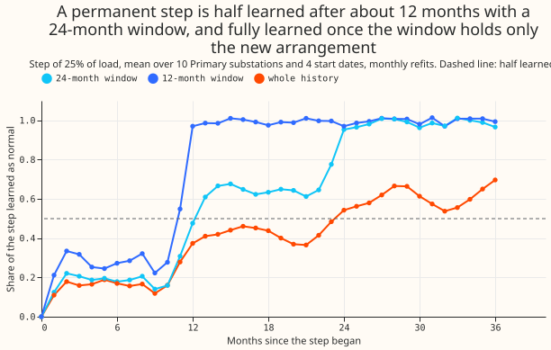

**A forecast that uses no recent power still learns a load transfer as normal.** A load transfer is a
spell in which an operator moves part of one substation's demand onto a neighbouring substation by
changing how the electricity network is connected. The way the network is normally connected is the
normal running arrangement (NRA). We took 10 Primary substations (substations that step 33 kV down
to 11 kV) and added a transfer of 25% of each substation's own power to its recorded power, for 7 to
90 days or for good. We refitted the forecast at the start of every month. The forecast, called
GAM_ONLY, is a generalised additive model fitted by convex least squares, with no lagged power
among its inputs. We compared each forecast with the forecast trained on the unaltered series, which
stands for the NRA. The difference between the two forecasts is the bias: a positive bias means the
transfer was learned as normal.

The prediction was that a 30-day transfer of 25% of load would bias the forecast by under 0.1 points
of effective capacity (1 point is 1% of the substation's capacity). The prediction did not hold, so
the verdict is `not supported`: in the 48 hours after the end the bias is 2.49 points (95% interval
2.04 to 3.04), which is 19% of the transfer. Even a 7-day transfer, the shortest we tested, is
learned as 8.5% of its size, so any limit on how long an arrangement can last before it counts as
normal is shorter than 7 days and is not located. The next experiment should test durations of 1 to
6 days and a training mask. Two conditions limit the result: the weather inputs are the ERA5 and
CAMS estimates of past weather (the European Centre for Medium-Range Weather Forecasts' reanalysis
and the Copernicus Atmosphere Monitoring Service's irradiance), not ensemble forecasts, and the
forecast has no lagged power. The share-of-load injection is the one of [experiment
141](../00141-switching-detector-fed-into-gam-k/result.md), and the forecast settings are the GAM-K
settings of [experiment 252](../00252-gam-stack-at-eight-more-primaries/result.md).

## Results

Every figure is in points of effective capacity unless it is a percentage, a mean over 10
substations and 4 onset dates, with a 95% interval from resampling substations and onset dates
independently. The mean transfer for the 25% size was 13.3 points. `e00274_report.py` prints every
number in `printed_report.txt`. A receiver is a substation that gains load and a donor is one that
loses load. A BEFORE row is a forecast row dated before the transfer began.

- **Controls passed.** The bias in the 3,720 groups of BEFORE rows and in the 1,920 groups of rows
  with a transfer of size 0 is exactly 0.
- **Headline (24-month window, 25% of load, receiver).** The bias in the 48 hours after the end is
  1.21 points (0.73 to 1.75) at 7 days, 2.67 (1.14 to 5.54) at 14 days, 2.49 (2.04 to 3.04) at 30
  days, 3.94 (3.29 to 4.68) at 60 days, and 4.20 (3.33 to 5.29) at 90 days. As shares of the
  transfer these are 8.5%, 18.0%, 19.1%, 30.4%, and 31.9%. The bias grows less than in proportion
  to the duration, so the prediction of proportional growth to 90 days did not hold. The bias is
  also not monotone: 2.67 at 14 days has a wide interval.
- **The bias scales with the size of the transfer.** The share learned at 30 days is 19% at 10%,
  25%, and 40% of load, and a transfer of 10% of load gives 1.00 points (0.82 to 1.21).
- **Training window (30 days, 25% of load).** The share learned is 32% (25% to 38%) with a 12-month
  window, 19% (16% to 22%) with a 24-month window, and 15% (11% to 20%) with the whole history.
- **Decay after the end (30 days, 25% of load).** The share learned is 2.8% in months 1 to 3 after
  the end (bias 0.37 points, 0.31 to 0.44) and 5.0% in months 4 to 12 (0.66 points, 0.48 to 0.86).
  For 90 days the shares are 5.3% and 15.2%. The share in months 4 to 12 is larger than in months 1
  to 3, and no season-by-season breakdown was run to say why.
- **Rows inside the transfer.** The learned share is 0% at 7, 14, and 30 days, 6.2% at 60 days, and
  11.4% at 90 days. A fit at a cut has seen only the earlier part of the transfer, so these rows
  lag by up to a month. A transfer of 30 days or shorter has its inside rows forecast by the fit
  cut at the onset, which has seen none of the transfer, so the bias there is 0 by design.
- **Permanent step (25% of load).** The share learned is about 20% from month 2 to month 10 after
  the step begins. With a 24-month window it is 48% at month 12, 61% at month 13, and 100% from
  month 24. With a 12-month window it is 55% at month 11 and 97% at month 12. With the whole
  history it is 54% at month 24 and 70% at month 36. The prediction of half learned within 12
  months (24-month window) failed, because half was reached at month 13. The prediction of half
  learned within 6 months (12-month window) failed, because half was reached at month 11.
- **Sign and shape (30 days, 25% of load, 24-month window).** When the transfer removes load from a
  donor substation, the bias is 2.47 points (2.05 to 2.96) and the share learned is 19.0%. When the
  transfer is a fixed block of MW with a flat shape, the bias is 2.72 points (2.19 to 3.24) and the
  share is 20.3%. The share for a share-of-load transfer is 19.1%, so the three are similar.
- **Season and substation.** A transfer beginning in winter gives a bias of 2.65 points (1.88 to
  3.48) and one beginning in summer gives 2.33 (1.96 to 2.69). Across substations the bias ranges
  from 1.47 points (D12) to 3.04 (D2), and the share learned from 17% to 21%.
- **The limit for NGED.** No tested duration, including 7 days, has an interval upper bound below
  0.1 points or below 5% of the transfer, for any size or window. The limit, if it exists, is below
  7 days and is not located.
- **Signed error against the NRA series (30 days, 25% of load).** In the 48 hours after the end, the
  clean-trained forecast is 2.8 points too high and the injected-trained forecast is 5.3 points too
  high. The error NGED would see is therefore larger than the learned bias alone. The 48-hour group
  is small.

## Checks

- **The 48-hour figure depends on where the fit is cut.** For D3 with a transfer ending on 1 July,
  the mean forecast difference over one fixed week was 2.13 points for a fit cut at the end of the
  transfer, 0.88 for a fit cut 12 hours later, 0.76 for a fit cut a day later, and about 1.0 for
  fits cut 3 and 10 days later (`diagnose_report.txt`). We did not find why 12 hours of extra clean
  data lowers the bias by 60%. The solar-capacity season year runs from September to August, so the
  cause is not that year boundary. The 48-hour figure is therefore an upper bound that holds at the
  cut, and the months 1 to 3 figure (2.8% at 30 days) is the steadier measure.
- **Where the bias sits.** For D3 and D11 after a 30-day winter transfer, the forecast difference
  is similar in every temperature band below 15 C (D3: 1.1 to 1.3 points; D11: 0.7 to 1.5), so the
  transfer is not learned mainly as a temperature response. The difference varies by time of day
  (D3: 0.8 to 1.7 points over four 6-hour blocks). For D3 it is 0.5 points in the first week after
  the end and 1.3 to 1.5 points in weeks 2 to 5.
- **Median minus mean.** GAM_ONLY is a least-squares forecast of the mean, so it has no
  median-minus-mean gap to report. The signed error against the NRA series is in the Results.
- **Audit triggers.** Two of the seven audit triggers of the `ml-experiment` skill fired. The result
  contradicted its own prediction in size: the prediction expected 0.5 to 1 points and the
  experiment measured 2.5. The explanation we tested is the cut sensitivity above, and it does not
  remove the result, because the bias is still 0.9 points 12 hours later and 0.4 points in months 1
  to 3, both above 0.1. The second trigger is that the statement to NGED rests on this result and
  no other experiment has replicated it. No Opus audit was run, because this session was limited to
  Sonnet models.

## Caveats and what to try next

- The forecast has no drift term and no lagged power (the GAM-K settings), so the production GAM
  stack with the Kalman filter correction would behave differently.
- The weather inputs are the ERA5 and CAMS estimates of past weather, not ensemble forecasts.
- The transfer is injected as a share of the receiver's own power or as a flat block, so it follows
  the receiver's daily shape or has none. Real transfers have shapes of their own.
- The existing masks (the lockdown window and the hand-filtered events) remove some rows from both
  the clean and the injected training sets. Real arrangements in the unmasked history sit in both.
- Only monthly refits were tested. Weekly refits are expected to learn a transfer sooner, but this
  experiment did not test them.
- The next experiment should test transfers of 1 to 6 days and a training mask that removes known
  transfers, and should look for the cause of the cut sensitivity.
