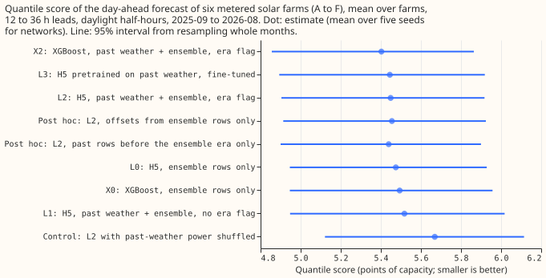
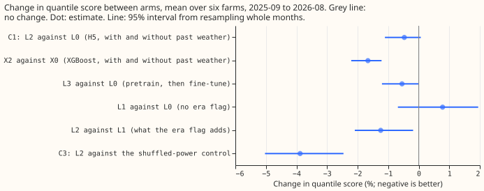
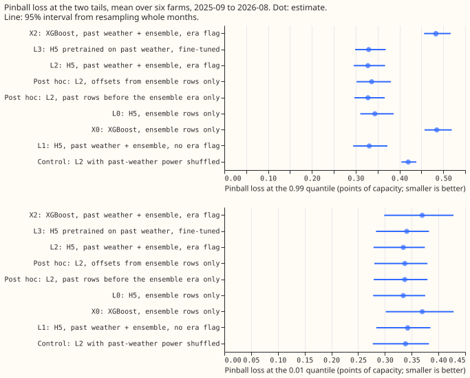

**Training the neural network that corrects a solar farm's power forecast on years of rows built
from past weather barely improves its forecast, and improves XGBoost's forecast more.** National
Grid Electricity Distribution (NGED) meters the output of six solar farms, labelled A to F here.
[Experiment 243](../00243-metered-farm-architecture-comparison/result.md) fitted H5 on only 17
months of European Centre for Medium-Range Weather Forecasts (ECMWF) ensemble weather forecasts
(many runs of one weather model). H5 is a physical model of a farm's output (the "plant") plus a
neural network that adds offsets for 11 quantile levels, which give a probability band around the
plant's forecast. We added nearly six years of rows (2019-09 to 2025-07) built from past weather
(Copernicus Atmosphere Monitoring Service irradiance and ERA5 temperature), with an "era flag" that
marks them, and measured the quantile score on the 12 months 2025-09 to 2026-08, which no arm
trained on. The quantile score is twice the mean pinball loss over 11 quantile levels (the loss that
penalises a quantile forecast on the side it errs), in percent of the farm's capacity; lower is
better. It is scored on daylight half-hours at 12 to 36 hours ahead. The idea follows [experiment
200](../00200-dp-pooled-correction-head-on-kalman-state/result.md) and [experiment
211](../00211-dp-boosted-tree-calibrator-and-input-ablations/result.md), where past-weather rows
helped a neural network that corrects a substation's forecast.

**The prediction fails.** Version L2 (H5 on past-weather plus ensemble rows with the flag) beats
version L0 (H5 on ensemble rows only) by 0.47% (95% interval -1.1% to +0.1%), against at least 2%
predicted. XGBoost, a gradient-boosted tree model, gains 1.7% (1.2% to 2.2%) from the same rows
(version X2 against X0), so L2's gain is 1.2 percentage points smaller than XGBoost's (interval 0.6
to 1.7), the opposite of the predicted sign. The stop rule (stop if L2 gains under 1% at 4 or more
of the 6 farms) fires: L2 gains under 1% at five farms (farm E gains 1.3%), so the versions fitted
on the other five farms' rows were not run. The shuffled-power control scores 3.9% worse than L2
(2.5% to 5.0%), so the gain that exists comes from the weather-to-power relation and not from a
prior on the power level.

## Arms, rows, and weather

- **Arms** (five random seeds for the neural networks; one fit on rows before 2025-09, the screening
  schedule, with no retraining in the scored year). L0: H5 on ensemble rows only. L1: past-weather
  plus ensemble rows, no flag. L2: L1 plus the era flag. L3: L2 pretrained on past-weather rows,
  then fine-tuned on ensemble rows. X0, X2: XGBoost on ensemble rows, and on both with the flag.
  Control: L2 with the past-weather rows' power shuffled across days of the same farm, month, and
  half-hour.
- **Rows.** Experiment 243's 41,654 daylight half-hours in the scored year, equal weight per farm,
  intervals from resampling the 12 scored months 20,000 times. L0 reproduces experiment 243's stored
  H5 exactly (5.475 against 5.475, identical to the last digit).
- **Weather at each time.** Past-weather rows use Copernicus Atmosphere Monitoring Service (CAMS)
  irradiance (about 2 days late) and ERA5 temperature (about 5 days late): neither exists at
  forecast time, and both appear only in training rows before 2025-07. Scored rows use the ECMWF
  ensemble (00 UTC run), which exists at forecast time. Lagged power (own power one day earlier, or
  two days earlier when the lead is over 24 hours) exists at forecast time.
- **Spread stand-in.** Each past-weather row takes the median ensemble spread of the same farm,
  month, half-hour, and cloud-cover tercile, from ensemble rows before 2025-09.
- **Row counts (farm A).** 9,709 ensemble training rows, 41,028 past-weather rows (4.2 times as
  many), and 1,660 validation rows (2025-07 to 2025-08, ensemble only). Farm E has 4,685
  past-weather rows because its history starts in 2024-10.
- **Quantile order.** H5 sorts its outputs before scoring. Before sorting, the 11 offsets give
  quantiles out of order in 31% of scored rows for L0, 33% for L2, and 31% for L3. [Experiment
  273](../00273-metered-farm-sorted-quantile-rescore/result.md) found 0 crossing rows in the stored
  files of experiment 243, because the fit scripts sort the 11 quantiles before writing them; the
  files here are written the same way, so the scores are sorted-quantile scores and the crossing
  rate above is a property of the unsorted network output.

## Numbers

- **Quantile score (95% interval):** X2 5.40 (4.86 to 5.86); L3 5.44 (4.89 to 5.92); L2 5.45 (4.90
  to 5.92); L0 5.47 (4.95 to 5.93); X0 5.49 (4.95 to 5.96); L1 5.52 (4.95 to 6.02); control 5.67
  (5.12 to 6.11).
- **Contrasts in quantile score:** C1 L2 against L0 -0.47% (-1.11 to +0.07; 98.3% interval -1.28 to
  +0.19). C2 (L2 gain minus X2 gain) +1.19 points (0.64 to 1.73). C3 L2 against control -3.88%
  (-5.03 to -2.46). L3 against L0 -0.55% (-1.20 to -0.00). L2 against L1 -1.24% (-2.09 to -0.18). X2
  against X0 -1.66% (-2.21 to -1.22).
- **Per farm, L2's gain over L0 (negative is worse):** A -0.7%, B +0.4%, C +0.5%, D +0.4%, E +1.3%,
  F +0.7%.
- **Tail calibration** (pinball loss in points of capacity, coverage as a share of scored rows):

| Arm | Pinball 0.01 | Pinball 0.05 | Pinball 0.95 | Pinball 0.99 | Coverage 0.01 | Coverage 0.99 |
|---|---|---|---|---|---|---|
| L0 | 0.334 | 1.393 | 1.265 | 0.344 | 3.3% | 98.5% |
| L2 | 0.334 | 1.385 | 1.229 | 0.328 | 3.3% | 98.5% |
| L3 | 0.341 | 1.386 | 1.238 | 0.330 | 3.3% | 98.4% |
| X0 | 0.370 | 1.393 | 1.228 | 0.485 | 3.8% | 99.3% |
| X2 | 0.370 | 1.373 | 1.193 | 0.483 | 3.7% | 99.5% |

- **Upper tail:** L2's 0.99 pinball loss is 4.6% lower than L0's (2.1% to 7.8%); L3's is 4.1% lower.
  The 0.01 quantile is unchanged for L2 and 2.0% worse for L3 (0.3% to 3.9%). The curtailment-cost
  metric was not scored, because it scores a substation node together with its generators, not one
  farm.
- **Post hoc explanation tests** (labelled post hoc, verdict unchanged). L2 with the offsets table
  taken from ensemble rows only scores 5.455 (-0.36% against L0, interval -0.86 to +0.06). L2 with
  only the past-weather rows before the ensemble era (no overlap with ensemble months) scores 5.439
  (-0.65%, interval -1.14 to -0.26). Neither test lifts the gain above 0.7%, so the small gain does
  not come from the offsets table or from overlapping months.

## Checks

- **Median minus mean forecast, per arm (points of capacity, mean over farms):** L0 +0.52, L2 +0.55,
  L3 +0.61, X0 -0.52, X2 -0.15, control +0.01. H5's median sits above its mean by a similar amount
  (+0.52 to +0.61) in every H5 arm, so the extra rows do not shift the forecast.
- **Error of the mean forecast beside the quantile score.** The mean forecast's absolute error
  (points of capacity) is 9.93 for L0, 9.95 for L2, 9.94 for L3, 10.17 for X0, and 10.12 for X2. L2
  against L0 is +0.16% (-0.31 to +0.55) in mean-forecast error, against -0.47% in quantile score;
  both intervals include zero. The median forecast's error is 9.85 for L0 and 9.84 for L2.
- **Audit triggers that fired.** The result contradicts its prediction and the finding of experiment
  200 for a substation, and the two post hoc tests above do not explain the contradiction.
- **Audit triggers that fired nominally.** The quantile score and the mean-forecast error point in
  different directions for C1, and both intervals include zero.
- **Audit triggers that did not fire.** The shuffled-power control scores worse than L0, as
  designed, because it adds rows whose power is random. Leaving out any one farm keeps the sign of
  the L2 gain (five of six farms agree). No arm that contains another beats it by more than noise,
  and no later design depends on this result. No Opus audit was run.

## Caveats and what to try next

- One fit on rows before 2025-09, with no retraining in the scored year; a weekly refit could change
  every arm's absolute score, and the contrast between arms may depend on it.
- The spread stand-in is a single rule. A neural network trained with a better spread might use the
  extra rows better.
- The past-weather rows hold no forecast error, because CAMS and ERA5 are close to the truth, so a
  head that learns the forecast's error can learn it only from the 17 ensemble months. Rows of an
  older ensemble forecast (for example the ensemble history before 2024-04 that other experiments
  fetched) would hold that error and are the next test.
- [Experiment 257](../00257-metered-farm-fair-plant-arm/result.md) found a linear fit recovers 90%
  of the neural head's gain, so the next test is the linear fit that experiment 257 called P2, with
  the extra rows and the era flag.
- The XGBoost versions train on the two validation months as well (about 17% more ensemble rows at
  farm A), because XGBoost has no epoch to select, while the neural networks use those months only
  to choose the epoch. C2 compares each version's own gain, so the difference should matter little.
