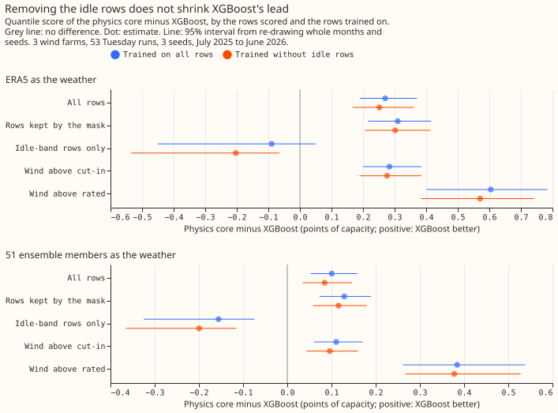
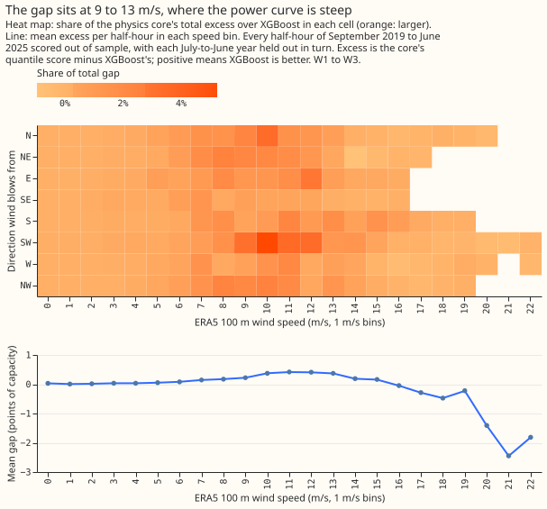
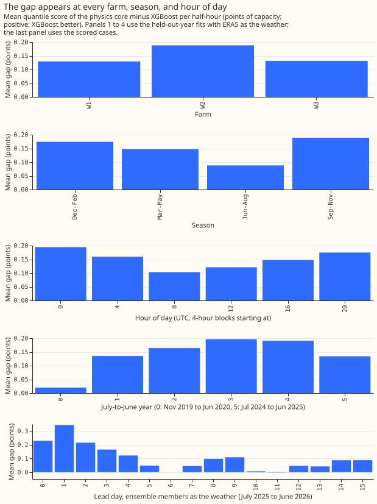
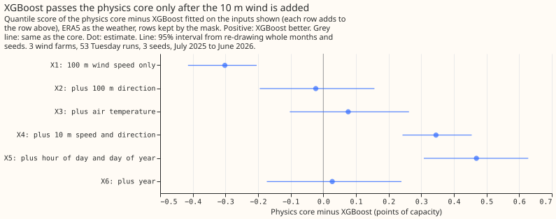
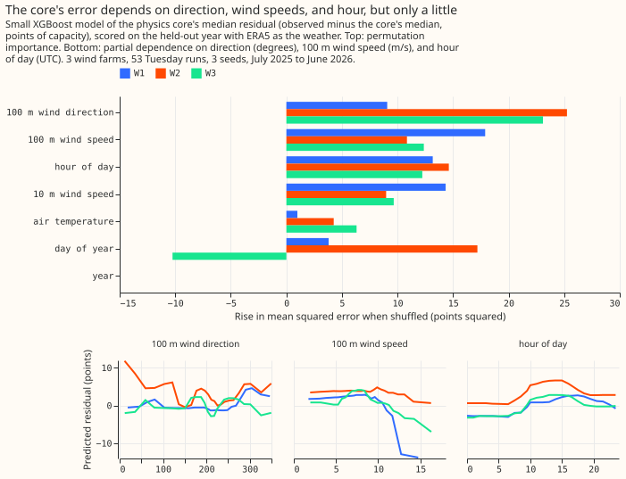
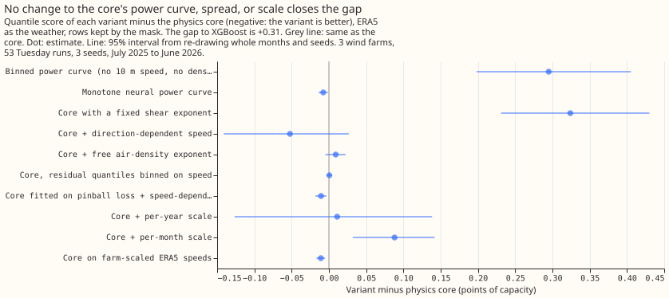
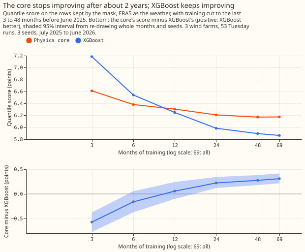

**Take-home: XGBoost beats the physics model because it corrects the wind speed, not because it
learns the metering noise.** The physics model scored 0.31 points of capacity worse than XGBoost
on the rows that experiment 210's mask keeps, and 0.27 worse on all rows, so XGBoost's lead does not
shrink when the noisy rows are removed. Wind direction, the 10 m wind speed, and the hour of day
carry the lead, and no change to the physics model's power curve, spread, or scale closed more than
about a sixth of the lead. These inputs explain only about 6% of the physics model's remaining
error, so most of that error is still unexplained.

We asked why an XGBoost model forecasts the three metered wind farms (W1, W2, and W3) better than a
physics model of the wind turbines, which we call the core. The core turns the 10 m and 100 m wind
speeds and the air temperature into power through a fitted power curve, an air-density correction,
and an apparent-power layer. The maintainer's first guess was that XGBoost learns the metering
noise: the reactive-power floor of the apparent-power readings, the deadband, and the dip near
cut-in (the wind speed at which a turbine starts). We scored both models with ERA5 (a past-weather
estimate) as the weather, which separates the wind-farm model's error from the weather forecast's
error, and with the 51 ensemble members of the ECMWF ensemble forecast, the production setting. We
then removed noisy rows from the scoring and from the training, and changed the core and XGBoost
one piece at a time. The guess is refuted. XGBoost's lead sits at 9 to 14 m/s wind, where the core's
fitted power curve is steep, and comes from reading the wind direction and the 10 m wind speed. The
experiment did not find which interaction between those inputs and the wind speed does the work.

**Scores are quantile scores in points of capacity, and every contrast is the first model minus the
second.** The quantile score estimates the continuous ranked probability score, and smaller is
better, so a positive contrast means the second model is better. Kept rows are the half-hours that
[experiment 210](../00210-wind-idle-noise-mva-artefact/result.md)'s mask keeps, and idle-band rows
are the half-hours it drops: near-zero readings, plus runs of at least 12 hours at high wind. The
method builds on [experiment 230](../00230-wind-physics-core-part-1/result.md), whose core, ERA5
training rows, and scoring code this experiment copies. Both models were trained on all rows before
17 June 2025 and scored on experiment 33's 53 Tuesday runs of July 2025 to June 2026 (107,121 rows,
of which 96,479 are kept rows and 10,642 are idle-band rows). Intervals resample whole months and
the three seeds; farms are not resampled. XGBoost uses 500 rounds with column subsampling off, and
each model was fitted once on all history.

The diagnostics are named D1 to D10. D1 and D2 vary the rows scored and the rows trained on, D3
locates the gap, D4 and D5 look for the inputs XGBoost uses, D6 to D8 and D10 change the core's power
curve, spread, scale, or wind speeds, and D9 varies the length of training.

## Is metering noise the cause? (D1 and D2)

- **The pre-registered prediction failed.** The gap on the kept rows (+0.310, interval 0.215 to
  0.416) is larger than on all rows (+0.270, 0.190 to 0.371), against a predicted gap of half or
  less. When both models trained without the idle rows the gap was +0.302 on the kept rows (0.206
  to 0.413), no smaller in any meaningful way. The noise hypothesis (H-noise) is refuted.
- **On the idle-band rows XGBoost is not better.** The gap there is -0.089 (-0.450 to 0.050) with
  ERA5 as the weather, and -0.156 (-0.325 to -0.075) with the ensemble, where the core is
  better.
- **The gap concentrates above the core's fitted rated speed:** +0.605 (0.401 to 0.784) with ERA5
  and +0.384 (0.262 to 0.538) with the ensemble, against +0.284 above cut-in.
- **Training without the idle rows helps with the ensemble and not with ERA5.** With the ensemble,
  the core improved by 0.075 (0.053 to 0.094) and XGBoost by 0.062 (0.040 to 0.079) on the kept
  rows. With ERA5 the score worsened by 0.006 and 0.014, both with intervals that include zero.
- **In the production setting the gap is smaller:** +0.129 (0.073 to 0.189) on the kept rows, in
  line with experiment 230's +0.126. A binned power curve on the 100 m speed alone ties XGBoost
  there (-0.008, -0.109 to 0.093), and the core is worse than the binned curve by 0.137 (0.033 to
  0.237).

| Setting | Model | All rows | Kept rows | Wind above rated |
|---|---|---|---|---|
| ERA5 as the weather | Physics core | 5.834 | 6.174 | 9.857 |
| ERA5 as the weather | XGBoost | 5.564 | 5.864 | 9.253 |
| ERA5 as the weather | Binned curve | 6.100 | 6.469 | 10.138 |
| 51 ensemble members | Physics core | 11.136 | 11.792 | 28.944 |
| 51 ensemble members | XGBoost | 11.035 | 11.663 | 28.559 |
| 51 ensemble members | Binned curve | 11.033 | 11.655 | 27.581 |

## Where the gap sits (D3)

- **Wind speeds from 9 to 14 m/s carry 65% of the total gap,** and the mean gap per half-hour
  there is 0.22 to 0.42 points. Above 16 m/s the core is better (rows are few: 7,141 of 289,237
  scored half-hours at 16 m/s and over).
- **Every direction sector has a positive mean gap (0.06 to 0.26),** and the south-west sector
  carries the most (21%), because it holds the most half-hours.
- **The gap is positive at every farm** (held-out-year fits: 0.13, 0.19, and 0.13 at W1, W2, and W3;
  scored cases: 0.28, 0.19, and 0.34), in every season (0.09 in June to August, 0.17 to 0.19 in
  December to February and September to November), and at every hour of day (0.10 at 08:00 to
  12:00 UTC, 0.19 at 00:00 to 04:00 UTC).
- **The gap is largest in the middle years.** The held-out-year fits give 0.02 in the first
  (partial) year, 0.14 to 0.20 in the next four, and 0.13 in the last; the scored cases of the final
  year give 0.27.
- **With the ensemble, the gap peaks at lead day 1 (0.34) and falls to near zero at lead days 6, 10,
  and 11.**

## What XGBoost uses (D4)

- **The 100 m wind speed alone scores no better than the binned curve** (6.476 against 6.469 on the
  kept rows), and 0.302 worse than the core.
- **Adding direction takes XGBoost level with the core** (0.023 worse than the core, interval
  -0.156 to 0.195, a tie), and temperature then adds 0.100 (0.004 to 0.215).
- **Adding the 10 m wind speed and direction passes the core:** this step gives 0.269 (0.176 to
  0.372), and XGBoost then leads the core by 0.345 (0.243 to 0.454).
- **Hour of day and day of year add another 0.124 (0.036 to 0.211),** and the year then makes the
  score worse by 0.442 (0.235 to 0.697).
- **ERA5 surface pressure, dew point, and gusts are not on disk for these farms,** so air density
  rests on temperature alone and the extra wind level is the 10 m speed and direction only.
- **With the ensemble the order is the same:** XGBoost with direction, temperature, and the 10 m
  wind (X4) leads the core by 0.213 (0.121 to 0.306), and the hour and day of year add 0.100 (0.027
  to 0.176).

## What the core's error depends on (D5)

- **A small XGBoost model of the core's median residual explains only 6.2%, 7.5%, and -0.7% of its
  variance at W1, W2, and W3 on the held-out year.** Most of the core's error is not a function of
  these inputs.
- **Permutation importance is largest for the 100 m wind direction at W2 and W3 (25 and 23 points
  squared) and for the 100 m wind speed at W1 (18),** followed by the hour of day (12 to 15), the
  10 m wind speed (9 to 14), and, at W2 only, the day of year (17). Air temperature adds 1 to 6,
  and the year adds none.
- **The partial-dependence curves for direction are uneven rather than smooth** (a swing of about 12
  points at W2), so no simple sinusoidal direction term is likely to capture them.

## Is the core's power curve, spread, or scale the cause? (D6 to D8 and D10)

- **D6, the power-curve form, is not the cause.** A monotone neural curve gained 0.008 (0.002 to
  0.014), a free density exponent lost 0.009, and the direction-dependent term gained 0.052 (-0.027
  to 0.141, a tie). The binned curve scored worse than the core by 0.295, because it lacks the 10 m
  speed.
- **D7, the loss and the spread, is not the cause.** Fitting the core on pinball loss with a
  speed-dependent spread gained 0.011 (0.004 to 0.018) and binning the residual quantiles on hub
  speed worsened it by 0.001.
- **D8, slow change, is not the cause.** A per-year scale on the core worsened the score by 0.011
  (-0.127 to 0.138, a tie) and a per-month scale made it worse by 0.088 (0.032 to 0.142).
  XGBoost with the year as an input was worse than XGBoost with only the hour and day of year by
  0.442 (0.235 to 0.697), and worse than XGBoost with no date column by 0.318 (0.106 to 0.561), on
  the kept rows with ERA5 as the weather.
- **D10, a farm-specific wind-speed scale, is not the cause.** The core gained 0.011 (0.005 to
  0.017) and XGBoost gained 0.001, because a tree model does not respond to a monotone rescaling
  of one input. The scale fitted a fixed generic power curve and is a weak stand-in for the weather
  grid cell's mismatch.

## Learning curve (D9)

- **XGBoost trails the core with 3 months of training (-0.573, -0.773 to -0.376), probably trails it
  at 6 months (-0.161, -0.372 to 0.055), ties it at 12 (+0.057), and leads by 0.223 at 24, 0.276 at
  48, and 0.310 with all of the training history (about 69 months).**
- **The core stops improving after 48 months** (0.033 from 24 to 48 months, then none: the
  48-month core is 0.003 better than the 69-month core), and XGBoost is still improving at 48 months
  (0.032 from 48 to 69). A gap that grows with the data while the core stays flat points to a
  structural error in the core, not to variance in XGBoost.

## Checks

- **Both models forecast a median below the mean, most strongly with the ensemble** (kept rows,
  points of capacity): -0.22 for the core and -0.19 for
  XGBoost with ERA5, and -5.27 and -5.22 with the ensemble. The low median is the bias experiments
  259 and 261 traced to the ensemble's wind, and both models share this bias.
- **The error of the median and the mean forecast agrees with the quantile score.** On the kept rows
  the contrast of absolute error of the median is +0.470 (0.337 to 0.620) and of the mean +0.488
  (0.367 to 0.620) with ERA5, and +0.213 and +0.131 with the ensemble.
- **Leaving one farm out keeps the sign.** The gap on the kept rows with ERA5 is +0.315, +0.344, and
  +0.272 without W1, W2, and W3, and with the ensemble +0.143, +0.124, and +0.120.
- **The tail quantiles agree between the two models, apart from the 0.01 level with ERA5**
  (pinball loss on the kept rows, core against XGBoost): 0.272 against 0.251 at the 0.01
  level and 0.364 against 0.377 at the 0.99 level with ERA5, and 0.288 against 0.285 and 0.658
  against 0.659 with the ensemble. The curtailment-cost metric was not run, because no arm here is a
  proposed forecast.
- **Audit trigger 5 fired:** XGBoost with the year (X6) scored worse than the same inputs without it
  (X5), by 0.44 points. We suspected the year only fails when it extrapolates beyond the training
  range. A follow-up fit holding out each July-to-June year in turn, inside the training range,
  found the year helps in 4 of 6 held-out years by 0.03 to 0.50 and hurts in 2 by 0.12 to 0.43, with
  an overall change of -0.014 points. The suspicion is not confirmed, and the year input is
  unreliable in both settings. No other trigger fired. No independent audit was run, and no headline
  in this write-up depends on the year arm.

## What the next experiment should answer

Which interaction between the wind direction, the 10 m wind speed, and the 100 m wind speed does
XGBoost use?
A small neural correction of the core's effective wind speed, fed the direction and the ratio of the
10 m to the 100 m speed, would test it directly and would keep the physics core's smooth power
curve. The core also loses to a binned curve in the production setting, so the same experiment
should be scored with the ensemble.

## Departures from the plan

- **Seeds:** the core variants are deterministic, so their three seeds repeat one fit. The
  monotone neural curve (P_net) used one seed.
- **The rows above cut-in and above rated speed** use the core's fitted cut-in and rated speeds
  against ERA5 100 m wind speed,
  as experiment 230 did. The fitted hub heights are 32 to 37 m, so the rated speeds are
  lower than the physical ones.
- **The by-year table of D3** uses every half-hour of November 2019 to June 2025 under fits that
  hold out each July-to-June year in turn, which is a different row set from the scored cases.
- **The last two input sets of D4:** the "all inputs" set adds the year. ERA5 surface pressure,
  dew point, other wind levels, and gusts were not on disk for these farms.
- **The ensemble setting** was run for D1, D2, the D4 input sets X4 to X6, and the core variants of
  D7 and D8, and not for D6's neural curve, D9, and D10.
