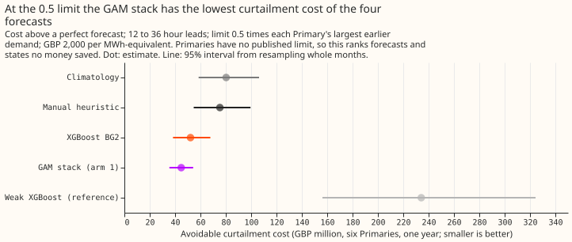
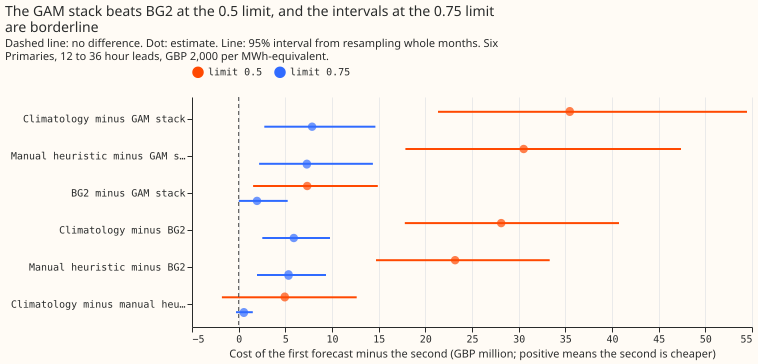
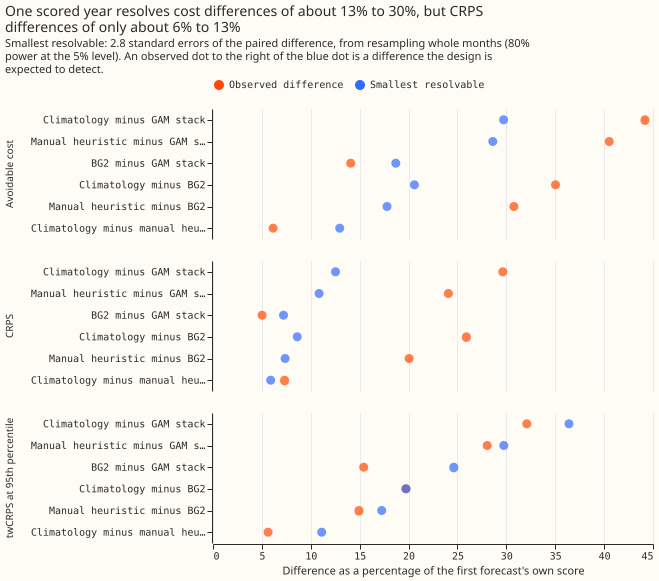
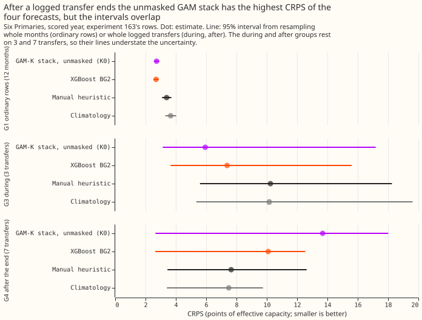
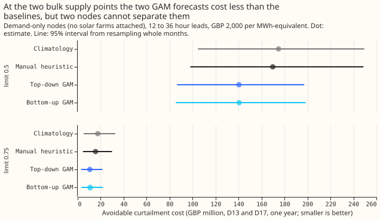

**On ordinary days the curtailment metric ranks the four existing forecasts as CRPS does and can
tell
the GAM stack from BG2, but inside the windows around the 7 logged load transfers it cannot separate
any pair of forecasts.** We scored the forecasts that already exist, with the node-only
curtailment metric of experiment
[268](../00268-lsc-curtailment-metric-v2-member-wise-ens/result.md), and measured how small a
difference the scored rows can resolve. The forecasts are climatology, the manual heuristic (the
rule NGED uses today), BG2 (an XGBoost forecast configured like the production service), and the
GAM stack of experiments [220](../00220-dp-bg-stage4-assembly-with-drop-one/result.md) and
[251](../00251-dp-final-best-guess-assembly-clip-and-coast-against-bg2/result.md). The stack is a
generalised additive model (GAM) with a Kalman filter on its recent errors, a neural-network head,
and a summary of the ensemble's solar response. The scored rows are one year (2025-07-02 to
2026-06-30) at six Primary substations (D5, D9, D10, D11, D14, D16). The node's quantiles carry the
ensemble spread, but no ensemble members are used, and none of the stored quantile sets crosses, so
sorting them changes nothing here. This is step 3 of the load-shift decision program.

**Verdict: supported on the pre-registered rows, with one prediction failed and the BG2 separation
narrow.** At the 0.5 limit the avoidable cost (cost above a perfect forecast) orders the forecasts
climatology, manual heuristic, BG2, GAM stack, from worst to best, and climatology minus the stack
is GBP 35.5 million (95% 21.4 to 54.5 million). The failed prediction is that BG2 minus the stack
would include zero: it is GBP 7.3 million (1.6 to 14.9 million). Primaries have no published limit,
so every money figure on this page ranks forecasts and states no money saved. After a logged
transfer ends the order reverses and the unmasked stack is the worst forecast, but 7 transfers
cannot separate it from the others.

## Row groups (the program's G0 to G5)

Rows are the six Primaries' half-hours with a 12 to 36 hour lead for cost, and all leads for CRPS
and
MAE. G0 uses experiment 251's rows (the stack is its arm 1). G1 to G5 use experiment
[163](../00163-switching-real-event-comparison-gam-stack-against-bg2/result.md)'s rows,
where the stack is the unmasked GAM-K stack K0 (a different build, with five stored quantiles),
so the first column of the table is K0 for G1 to G5. The
logged transfers are the 7 of experiment 163; the group sizes are rows, and the unit of resampling
is
a transfer, or a calendar month for G0 and G1.

| Group | Rows (transfers) | CRPS: stack (K0 from G1), BG2, manual heuristic, climatology | Avoidable cost at 0.5, GBP million |
|---|---|---|---|
| G0 all 251 rows | 561,207 | 2.58, 2.72, 3.40, 3.67 | 44.82, 52.17, 75.36, 80.30 |
| G1 ordinary | 556,809 | 2.73, 2.70, 3.39, 3.66 | 44.86, 50.73, 74.42, 79.12 |
| G2 before the alarm | 11 (1) | 19.21, 16.15, 14.13, 24.00 | no half-hour at a 12 to 36 hour lead |
| G3 during | 12,168 (3) | 5.94, 7.38, 10.24, 10.16 | 3.47, 8.46, 15.42, 18.08 |
| G4 after the end | 3,675 (7) | 13.69, 10.09, 7.65, 7.49 | 2.49, 2.65, 1.69, 1.72 |
| G5 near (G2 + G3 + G4) | 15,854 (7) | 7.75, 8.01, 9.64, 9.55 | 5.95, 11.11, 17.11, 19.80 |

- **What the groups show.** During a transfer the stack is best (CRPS 5.94). After the end it is
  worst (13.69, against 7.49 for climatology), because the stack carries the transfer's lagged power
  into its forecast. G4 minus the stack: BG2 -3.59 CRPS points (95% -5.71 to +0.12), climatology
  -6.19 (-8.62 to +1.71). Cost: during a transfer (G3, 3 transfers) BG2, the manual heuristic, and
  climatology cost more than the stack at the 0.5 limit, with 3-transfer intervals that just exclude
  zero (BG2 minus stack GBP 5.0 million, 0.001 to 13.6 million). Three transfers give only 10
  distinct resamples, so these are point estimates by transfer and not 95% intervals. The 7-transfer
  intervals of G4 and G5 understate the uncertainty for the same reason, and the transfers are not
  independent: 3 of them appear in both G3 and G4, and one involves two Primaries. After the end the
  only cost interval that
  excludes zero is BG2 minus the stack at the 0.75 limit (GBP -0.05 million, -0.12 to -0.002).
- **Row-group sizes.** G2 has 11 rows from one transfer and no scored half-hour, so it is
  unreadable. The cost columns use only half-hours at a 12 to 36 hour lead: 80,143 in G1, 1,997 in
  G3, 926 in G4, and 2,923 in G5, while the CRPS columns use all leads. 243 rows sit in both G3 and
  G4, so G5 counts them twice (1.5% of its rows).
- **Splits (G6).** Season, G1: BG2 minus the stack is +0.22 CRPS points (95% +0.16 to +0.26) from
  November to March and -0.20 (-0.36 to -0.03) from April to October, so the stack's gain is a
  winter
  gain, as in experiment 251. Duration, G5: none of the 7 transfers lasted under 6 hours, 5 lasted 6
  to 24 hours (1,138 rows), and 2 lasted over a day (14,716 rows). Substation, G5: transfers appear
  at
  D5 (10,725 rows, 3 transfers), D16 (4,335, 2), D14 (692, 3), and D10 (102, 1), and none at D9 or
  D11. The stored transfers carry no size, so the split by size of shift is not available, and the
  margins of 7 days either side are not stored, so G5 is the union of the three phases only.

## Detectability

**One year of scored rows resolves a difference of about 7% of the CRPS and 19% of the avoidable
cost
between BG2 and the GAM stack, and the near-transfer rows resolve far less.** The smallest
resolvable difference is 2.8 standard errors of the paired difference (80% power at the 5% level),
from resampling whole calendar months, or whole transfers in the near groups.

- **Ordinary year, BG2 minus the stack.** Cost: observed GBP 7.35 million, smallest resolvable 9.75
  million (18.7%). CRPS: observed 0.137, smallest resolvable 0.196 points. Tail-weighted CRPS at the
  95th percentile (twCRPS): observed 0.028, smallest resolvable 0.044. The difference is real by the
  95% interval and below the 80%-power size, so it was found with little to spare.
- **Climatology and the manual heuristic.** Climatology minus the stack is resolved (cost observed
  35.5 against 23.9 million; CRPS observed 1.09 against 0.46). Climatology minus the manual
  heuristic
  is not (cost 4.9 against 10.4 million).
- **Load-shift effects against the resolvable size.** Experiment
  [208](../00208-switching-value-of-a-detector-by-phase-and-quality/result.md)'s effect on the
  pooled year is
  0.005 points, about 40 times below the smallest resolvable CRPS difference of 0.196 points. Its
  effect of 1.50 points after a transfer is below the smallest resolvable difference in G4 (4.02
  points for BG2 against K0, 7 transfers) and level with G5's (1.43 points, 7 transfers, G3 2.36
  with 3). These multiples of 2.8 standard errors are about 10% to 15% too small at 12 months (a
  small-sample multiplier near 3.1 fits), and more at 3 to 7 transfers. In G4 the smallest
  resolvable cost
  difference is GBP 0.69 million at the 0.5 limit, in G5 12.2 million.
- **Consequence for steps 4 to 6.** The curtailment part of the three questions cannot be answered
  from the real record of 7 transfers. It needs injected worlds with many shifts, and CRPS and
  twCRPS from the same worlds as the fallback measure.
- **Events.** At the 0.5 limit 35,670 of 80,794 scored half-hours (44%) are above the limit, at 0.75
  3,996, at 0.9 164. At 0.5 the metric is therefore close to an accuracy ranking of the 0.95
  quantile, and at 0.9 it cannot rank forecasts.

## Numbers

- **Scores on the 561,207 shared rows (95% interval from resampling 12 months), CRPS; MAE of the
  median; twCRPS at the 95th percentile of earlier power.** Stack 2.579 (2.436 to 2.725); 4.510;
  0.152. BG2 2.715 (2.534 to 2.917); 4.767; 0.180. Manual heuristic 3.397 (3.097 to 3.714); 6.034;
  0.211. Climatology 3.665 (3.304 to 4.037); 6.558; 0.224. Weak XGBoost 5.697; 6.206; 0.301.
- **Contrasts (first minus second, CRPS).** BG2 minus stack +0.136 (+0.005 to +0.278); manual
  heuristic minus stack +0.818 (+0.573 to +1.088); climatology minus stack +1.086 (+0.778 to
  +1.419);
  climatology minus manual heuristic +0.268 (+0.125 to +0.427). These match experiment 251.
- **Avoidable cost at 0.5, GBP million (six Primaries, 12 to 36 hour leads, GBP 2,000 per MWh).**
  Stack 44.82 (35.52 to 54.20); BG2 52.17 (38.41 to 67.82); manual heuristic 75.36 (54.69 to
  99.48); climatology 80.30 (58.54 to 106.24); weak XGBoost 234.22 (156.30 to 324.33); a perfect
  forecast costs 46.35 million in total which is the curtailment that even a perfect forecast would
  order.
- **Cost contrasts at 0.5, GBP million.** BG2 minus stack 7.35 (1.55 to 14.91); manual heuristic
  minus BG2 23.19 (14.72 to 33.33); climatology minus BG2 28.13 (17.80 to 40.75); climatology minus
  manual heuristic 4.94 (-1.80 to 12.65), so those two are not separated.
- **Sweep.** At 0.75, BG2 minus stack 1.97 (0.01 to 5.25), manual heuristic minus BG2 5.34 (1.96 to
  9.36), climatology minus manual heuristic 0.56 (-0.29 to 1.52). At 0.9 the contrasts rest on 164
  half-hours: BG2 minus stack 0.08 (0.01 to 0.17), and the climatology contrasts include zero.
- **Cuts of the 0.5 cost (BG2 minus stack, GBP million).** November to March 6.66 (2.09 to 12.74),
  April to October 0.68 (-1.57 to 2.89); leads 0 to 12 hours 5.96 (1.56 to 11.33), 36 hours to 7
  days
  32.84 (2.61 to 69.87). By Primary the estimate is positive at all six and the interval excludes
  zero at D10 and D14 only.
- **Bulk supply points D13 and D17 (demand only, 12 to 36 hour leads).** Climatology and the manual
  heuristic exist at both (experiment
  [87](../00087-bg2-best-guess-assembled-with-drop-one-ablations/result.md)'s stored references),
  and so do the top-down GAM forecast
  (experiment [161](../00161-dp-bsp-top-down-against-bottom-up/result.md)) and the bottom-up
  forecast (experiment [204](../00204-dp-bsp-full-bottom-up-with-signed-mva-children/result.md)); no
  BG2 and no experiment 220 stack
  exist there. CRPS: top-down 6.05, bottom-up 6.06, manual heuristic 6.92, climatology 7.22.
  Avoidable
  cost at 0.5, GBP million: top-down 140.34 (86.46 to 197.17), bottom-up 140.57 (85.43 to 198.46),
  manual heuristic 169.79 (98.01 to 248.65), climatology 174.85 (104.69 to 249.44). Climatology
  minus top-down is 34.51 (-3.85 to 78.82), so two nodes cannot separate them at 0.5, and at 0.75
  it is 6.95 (1.09 to 15.16). Top-down minus bottom-up is -0.23 (-3.31 to 2.85).
- **Child Primaries.** D13 has children D2, D4, D9, D10, D11, D19, and D21. D17 has children D3, D5,
  D8, D12, D14, D15, D16, D18, and D22. Only D5, D9, D10, D11, D14, and D16 have stored forecasts of
  the four arms.

## Checks

- **Median minus mean forecast, per Primary, for the stack (points of capacity).** D10 +0.72, D11
  -0.50, D14 -0.20, D16 -0.84, D5 +0.01, D9 -0.75. Only the stack stores a mean (arm D's, before the
  head's correction), so the other arms have no mean to compare.
- **Mean-forecast error beside the contrasts.** The stack's MAE of the mean is 4.62 against 4.51 for
  its median. BG2 stores no mean, so the BG2 contrast has no mean-forecast partner. The median MAE
  moves with CRPS in every contrast (BG2 minus stack +0.257, +0.008 to +0.497).
- **Triggers.** Trigger 2 fired once, for the BG2 interval that was predicted to include zero. We
  tested an explanation: the cost gain is the winter gain of experiment 251 (November to March 6.66
  million, April to October 0.68 million with an interval including zero), and the interval excludes
  zero at 0.5 because 44% of half-hours are above the limit. Trigger 4 did not fire: leaving out
  each Primary in turn keeps BG2 minus the stack positive with an interval above zero at 0.5, and at
  0.75 the interval touches zero when D10, D14, or D16 is left out. Trigger 6 did not fire: the BG2
  interval is 13.4 million wide on a cost of 98.5 million, and experiment 251's is 0.27 wide on
  2.58.
  Triggers 1, 3, and 5 did not fire (a perfect forecast has zero breach; no mean exists for BG2; no
  nested arms). Trigger 7 fired, because steps 4 to 6 build on this result. A fresh Sonnet agent
  audited it, by manager instruction (Sonnet only); the findings are under "Audit".

## Audit

A fresh Sonnet agent re-derived the headline numbers with its own code from the stored arrays.

- **Reproduced.** CRPS of all four forecasts, the BG2 minus stack CRPS contrast (0.1365, 0.004 to
  0.275), the avoidable costs at 0.5 (44.82, 52.17, 75.36, and 80.30 million), BG2 minus stack GBP
  7.35 million (1.61 to 14.88), and the after-transfer CRPS of K0, BG2, the manual heuristic, and
  climatology. Accepted.
- **Robust.** The order climatology, manual heuristic, BG2, stack holds for cut quantiles q90, q95,
  and q99, breach ratios 10, 20, and 50, any lead window, and leaving out any one Primary except D14
  (the auditor's "D16" is time series 16, which is D14 in these labels), where climatology and the
  manual heuristic tie (58.49 against 58.65 million). Climatology minus the stack survives every
  change.
- **Fragile.** BG2 minus the stack includes zero at breach ratio 50, at the 0.75 limit, and on 12 to
  24 hour leads alone. Without D14 it halves to 3.39 million (0.13 to 7.20), and the 24 to 36 hour
  half carries 6.27 of the 7.35 million. The page therefore calls the separation narrow. Accepted;
  the verdict wording and caveats say so. At the 0.9 limit climatology costs less than the manual
  heuristic, which the page already attributes to 164 events.
- **Code review (fresh Sonnet).** Leakage, units, row alignment, and the metric call checked and
  fine.
  Accepted and applied to the page: the 3-transfer and 7-transfer intervals are not reliable
  (stated under the row-group table and in the figure subtitle); the first table column is K0 for G1
  to G5; the cost and CRPS columns use different leads; 243 rows are in both G3 and G4; the
  small-sample multiplier makes the smallest resolvable differences about 10% to 15% too small; the
  headline quotes the range 1.4 to 4.0 points, not G4's value alone; the capacity-file note and the
  156 dropped rows are stated. Applied to the code: the dead census arguments are gone and a check
  that the actuals agree across sources replaced a row count. Not applied: deduplicating G5 (stated
  instead, 1.5% of its rows), and a t-based multiplier (stated instead).

## Caveats and what to try next

- **Node-only demand proxy.** The six Primaries and the two bulk supply points are scored as nodes
  with no generators attached, a positive demand reading is assumed to be the flow that can breach,
  and planned cuts are assumed delivered. Generator-aware scoring at D13 and D17 needs a farm table
  for those two points that no file we found provides, and the forecasts of the six solar farms that
  experiments 224 and 243 stored are not mapped to them. The stored forecasts here are complete (11
  quantiles for the Primaries, no padded quantile), so the generator padding problem found in
  experiment 255's farm frames does not touch this scoring.
- **Not a saving.** The scaled limit is a fraction of the largest earlier demand. The page ranks
  forecasts and does not estimate money saved. The manual heuristic's implied risk level is not
  used,
  because the heuristic enters only as a forecast.
- **Capacity file.** Point-to-MW conversion uses experiment 1156's effective capacities, which
  include the scored year (series 18: 9.115 MW against 8.834 before it; others under 1%). The
  limits come from raw MW flows before the scored year, so no limit leaks.
- **Dropped rows.** Joining experiment 87's references onto experiment 163's rows drops 156 of
  572,819 rows (26 per Primary, all ordinary).
- **Stack builds differ.** G0 uses the stack with the neural-network head (arm 1). G1 to G5 use K0,
  the unmasked GAM-K stack, whose five stored quantiles give CRPS and pinball losses at q95 and q99
  but not twCRPS. On ordinary rows K0's CRPS is 2.73 against arm 1's 2.58.
- **Seeds and schedule.** One seed, no refits; the stack's monthly refits and BG2's weekly refits
  are
  those of experiments 220 and 87. Weather at lag times is the ensemble weather available at
  forecast
  time. No downloads.
- **What to try next.** Steps 4 to 6 should use injected worlds with many shifts and a node whose
  limit is crossed on enough half-hours, with CRPS and twCRPS as the fallback. A scoring of the six
  solar farms at D13 and D17 needs the farm-to-node map first.
