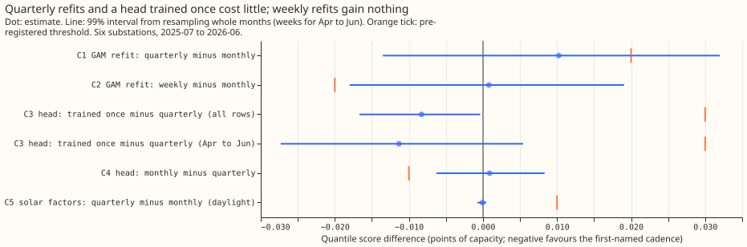
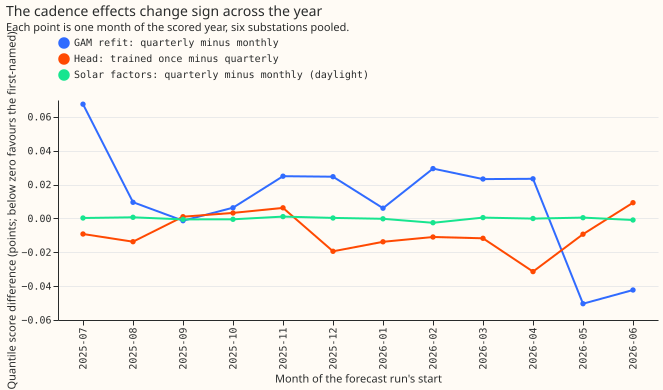
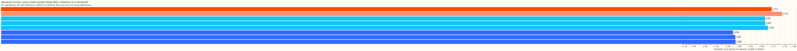
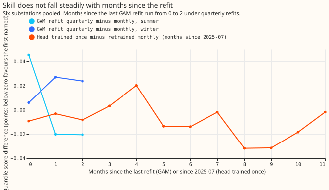

**Retraining the small neural network that corrects the median (the head) more often did not help,
and the convex demand model's monthly refit is worth keeping.** We asked how much forecast skill
the best-guess demand stack loses when its three retrained parts are retrained less often. The
stack is the combined demand forecast of [experiment
251](../00251-dp-final-best-guess-assembly-clip-and-coast-against-bg2/result.md), built from three
parts. The first is the convex model, a generalised additive model (GAM) whose coefficients a
Kalman filter updates (called arm D in experiment 155). The second is the head ([experiment
201](../00201-dp-gam-residual-mlp/result.md)). The third is the solar factors ([experiment
202](../00202-dp-ens-two-number-rolling-replay/result.md)): two numbers per half-hour, the mean and
the standard deviation of the 51 weather-ensemble members' solar responses, each rescaled by a
fitted factor. We refitted each part on a different schedule. We scored the 561,363 half-hourly
rows of 2025-07 to 2026-06 in total across six anonymised substations. The quantile score is twice
the mean pinball loss (the standard error of a quantile forecast) over 11 quantiles, in percentage
points of the substation's effective capacity (its rated demand); lower is better. BG2 is the
XGBoost best-guess demand model of [experiment
87](../00087-bg2-best-guess-assembled-with-drop-one-ablations/result.md).

**Verdict `not supported`.** The plan predicted two things. P1: the convex model tolerates quarterly
instead of monthly refits, losing under 0.02 points. P2: the head trained once scores at least 0.03
points worse than the quarterly head. P2 failed, because the head trained once scored 0.008 points
better than the quarterly head. P1's point estimate held (+0.010), but its 99% interval reaches
+0.032, so the decision rule calls P1 inconclusive. P3 held (the monthly head minus the quarterly
head +0.001), and P4 held (quarterly minus monthly solar factors -0.0001). The stop rule (stop
before the head arms if monthly and quarterly refits differ by under 0.01 at 5 of 6 substations)
did not fire: they differ by under 0.01 at 2 of 6. We measured the convex model's cadence on its
own forecasts. We then added the head and the solar factors to the monthly-refit forecasts only,
and did not rebuild the whole stack on quarterly refits. The contrasts C1 to C5 below are the five
planned comparisons: C1 and C2 for the convex model, C3 and C4 for the head, C5 for the solar
factors.

## Results

- **Schedule and what was refitted.** Convex model: experiment 136's stored fits on all substations'
  history with a 24-month window, weekly, monthly (the stack's own schedule), and quarterly (the
  monthly fits cut in January, April, July, and October); the Kalman filter runs throughout. Head:
  the experiment 201 variant that sees calendar flags, three random seeds, retrained at each month
  start from 2025-07 (12 retrains, 36 fits) with every training target dated before the retrain
  date. Solar factors: experiment 202's replay, refitted at the month or the quarter start.
  Retraining the head took 2.7 s per fit on the GPU, and refitting the convex model took 0.4 s per
  substation, so no schedule saves meaningful compute. BG2's weekly and monthly refits are
  experiment 87's.
- **Absolute scores, six substations:** the table gives the quantile score, the mean absolute error
  of the median, and the tail-weighted CRPS at the 95th percentile of earlier power.

  | Forecast | Quantile score | Median error | Tail CRPS |
  |---|---|---|---|
  | BG2 refitted weekly | 2.715 | 4.766 | 0.202 |
  | BG2 refitted monthly | 2.752 | 4.805 | 0.204 |
  | Convex model, monthly refits | 2.691 | 4.623 | 0.191 |
  | Convex model, weekly refits | 2.692 | 4.613 | 0.193 |
  | Convex model, quarterly refits | 2.702 | 4.636 | 0.192 |
  | Stack, head trained once | 2.578 | 4.510 | 0.171 |
  | Stack, head retrained quarterly | 2.587 | 4.526 | 0.170 |
  | Stack, head retrained monthly | 2.588 | 4.528 | 0.170 |

  The stack scores about 0.13 below BG2 refitted weekly at every head schedule.
- **C1, convex model quarterly minus monthly:** +0.010 (99% interval -0.014 to +0.032). Post hoc, at
  the 95% level and excluding October: winter (November to March) +0.022 (+0.014 to +0.027),
  summer (April to September) +0.002 (-0.028 to +0.033). By substation: D10 +0.044, D5 +0.016,
  D16 +0.013, D11 +0.006, D14 -0.000, D9 -0.016.
- **C2, weekly minus monthly:** +0.001 (99% -0.018 to +0.019); post hoc, 95% level, October
  excluded: winter +0.020 (+0.007 to +0.034), summer -0.014 (-0.031 to +0.006).
- **C3, head trained once minus quarterly retrained (stack):** -0.008 over all rows (99% -0.017 to
  0.000); April to June -0.011 (week-block 99% -0.027 to +0.005, because three months are too few to
  resample). Once minus monthly retrained is -0.009.
- **C4, monthly minus quarterly head:** +0.001 (99% -0.006 to +0.008).
- **C5, solar factors quarterly minus monthly, daylight rows:** -0.0001 (99% -0.0008 to +0.0003)
  for the solar summary alone, and -0.0001 (99% -0.0008 to +0.0004) with the head added.
- **Tails (coverage and pinball loss; stack with head trained once against BG2 refitted weekly):**
  q01 coverage 0.013 and loss 0.172 against 0.010 and 0.211; q99 coverage 0.984 and loss 0.211
  against 0.983 and 0.253. Tails move by under 0.002 across head
  cadences.
- **Post hoc:** the head fitted at 2025-07 with this experiment's pipeline and never retrained
  ("own once") scores 2.582, 0.004 below the quarterly head (95% -0.013 to +0.003) and 0.004 above
  experiment 201's stored head (-0.004 to +0.012).
- **What to try next:** a retest of the head's cadence once a second year of ensemble weather
  exists, because one year cannot show slow drift; and a stack rebuilt end to end on quarterly
  convex-model refits, which would test the interaction with the head.

## Checks

- **Median minus mean forecast, per substation:** exactly 0.000 at all six substations at every
  convex-model cadence, because arm D's median is its mean forecast by construction.
- **Mean-forecast error beside each contrast:** the median's absolute error moves with the quantile
  score in C1 (+0.013 against +0.010), C2 (-0.009 against +0.001, within noise), and C3 (once
  4.510 against quarterly 4.526), so trigger 3 did not fire.
- **Triggers (the seven audit triggers of the experiment guide):** trigger 1, a failed control, did
  not fire (the gates reproduced experiment 155's arm D and experiment 202's solar arm exactly).
  Trigger 2, a result contradicting its prediction, fired for P2 and was resolved here: the head
  trained once scored 0.004 better than the same pipeline's head trained at 2025-07 and never
  retrained, a gap whose 95% interval (-0.004 to +0.012) includes zero, so retraining adds nothing
  measurable. Trigger 4, a sign flip when one site is left out, did not fire: leaving one substation
  out leaves C1 between +0.003 and +0.016 and C3 between -0.007 and -0.010. Triggers 5 and 6 (a
  nested arm beating its parent, and interval widths) did not fire. Trigger 7, later work depending
  on an unreplicated result, is open: later work may rely on the one-year result.
- **Departures from the plan:** the last-quarter C3 interval uses week blocks as well as month
  blocks, because three months are too few to resample. The cadence contrast is read at the arm D
  level, as planned; the stack approximation was not run separately.
