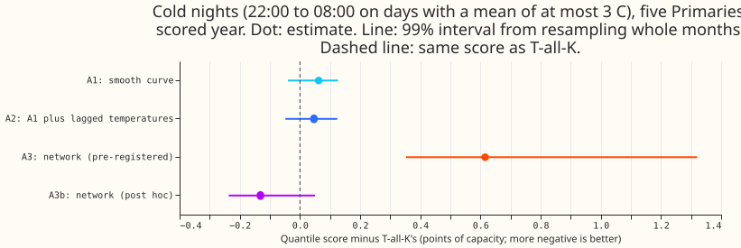
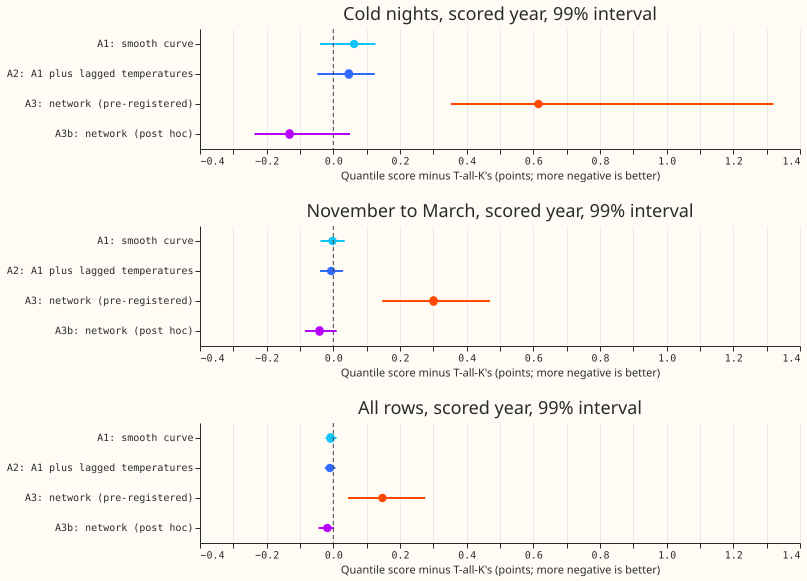
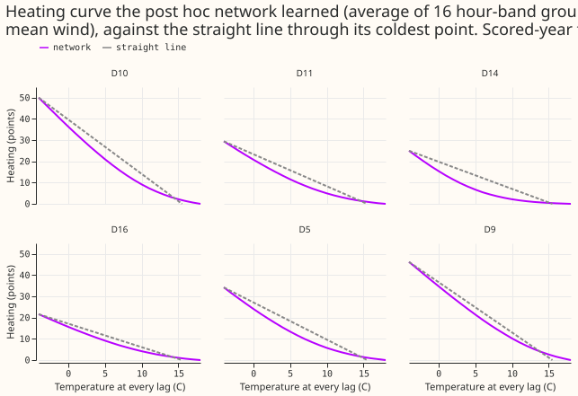

## Take-home message

**A straight-line heating response is close to what one winter of data can distinguish from a
curve.** Three changes to the heating term (a smooth monotone curve, lagged temperatures, and wind)
each moved the day-ahead score by less than 0.02 points outside cold nights, and none beat the
current model on cold nights. A small neural network learned a plausible curve, flat above about 12
C and 2 to 3 times steeper per degree below 3 C. Trained longer, it lowered the cold-night score by
0.13 points, but the interval includes zero, the gain reversed in the previous year, and the network
failed a test on synthetic data. The audit traced the gain to one cold spell in January 2026. The
card keeps the straight line. The next step is to repeat the network test when a second winter of
scored cold nights exists.

## What was asked

We asked whether the demand model's straight-line heating response is too rigid. The model
([experiment 114's](../00114-differentiable-physics-n3-n4-interactions-and-heating-threshold/result.md)
T-all, with the recent-error Kalman filter, "T-all-K" here) adds heating power in
proportion to how far four trailing-mean temperatures fall below 15.5 C. We replaced or extended
that response in four ways and scored each against T-all-K on the five decision Primaries over
2025-07 to 2026-06, using ERA5 past weather, so every score is a ceiling for a forecast made from
a weather forecast. The ideas build on [experiment 126](../00126-differentiable-physics-s1-cheap-screens-added-to-gam-k/result.md),
whose screens of monotone ramps, exponentially weighted temperatures, and wind chill all tied on
winter rows, and on [experiment 121](../00121-differentiable-physics-mh-multi-hinge-heating-curve-and-night-step/result.md),
where five heating hinges gained only 0.016 points. The network follows the monotone-network
design of [experiment 250](../00250-dp-monotone-network-between-the-solar-forecast-and-the-gam/result.md).

The first fit of the network under-fitted. The training fit and the known-answer test pointed to
the network, not the hypothesis, so a second network (A3b) was trained longer and given more
inputs. A3b is labelled post hoc throughout, and the pre-registered contrasts are reported as
measured.

## Arms and rows

- **A0, T-all-K:** hinge at 15.5 C on the 6, 24, 72, and 168 hour mean temperatures, split by day
  type and half of the hour band (experiment 114's T-all, penalty weight 1.0); Kalman filter with
  T-all's per-site hyperparameters from experiment 126, used for every arm. Reproduced exactly:
  the forecast equals experiment 126's stored scored-year forecast on all 104,897 rows.
- **A1:** A0 plus a smooth monotone curve (decreasing cubic smoothsteps between knots at 0, 4, 8,
  12, 16, and 20 C, non-negative coefficients) on the four trailing means, per hour band.
- **A2:** A1 plus the same curve on exponentially weighted temperatures (time constants 1 and 3
  days) and on the previous two days' mean temperatures.
- **A2w:** A2 plus the 24-hour and 72-hour mean wind speed times the cold hinge of the 24-hour and
  72-hour mean temperature.
- **A3 (pre-registered):** T-all's heating columns replaced by a monotone network (2 hidden layers
  of 16 units, non-negative weights on temperature and wind) on three daily mean temperatures and
  the 24-hour wind; 3 seeds; 90 epochs. **A3 without wind** is the same without the wind input.
- **A3b (post hoc):** the same network on A0's four trailing means plus the two previous-day
  means and the wind, trained for 200 epochs at a higher learning rate. **A3b without wind** drops
  the wind input.
- **Rows:** `dp_mw_v1` on past weather, five decision Primaries (D5, D10, D11, D14, D16), D9
  scored beside them in the verdict year only, outside the hand-filtered events, day ahead. Cold
  nights are 22:00 to 08:00 local time on days with a mean temperature of at most 3 C (1,220 rows
  in the scored year). Yearly refits, not weekly; a contrast of 0.02 points or more does not depend
  on the cadence. The conditional retest on ensemble weather (`fold_a_daily_gap_v1`) was not run,
  because no arm passed.

## Results

- **Absolute scores, scored year (quantile score, points):**

    | Arm | Cold nights | November to March | All rows |
    |---|---|---|---|
    | A0, T-all-K | 2.144 | 2.306 | 2.216 |
    | A1 | 2.206 | 2.303 | 2.208 |
    | A2 | 2.190 | 2.299 | 2.206 |
    | A2w | 2.185 | 2.283 | 2.198 |
    | A3 (pre-registered) | 2.759 | 2.607 | 2.364 |
    | A3b (post hoc) | 2.012 | 2.265 | 2.198 |
    | A3b without wind (post hoc) | 1.981 | 2.285 | 2.212 |
    | A3c (post hoc) | 2.065 | 2.303 | 2.210 |

- **C1, A1 minus A0:** cold nights +0.062 (99% interval -0.040 to +0.127), replicate year -0.001,
  better at 2 of 5 Primaries. All rows -0.008 (-0.024 to +0.009). Label: tie.
- **C2, A2 minus A0:** cold nights +0.047 (-0.048 to +0.124), replicate +0.004, better at 2 of 5.
  All rows -0.010 (-0.026 to +0.006). Label: tie. The prediction of -0.05 to -0.15 on cold nights
  failed, and so did 4 of 5 Primaries improving.
- **C3, A3 minus A0:** cold nights +0.616 (+0.353 to +1.320); all rows +0.147 (+0.044 to +0.275).
  The network fitted D10's training rows with squared error 66 to 78 per row against T-all's
  52.6, so the contrast measures under-fitting. Label: worse, and not a test of the idea.
- **C5, wind (A2w minus A2):** all rows -0.008 (-0.015 to -0.001), November to March -0.016
  (-0.024 to -0.003), cold nights -0.005 (-0.025 to +0.003). Wind adds less than 0.01 points pooled,
  as predicted, and its interval excludes zero at 99%.
- **C7, A3b minus A0 (post hoc):** cold nights -0.131 (-0.237 to +0.050), replicate year +0.019,
  better at 3 of 5 Primaries (D10 -0.25, D11 -0.34, D16 -0.04; D5 +0.05, D14 +0.23). November to
  March -0.041 (-0.085 to +0.010); all rows -0.018 (-0.045 to +0.002); other rows' upper bound
  +0.006. Label: tie, capped at inconclusive by the gate below.
- **A3b against A2 (post hoc):** cold nights -0.178 (-0.264 to +0.070).
- **A3b's gain rests on one cold spell (audit):** the largest per-day gains are at D11 and D10 on
  2 to 11 January 2026, and 728 of the 1,220 cold-night rows fall in January 2026. Without those
  nights the contrast is +0.027, and only 36 of 61 cold site-nights improve.
- **A3c (post hoc, validation on every fifth calendar month):** the first network stopped on the
  last 15% of rows, which are March to June and hold almost no cold nights. A3c holds out whole
  months across the year instead. Cold nights -0.078 (-0.274 to +0.266), replicate -0.041, better
  at 4 of 5 Primaries, all rows -0.006 (-0.031 to +0.022); it also failed the curved-truth gate at
  D10 (1.20 against T-all's 1.06) and is worse than T-all on the straight truth there.
- **A3b's wind input:** A3b minus A3b without wind is +0.032 on cold nights (-0.015 to +0.057), so
  the network does not use wind to lower the cold-night score.
- **Curves:** A3b's average curve flattens above 12 C (slope from 12 to 18 C under half the slope
  from 6 to 12 C) at 4 of 6 Primaries and is more than 1.25 times steeper below 3 C at all 6. The
  prediction that both hold at 3 or more Primaries is met.
- **Economy 7 step hours (00:30 to 07:30 UTC, November to March):** A3b -0.025 (-0.077 to +0.033),
  A2 +0.007 (-0.028 to +0.046). No curve absorbs or worsens the step measurably.

**Tail calibration (scored year, five Primaries; coverage is the share of actuals at or below the
quantile):**

| Arm, rows | q01 coverage | q05 | q95 | q99 | q05 pinball | q95 pinball |
|---|---|---|---|---|---|---|
| A0, cold nights | 0.011 | 0.034 | 0.914 | 0.978 | 0.515 | 0.581 |
| A2, cold nights | 0.009 | 0.042 | 0.907 | 0.981 | 0.495 | 0.584 |
| A3b, cold nights | 0.010 | 0.043 | 0.930 | 0.975 | 0.463 | 0.544 |
| A0, all rows | 0.014 | 0.053 | 0.941 | 0.984 | 0.576 | 0.588 |
| A3b, all rows | 0.015 | 0.053 | 0.944 | 0.984 | 0.577 | 0.582 |

## Known-answer gate

- **Synthetic truth:** T-all's non-heating terms plus a known heating curve of the real
  temperatures and noise as large as T-all's own residual, at D10 and D14, fitted on the 24-month
  window and scored on the next year against the noiseless truth.
- **Curved truth:** on cold rows the root mean squared error falls from 1.06 to 0.93 (A2) at D10
  and from 0.98 to 0.72 (A2) at D14, so A1 and A2 can see a curve if one exists. A3b gets 1.28 at
  D10 (worse than T-all's 1.06) and 0.75 at D14 (23% better, short of the pre-registered 25%).
- **Straight truth:** A3b is within the pre-registered tolerance of T-all at both sites.
- **A3c** gets 1.20 at D10 and 0.79 at D14 on the curved truth, no better than A3b.
- **Scope:** only the networks have a pass rule; A1 and A2 are in the gate only to show they can
  see a curve, and A3, A3 without wind, and A2w are not in it.
- **Consequence:** A3b and A3c fail the curved-truth gate, so their labels are capped at
  inconclusive (the report applies the cap).
  Four settings of the network's size and regularisation were tried on the synthetic curved
  truth only; none passed, and the original post hoc setting was kept.

## Checks

- **Median minus mean forecast:** 0.000 points at every Primary for every arm, because each
  quantile set is the filtered mean plus a centred residual spread.
- **Error of the mean forecast beside each score contrast:** the mean-forecast error moves in the
  same direction as the score on cold nights for C1 (+0.181), C2 (+0.140), C3 (+1.137), and C7
  (-0.200).
- **Triggers that fired:** the failed known-answer gate (trigger 1); dropping D10 flips the sign
  of C1 and C2 on cold nights (trigger 4), which leaves both labelled tie; and the C3 result
  contradicting its prediction (trigger 2), which the training-fit check explains.
  A fresh Sonnet auditor (the brief set Sonnet only, so no Opus audit ran) re-derived C1, C2, and
  C7 from the stored predictions and matched them. Its findings are triaged under "Reviews".

## Reviews

- **Code review (Sonnet), triaged.** Accepted: the network stopped on the last 15% of rows, which
  hold almost no cold nights; A3c tests that and does not fix the gate failure. Accepted: the
  gate cap is now applied in the report, and the gate's scope is stated above. Accepted as
  harmless here: null daily means drop a few rows from the subsets, and the first four days of
  the grid carry NaN or back-filled inputs, but no training window reaches them. No leakage found.
- **Audit (Sonnet), triaged.** Accepted: the A3b gain rests on one cold spell, so the take-home
  message and advice treat it as unreplicated. Accepted: C1 and C2 flip sign without D10 (both
  stay ties). Confirmed: the pre-registered network's failure is under-fitting plus two missing
  inputs, not a code defect; T-all-K reproduces exactly; no look-ahead; pairing is clean.
- **Write-up and prose reviews:** see the pull request.

## What to try next

- Repeat the network test when a second winter of cold nights can be scored, with the network
  checked against its own training fit first.
- If the network is retested, give it the four trailing means and the previous-day means as in A3b,
  and compare against a plain gradient-boosted tree on the same inputs to separate "curved" from
  "flexible".
- A wind term of -0.008 points on all rows is the only gain here whose interval excludes zero; it
  is too small to port by itself.
