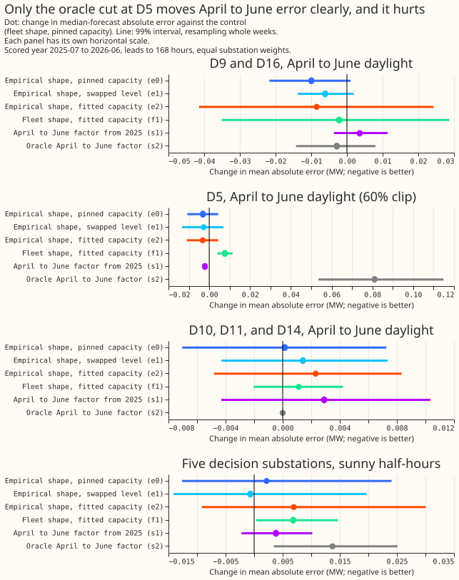

# PV capacity: does the empirical solar shape lower arm D's April to June error?

**Take-home message: no. Neither the empirical solar shape nor a lower solar capacity changes arm D's
April to June error by more than 0.01 MW at D9 and D16.** Arm D is the monthly-refit generalised
additive model of experiments
[155](../00155-dp-bg-stage2-assembly-night-offset-and-error-correction/result.md) and
[220](../00220-dp-bg-stage4-assembly-with-drop-one/result.md), scored on [experiment
178](../00178-dp-sunny-daylight-gap-diagnosis/result.md)'s rows. [Experiment
266](../00266-summer-gap-diagnostics-solar-term/result.md) put the April to June gap to BG2 in its
solar term. [Experiment 269](../00269-pv-capacity-gain-decomposition/result.md) found a pooled
empirical shape that recovers an injected farm better than the physical fleet shape, with real
capacities 0.2 to 0.4 MW lower. This experiment puts that shape and those capacities into arm D.

**Verdict: not supported.** C1 (e2 minus the control, April to June daylight, D9 and D16) is -0.009
MW with a 99% interval of -0.041 to +0.024, so the interval contains zero and the point estimate is
above -0.01 MW. The control's April to June daylight error at D9 and D16 is 0.528 MW, and its gap to
BG2 there is +0.044 MW (-0.018 to +0.103), so the largest gain any arm showed (0.010 MW) closes under
a quarter of the
gap. Every level, table, and factor except the oracle arm s2 uses data before 2025-07-01 only, and
all 36 stored control frames equal experiment 180's control frames (`e00280_check_control.py`).

**Figure 1. Almost every interval contains zero; the oracle cut at D5 stands clear of it, upward.** Week-block
intervals are wide (about 13 weeks of April to June, 4,000 resamples).

## Results

**The shape alone changes the error by about 0.01 MW, and the all-half-hours error rises.** At D9
and D16, April to June daylight, e0 (the empirical shape at the pinned capacity) is -0.010 MW (-0.022
to +0.001), e1 (swapped level) -0.006 MW (-0.014 to +0.002), and C4 is therefore small. On all
half-hours at D9 and D16, e0 is +0.006 MW (+0.002 to +0.009), e1 +0.007 MW (+0.003 to +0.010), and
e2 +0.008 MW (0.000 to +0.014). The empirical shape raises the error outside April to June daylight.

**The lower capacity helps D9 and does nothing at D16.** e2 at D9 alone is -0.022 MW (-0.060 to
+0.010) and at D16 alone +0.005 MW (-0.028 to +0.040), so the pooled C1 is a D9 result. With a 60%
export clip at D9 as well, e2 at D9 is -0.004 MW (-0.010 to +0.001): the clip already removes most
of what the capacity cut offers. f1 (the fleet shape at the real-fit capacity) is -0.002 MW at D9
and D16 (-0.035 to +0.029), so the capacity gives no more than the shape did (C3).

**The capacity bias in April to June does not generalise.** s1 (a factor of 1.02 to 1.13 from April
to June 2025) is +0.004 MW at D9 and D16 (-0.004 to +0.011), as P3 predicted. s2 (the oracle factors
of experiment 266, which read the scored year) is -0.003 MW at D9 and D16 (-0.014 to +0.008) and
+0.081 MW at D5 (+0.053 to +0.115): the capacity cut experiment 266 measured at D5 is already
supplied by the 60% clip, and cutting it again overshoots.

**The other substations and the night-time error do not move.** At D10, D11, and D14, April to June
daylight changes by at most +0.003 MW in any arm, and the April to June night-time error of the five
decision substations changes by at most +0.004 MW (P4 holds). On sunny half-hours, e2 is +0.007 MW
over the five decision substations (-0.009 to +0.030), but it raises D16's sunny-half-hour error by
+0.020 MW, which reaches the 0.02 MW no-harm limit. The verdict does not change, because C1 fails first.

## Predictions

- **P1 (e0 and e1 change sunny-daylight error by under 0.02 MW at each of D9, D10, D11, D14, D16):**
  met; the largest is e0 at D9 on sunny half-hours, -0.016 MW (the group means for D16 and the
  others are within 0.004 MW).
- **P2 (e2 lowers April to June daylight error by at least 0.02 MW over D9 and D16, and moves D5 by
  under 0.02 MW):** the first part is not met (-0.009 MW); the D5 part is met (-0.003 MW).
- **P3 (s1 is above -0.01 MW at D9 and D16):** met; +0.004 MW.
- **P4 (night-time error at D10 does not move by more than 0.02 MW in any arm):** met; D10 moves by
  at most +0.004 MW.

## Caveats

- **Pinball loss agrees.** C1 in pinball loss is -0.001 MW (-0.011 to +0.008).
- **The intervals are wide.** About 13 weeks of April to June fall in the scored year, so a gain of
  0.02 MW would not show unless it sat in most weeks.
- **s2 is a bound, not a forecast,** because it reads the scored year.
- **D9 and D16 are two substations.** C1 is a mean over two, and D9 carries it.

## What the next experiment should answer

Neither the shape nor the capacity of the solar term closes the April to June gap in this test. The
next experiment should test the parts of arm D outside the solar term, and should score D9 alone,
where e2 gains 0.022 MW (-0.060 to +0.010) but the interval includes zero.
