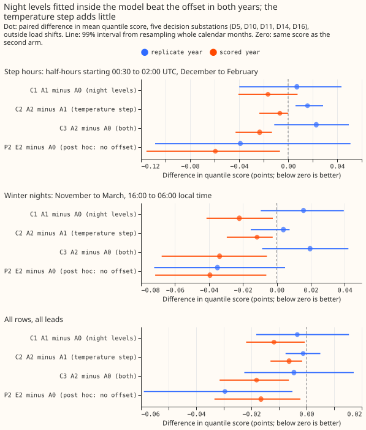
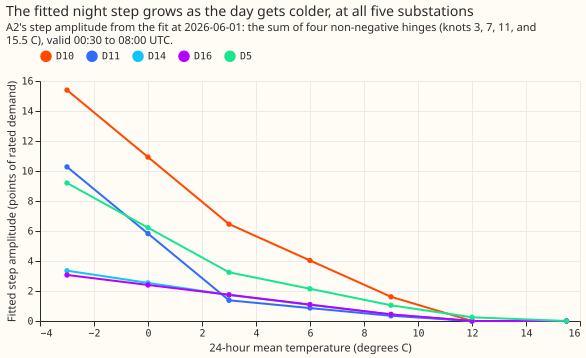
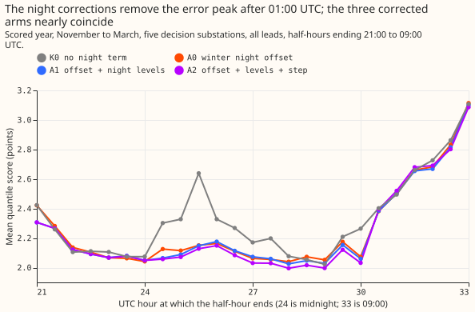
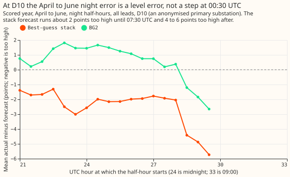

**Fitting the Economy 7 night levels inside the substation demand model beat a winter night offset
in both years, but the gain in the two hours after the night step starts, which we had
pre-registered as the test, could not be shown.** Economy 7 is a tariff that switches storage
heaters on shortly after 00:30 UTC, which raises demand at night. We asked whether a night step
that grows with the cold, fitted inside the demand model of a primary substation, lowers the
forecast error on winter nights when the weather input is an ensemble forecast. We fitted six
versions of the model (defined below) at 5 primary substations and scored them on a year that no
fit had seen. In the two hours after the step starts (half-hours starting 00:30 to 02:00 UTC,
December to February), the scores improved by 0.023 points of a substation's rated demand in that
year. In a second year used to check the sign, the same contrast worsened by 0.023 points. A
leave-one-substation-out check shows that the gain rests on two or three substations.

Scores are quantile scores in points of a substation's rated demand, and a lower score is better.
**Winter nights** are the half-hours from 16:00 to 06:00 local time in November to March. A
difference written "A1 minus A0" is negative where A1 is better. The **scored year** is 2025-07 to
2026-06, and the **replicate year** is the even months of 2024-07 to 2025-06. **A0** is [experiment
136](../00136-dp-bg-stage1-assembly-on-the-ensemble-mean/result.md)'s demand model (a Kalman filter
on recent errors, the heating split by day type, and one shared filter setting) plus the winter
night offset of [experiment
155](../00155-dp-bg-stage2-assembly-night-offset-and-error-correction/result.md), which adds a
constant learned from the demand model's own past errors on winter nights. **A1** is A0 with 20 free
night levels added (one per half-hour from 22:00 to 07:30 UTC, the design of [experiment
121](../00121-differentiable-physics-mh-multi-hinge-heating-curve-and-night-step/result.md)), plus
the offset. **A2** is A1 with a step from 00:30 to 08:00 UTC added, whose size is a sum of four
hinge functions of the 24-hour mean temperature (each is zero above a temperature threshold and
linear below it), with every coefficient at least zero, so the step grows with the cold. **K0** is
A0's demand model without the offset, **E1** is A1's without the offset, and **E2** is A2's without
the offset. The plan fixed the start of the step at 00:30 UTC because [experiment
123](../00123-differentiable-physics-e7-storage-heating-night-step-estimation/result.md) found the
step begins at the half-hour starting 00:30 UTC at all 14 time series it examined. The three planned
contrasts are **C1** (A1 minus A0), **C2** (A2 minus A1), and **C3** (A2 minus A0). BG2 is the
production-style XGBoost forecast of [experiment
87](../00087-bg2-best-guess-assembled-with-drop-one-ablations/result.md).

## Results

- **Verdict `inconclusive`.** The plan's rule gives `partly supported` by its letter, because the
  step-hour interval of C3 (-0.043 to -0.013) lies below zero. We set the verdict lower because the
  audit found that interval is not a 99% interval in any useful sense: the scored year holds 4
  step-hour months, so the interval spans the smallest and largest monthly values. The sign of C3
  also flips between the years (+0.023 in the replicate year, -0.014 in the odd months of 2024-07 to
  2025-06).
- **Pre-registered contrasts (scored year, 99% interval, substations improved of 5).**
    - C1 (A1 minus A0): step hours -0.016 (-0.041 to +0.008, 2 of 5); winter nights -0.022
      (-0.041 to -0.002, 3 of 5); all rows -0.012 (-0.022 to -0.001, 5 of 5).
    - C2 (A2 minus A1): step hours -0.007 (-0.024 to -0.000, 2 of 5); winter nights -0.012
      (-0.029 to -0.002, 4 of 5); all rows -0.006 (-0.013 to -0.002, 5 of 5).
    - C3 (A2 minus A0): step hours -0.023 (-0.043 to -0.013, 3 of 5); winter nights -0.034 (-0.068
      to -0.006, 5 of 5); all rows -0.018 (-0.032 to -0.006, 5 of 5). The decision rule's step-hour
      threshold (an interval wholly below -0.02) and 4-of-5-substations condition both fail.
    - **Replicate year.** C1, C2, and C3 on step hours are +0.007, +0.016, and +0.023, so the sign
      is opposite to the scored year. On all rows they are -0.003, -0.001, and -0.005.
- **Post hoc: night terms inside the model, no offset (E2 minus A0).** All rows: -0.017 (-0.033 to
  -0.002, 5 of 5) in the scored year and -0.030 (-0.059 to -0.005, 3 of 5) in the replicate year.
  Winter nights: -0.039 and -0.035. Step hours: -0.059 (-0.116 to -0.007, 4 of 5) and -0.039
  (-0.109 to +0.051, 3 of 5). E1 minus A0 is -0.010 and -0.027 on all rows. E2 minus E1 is -0.006
  and -0.003.
- **Absolute scores, scored year** (mean quantile score in points; cold nights are winter nights
  with a daily mean temperature below 2 C, 5,395 rows):

    | Arm | All rows | Step hours | Winter nights | Cold nights |
    |---|---|---|---|---|
    | K0 | 2.791 | 2.578 | 2.339 | 3.370 |
    | A0 | 2.774 | 2.381 | 2.277 | 3.313 |
    | A1 | 2.762 | 2.365 | 2.255 | 3.266 |
    | A2 | 2.756 | 2.358 | 2.244 | 3.174 |
    | E1 | 2.764 | 2.337 | 2.252 | 3.272 |
    | E2 | 2.757 | 2.322 | 2.238 | 3.176 |
    | BG2 | 2.780 | 2.526 | 2.394 | 3.724 |
    | Manual heuristic | 3.497 | 3.517 | 3.361 | 7.090 |

- **Predictions.** The A1 minus A0 contrast (C1) on step hours missed (predicted -0.05 to -0.15, was
  -0.016). C1 on winter nights held (-0.022 against -0.02 to -0.06). The A2 minus A1 contrast (C2)
  on cold nights was larger than predicted (-0.093 against -0.01 to -0.04). The step amplitude is
  larger at 0 C than at 3 C at 5 of 5 substations. C3 equals C1 plus C2 on winter nights to within
  0.001. The cold-night q95 coverage rose by 2.4 points (A2 minus A0, 83.8% to 86.1%), inside the
  predicted 0 to 3. A3 was not run, because no arm met the decision rule.
- **Start audit.** Fitted on the 24 months before 2025-07-01, the start of the step is 00:00 UTC at
  D5, D10, and D11 and 00:30 at D14 and D16, so all 5 substations agree with the 00:30 start of
  [experiment
  123](../00123-differentiable-physics-e7-storage-heating-night-step-estimation/result.md) within 30
  minutes, and the cap on the verdict in the decision rule does not apply.
- **The night question from [experiment
  266](../00266-summer-gap-diagnostics-solar-term/result.md).** On D10's April to June night rows
  the scores are A0 2.782, A1 2.748, A2 2.716, and BG2 2.328. The Economy 7 terms close 0.067 of the
  0.455-point gap. The stored stack's residual at D10 is about -2 points from 21:00 to 07:30 UTC and
  -4 to -6 from 07:30 to 09:00 (figure 4), a level error, not a step at 00:30. The question is
  answered for the Economy 7 term: no. The D10 gap needs its own experiment.
- **Rows, schedule, and weather.** 561,172 forecast rows shared by all arms in the scored year (one
  per substation, forecast origin, and lead time), from 292 forecast origins, with the demand
  models refitted monthly on the previous 24 months and the ensemble-mean weather available at
  forecast time. The start audit used past weather
  because it fits on history. A contrast could depend on the monthly schedule, which weekly refits
  would test.
- **Post hoc.** The E1 and E2 contrasts against A0 (P1, P2, P3) were added after the planned
  contrasts were read. The cold-night q95 coverage and the D10 cut are planned and post hoc
  respectively, as the plan says.
- **Tail calibration, cold nights, scored year (A0, A2, BG2).** q01 coverage 4.3%, 4.4%, 2.0% and
  pinball loss 0.380, 0.362, 0.444. q05 coverage 7.8%, 9.0%, 3.5% and loss 0.931, 0.905, 0.919. q95
  coverage 83.8%, 86.1%, 75.6% and loss 0.902, 0.819, 1.390. q99 coverage 94.2%, 94.8%, 86.1% and
  loss 0.290, 0.284, 0.809. The curtailment-cost metric was not scored, because the metric needs
  nodes with generators and this experiment's rows are single substations.

## Checks

- **Median minus mean forecast.** The median equals the mean at all 6 substations for A0 and A2
  (difference 0.0), because the quantiles are centred on the mean.
- **Error of the mean beside the quantile score.** The mean absolute error of the mean has the same
  sign as the quantile score for C1, C2, and C3 on all rows (-0.026, -0.008, -0.034) and on step
  hours (-0.008, -0.005, -0.013) in the scored year.
- **Audit triggers that fired.** A result contradicted its prediction (C1 on step hours). Leaving
  one substation out flipped a contrast (C3 on step hours becomes +0.000 without D11 in the scored
  year and +0.059 without D16 in the replicate year). A nested arm beat the arm that contains it
  (E1 and E2 beat A1 and A2 on step hours in both years).
- **Audit.** A fresh Sonnet agent re-derived C1, C2, C3, and P2 from the stored predictions and
  matched them to 3 decimals. It found no leakage: every fit stops at its cut and the step's
  temperature at forecast time is the ensemble's. The offset applied to E1 and E2 loses on step
  hours because of two months of forecast origins. In December 2024 the offset was fitted on one
  month of winter data and shifted the forecast up by about 1.0 point, while the error of E1 was
  already -0.93. The other month is January 2026. Leaving D10 out leaves P2 on step hours, winter
  nights, and all rows in the replicate year at +0.005, -0.009, and -0.007. P2 on all rows in the
  scored year never flips. We accepted all findings as caveats and set the verdict from them.

## What to try next

- **Test E1, the in-model night levels without the offset, over more winters**, with a block
  longer than a month to resample, so that the all-rows gain of 0.017 to 0.030 points can be told
  from one substation's winter.
- **Give D10's April to June night error its own experiment**, with a level term from 21:00 to
  07:30 UTC, because the Economy 7 step explains 15% of it.
