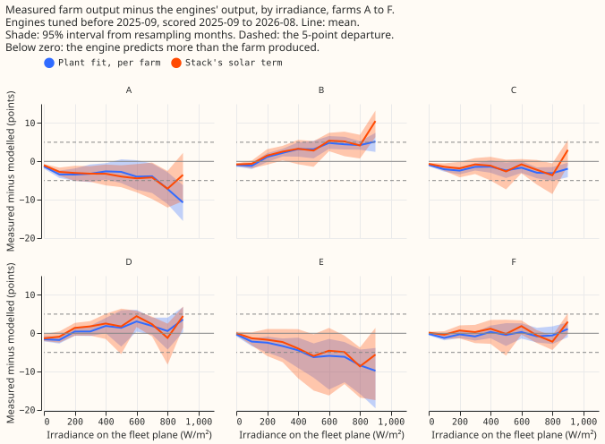
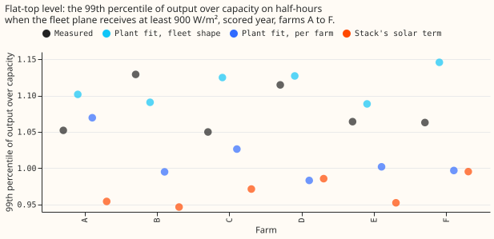
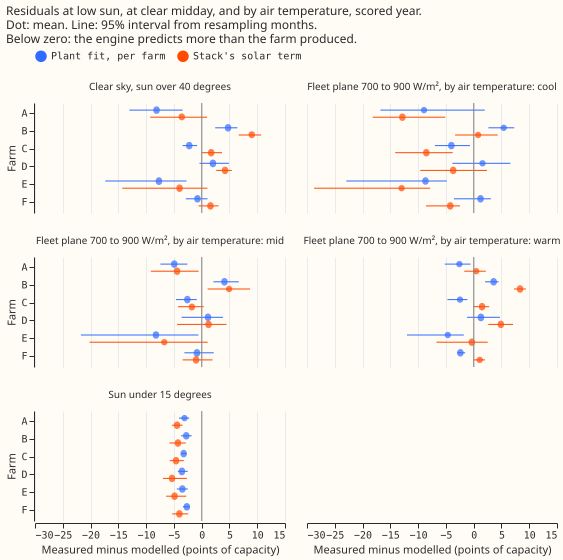
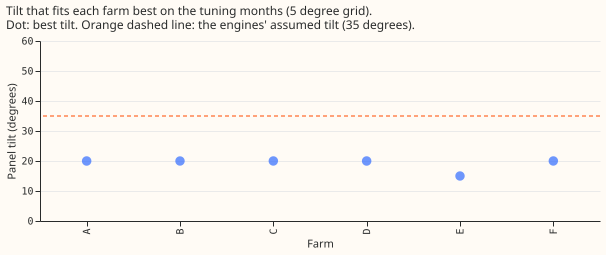
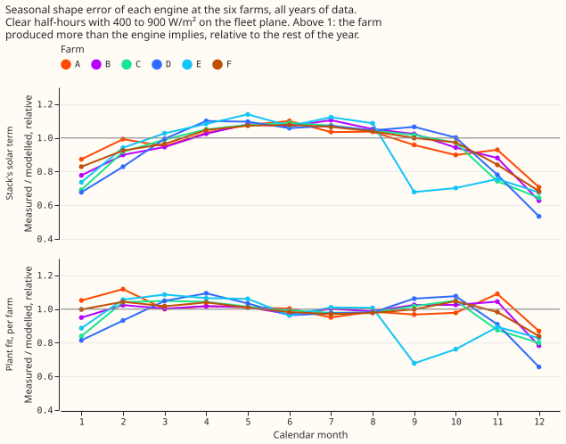
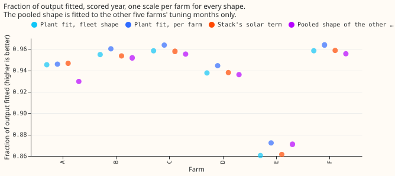

**Our solar curve stays within 5 percentage points of capacity at three of the six metered farms and
departs by more at the other three, in different directions, so no single fix to the inverter limit
repairs it.** The one error common to all six farms is the panel tilt of 35 degrees that the
best-guess demand stack assumes. National Grid Electricity Distribution (NGED) meters the output of
six solar farms, labelled A to F. We compared the farms' measured output over September 2025 to
August 2026 with the curve that turns irradiance (sunshine, in W/m²) into power in two of our solar
models. The two models are the per-farm plant fit of [experiment
218](../00218-metered-solar-farm-plant-fit/result.md) and the solar term of the best-guess demand
stack (the "stack") of [experiment
139](../00139-differentiable-physics-pv-as-of-capacity-in-gam-k/result.md). Both were tuned on
earlier months. A "departure" is a mean error above 5 percentage points of the farm's capacity whose
95% interval excludes zero. We predicted departures at 4 or more of the 6 farms; they occurred at 3
(A, B, and E), so the prediction is not supported. The count is fragile to the bin edges: farm D's
fleet-shape error reaches 4.95 points in one bin. The stop rule would have ended the audit before
the pooled-shape test (check 7) if fewer than 5 of 6 farms had a bin with a mean error above 3
points. Five farms had such a bin in the per-farm plant fit and six in the stack, so check 7 ran.

## Which curve each solar model uses

- **Plant fit (experiment 218).** Plane-of-array irradiance (the irradiance on the tilted panel
  surface) is the direct beam projected on the plane, plus isotropic sky diffuse, plus ground
  reflection (albedo 0.2). Cell temperature is air temperature plus 25 K times the plane's
  irradiance in units of 1000 W/m². DC power is a fitted scale times that irradiance times one minus
  0.4% per kelvin above 25 °C (fleet shape: tilt 35 degrees, facing south). The per-farm plant
  instead fits its own loss for each farm. A soft clip (a smooth cap on output, a p-norm minimum
  with exponent 6) with a fitted limit on alternating-current (AC) power follows.
- **The stack's solar term.** The shape is the fleet plant (tilt 35 degrees, facing south, a
  direct-current to AC rating ratio of 1.15) with a hard clip (an abrupt cap) at 1.0 per MW of AC
  capacity. The term is a pinned capacity times that shape times the same temperature loss, which is
  applied after the clip. Here the capacity is one fitted scale per farm.

## Results

- **Check 1, residual by irradiance (figure 1).** Departures above 5 percentage points of capacity
  whose 95% interval excludes zero: farm A (solar model too high by 7 to 11 points in the 800 and
  900 W/m² bins on the fleet plane), farm E (too high by 6 to 12 points, in the 500 to 900 W/m² bins
  for the per-farm plant and in the 800 and 900 bins for the fleet shape), and farm B (solar model
  too low by 5 to 10 points, at 600 to 900 W/m² for the stack and in fewer bins for the other two).
  Farms C, D, and F stay within 5 points in every bin. The stack and the per-farm plant depart at
  the same three farms. The signs differ by farm, so one clip level cannot fix them.
- **Check 2, flat top (figure 2).** The measured 99th percentile of output over capacity above 900
  W/m² is 1.05 to 1.13. The stack's term reaches 0.95 to 0.99 (7 to 18 points lower), the per-farm
  plant 0.98 to 1.07, and the fleet shape 1.09 to 1.15.
- **Check 3, low and high sun (figure 3).** At sun elevation under 15 degrees, both solar models
  over-predict at all six farms, by 2.7 to 3.6 points (per-farm plant) and 4.0 to 5.3 points
  (stack), with intervals that exclude zero. At clear midday the per-farm plant is off by 8 points
  at A and E (too high) and 5 points at B (too low).
- **Check 4, temperature (figure 3).** At 700 to 900 W/m², the stack's residual rises from the
  coolest to the warmest third of air temperatures by about 13 points at A, 10 at C, and 12.5 at E.
  The same rise appears at the other three farms (5 to 8 points). Cool air and winter coincide in
  the data and no table here separates them, so the temperature sub-prediction (residuals under 3
  points) is not answered.
- **Check 5, orientation (figure 4).** The best fit is south-facing at every farm, at a tilt of 20
  degrees at five farms and 15 degrees at E, against the 35 degrees both solar models assume as the
  fleet shape. An east-west pair at tilt 15 fits worse than the best south-facing tilt at every
  farm. Using the best tilt in place of 35 changes the fraction of output fitted (both fitted here
  with no heat loss) by -0.002 (A) to +0.010 (E). The public register of renewable energy projects
  states location and AC capacity but not tilt or azimuth, so there is no register value to compare
  with.
- **Check 6, seasonal shape (figure 5).** On clear half-hours at 400 to 900 W/m², the ratio of
  measured to the stack's output, relative to each farm's whole year (median over farms), is 0.66 in
  December (0.53 to 0.71 across farms), 0.76 in January, 0.81 in November, and 1.08 in May. The
  per-farm plant (best tilt 20 degrees, fitted heat loss and soft clip) is within 5% of 1 in every
  month except November (0.95), December (0.81), and January (0.92). No arm isolates the tilt, so
  the winter error is partly the tilt; the fit may also absorb error in the irradiance data.
  Experiment 266 found the stack's pinned capacity too high in April to June at three of NGED's
  primary substations (D5 -41%, D9 -14%, D16 -10%). At the farms the stack under-predicts April to
  July by 5 to 8%, the opposite sign, so the spring capacity bias is not the same departure as the
  seasonal shape error. The primary substations' own solar output is not metered, so this test is
  indirect.
- **Check 7, pooled shape (figure 6).** The pooled leave-one-farm-out shape (fitted on the other
  five farms and scored on the sixth, for each farm in turn), fitted to the other five farms' tuning
  months with one scale per farm, scores a median fraction of measured output explained (one minus
  the squared error over the squared output) of 0.944 against 0.950 for the fleet shape (difference
  -0.006, 95% interval -0.013 to +0.002) and 0.953 for the per-farm plant (difference -0.010, -0.017
  to -0.005). The pinball loss (a quantile-forecast score; lower is better) averaged over 11
  quantiles and the six farms is 4.91 points for the pooled shape, against 4.69 for the fleet shape,
  4.70 for the stack, and 4.46 for the per-farm plant. The threshold of a 0.02 gain is not met.

## Checks

- **Median minus mean forecast per site:** not applicable, because every arm is a point forecast
  with residual-quantile bands from the tuning months. The mean-forecast error is the fraction of
  output fitted reported above.
- **Reuse of experiment 218:** the fleet shape (0.950) and per-farm plant (0.953) use experiment
  218's stored fold 1 predictions, so their numbers match by construction.
- **Triggers fired:** trigger 2 (the result contradicts the prediction of 4 of 6 farms): the
  departures sit at A, B, and E and their signs differ, so the explanation tested is that the
  departures are farm-specific and not a common flat-top error. Trigger 7 (a later experiment
  depends on this result): experiment 280 scores a pooled six-farm shape inside arm D; its session
  has been told by message that the pooled shape gave no gain at the farms. The pooled shape scores
  below the fleet shape at five of the six farms (no farm-dropping check was run). No audit was run.
- **Caveats:** the irradiance axis uses the 35 degree fleet plane, which the farms do not share.
  The bins used for flagging hold 147 to 1,608 half-hours of the scored year, and check 6 uses all
  years of data.
  Farm E has 10 tuning months. Irradiance is from the Copernicus Atmosphere Monitoring Service
  (CAMS) and air temperature is from the ERA5 reanalysis, and neither is available at forecast time.
  The pooled shape's penalty took the lowest values of its search range, so a weaker penalty might
  score differently. The pinball losses have no interval, and the pooled shape's quantile offsets
  come from residuals of a shape it was not fitted to, while the other shapes' offsets are
  in-sample.

## What the next experiment should answer

- Does a 20 degree fleet tilt in the stack's solar shape lower the stack's winter error and its
  quantile score?
- Does a higher or softer clip level in the stack's shape fix the 7 to 18 point shortfall at the top
  of the curve?
