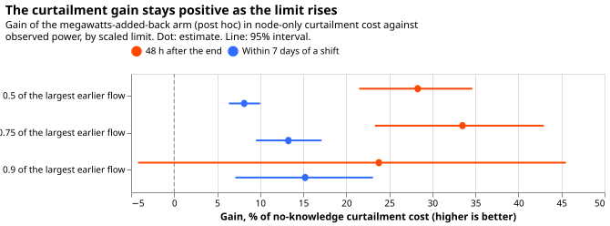
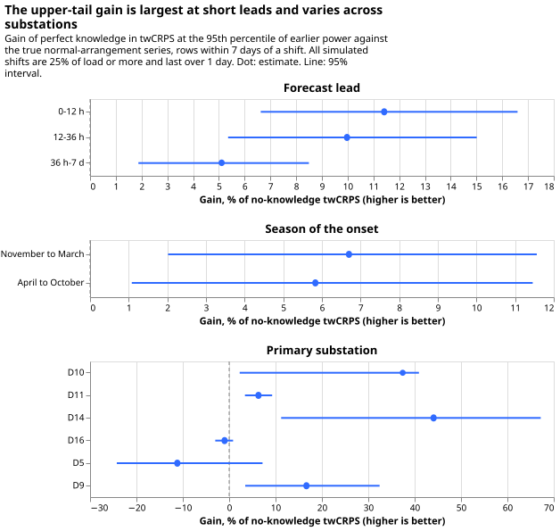
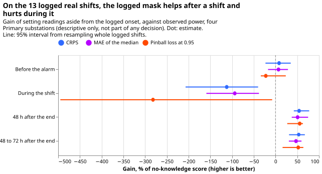

**A load shift moves demand from one Primary substation to its neighbours for hours or days. Knowing
every shift exactly lowers the forecast's error in the highest power values by 23.1% (95% interval
8.8% to 39.1%) in the 48 hours after the shift ends, and by under 1% over a whole year, because
shifts are rare.** That figure is the threshold-weighted continuous ranked probability score
(twCRPS) against the power the substation would have carried in its normal running arrangement
(NRA), as a share of the score of a forecast that knows nothing about the shift.

**Curtailment cost is the cost of limiting generation when the flow at a substation would breach its
limit.** The design fixed before any score was read ignored the power readings recorded during a
shift. Against observed power, which includes the shift, that design did not lower curtailment cost
(-1.4%, -4.9% to +1.5%), so the curtailment prediction failed. A variant added after seeing the
results adds the shift's known megawatts back to the forecast, and lowers cost by 8.1% (6.4% to
10.0%) within 7 days of a shift. The next step is to ask how good a detector of load shifts must be
to keep that gain.

**Question and method.** A load shift moves demand from one Primary substation to its neighbours for
hours or days. We asked whether a forecast that knows every shift exactly, from its true start and
end, beats one that knows nothing (question 1 of the [LSC decision
program](../themes/lsc-detectors/plan.md)). The forecasting model is the generalised additive model
with a Kalman filter on its recent errors of [experiment
208](../00208-switching-value-of-a-detector-by-phase-and-quality/result.md), unchanged. We scored
411 simulated shifts (44 copies of the real 27-month power record, six Primary substations, stored
by experiment 141) on two targets: the true normal-arrangement (NRA) series, and observed power,
which includes the shift. Curtailment cost is the node-only metric of [experiment
268](../00268-lsc-curtailment-metric-v2-member-wise-ens/result.md) (`studies.node_curtailment`), at
a limit of 0.5 times the largest earlier power, 12 to 36 hour leads, GBP 2,000 per MWh.

**Curtailment figures are relative comparisons between forecasts at a Primary substation and state
no money saved.** A Primary substation has no published export limit and no known generator beneath
it, so the metric treats its demand as the flow that can breach, as [experiment
277](../00277-lsc-curtailment-metric-on-existing-forecasts/result.md) did. Bulk supply points are
not scored: [experiment 271](../00271-lsc-load-shifts-net-out-at-bulk-supply-points/result.md) found
that few shifts cross a boundary and that the bulk-supply-point metric cannot value detection.

## Gain over no knowledge, by row group

**Each cell is the gain of perfect knowledge over no knowledge, as a percentage of the no-knowledge
score, with a 95% interval; positive is better.** Arms: PERFECT (true span known at the true onset,
readings inside it set aside, end known at once) and PERFECT_LAG (the same span known after a live
service's delays). The post hoc arms PERFECT_ADD and PERFECT_LAG_ADD subtract the span's megawatts
from the readings and add the true megawatts back to the forecast at the target time once the span
is known. Row groups: G1 ordinary rows (outside every shift, the 72 hours after it, and the 7 days
either side of it); G2 before the alarm would arrive; G3 during the shift; G4 the 48 hours after its
end; G5 within 7 days of a shift (G2 to G4 plus the margins); G0 all rows, with ordinary rows
weighted 4 because every fourth daily run is scored.

| Group | twCRPS vs NRA, PERFECT | CRPS vs NRA, PERFECT | Cost vs observed, PERFECT | Cost vs observed, PERFECT_ADD (post hoc) |
|---|---|---|---|---|
| G0 all rows | +0.22 (+0.04 to +0.50) | +0.80 (+0.55 to +1.13) | -0.10 (-0.35 to +0.11) | +0.55 (+0.39 to +0.77) |
| G1 ordinary | -0.03 (-0.14 to +0.06) | +0.01 (-0.05 to +0.06) | -0.00 (-0.02 to +0.01) | -0.01 (-0.03 to +0.01) |
| G2 before alarm | +25.3 (+9.1 to +39.5) | +20.1 (+14.6 to +25.4) | -7.3 (-15.9 to +1.3) | +21.5 (+14.1 to +28.7) |
| G3 during | +14.4 (+3.8 to +23.5) | +44.4 (+26.7 to +55.1) | -35.2 (-47.0 to -25.3) | +9.2 (+3.2 to +15.2) |
| G4 after | +23.1 (+8.8 to +39.1) | +35.1 (+24.8 to +43.9) | +25.2 (+14.1 to +34.2) | +28.3 (+21.5 to +34.7) |
| G5 near | +6.3 (+2.8 to +10.1) | +10.8 (+8.2 to +13.4) | -1.4 (-4.9 to +1.5) | +8.1 (+6.4 to +10.0) |

## Results

- **Pre-registered prediction, part 1 held:** the twCRPS gain in G4 against the true NRA series is
  +23.1% (8.8 to 39.1), above the 3% bar. PERFECT_LAG gains +22.3% (7.9 to 38.1).
- **Part 2 failed:** the curtailment gain against observed power in G5 at the 0.5 limit is -1.4%
  (-4.9 to +1.5) for PERFECT and -0.6% (-3.7 to +2.0) for PERFECT_LAG, so the interval includes zero
  and the curtailment-cost answer for the design fixed in advance is "not shown". The loss sits in
  G3 (-35.2%, -47.0 to -25.3): the forecast with readings set aside predicts the normal arrangement,
  while observed power includes the shift.
- **Part 3, G0 and G1 under 0.5%:** G1 changes by -0.03% (-0.14 to +0.06) in twCRPS and G0 by
  +0.22%. G0 CRPS changes by 0.80% (0.55 to 1.13), above the 0.5% limit, so that condition failed
  for CRPS; the rise comes from the shifts in the year and is not harm.
- **Post hoc, megawatts added back:** curtailment cost falls 8.1% (6.4 to 10.0) in G5 and 28.3%
  (21.5 to 34.7) in G4 at the 0.5 limit. With live delays the gains are 3.5% (2.4 to 4.7) and 26.1%
  (19.0 to 32.8). At the 0.75 limit PERFECT_ADD gains 13.3% (9.5 to 17.1) in G5, and at 0.9 it gains
  15.2% (7.1 to 23.1); the sweep is figure 3.
- **Absolute no-knowledge scores (points of effective capacity):** CRPS against the NRA series is
  4.14 in G4, 3.03 in G2, 4.62 in G3, and 2.71 on ordinary rows; the mean absolute error (MAE) of
  the median is 6.89 in G4 and 4.69 on ordinary rows.
- **Real record, descriptive only:** on 13 logged shifts at four Primary substations (experiment
  208's stored scores, five stored quantiles, so twCRPS is replaced by pinball loss at 0.95), the
  logged mask lowers CRPS by 54.3% (42.1 to 77.4) in the 48 hours after 7 shifts and worsens it by
  112% (40% to 207%) during 6 shifts. The real record resolves no curtailment difference
  ([experiment 277](../00277-lsc-curtailment-metric-on-existing-forecasts/result.md)).
- **Substations differ:** G5 twCRPS gain is +37.4% at D10, +44.1% at D14, +16.7% at D9, +6.3% at
  D11, -1.0% at D16, and -11.2% at D5 (figure 4). Gains fall with lead: 11.4% at 0 to 12 h, 10.0% at
  12 to 36 h, 5.1% at 36 h to 7 d.
- **Shift sizes are untested below 25% of load and under 1 day:** every simulated shift is that
  large and that long, so the size and duration strata of the program cannot be scored. November to
  March gains 6.7% (2.0 to 11.6) and April to October 5.8% (1.1 to 11.5).

## Checks

- **Median minus mean forecast, per site:** the mean absolute error of the median forecast minus
  that of the mean forecast lies between -0.019 and +0.008 points for every site and arm, and
  changes by under 0.005 points between K0 and PERFECT, so no arm's spread shifts its forecast
  (printed report).
- **Mean forecast error beside each quantile-score contrast:** in G5 against the NRA series the MAE
  of the mean gains 9.6% (7.5 to 11.7) beside the CRPS gain of 10.8%, the same direction. Against
  observed power the mean absolute error (MAE) of the median gains 1.7% (0.3 to 3.0) in G5 for
  PERFECT, while curtailment cost loses 1.4%; the difference is the G3 tail loss above.
- **Triggers that fired:** trigger 2 (the curtailment result contradicts its prediction) fired, and
  the megawatts-added-back arm is the tested explanation. Trigger 4 fired weakly: leaving out D11
  moves the G4 twCRPS interval to -1.4% to +51.1% while the point estimate stays above 17% in all
  six leave-one-out runs. Trigger 7 fired because later steps compare detectors with these arms. A
  fresh Sonnet audit re-derived the headline contrasts from the stored scores with its own code and
  reproduced them (twCRPS +23.08%, 8.6 to 39.0; curtailment -1.36%, -4.83 to +1.57; megawatts added
  back +8.14%, 6.35 to 10.03). It found no leakage: the 1008 rows scored before a first onset that
  differ from K0 belong to one overlapping pair of shifts at D5. Its four caveats are listed under
  "Caveats", and we accepted all four.
- **Cost metric check:** the per-row node-only cost equals
  `studies.node_curtailment.node_curtailment` on one substation and one simulated world (GBP
  32,468,687.88 both).

## Caveats

- **The megawatts-added-back arms are an upper bound.** They add the true megawatts at the target
  time and stop at the true end of the shift, even when the forecast was issued before the end, so
  they know the future shape and end of the shift. The 8.1% (6.4 to 10.0) is therefore the most that
  perfect timing and size can deliver.
- **The pre-registered curtailment prediction failed by construction.** The readings-set-aside arm
  forecasts the normal arrangement and is scored against observed power, so it loses during a shift
  (-35.2%) whatever the value of the knowledge. The post hoc arm is the one that tests the question.
- **The twCRPS bar is met overall but not robustly.** Without D11, which supplies 106 of the 267
  shifts that reach the 48-hour group, the gain is +17.8% (-1.4 to +51.1). Without D16 it is +32.7%
  (18.5 to 42.9).
- **G0 and G1 are one test.** Ordinary rows carry 93.3% of the weight of G0, and the ordinary
  intervals rest on 23 calendar months. About 10% of ordinary rows differ between K0 and PERFECT,
  because K0's filter still carries a past shift, and the net effect is zero within noise.

## Arms and rows

- **Arms:** K0 (no knowledge of shifts; the filter reads all recent power); PERFECT and PERFECT_LAG
  (MASK design); post hoc PERFECT_ADD and PERFECT_LAG_ADD (SUB design plus true megawatts added
  back). Lab conditions: true megawatts known, spans known exactly.
- **Rows:** 411 simulated shifts in 44 simulated copies of the record, six Primary substations (D5,
  D9, D10, D11, D14, D16), 22.9 million weighted rows (1.54 million within 7 days of a shift, 5.34
  million ordinary rows scored of every fourth daily run). Intervals resample whole simulated
  shifts, and whole calendar months for ordinary rows, 20,000 draws.
- **Retraining schedule:** none; the forecasts are experiment 208's cached member forecasts, so the
  contrast cannot depend on a schedule.
- **Targets:** observed power (real series plus the injected megawatts) and the true NRA series
  (real series); PERFECT_ADD arms are scored on observed power only.
- **Quantiles:** the node curtailment metric reads the 0.95 quantile of 11 stored quantiles; none
  cross, so sorting changes nothing.
- **Data used:** experiment 141's stored worlds, experiment 111 and 115's cached member forecasts
  and spreads, the cleaned power table before the first replicate row for limits and thresholds.

## What to try next

- **Step 5 of the program (do we need a detector at all?)** should score its arms against both
  PERFECT and PERFECT_ADD, because the money answer differs by design.
- **Step 6 (how good must a detector be?)** should degrade PERFECT_ADD, since the megawatts need a
  detector that estimates size as well as timing.
- **Shifts under 25% of load and under 1 day** need new simulated worlds before a detector can be
  judged on them.
