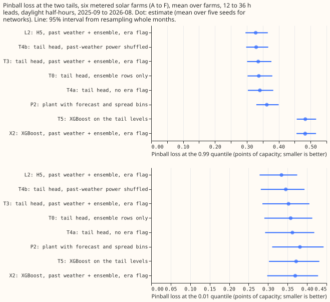
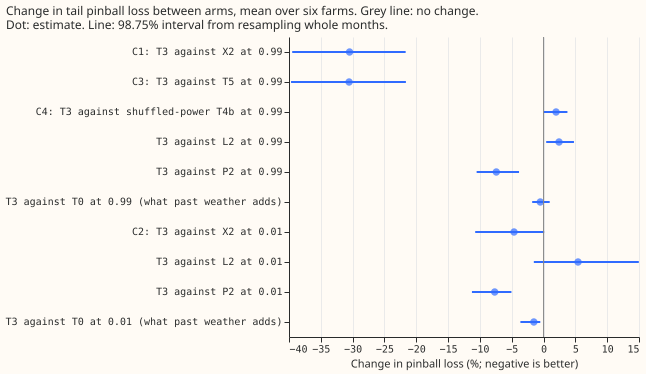
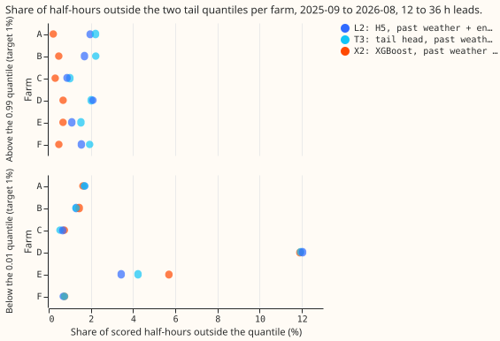

**A neural network trained only for the tails beats XGBoost at the 0.99 quantile by 30%, but H5 from
experiment 275 is slightly better than the tail network, and most of the gain comes from the
physical power model underneath.** National Grid Electricity Distribution (NGED) meters the output
of six solar farms, labelled A to F. Curtailing a farm depends on the upper edge of its forecast
band, so the 0.01 and 0.99 quantiles matter most. [Experiment
275](../00275-metered-farm-long-history-neural-head/result.md) trained the neural network H5 (the
plant, a physical model of a farm's output, plus a network that adds offsets at 11 quantile levels)
on 17 months of European Centre for Medium-Range Weather Forecasts (ECMWF) ensemble forecasts plus
nearly 6 years of rows built from past weather. The past-weather rows lowered H5's 0.99 pinball
loss (the loss that penalises a quantile forecast on the side it errs) by 4.6%, while its overall
score moved by 0.5%. We asked whether a network trained only for six tail levels (0.01, 0.02, 0.05,
0.95, 0.98, and 0.99) on the same rows beats [XGBoost (Chen and Guestrin,
2016)](https://doi.org/10.1145/2939672.2939785) at the 0.01 and 0.99 quantiles. [Experiment
270](../00270-metered-farm-xgboost-vs-plant-diagnostic/result.md) built a plant whose offsets are
binned by its forecast and the ensemble spread (P2). The tail head (T3) is a neural network that
corrects the offsets of P2, trained only for the six tail levels. XGBoost X2 is trained on the same
rows to predict each quantile directly, and T0 and T4b are controls defined under Arms below.
Percentages are changes in pinball loss, and negative means the first arm is better.

**The tail network beats XGBoost at the 0.99 quantile by more than the predicted margin, and a
calibration check fixed in the plan also fires at the 0.01 quantile.** T3's 0.99
pinball loss is 0.336 points of capacity against 0.483 for XGBoost on the same rows (X2), 30.5%
lower (98.75% month-block interval -39.5% to -21.7%, against the 5% reduction predicted), and the
gain has the
same sign at all six farms. Stop rule 1 does not fire. The calibration check (stop rule 2 in the
plan) required the miscalibration to be reported first if it fell outside the band at 3 or more
farms. It fires on its literal reading, because the 0.01 quantile has coverage outside 0.5% to 1.5%
at farms A (1.7%), D (11.9%), and E
(4.2%), but farm D's 11.9% is tied zeros: its output is exactly zero in 11.7% of scored half-hours,
mostly in winter. Three further results limit what the 30% means. First, XGBoost's 0.99 quantile is
too high, and P2, which has no neural network, is already 25% below it (0.363). Second, T3 is 2.4%
worse
than H5 at 0.99 (interval 0.4% to 4.8%). Third, past-weather rows add little at 0.99: T3 against
the same head on ensemble rows only (T0) is -0.5% (interval -1.8% to +1.0%), and a placebo with the
past-weather rows' power shuffled (T4b) scores 2.0% better than T3 (interval -0.01% to 3.8%).

## Arms, rows, and weather

- **Arms** (own history, one fit on rows before 2025-09 with no retraining in the scored year, the
  screening schedule; 5 seeds for neural networks). X2: XGBoost with past-weather plus ensemble rows
and
  the era flag (from experiment 275). P2: the plant with offsets binned by forecast (6 bins) and
  ensemble spread (3 bins), from ensemble tuning rows. L2: H5 as in experiment 275. T3: the tail
  head, with inputs P2's forecast, ensemble spread, lagged power, clear-sky index, lead, cell
  temperature, sun elevation, and the era flag, trained on pinball loss at the six tail levels plus
  a penalty on crossing. T0: T3 on ensemble rows only. T4a: T3 without the era flag. T4b: T3 with
  shuffled power in the past-weather rows. T5: XGBoost on the six tail levels with T3's inputs.
- **Rows.** Experiment 275's scored rows (daylight half-hours at 12 to 36 hour leads, 2025-09 to
  2026-08, equal weight per farm; 41,654 rows common to every arm). Intervals resample the 12 scored
  months 20,000 times. T3's 11-level forecast for the quantile score is T3's 0.01, 0.05, 0.95, and
  0.99 quantiles inside L2's other seven (same seed), sorted per row.
- **Weather at each time.** Past-weather rows use Copernicus Atmosphere Monitoring Service (CAMS)
  irradiance (about 2 days late) and ERA5 temperature (about 5 days late), neither of which exists
  at forecast time; they appear in training rows before 2025-07. Scored rows use the ECMWF ensemble
  (00 UTC run), which exists at forecast time, as do lagged power (one day, or two when the lead
  exceeds 24 hours) and the ensemble spread. Past-weather rows take a stand-in spread (the median of
  the same farm, month, half-hour, and cloud tercile).
- **Curtailment value.** Not scored as a contrast. The rule of `studies.node_curtailment` reads only
  each farm's median forecast, and T3 keeps L2's median and middle quantiles, so T3's curtailment
  cost equals L2's by construction. [Experiment
  255](../00255-metered-farm-node-curtailment-value/result.md) found 72 event half-hours at 0.5
  times the maximum export and 2 to 5 at the other limits, too few to rank forecasts.

## Numbers

- **Pinball loss at 0.99 (points of capacity, 95% interval):** L2 0.328 (0.296 to 0.366); T4b 0.329
  (0.298 to 0.367); T3 0.336 (0.301 to 0.377); T0 0.338 (0.302 to 0.380); T4a 0.341 (0.303 to
  0.383); P2 0.363 (0.330 to 0.400); X2 0.483 (0.456 to 0.517); T5 0.484 (0.457 to 0.517).
- **Pinball loss at 0.01:** L2 0.334 (0.278 to 0.375); T4b 0.345; T3 0.353 (0.285 to 0.406); T0
  0.358; T4a 0.362; X2 0.370 (0.298 to 0.428); T5 0.372; P2 0.382 (0.311 to 0.443).
- **Planned contrasts (98.75% intervals, percent change in pinball loss).** C1 T3 against X2 at
  0.99: -30.5% (-39.5 to -21.7). C2 T3 against X2 at 0.01: -4.6% (-10.7 to +0.1), driven by farm E
  alone (-16.0%; the other five farms are between -1.9% and +1.3%; leaving E out gives -0.1%). C3 T3
  against T5 at 0.99: -30.6% (-39.7 to -21.6), the same as C1 because X2 and T5 are the same kind of
XGBoost model. C4 T3 against T4b at 0.99: +2.0% (-0.01 to +3.8).
- **Secondary contrasts at 98.75%.** T3 against L2 at 0.99: +2.4% (0.4 to 4.8), at 0.01 +5.4% (-1.5
  to +15.0), driven by farm E. T3 against P2: -7.4% at 0.99 (-10.5 to -3.9) and -7.7% at 0.01 (-11.3
  to -5.0). T3 against T0 at 0.99: -0.5% (-1.8 to +1.0), at 0.01 -1.5% (-3.6 to -0.5). T3 against
  T4a at 0.99: -1.5% (-4.5 to +2.2), at 0.01 -2.7% (-4.9 to -0.6). T3 against X2 at 0.95: +4.6% (1.2
  to 8.4), so XGBoost is better at the 0.95 quantile.
- **Tail calibration (share of half-hours outside the quantile, target 1%).** Below the 0.01
  quantile, T3 is at 1.7%, 1.3%, 0.5%, 11.9%, 4.2%, and 0.75% for farms A to F, and L2 and X2 are
  within 0.25 points of T3 except at E (L2 3.4%, X2 5.7%). Above the 0.99 quantile, mean over farms:
  T3 1.8%, L2 1.5%, P2 1.7%, T5 and X2 0.5%. XGBoost's 0.99 quantile is therefore too high (it sits
  near 0.69 of capacity at 05:00 and 19:00 UTC, against 0.12 to 0.13 for T3), and the pinball
  ranking does not make T3 calibrated.
- **Exceedances (scored half-hours, sum over farms; networks are seed-averaged).** Below the 0.01
  quantile: T3 1,353, L2 1,322, X2 1,455. Above the 0.99 quantile: T3 763, L2 648, X2 193.
- **Quantile score of the 11-level frame:** X2 5.403 (4.849 to 5.857); L2 5.449 (4.902 to 5.915); T3
  with L2's middle 5.450 (4.901 to 5.921); T3 against L2 +0.02% (95% interval -0.13 to +0.20).

## Checks

- **Median minus mean forecast, per farm (points of capacity), farms A to F.** L2: 0.29, 0.47, 0.40,
  0.40, 1.26, 0.49. T3 with L2's middle: 0.22, 0.41, 0.40, 0.46, 1.12, 0.46. X2: -0.75, -0.06,
  -0.14, -0.01, -0.03, 0.09. T3 shifts the mean forecast by under 0.15 points at every farm.
- **Error of the mean forecast beside the quantile score.** T3's mean-forecast error is 9.95 points
  of capacity against 9.95 for L2 (-0.01%, interval -0.14 to +0.12) and 10.12 for X2 (-1.7%,
  interval -3.2 to -0.7). The quantile score points the other way against X2 (T3 +0.9% worse,
interval -0.2 to
  +2.3, which is not a gain) and is level with L2.
- **Audit triggers that fired.** A control failed: the placebo T4b, whose past-weather power is
  shuffled, scores as well as T3, and better in 4 of 5 seeds at 0.99 and in all 5 at 0.01. A control
  that should change nothing, T4b, also moved the 0.01 loss by more than its interval's half-width.
  A fresh Sonnet agent re-derived every headline contrast
  from the stored predictions (the audit report is private, and its numbers match the reported ones
to 0.2 points, apart from the farm E contrast, which differs because the audit averages seeds per
row) and reported these findings.
- **Ceiling clamp.** The ceiling clamp (the plant arms clip at the 0.995
  quantile of tuning output, the XGBoost arms do not) does not cause C1: clipping X2 and T5 at the
  same ceiling gives -31.1%.
- **Placebo limit.** The placebo keeps each farm's month-by-half-hour power distribution, so
  it cannot separate the weather-to-power link from that distribution; T3 against T0 shows the
  past-weather rows add little either way. The audit ran on Sonnet.
- **Audit triggers that did not fire.** Leaving one farm out keeps the sign of C1 at every farm;
  C2's interval already includes zero. Both contrasts are against single-seed XGBoost, whose fit is
  deterministic.

## Caveats and what to try next

- **The tail head is not needed.** H5 matches it at the 0.99 quantile and beats it slightly, so the
  next test for the upper tail is the plant with an offset table binned by forecast and spread (P2)
  taken as the production tail, since it is 25% below XGBoost without a network.
- **Past-weather rows hold no forecast error,** so a tail head cannot learn how wrong the ensemble
  can be from them; rows from an older ensemble forecast would (the next test from experiment 275).
- **Farm D's output is zero in 11.7% of scored half-hours,** so its 0.01 coverage is not a
  calibration measure and its 0.01 loss says nothing about tail skill (cause not established here).
  Farm E's 0.01 loss is large and unstable for every arm.
- **Plant geometry.** [Experiment 282](../00282-pv-plant-curve-audit/result.md) found all six farms
  fit best at a 15 to 20 degree tilt where the plant here uses a fleet shape at 35 degrees; a plant
  arm with the tilt fitted was not added to this experiment.
- **Unequal training rows.** X2 and T5 train on the two validation months too (as in experiment
  275); the neural networks use those months only to pick the epoch. The spread-binned table also
fits
  those months, so validation loss is in-sample for the table.
