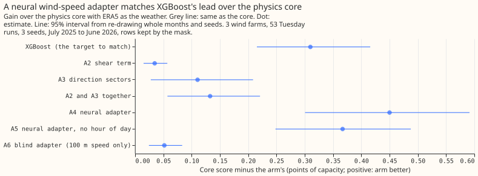
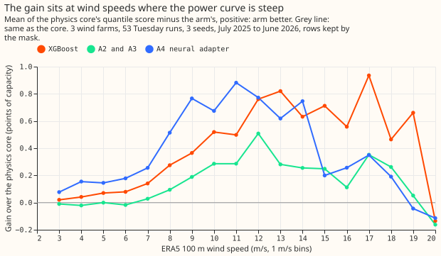
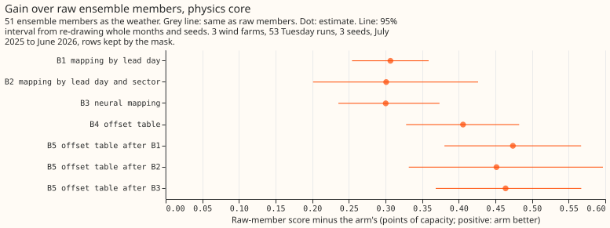
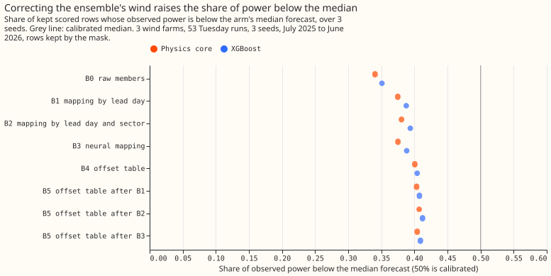
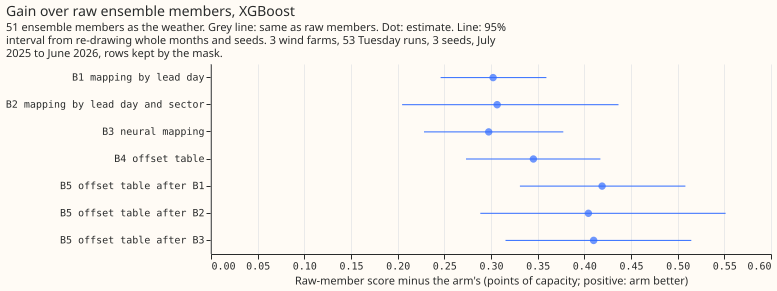

**Take-home: the physics core of a wind farm matched XGBoost once a small neural network adjusted
the wind speed it takes as input, but the wind-speed mappings fixed only a small part of the
ensemble's low bias.** With ERA5 (the ECMWF reanalysis of past weather) as the weather input, the
neural adapter scored 0.45 points better than the physics core, more than the 0.31-point lead of
XGBoost. Scores are quantile scores in points of farm capacity, and lower is better. A correction
using only wind shear (the change of wind speed with height) plus 8 wind-direction sectors closed
43% of the 0.31-point gap, and a neural adapter given only the 100 m speed closed 17%. On the 51
members of the ECMWF ensemble weather forecast, mapping each member's wind speed to ERA5's lowered
the score by about 0.3 points. The share of observed power below the median forecast (50% if
unbiased) rose only from 34.1% to 37.5%. A lookup table of power offsets (per lead day, quantile,
and farm) lowered the score by 0.41 points.

We asked whether a small, bounded correction of the wind speed could reproduce the part of XGBoost's
lead that comes from the wind speed, for the three metered wind farms (W1, W2, W3). [Experiment
276](../00276-wind-xgboost-vs-physics-gap-diagnostics/result.md) found that XGBoost beats the
physics core, the physics-based model that turns wind speed into farm power through a power curve,
by correcting the wind speed with the wind direction, the 10 m wind, and the hour of day. Part A
puts a wind-speed correction in front of the core and scores it with ERA5 as the weather, which
isolates the correction from forecast error. Part B corrects each ensemble member's wind speed
towards ERA5's before the core and XGBoost, and uses the production weather input, the ensemble. The
physics core comes from [experiment 230](../00230-wind-physics-core-part-1/result.md), the
low-bias decomposition from [experiment 261](../00261-wind-low-bias-decomposition/result.md), and
the offset table from [experiment 259](../00259-wind-plant-plus-quantile-offset-head/result.md).

**Scoring.** Scores are quantile scores (an estimate of the continuous ranked probability score) in
points of capacity. Contrasts are the first arm minus the second, so a positive number means the
second arm is better. Intervals resample whole months and the three seeds; farms are not
resampled. Both parts score experiment 33's 53 Tuesday runs from July 2025 to June 2026 (107,121
rows). "Kept rows" are the 96,479 rows outside experiment 210's idle-band mask, which removes
half-hours of near-zero wind where the metered series holds a reactive-power floor. "All rows in the
band" means every row, kept or not, whose lead is 12 to 36 hours.

**Training.** Part A trained on ERA5 before 2025-06-17 (all rows, one fit, no weekly refits). Part B
trained the core and XGBoost on ERA5 before 2024-04-01 and fitted the mappings and offsets on the
442 daily ensemble runs of 2024-04-01 to 2025-06-16. XGBoost refits use 500 rounds with column
subsampling off.

## Part A: an adapter on ERA5 wind

- **Every Part A prediction held except the blind control's bound.** A2 and A3 together closed 43%
  of the 0.31 gap (at least a quarter predicted). A4 closed 0.450 (0.301 to 0.591; at least 0.15
  predicted) and beat A2 and A3 together by 0.317 (0.169 to 0.475; at least 0.05 predicted). The
  blind adapter A6 closed 0.052 (0.024 to 0.083), just above the predicted 0.05 bound.
- **A4 and XGBoost cannot be told apart.** A4 scored 0.140 points better than XGBoost, but the 95%
  interval (-0.312 to 0.025) includes zero. Each farm gains 0.45 from A4 (W1 0.446,
  W2 0.458, W3 0.446).
- **The hour of day adds 0.083 (0.019 to 0.154).** A5 (no hour) closed 0.367 (0.248 to 0.488).
- **Shear alone helps little.** A2 closed 0.035 (0.015 to 0.057); A3 closed 0.110 (0.028 to 0.209).
- **The comparison with XGBoost is not like for like.** The XGBoost arm reads six wind columns but
  not the 2 m temperature or the hour of day; A4 reads both. The contrasts between the core and A4,
  and between A4 and A5, are like for like.
- **A4 is not over-narrow on kept rows:** 5% to 95% coverage 91.2% against 91.7% for the core, and
  54.2% of observed power below the median forecast against 52.9% for the core.
- **The gain is largest at 8 to 14 m/s**, where the power curve is steepest (second figure), as
  experiment 276 found for XGBoost.
- **Lead 12 to 36 hours (all rows in the band).** Core 5.764, XGBoost 5.494, A4 5.348.

| Arm | Score, kept rows | Score, all rows |
|---|---|---|
| A0 physics core | 6.174 | 5.834 |
| A1 XGBoost | 5.864 | 5.564 |
| A2 shear term | 6.140 | 5.803 |
| A3 direction sectors | 6.064 | 5.740 |
| A2 and A3 together | 6.042 | 5.719 |
| A4 neural adapter | 5.724 | 5.430 |
| A5 without the hour | 5.807 | 5.506 |
| A6 blind adapter | 6.122 | 5.789 |

## Part B: an ensemble-wind correction

- **Mapping raises the share of observed power below the median only to 38.1% at best, not above
  42%.** The share was 34.1% for the core on raw members (B0), 37.5% after B1, 38.1% after B2, and
  37.5% after B3, so about 62% of observed power stays above the median forecast.
- **The score fell by 0.307 (0.254 to 0.359) with B1 and 0.300 (0.236 to 0.374) with B3**, above the
  predicted 0.2. B2 gave 0.301 (0.201 to 0.426). The three mappings do not differ (B1 minus B3 is
  -0.006, -0.046 to 0.037), so lead-day quantile mapping is enough. XGBoost gains the same (0.302,
  0.307, 0.298).
- **The offset table beat the mappings by 0.1.** B4 lowered the score by 0.406 (0.328 to 0.482),
  against the predicted tie with the best mapping within 0.05. The offset table lowers the median
  forecast error more (0.591 against 0.470 for B1).
- **The stack helps.** B5 after B1 lowered the score by 0.474 (0.380 to 0.567) against raw members
  and by 0.068 (0.048 to 0.090) against B4. The best of B1 to B3 on the hindcast runs, chosen
  without looking at the scored year, is B2. B5 after B2 gained 0.046 (95% interval -0.022 to
  0.137) over B4, so that stack is not distinguishable from B4 alone. B5 after B1 or after B3 is
  distinguishable from B4.
- **The 0.99 tail improved slightly with the stack.** Pinball loss at 0.99 on kept rows: 0.680
  (B0), 0.657 (B1), 0.643 (B4), 0.638 (B5 after B1); B5 after B1 against B4 is 0.005 (0.000 to
  0.010).
- **W2 carries most of the offset table's gain.** B0 minus B4 by farm: W1 0.229, W2 0.918, W3 0.057.
  Dropping any one farm leaves the sign unchanged.
- **The members' mean 100 m wind is only 3% below ERA5's** (6.73 against 6.94 m/s, W1 hindcast
  runs). The mappings change the speed distribution only slightly, yet they lower the score by 0.3
  points; this experiment does not show the mechanism.
- **XGBoost's lead over the core is 0.120 (0.068 to 0.174) on raw members and 0.060 (0.013 to
  0.109) after the offset table.**

| Arm (kept rows) | Core | XGBoost | Core, observed below median | Core, 5% to 95% coverage |
|---|---|---|---|---|
| B0 raw members | 11.817 | 11.697 | 34.1% | 90.6% |
| B1 mapping by lead day | 11.511 | 11.395 | 37.5% | 91.5% |
| B2 mapping by lead day and sector | 11.517 | 11.391 | 38.1% | 91.9% |
| B3 neural mapping | 11.517 | 11.400 | 37.5% | 91.8% |
| B4 offset table | 11.412 | 11.352 | 40.1% | 91.9% |
| B5 after B1 | 11.344 | 11.278 | 40.3% | 92.1% |
| B5 after B2 | 11.366 | 11.293 | 40.7% | 92.2% |
| B5 after B3 | 11.354 | 11.287 | 40.4% | 92.1% |

Pinball loss at 0.01 on kept rows is 0.287 for every core arm and 0.283 to 0.284 for XGBoost, so
the lower tail does not move. Lead 12 to 36 hours (all rows in the band), core: 6.595 (B0), 6.294
(B1), 6.383 (B4), 6.209 (B5 after B1); the mapping gains more than the offset table at this lead.
The curtailment-cost metric was not scored.

## Checks

- **Median forecast minus mean forecast, kept rows, points of capacity:** physics core with ERA5
  -0.22, A4 +0.12; ensemble core -4.98 (B0), -4.86 (B1), -4.75 (B4). The large ensemble gap is the
  right skew of a mixture of 51 members, not a shift of the forecast; each arm has it equally.
- **Mean absolute error of the mean forecast, compared with each quantile-score contrast:** same
  sign everywhere (for
  example core B0 minus B1: 0.307 in quantile score, 0.167 in mean absolute error of the mean
  forecast, 0.470 for the median forecast; A4 against the core: 0.450, 0.749, 0.664).
- **Audit triggers:** the trigger for a control that moves the score by more than its interval's
  half-width fires on the blind control A6, which moved the score by 0.052, more than
  its interval's half-width of 0.03. A6 is a capacity control with a predicted bound of 0.05 and A4
  beats it by 0.40, so no result rests on it. No other trigger fires: the farm-by-farm leave-one-out
  keeps the sign of every planned contrast, and the intervals match experiment 276's for the shared
  contrast (core minus XGBoost 0.310, 0.215 to 0.416).

## Caveats and deviations

- **The 10 m wind is the only extra level on disk.** ERA5 surface pressure, dew point, and gusts
  are not on disk for these farms (experiment 276), so air density rests on the 2 m temperature.
- **ERA5 reaches us about 5 days after the weather,** so it is unavailable when a forecast is
  issued, and Part A is a ceiling that isolates the adapter. Part B uses the ensemble's own weather.
- **Deviation: loss.** The adapters were trained on the median pinball loss (the L1 loss that trains
  the core) and the quantiles come from residuals, as in experiment 276.
- **Deviation: training end.** Part B's core and XGBoost trained on ERA5 to 2024-04-01, not to
  2025-06-17, so that the hindcast months are out of sample for the offsets.
- **Deviation: B3 loss.** B3 treats each ensemble member as a quantile of ERA5 speed by its rank
  within the case.
- **The adapter arms were fitted for 1,200 Adam steps and the core for 800.** The blind adapter A6,
  fitted for 1,200 steps, gained only 0.05, so the longer fit explains little.
- **The B3 mapping and the B5 offsets are fitted on the same hindcast runs,** so the hindcast is
  in sample for them. The choice of the best of B1 to B3 on the hindcast runs rests on a spread of
  0.02 points.
- **One fit on all history, no weekly refits;** a contrast could depend on the schedule.

## What to try next

- **Test the adapter on ensemble members**, with the core retrained so the adapter sees what the
  production service sees, since Part A used ERA5.
- **Find where the ensemble's low bias sits.** The mapping changed the speed distribution slightly
  and raised the below-median share by only 3.4 points, so test the wind
  direction, the members' spread, and the timing of fronts.
- **Port the cheap pieces first:** the lead-day quantile mapping is a lookup table, and its stack
  with the offset table lowered the score by 0.07 against the table alone (the sector mapping's
  stack did not).
