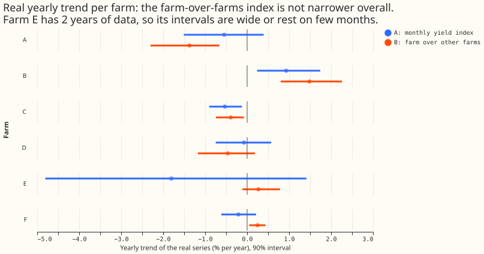
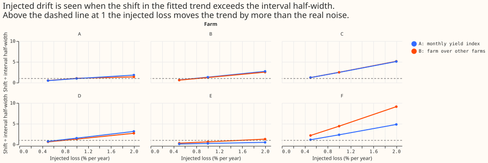
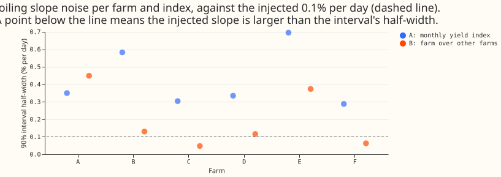

**A loss of 1 per cent of output per year is visible in 4 to 5 of the 6 metered solar farms, and a
loss under about 0.4 per cent per year is visible in only 2 (farms C and F).** A loss is visible
when it shifts the fitted yearly trend by more than the half-width of that trend's 90% interval.
Experiment 286 asks how small a yearly drift or a soiling loss the farms' output can show. We added
known losses to each farm's real half-hourly output: a loss growing linearly from a random start
date, and a soiling loss of 0.1% of output per day that resets on any day with 5 mm or more of rain
(from ERA5, the European Centre for Medium-Range Weather Forecasts' fifth-generation reanalysis).
We then read each loss back with two yield indices. [Experiment
179](../00179-metered-solar-farm-exploration/result.md), the earlier exploration of the six farms'
data, defined the plain index: each farm's power divided by the irradiance expected under a
cloudless sky, summarised per calendar month. The farm-over-farms index is new here. It divides the
farm's power by each other farm's power on half-hours when the other farms produce within 20% of
their own clear-sky output, then averages the farm pairs.

**The farm-over-farms index does not narrow the yearly trend interval overall, but of the two
indices only it reads soiling, and only at farms C and F (and at D under the looser pre-registered
rule).** The prediction needed a half-width under 0.6 %/yr at the farms with 4 or more years, and
the farm-over-farms index reaches it at 2 of 5 farms (C and F). The farm-over-farms index also
removes most of a false soiling slope. With nothing injected, the plain index reads +0.26 to +0.62
%/day at 5 of 6 farms when fitted against the days since the last day with 5 mm or more of rain,
probably because cloudier days tend to follow rainy days. The farm-over-farms index reads a slope
smaller than 0.05 %/day in size at farms B, C, D, and F, and +0.10 and +0.46 %/day at farms A and
E. The prediction therefore holds in part: the soiling half is supported, and the narrower yearly
interval is not.

## Headline numbers

- **Real yearly trends** (%/yr, 90% interval, from resampling months 500 times), the plain index
    then the farm-over-farms index. Farm A: −0.55 (−1.51 to +0.40) and −1.37 (−2.30 to −0.66). Farm
    B: +0.93 (+0.24 to +1.74) and +1.49 (+0.80 to +2.26). Farm C: −0.53 (−0.90 to −0.13) and −0.39
    (−0.74 to −0.08). Farm D: −0.08 (−0.75 to +0.57) and −0.46 (−1.17 to +0.19). Farm E (18 and 10
    months): −1.80 (−4.81 to +1.41) and +0.27 (−0.11 to +0.79). Farm F: −0.21 (−0.61 to +0.21) and
    +0.25 (+0.05 to +0.44). The plain index reproduces the trends printed on experiment 179's result
    page.
- **Interval half-width at the 5 farms with 4 or more years** (A, B, C, D, F): the plain index 0.95,
    0.75, 0.39, 0.66, 0.41 %/yr (median 0.66); the farm-over-farms index 0.82, 0.73, 0.33, 0.68,
    0.19 %/yr (median 0.68). C1 (under 0.6 %/yr) holds at 2 of 5 farms for the farm-over-farms index
    and 2 of 5 for the plain index.
- **Same months.** The farm-over-farms index keeps 48 to 56 months against 59 to 65 for the plain
    index, which widens its interval. The plain index refitted on only the months the farm-over-
    farms index kept has half-widths 0.86, 0.83, 0.37, 0.86, and 0.33 %/yr at farms A, B, C, D, and
    F, so on equal months the farm-over-farms index is narrower by 4% to 41%.
- **Drift recovery.** The injected loss comes back at a median 0.92 to 1.08 of its size with the
    plain index at the 5 farms with 4 or more years and at farm E 0.86 to 0.87. The farm-over-farms
    index returns 0.87 to 0.96 at those farms (0.60 at farm A for 2 %/yr), probably because the
    monthly calendar normalisation absorbs part of a trend, and 0.29 at farm E, which has 10 usable
    months.
- **Detection at 1 %/yr.** The shift in the fitted trend over the half-width is, for farms A to F,
    0.99, 1.32, 2.48, 1.53, 0.26, and 2.35 with the plain index, and 1.05, 1.23, 2.50, 1.32, 0.64,
    and 4.42 with the farm-over-farms index. The plan's rule (median recovery 0.7 to 1.3, and the
    injected series' own interval excluding zero in at least half the starts) is met at 4 farms at 1
    %/yr with each index, so the stop rule does not fire.
- **Minimum detectable drift** (the injected rate whose shift equals the half-width, from the median
    shift per injected %/yr, so it can sit either side of the 1 %/yr ratio above), the plain index
    then B in %/yr: farm A 1.05 and 1.01, B 0.75 and 0.81, C 0.40 and 0.40, D 0.65 and 0.76, F 0.42
    and 0.22, E 3.8 and 1.6.
- **Soiling.** Under the plan's rule, 3 farms read the injected 0.1 %/day with each index. Under the
    stricter post hoc rule (the shift exceeds the half-width in at least half the starts) the plain
    index reads it at 0 farms and the farm-over-farms index at 2 (C and F). The half-widths on the
    slope are 0.35, 0.58, 0.30, 0.34, 0.70, and 0.29 %/day for A, and 0.45, 0.13, 0.05, 0.12, 0.37,
    and 0.06 %/day for B, at farms A to F. The plan's recovery ratio is 1.00 everywhere because the
    injected change is a known multiplier and both estimators are linear in the log of the index, so
    it carries no information.
- **Compute and inputs.** One fit per farm and injection, no retraining, no weather forecast.
    Rainfall is ERA5 total precipitation (a past-weather product that arrives about 5 days late and
    so does not exist at forecast time), summed per UTC day at the nearest 0.25 degree cell.

## Checks

- **Median minus mean forecast, and mean-forecast error:** not applicable, because no forecast is
    made or scored.
- **Triggers.** The result contradicts its own prediction (C1): tested with the same-months bullet
    above, which finds that fewer months explain part of the gap, and that on equal months the farm-
    over-farms index is narrower but still above 0.6 %/yr at A, B, and D. The reproduction of
    experiment 179's trends to the printed digits is the sister-experiment check on interval width.
    The other five triggers (a failed control, the quantile and mean forecast disagreeing, leave-
    one-out, a nested arm, a later design depending on this result) do not apply. No audit was run.
- **Injected recovery is partly by construction.** An index linear in the log of the multiplier
    returns the injected multiplier exactly, so the recovery ratio only exposes attenuation from the
    calendar-month normalisation and the month filter. The informative figure is the shift over the
    half-width.
- **Real series carry their own trend.** The injected estimate adds to each farm's real trend and
    noise, so detection is judged by the shift from the un-injected estimate, not by the interval
    excluding zero (the pre-registered rule, kept as one of two).
- **Neighbours' own drift.** The farm-over-farms index measures a farm against the others, so a
    farm's real trend and its neighbours' real trends are mixed. The six the farm-over-farms index
    trends sum to −0.2 %/yr, but they cover different months (10 to 56), so they need not cancel.
- **Plan amendments before any injection result was read.** The neighbour mask uses a band of 0.8 to
    1.2 around each farm's own calendar-month 90th-percentile yield, not 0.85 to 1.15 around a
    single yearly value (the single value dropped all but 5 to 36 of 86 months); the farm-over-farms
    index needs 20 rows a month, not 40. Eight random start dates were used, not five.
- **Code review caveats.** The month filter on the relative index runs after the injection, so the
    injected and un-injected fits can keep different months when a month's index crosses 0.75. The
    minimum detectable drift is an injected rate after the start date, read through a line fitted to
    the whole history, so it is not a plain yearly rate. The days-since-reset counter runs over days
    with data, and a day without ERA5 rainfall counts as dry. No leakage of the injected series into
    the neighbour mask was found.
- **Not done.** No drift or soiling is claimed for any real farm, and the real-data stage reports
    only the trends above. Panel-plane irradiance, temperature, and the flat top of experiment 179
    (the farm-over-farms index stays under 650 W/m² to avoid it, the plain index does not) were not
    modelled.

## Open questions

- Can an independent record, such as a panel-level or inverter-level reading, show whether the real
    farm trends of −1.8 to +1.5 %/yr are drift, or are the farms' own differences from each other?
- Does a regression on irradiance on the panel plane and cell temperature narrow the yearly interval
    below the farm-over-farms index's 0.19 to 0.82 %/yr?
