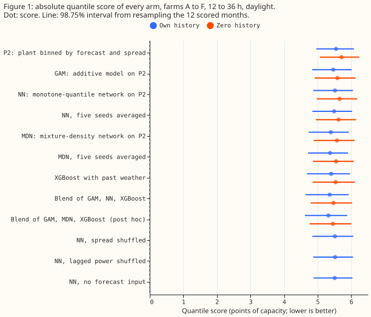
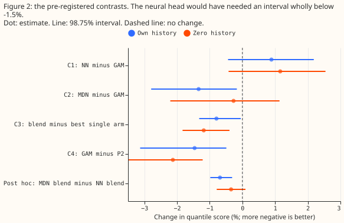
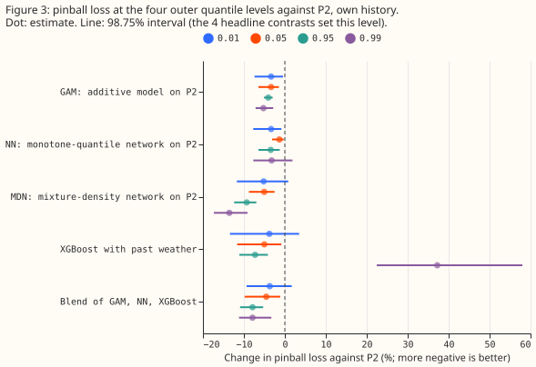
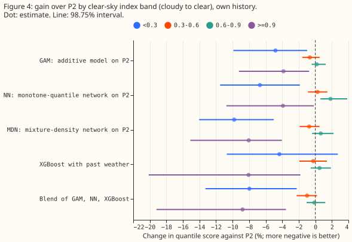

**An additive model is the better final stage for the solar-farm power model's forecast band than a
neural network that adjusts each quantile, and a neural network that outputs a probability
distribution is the only neural arm of those run that we would test again.** National Grid
Electricity Distribution (NGED) meters six solar farms, labelled A to F here. The "plant" is the
physical power model of [experiment 224](../00224-metered-farm-dayahead-two-number/result.md). "P2"
is the version from [experiment 270](../00270-metered-farm-xgboost-vs-plant-diagnostic/result.md),
which turns the plant's forecast into 11 quantiles (levels 0.01 to 0.99) using the plant's forecast
and the spread of the plant's responses to the 51 members of an ensemble weather forecast. The
"head" is the final stage that turns P2's inputs into 11 quantiles. We compared four heads: a
generalised additive model (GAM, 400 depth-one boosted trees); a neural network (NN) that adds
corrections to P2's quantiles and cannot reorder them; a mixture-density network (MDN), a neural
network whose output is a three-component Gaussian mixture; and a per-quantile blend of GAM, NN, and
[XGBoost (Chen and Guestrin, 2016)](https://doi.org/10.1145/2939672.2939785), following [experiment
260](../00260-metered-farm-quantile-combination/result.md). "Own history" means a head trains on the
farm's own earlier months, and "zero history" means it trains on the other five farms only.

**The prediction held: NN is not better than GAM.** The quantile score is twice the mean pinball
loss over the 11 levels, in points of capacity, and lower is better. NN scores 0.9% worse than GAM
in own history (98.75% interval from resampling the 12 scored months, -0.4% to +2.2%), where the
pre-registered bar was 1.5% better. MDN scores 1.3% better than GAM in own history (-2.8% to -0.2%),
which excludes zero but is not 1.5% better, and only 0.3% better in zero history (-2.2% to +1.1%,
which includes zero). The blend scores 0.8% better than XGBoost (-1.3% to -0.1%), above the 0.5%
margin below which the plan stopped at the best single arm, so the stop rule did not apply.

## Results

- **Arms.** P2 (control). GAM: depth-one quantile trees on experiment 270's six input groups,
  started from P2's quantiles. NN: two 64-unit layers, output is P2's lowest quantile plus a shift,
  then cumulative non-negative gaps, equal to P2 at initialisation up to a gap floor of 0.001. MDN:
  three Gaussian components on the residual from the plant forecast, read at the 11 levels. Blend:
  simplex weights per level, rolling origin, first three scored months equal weights. NN, MDN, and
  the controls have five seeds. XGBoost is experiment 275's XGBoost arm with past weather and an era
  flag in own history, and experiment 270's XGBoost arm on ensemble rows with all input groups in
  zero history, because experiment 275 stored no zero-history fits.
- **Row set and schedule.** Experiment 224's scored-year daylight rows at 12 to 36 h leads (farms A
  to F, 2025-09 to 2026-08). One fit per arm on the months before 2025-09, no refits, 60 epochs, the
  last two tuning months select the epoch; heads train on ensemble rows only. Forecast inputs are
  the ECMWF ensemble 00 UTC run and the farm's own power 1 or 2 days earlier, both available at
  forecast time. A weekly refit could change the absolute scores and the MDN's gain. Zero history
  trains on the other five farms only.
- **Quantile score (points of capacity; own history, interval over 12 months).** `manual_heuristic`
  8.69, `climatology` 8.64, P2 5.55 (4.96 to 6.08), NN 5.52, GAM 5.47 (4.84 to 6.01), XGBoost 5.40,
  MDN 5.39, blend 5.36, MDN blend 5.32. Zero history: P2 5.71, NN 5.65, GAM 5.59, MDN 5.57, XGBoost
  5.54, blend 5.47, MDN blend 5.45.
- **Contrasts (own history, 98.75% interval).** C1 NN minus GAM +0.9% (-0.4 to +2.2); C2 MDN minus
  GAM -1.3% (-2.8 to -0.2); C3 blend minus best single arm (XGBoost) -0.8% (-1.3 to -0.1); C4 GAM
  minus P2 -1.5% (-3.1 to -0.5). Zero history: C1 +1.2% (-0.4 to +2.5), C2 -0.3% (-2.2 to +1.1), C3
  -1.2% (-1.8 to -0.4), C4 -2.1% (-3.5 to -1.2).
- **Seed averaging.** Averaging NN's five seeds before scoring lowers NN's score by 0.4% (own
  history) and 0.5% (zero history) but leaves NN 0.4% worse than GAM (-0.9% to +1.7%). The same
  average lowers MDN's score by 0.4%.
- **The controls show the head adds nothing beyond P2 from spread, lagged power, or the forecast
  input.** NN's score minus each control's (own history): shuffled spread +0.02% (-0.4 to +0.7),
  shuffled lagged power -0.08% (-0.8 to +0.6), no forecast input +0.10% (-0.3 to +0.5). The controls
  change nothing, so NN's small gain over P2 (-0.6%, -3.0 to +0.5) does not come from those inputs.
  P2 supplies the base quantiles in every control, so the controls do not show that spread and
  lagged power are useless.
- **Pinball loss change against P2 (own history, %).** At 0.99: GAM -5%, MDN -14%, blend -8%,
  XGBoost +37% (22 to 58). At 0.95: GAM -4%, MDN -9%, blend -8%, XGBoost -7%. At 0.05: GAM -3%, MDN
  -5%, blend -5%, XGBoost -5%. At 0.01 only GAM and NN (both -3%) have intervals that exclude zero.
- **Coverage (own history, nominal 0.01, 0.05, 0.95, 0.99).** GAM 0.037, 0.070, 0.949, 0.987; MDN
  0.037, 0.072, 0.947, 0.984; blend 0.036, 0.071, 0.958, 0.992; XGBoost 0.037, 0.073, 0.957, 0.995.
  Actual power falls below the 0.01 quantile 3.6 to 3.7 times too often and below the 0.05 quantile
  1.4 times too often, for every arm.
- **Where the gain sits (own history, change against P2).** Clear-sky bands: below 0.3 the blend is
  8% better and MDN 10%; at 0.3 to 0.9 no arm differs from P2 by more than 1.8%; at 0.9 and above
  the blend is 9% better and MDN 8%. Lead 12 to 24 h: blend -3.9%; 24 to 36 h: blend -2.8%. Season:
  December to February is where the gain is, blend -13% and XGBoost -13%, with June to August -2%.
  Per farm, MDN beats GAM at all six farms and NN is no better than GAM at any farm.
- **Curtailment cost.** Not scored: the node-plus-generators metric needs a substation node with its
  generators, and these six farms are single series.

## Checks

- **No arm's median forecast sits far from its mean forecast (own history, per farm, in points of
  capacity).** Median minus mean: NN -0.02 to 1.0, GAM -0.2 to 0.6, MDN -0.04 to 1.05, XGBoost -0.75
  to 0.09, P2 0.16 to 0.46. No arm's median sits more than about 1 point of capacity from its mean
  forecast.
- **Error of the mean forecast beside each score contrast.** C2: mean-forecast error +0.2% (-1.2 to
  +1.8) and median error -0.5% (-2.0 to +1.1), against a score change of -1.3%, so MDN's gain is in
  the tails and not in the central forecast. C1: mean-forecast error +1.1% (-0.3 to +2.6). C3: mean
  error -1.7% (-2.8 to -1.1).
- **No audit trigger fired.** Trigger 3 (score and mean-forecast contrasts pointing different ways)
  was close for C2, but both central-forecast intervals include zero. Dropping each farm in turn
  leaves C2 between -1.2% and -1.5%, C1 between +0.6% and +1.1%, and C3 between -0.7% and -1.0%, so
  no farm drives a contrast.
- **Design after code review.** Each shuffle control uses a different permutation for each seed.
  Every arm is checked to hold the same rows. The best single arm for C3 is chosen once, on the
  overall score. NN and MDN are also scored as the average of their five seeds' quantiles. P2 is
  fitted on the months that select the training epoch, which favours stopping early. A 24 h lead
  needs the power at midnight, which no daylight row scores, so the lag boundary does not matter.

## Caveats and next steps

- **Post hoc.** The MDN blend was added after the results and was not pre-registered. The best
  single arm of C3 is chosen on the scored year (XGBoost in both settings), which is conservative
  for the blend. The 98.75% level covers the four pre-registered contrasts only; all other rows are
  exploratory.
- **Weather at lag.** Forecast inputs are ensemble weather at forecast time; no past-weather rows
  train the heads, and XGBoost's past-weather rows use CAMS irradiance and ERA5 temperature, which
  arrive about 5 days late, so XGBoost's score in a live service would be worse than reported here.
- **Not run.** A plant arm using experiment 282's pooled empirical shape and a plant arm with a
  20-degree tilt were not run. Both arms need the 51 members' responses recomputed with a new panel
  geometry, which is not cheap.
- **Next.** A weekly refit of MDN on the longest history would show whether its 1.3% gain survives.
  If it does, a convex mixture of the additive model's quantile offsets would be the explainable
  alternative.
