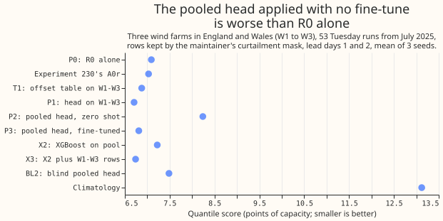
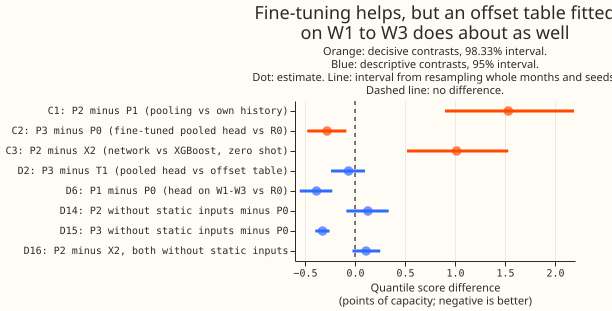
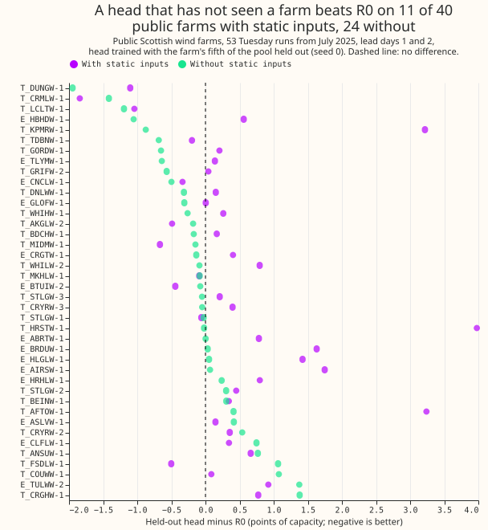
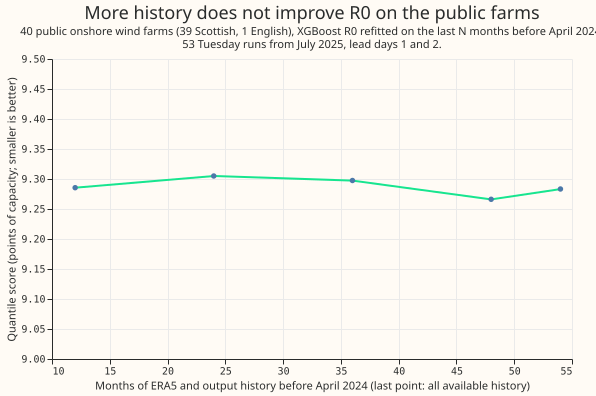

We asked whether a small neural network can improve a wind forecast for three wind farms on the
electricity network of National Grid Electricity Distribution (NGED), after learning from the
published output of 40 other wind farms. The network adjusts the 11 quantiles of the XGBoost wind
forecast (called R0 below, fitted on ERA5 weather estimates), and the three NGED farms are called
W1 to W3. The 40 public farms are nearly all in Scotland, and W1 to W3 are in England and Wales.
We trained the network on the 40 farms and compared its corrections with the ones learned from
W1 to W3's own records. Applied with no training on W1 to W3 (zero shot), the network made the
forecast worse. The quantile score, a measure of how well the forecast's range of likely outputs
matches what happened (smaller is better), rose from 7.09 to 8.24 points of capacity, on
forecasts one and two days ahead. After fine-tuning on W1 to W3's own records, the score fell to
6.81. A simple table of corrections per lead day and quantile, fitted on those records, scored
6.88. An audit by a second language-model reviewer found that three static inputs (capacity,
turbine rating, and hub height) let the network memorise each of the 40 farms, which caused most
of the damage. We reran every variant of the experiment (each called an arm below) without them,
and report those runs as a diagnostic. The hypothesis that a head trained on public farms
improves the forecasts for W1 to W3 is not supported (verdict `not supported`). The method
follows [experiment 259](../00259-wind-plant-plus-quantile-offset-head/result.md), which
corrected the XGBoost forecast of [experiment 230](../00230-wind-physics-core-part-1/result.md)
in the same way.

Contains Balancing Mechanism Reporting Service (BMRS) data © Elexon Limited copyright and
database right 2026.

## Results

**Two of the three decisive contrasts fail their predictions.** The third fails on its tail
condition. Each interval is the 98.33% interval from resampling whole months and the three seeds, on
W1 to W3's kept rows at lead days 1 and 2. Intervals of descriptive contrasts elsewhere on this page
are 95% intervals.

| Contrast | Prediction | Estimate | Interval | Same contrast on the mean forecast's error |
|---|---|---|---|---|
| C1: P2 minus P1 | at most -0.10 | +1.534 | +0.900 to +2.189 | +2.040 (+1.076 to +3.027) |
| C2: P3 minus P0 | -0.30 to 0.00, and 0.99 pinball loss 5% lower | -0.279 | -0.477 to -0.086 | -0.083 (-0.389 to +0.227) |
| C3: P2 minus X2 | at most -0.03 | +1.016 | +0.520 to +1.532 | +1.646 (+0.861 to +2.466) |

- **C1:** the pooled head with no fine-tune is worse than the head trained on W1 to W3 alone, by
  more than the interval's width.
- **C2:** the score gain falls inside the predicted range, but the 0.99 pinball loss did not fall.
  P3's 0.401 against P0's 0.402 is a difference of -0.001 (95% interval -0.008 to +0.007), not 5%.
  The decision rule's porting threshold, C2 wholly below zero, is met. The verdict is nonetheless
  `not supported`, because the prediction's second condition fails, C1 and C3 fail, and the plan's
  "Reading the results" section says C2 alone does not license a port when P3 gains no more than the
  offset table T1 (D2).
- **C3:** the zero-shot network is worse than the XGBoost model trained on the pool with no
  fine-tune (X2), so the non-neural stage is preferred.
- **Mean forecast against the median:** the quantile score judges the whole distribution, and the
  forecast's median sits below its mean by 1.6 points for R0 and 1.0 for P3 (kept rows, lead days 1
  and 2). C2's gain on the mean-forecast error is -0.083 with an interval that includes zero, so the
  median improved and the mean did not.

**Fine-tuning recovers only what W1 to W3's own runs would give.** P3 minus T1 is -0.064 (interval
-0.240 to +0.101), P3 minus P1 is +0.106 (-0.017 to +0.232), and X3, the XGBoost stage trained on
the pool plus W1 to W3's rows, scored 6.740 against P3's 6.812 (X3 minus P3 -0.072, -0.209 to
+0.069). The pool's mean offset therefore did not measurably help beyond the offset table. P1 minus
P0 is -0.385 (-0.552 to -0.227), reproducing experiment 259's gain from a head on the three farms.

| Arm | Hours 12 to 36 | Days 1 and 2 | Days 3 to 6 | Days 7 and later | All leads |
|---|---|---|---|---|---|
| P0 (R0 alone) | 6.63 | 7.09 | 10.44 | 13.89 | 11.70 |
| T1 (offset table on W1 to W3) | 6.43 | 6.88 | 10.02 | 13.21 | 11.17 |
| P1 (head on W1 to W3) | 6.21 | 6.71 | 10.03 | 13.28 | 11.17 |
| P2 (pooled head, zero shot) | 7.95 | 8.24 | 10.76 | 13.86 | 11.98 |
| P3 (pooled head, fine-tuned) | 6.31 | 6.81 | 10.07 | 13.29 | 11.20 |
| X2 (XGBoost stage on the pool) | 6.80 | 7.22 | 10.20 | 13.57 | 11.47 |
| X3 (X2 plus W1 to W3 rows) | 6.21 | 6.74 | 9.94 | 13.20 | 11.11 |
| BL2 (blind pooled head) | 7.03 | 7.48 | 10.72 | 14.24 | 12.03 |
| Climatology | 12.87 | 13.12 | 13.88 | 13.48 | 13.55 |

Quantile score in points of capacity on the kept rows; smaller is better. Experiment 230's stored
A0r scored 7.028 at lead days 1 and 2.

| Arm | q01 | q05 | q50 | q95 | q99 | 5% to 95% coverage | 1% to 99% coverage |
|---|---|---|---|---|---|---|---|
| P0 | 0.259 | 1.128 | 5.004 | 1.460 | 0.402 | 0.942 | 0.982 |
| P1 | 0.248 | 1.046 | 4.735 | 1.430 | 0.396 | 0.906 | 0.973 |
| P2 | 0.279 | 1.208 | 5.942 | 1.640 | 0.435 | 0.914 | 0.984 |
| P3 | 0.261 | 1.063 | 4.795 | 1.443 | 0.401 | 0.906 | 0.980 |
| X2 | 0.259 | 1.128 | 4.993 | 1.572 | 0.418 | 0.956 | 0.984 |

Pinball loss at each level (points of capacity) and coverage of the 5% to 95% and 1% to 99% bands,
kept rows, lead days 1 and 2. The tails barely move between arms. Every head's 5% to 95% band
(0.906 to 0.914) is narrower than R0's (0.942), and all of them sit above the 0.90 target.

**The blind-share prediction cannot be evaluated.** BL2 (the blind pooled head) minus P0 is +0.394
and P2 minus P0 is +1.149. The prediction divides BL2's gain over P0 by P2's gain over P0. Both
arms are worse than P0, so their ratio (0.34) has no meaning.

## The public farms

- **Region:** of the 40 kept farms, 39 are in Scotland and 1 is in England. The register held no
  Welsh farm that passed the checks. C1 to C3 therefore test transfer from Scotland to England and
  Wales, and the plan's region arm (at least 3 kept farms in England or Wales) did not apply.
- **Size:** the kept farms span 4.7 to 181 MW of capacity and turbine ratings of 0.66 to 4.48 MW;
  27 of 40 have a hub height predicted from turbine rating, because REPD gives none. W1 to W3's
  capacities and ratings are private and were not compared.
- **Selection:** 65 candidate wind farms, of which 52 passed the checks and 40 (the longest
  histories) were kept. The plan's stop rules
  passed: far more than 15 farms qualified, and R0 scored worse than climatology at lead days 1 and
  2 on 1 of 40 farms (mean quantile score over the 40 farms: R0 9.29, climatology 15.17).
- **Held-out fifth:** a head trained on the other four spatial blocks scored 9.731 on its held-out
  farms. That is 12.8% worse than the same farms scored by the all-farm head (8.627), and worse than
  R0 (9.283); the plan predicted within 5%. It beat R0 on 11 of 40 held-out farms. Without the
  static inputs the held-out head scored 9.224, 4.4% worse than the all-farm head without them
  (8.836), and beat R0 on 24 of 40 farms. The audit's own retrain used random seed 0 only and
  reported +3.9% and 19 of 40 farms; the figures here come from the final run of
  `e00288_pool_score.py`.
- **Curtailment drop:** the plan dropped half-hours with a bid-offer acceptance, and half-hours
  where the final physical notification exceeds metered output by more than 5% of capacity. The
  second rule removed 35% of half-hours at the median kept farm (range 20% to 83%), because the
  notification is the operator's own forecast and exceeded metered output in that share of
  half-hours. Dropping on that rule also keeps the half-hours where the farm outproduced its own
  forecast. The primary clean set therefore drops acceptance half-hours only (median 3.6%, at most
  10.4% on the kept farms). The notification rule is written to a separate file for a sensitivity
  run that was not made.

**More history changed R0's score on the public farms by less than 0.02 points.** R0 refitted on
the last 12, 24, 36, and 48 months scored 9.285, 9.305, 9.298, and 9.266 (quantile score, points of
capacity, lead days 1 and 2), against 9.283 on all available history. The plan's learning-curve
prediction (a gain of at least 0.15 points from 24 to 48 months) was written for W1 to W3. This
curve covers the public farms only.

## After the audit: the static inputs

**The three static inputs identify each public farm.** The head used them to memorise
farm-specific offsets. An Opus audit, which two rules triggered, found this. The result
contradicted its prediction, and the blind head BL2 beat the full head P2 (the head with the static
inputs) by 0.755 points. The audit found no leakage, no scale mismatch between the public farms and
W1 to W3, and no difference in how the spread factor was fitted. All 40 public farms have a
distinct combination of log capacity, turbine rating, and hub height, and a head given 3 random
numbers per farm fitted the training farms as well as one given the real inputs. W1 to W3 received
the pool's median turbine rating and hub height, a pair the head never saw in training. The head
therefore raised the median forecast by 0.10 to 0.135 points of capacity in the middle bins, where
about 0.03 was needed. We reran every head and XGBoost arm with the three inputs set to zero. These
runs are labelled "without static inputs". They were not pre-registered and are diagnostic.

| Arm, days 1 and 2 | With static inputs | Without static inputs |
|---|---|---|
| P2 (pooled head, zero shot) | 8.239 | 7.219 |
| P3 (pooled head, fine-tuned) | 6.812 | 6.766 |
| X2 (XGBoost model on the pool) | 7.223 | 7.108 |
| X3 (X2 plus W1 to W3 rows) | 6.740 | 6.955 |
| BL2 (blind pooled head) | 7.484 | 7.337 |
| P1 (head on W1 to W3) | 6.706 | 6.802 |

- **Zero shot:** P2 without static inputs minus P0 is +0.128 (95% interval -0.086 to +0.337), so the
  pooled head is level with R0, because the interval includes zero. P2 minus P1 is still +0.513
  (+0.213 to +0.831), so C1's prediction still fails, and P2 minus X2, both without static inputs,
  is +0.111 (-0.025 to +0.252), so C3's does too.
- **Fine-tuned:** P3 without static inputs minus P0 is -0.325 (-0.397 to -0.255) and its 0.99
  pinball loss is 0.407 against P0's 0.402, so the tail does not improve. P3 without static inputs
  minus the offset table T1 is -0.110 (-0.233 to +0.002), a margin smaller than the half-width of its
  interval. P3 without static inputs minus P3 with static inputs is -0.046 (-0.233 to +0.128).
- **Verdict:** the pre-registered verdict stands. The diagnosis changes: the zero-shot failure came
  mainly from the three static inputs, and these results do not rule out transfer from a Scottish
  pool to farms in England and Wales.

## What was not done

- **W1 to W3's learning curve and the core-only arm** were not run, so the claim that XGBoost
  keeps improving to 48 months of history while the physics core is flat is untested here. The
  public farms' curve is flat.
- **The public-farm base model applied to W1 to W3, and the no-drop and notification-rule
  sensitivity runs,** were not run. All three would have tested the same transfer failure from a
  different side, and the result of every arm that uses the pool already answers the question.
- **The pool's held-out check used one seed, not five.**

## Checks

- **Median minus mean forecast (kept rows, days 1 and 2):** the median forecast sits below the mean
  forecast by 1.62 points for P0, 0.90 for P1, 1.03 for P3, and 0.84 for P2. Mean-forecast error is
  beside each quantile contrast above.
- **Audit triggers fired:** the result contradicts its own prediction (C1, C3, and the held-out
  check), and a nested arm beats the arm that contains it (the blind head BL2 scores 0.755 points
  better than the full head P2, D10). The Opus audit's findings are in the section above. Triage:
  the static-input cause was accepted and every arm rerun without them; the minor point that early
  stopping never considers the untrained head (epoch 0) was accepted and left as a limitation; the
  findings that leakage, target scale, and the spread factor were sound needed no change.
- **Retraining schedule:** every R0 model is fitted once on ERA5 before 2024-04-01; heads are
  trained once on runs before 2025-04-16. No rolling retraining.
- **Tail calibration:** coverage and pinball losses at 0.01, 0.05, 0.95, and 0.99 are in the table
  above.

## What the next experiment should answer

**Does a pooled head trained without farm-identifying inputs help once the base model's bias is
removed?** Without static inputs the zero-shot head was level with R0, so a later experiment could
retest the pool with those inputs left out, and with public farms in England and Wales if any pass
the checks. A cheaper question is whether more of W1 to W3's own history helps the XGBoost
model, which the unrun learning curve on W1 to W3 would answer.
