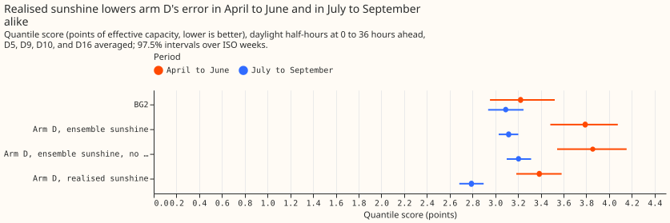
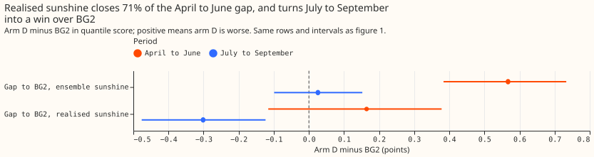
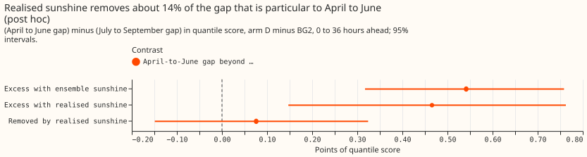
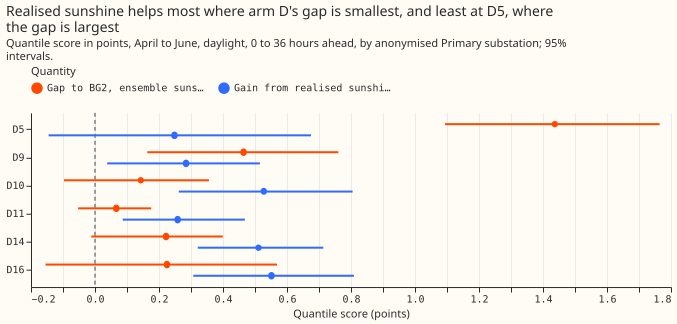
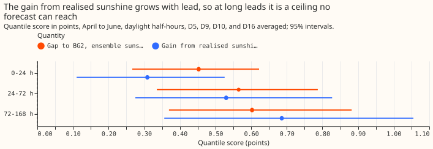

**If the best-guess stack were given the sunshine that actually happened, its April to June gap to
BG2 would shrink by about 70%. The same change helps almost as much in July to September, so the
sunshine input explains little of what is particular to April to June.** BG2 is the production-style
XGBoost forecast. The stack's base engine (arm D) predicts demand from an ensemble weather forecast.
We re-ran that engine with realised sunshine (the CAMS satellite irradiance estimate) in place of
the ensemble's sunshine at the forecast hours, and measured how much of arm D's gap to BG2
disappears. Nothing was refitted. Realised sunshine is not available at forecast time, so the result
is a ceiling for a better sunshine input.

Scores are quantile scores in points of effective capacity (a substation's rated demand), and lower
is better. "Arm D minus BG2" is positive where arm D is worse. [Experiment
266](../00266-summer-gap-diagnostics-solar-term/result.md) located the gap at D5, D9, and D10 and
cleared the ensemble sunshine only by an agreement test; this experiment tests it directly. The
method of adding a per-row shift to arm D's quantiles follows [experiment
251](../00251-dp-final-best-guess-assembly-clip-and-coast-against-bg2/result.md)'s clip arm.

## Results

- **Verdict `partly supported`.** The pre-registered rule says the ensemble sunshine is implicated:
  the gain from realised sunshine is 71% of the quantile-score gap (P1 held) and 70% of the
  mean-absolute-error gap (P2 held), both with intervals above zero. The negative control, which the
  plan added after review, weakens that reading, so the verdict stops short of `supported`.
- **Headline (April to June, daylight, 0 to 36 hours ahead, D5, D9, D10, and D16 averaged, 97.5%
  intervals over 14 ISO weeks).** BG2 scores 3.223 (2.954 to 3.523) and arm D with ensemble sunshine
  3.790 (3.484 to 4.077), a gap of +0.567 (+0.384 to +0.733). Arm D with realised sunshine scores
  3.387 (3.186 to 3.583), a gap of +0.164 (-0.116 to +0.378).
- **C1, quantile score: ensemble minus realised sunshine is +0.403 (+0.154 to +0.680).** C2, mean
  absolute error of the median forecast: +0.715 (+0.260 to +1.217), against a gap of +1.021 (+0.721
  to +1.285) points of effective capacity, which is 70%. The median and the mean forecast of arm D
  are identical, so the median stands for the mean.
- **Negative control (July to September, same rows).** The gap to BG2 is +0.026 (-0.099 to +0.152),
  and realised sunshine still lowers arm D's score by +0.327 (+0.176 to +0.470), 81% of its April to
  June gain. With realised sunshine arm D beats BG2 by 0.301 points there (-0.476 to -0.123).
- **Post hoc: the gap particular to April to June.** The April to June gap minus the July to
  September gap is +0.541 (+0.317 to +0.758) with ensemble sunshine and +0.466 (+0.147 to +0.763)
  with realised sunshine. The swap removes +0.076 of it (-0.149 to +0.324), 14%; the same reading on
  mean absolute error gives 15%.
- **Calibration versus input.** Setting the irradiance ratio and the solar shrink to 1 on the
  ensemble raises the score by 0.066 (interval -0.010 to +0.137), so the calibration helps slightly;
  the whole gain comes from the realised input.
- **By substation (0 to 36 hours, 95% intervals).** The gap and the gain are D5 +1.437 and +0.248
  (-0.145 to +0.675), D9 +0.464 and +0.285 (+0.038 to +0.515), D10 +0.143 and +0.527, D16 +0.225 and
  +0.551, D11 +0.066 and +0.258, and D14 +0.222 and +0.511. Realised sunshine helps least at D5,
  where the gap is largest.
- **By lead band (decision Primaries).** The gap and the gain are +0.453 and +0.309 at 0 to 24
  hours, +0.565 and +0.530 at 24 to 72 hours, and +0.603 and +0.686 at 72 to 168 hours. The gain
  grows with lead and exceeds the gap at long leads, so it is a ceiling there.
- **Tail calibration (April to June, daylight, 0 to 36 hours, decision Primaries).** Coverage and
  pinball loss, BG2 then arm D with ensemble sunshine then arm D with realised sunshine, are 0.015,
  0.019, and 0.012 at the 0.01 quantile (pinball 0.203, 0.263, 0.236); 0.052, 0.075, and 0.049 at
  0.05 (0.676, 0.924, 0.808); 0.976, 0.922, and 0.932 at 0.95 (0.985, 1.031, 0.938); and 0.993,
  0.969, and 0.977 at 0.99 (0.340, 0.324, 0.289). Arm D's upper tail is under-covered under both
  inputs. The curtailment-cost metric was not run, because it needs the node and generator forecasts
  that this swap does not produce.
- **Data and schedule.** The 561,207 rows of experiment 251, with experiment 136's monthly fits (no
  refit) and weekly-block intervals; D11 and D14 are reported beside the decision Primaries. The
  ensemble temperature is unchanged in every arm. CAMS sunshine was missing at no scored half-hour.
- **What this cannot tell.** The shift keeps arm D's stored quantile widths, which came from
  ensemble residuals, so the quantile score understates what realised sunshine would do to the
  spread. The monthly fits were trained on calibrated ensemble sunshine, so realised sunshine is
  slightly out of distribution, and the offset tables and recipe R of arm D are not re-simulated.
  One year gives 14 ISO weeks per season.
- **What the next experiment should answer.** Refit arm D with realised sunshine as the solar driver
  in April to June, to see whether the excess is in the solar term itself, and look at D5's and D9's
  solar term in those months.

## Checks

- **Gates.** P0 held: the engine with ensemble weather reproduces experiment 136's stored mean
  exactly (largest difference 0.0 at all six substations). Arm D minus BG2 in April to June over all
  rows and six substations is +0.322 (+0.199 to +0.438), the +0.319 of experiment 266 within 0.005.
  P0b held on the mean: the engine's irradiance from CAMS differs from the cache's by -0.002 W/m² on
  average over April to June 2026 at D5, with half-hour differences up to 24 W/m² (mean irradiance
  221 W/m²) from re-spreading each hour by the sun's height.
- **Median minus mean forecast.** 0.0 at all six substations, because arm D's quantiles are
  symmetric about the mean.
- **Error of the median beside the quantile score.** The mean absolute error contrast (+0.715) and
  the quantile-score contrast (+0.403) agree in sign in every subset reported above.
- **Triggers.** Trigger 5 fired: the July to September control, which should change nothing, moved
  the score by +0.327, more than its half-width of 0.15. The page reads this as the finding that
  realised sunshine improves every season. The audit's findings are triaged in the pull request.
  Triggers 1 to 4 and 6 did not fire. Trigger 7 applies if a later design depends on this reading.

## Plan

- **Weather swap.** Arm D's base engine is experiment 136's A2 (monthly fits, ensemble-driven, with
  the Kalman filter). Re-forecast it with the ensemble's shortwave replaced by realised CAMS
  irradiance at the forecast's target half-hours only (the analysis proxy and the filter's past
  residuals stay as stored), with the irradiance ratio set to 1 and the solar shrink to 1. The
  monthly fits were trained on calibrated ensemble irradiance, so the realised input is slightly out
  of distribution; a second arm with ensemble irradiance and the same identity calibration
  separates the calibration effect from the input effect. Temperature stays the ensemble's, so only
  sunshine changes. Nothing is refitted.
- **Arm D with realised sunshine.** Add the per-row change in the base engine's mean to every
  quantile of stored arm D, the method experiment 251 used for its clip arm. The offset tables,
  winter night offset, and recipe R of arm D are not re-simulated; this is a caveat.
- **Rows.** The six stored Primaries, April to June daylight half-hours (clear-sky irradiance above
  20 W/m²); the decision Primaries D5, D9, D10, and D16 are the pooled headline, and D11 and D14
  are reported beside them.
- **Gate (P0).** The re-forecast with ensemble weather must reproduce experiment 136's stored A2
  mean.
- **Stratification.** Results are reported by lead band (0 to 24, 24 to 72, 72 to 168 hours) and
  per substation; the decision uses 0 to 36 hours. A lead of 72 hours or more is an upper bound
  only, since no forecast has that sunshine.
- **Reported:** absolute quantile score and mean absolute error for BG2, arm D with ensemble
  sunshine, arm D with realised sunshine, and the base engine alone; tail coverage and pinball loss
  at 0.01, 0.05, 0.95, and 0.99; per-substation results.
- **Caveat.** CAMS sunshine exists only after the fact, so arm D with realised sunshine is a
  ceiling for an improved sunshine input, not a deployable forecast.
- **Checks.** Median minus mean forecast per site, the mean-forecast error beside the quantile
  score, and the audit triggers, recorded in the write-up.
- **Earlier advice followed.** Judge any change on April to June at D5, D9, and D10 as well as the
  whole year (experiment 266).
