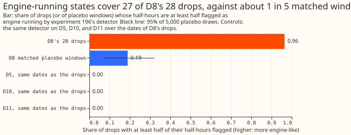
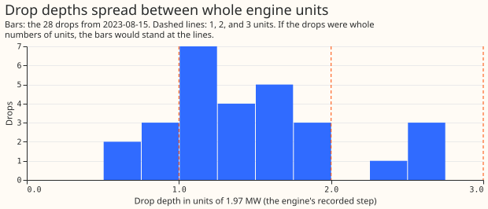
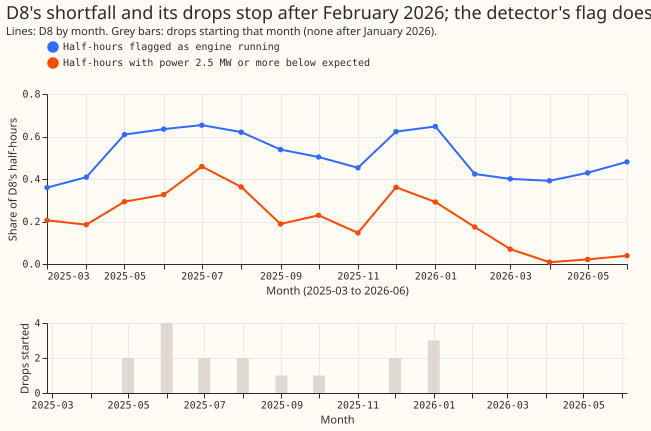

**D8's multi-day drops coincide with the engine detector's running states, which is consistent with
one gas engine running, but this experiment cannot prove it.** D8 is one of the 16 Primary
substations of the trial. In 27 of its 28 drops that began after 2023-08-15, the engine detector
flags at least half of the half-hours. The detector flags the same share in only about one in five
matched windows of D8, and in none of the drops' dates at three other Primaries (D5, D10, and D11).
The depths of the drops do not stand at whole multiples of one engine unit, so the second part of
the prediction failed, and the verdict is `partly supported`: one of the two tests in the decision
rule held.

**We asked whether D8's drops coincide with a gas engine running.** A drop is a stretch of 2 to 19
days in which D8's metered power sat about 2.7 MW below the power that the fitted expected-power
model of experiment
[159](../00159-switching-d8-multi-day-drops-recurrence-and-report/result.md) predicted. That
experiment found 29 drops. The first, in 2022, predates the engine's disappearance from D8's
reading (experiments
[194](../00194-ps1-ps5-generator-visibility-d8-analogue-break-and-price-following-census/result.md)
and
[196](../00196-ps2-quantised-engine-detector-on-d8-with-known-answer-gate/result.md)), so 28 drops
are scored. The engine has up to three units of about 2 MW each. The detector of experiments 196
and [199](../00199-ps2b-engine-detector-v2-ramp-night-price/result.md) gives, for each half-hour,
the probability that one or more units run. We call a half-hour "flagged" when that probability
exceeds 0.5, and a drop "overlapping" when at least half of its half-hours are flagged. We compared
the number of overlapping drops with the same number in 5,000 draws of placebo windows. A placebo
window has the length of a drop, lies a whole number of weeks away, and avoids every drop. We also
checked whether the drops' depths are whole numbers of one unit (1.97 MW), and whether the
load-shift alarms of D8 fall inside the engine's spells.

## Figures

*Figure 1. The detector flags at least half of the half-hours in 0.96 of D8's drops, in 0.19 of
matched placebo windows, and in none of the drops' dates at D5, D10, and D11.*

*Figure 2. The depths spread across 0.6 to 2.7 units, with the most drops between 1.0 and 1.25
units.*

*Figure 3. D8's shortfall fades from March 2026 and no drop starts, but the detector still flags
39% to 48% of half-hours.*

## Results

**The detector flags most drops and few matched windows.**

- **Overlap (arm v1, all half-hours of each drop):** 27 of 28 drops (0.96; Wilson 95% interval 0.82
  to 0.99). In the placebo windows 0.19 overlap, so 5.2 drops are expected (95% of draws 2 to 9;
  one-sided p 0.0002). On average 0.70 of a drop's half-hours are flagged.
- **Two periods:** from 2023-08-15 to 2025-02-28, 10 of 11 drops overlap (placebo 0.12). From
  2025-03-01, 17 of 17 overlap (placebo 0.23). Experiment 196 found that the detector over-flags D8
  from March 2025, and outside the drops the detector flags 0.46 of D8's half-hours from then,
  against 0.31 before.
- **Night half-hours only (arm N, which does not decide the verdict):** 14 of 28 drops overlap
  (0.50; 0.33 to 0.67), against a placebo of 0.05 (p 0.0002). The direction agrees with arm v1.
- **Controls:** at D5, D10, and D11, 0 of 28 drops' dates have at least half of their half-hours
  flagged (placebo windows 0.00 to 0.01). A regional cause such as shared weather therefore does not
  explain the overlap.

**The depths of the drops do not stand at whole units.**

- **Unit:** the unit estimated from the engine's recorded output is 1.93 MW (95% interval 1.91 to
  1.95). The plan fixed 1.97 MW.
- **Depths:** the mean distance of the 28 depths from the nearest multiple of one unit is 0.287
  units (0.233 to 0.342) at 1.97 MW, 0.277 at 1.93 MW, and 0.230 at 1.75 MW. A uniform spread gives
  0.25, and the prediction needed the interval wholly below 0.25. Depths from 2023-08-15 to
  2025-02-28 (11 drops, median 3.6 MW) give 0.319, and depths from 2025-03 (17 drops, median
  2.4 MW) give 0.266.
- **Steps at the drops' edges:** the onset steps give 0.214 (0.159 to 0.273, p 0.046) at 1.97 MW but
  0.222 at 1.75 MW (p 0.24). The end steps give 0.258 (0.207 to 0.307).
- **Possible reason:** the 24-hour median of D8's residual outside the drops (metered power minus
  expected power) has a standard deviation of 1.20 MW before March 2025 and 0.91 MW after, about
  half of one unit. The test may therefore be unable to resolve whole units at this noise. We have
  not tested that explanation, so the failed prediction neither supports nor refutes the engine.

**The drops sit in dearer half-hours, and none began after January 2026.**

- **Timing:** onsets fall in the 6-hour blocks 0 to 6, 6 to 12, 12 to 18, and 18 to 24 UTC 11, 3, 4,
  and 10 times (chi-squared p 0.067), and ends 6, 4, 6, and 12 times. No weekday stands out
  (onsets p 0.48).
- **Price:** the mean system-price fifth across a drop is 3.45, against 3.03 in matched placebo
  windows (paired Wilcoxon p 0.001). The engine runs in 26% of the dearest fifth and 9% of the
  cheapest (experiment 194). The onsets themselves do not rise with price: by fifth, cheapest to
  dearest, they number 6, 8, 7, 2, and 5.
- **After March 2026:** no drop starts from 2026-03-01 to 2026-06-24, against 5.4 expected at the
  rate of the previous 12 months (17 drops; Poisson probability of none 0.0045). The share of D8's
  half-hours with power 2.5 MW or more below expected falls from 0.17 in February 2026 to 0.008 in
  April, but the detector's flag share stays at 0.39 to 0.48.

**Most of D8's load-shift alarms lie inside engine spells, but spells cover most of the time.**

- **Spells:** the detector's flagged runs, joined across gaps of up to 3 hours and widened by 3
  hours either side, cover 0.73 of D8's half-hours from 2023-08-15. Every share of alarms inside
  spells has to be read against 0.73.
- **RO-NC alarms:** of the 27 unexplained alarms of the refit-offset neighbour-count detector
  (RO-NC) from 2023-08-15, 26 lie inside a spell (expected 19.8, p 0.002), and 21 lie within 3 hours
  of a spell's start or end (expected 13.8, p 0.004). Five lie inside a drop (3.5 expected).
- **Experiment 195 alarms:** the pair alarm, the learned score, and the re-ranker of experiment
  [195](../00195-switching-neural-plus-detector-features/result.md) have all of their 60, 36, and 36
  alarms inside a spell (expected 44.0, 26.4, and 26.4).
- **Share of unexplained alarms at D8 and D9:** the two Primaries supply 61 of the 148 unexplained
  alarms in the false-alarm analysis of the alarms of experiment
  [130](../00130-ro-nc-detector-on-the-gam-k-residual/result.md) (0.41). The 26 alarms inside spells
  exceed the random-time expectation by 6.2 alarms. Counting only that excess leaves D8's and D9's
  share at 0.37 (0.39 if the 6.2 alarms also leave the total of 148). Counting all 26 gives 0.24
  (0.29), an upper bound that mostly restates the 0.73.
- **Neighbours:** among the 27 drops that overlap, 9, 6, and 3 have a neighbour step-up at onset of
  at least 0.25, 0.5, and 0.75 times the depth (0.33, 0.22, and 0.11). Experiment 159's placebo
  shares are 0.344, 0.214, and 0.124. The one drop without overlap has a step-up above all three, so
  the comparison cannot separate the two groups.

## Checks

- **No audit has run:** this result has not been replicated, and the brief for a D8 forecast that
  is told when the engine is running depends on its headline. The manager decides whether an audit
  of the method runs. The failed depth prediction has only the noise measurement above as an
  explanation.
- **No forecast is scored:** the median-minus-mean and mean-forecast checks of the experiment skill
  therefore do not apply.
- **Circularity:** the drops and the detector both read D8's residual, so some overlap is built in.
  The controls rule out a shared regional cause, and the placebo rules out a detector that flags
  everything (0.19), but neither tests the engine directly. D8's own record of the engine after
  2023-08-15 is zeros or absent (experiment 194), so we found no independent record. The engine's
  recorded output exists only for the 44 days from 2023-07-03 to 2023-08-15, and no drop falls in
  them (the first drop after the 2022 one starts on 2023-10-21), so that check cannot be run.
  Experiment 196 also fitted D8's detector parameters and noise on 2023-09 to 2025-12, a window that
  contains most of the drops, whereas the three controls fit their own noise on their own history.
- **Detector reliability:** experiment 196 judged the detector `not supported` after March 2025,
  and 17 of the 28 drops lie there. The period before March 2025, where the detector's
  known-answer test applies, gives 10 of 11 against 0.12.
- **Reproduction:** arm v1 agrees with the stored probabilities of experiment 196 on every
  half-hour, and the 29 drops are those of experiment 159.

## What the next experiment should answer

**A forecast for D8 that is told when the engine is running is justified, and its first test is
whether the drops' half-hours are forecast better with that information than without it.** NGED
could confirm the engine's running hours in the drops, which would settle the circularity.
