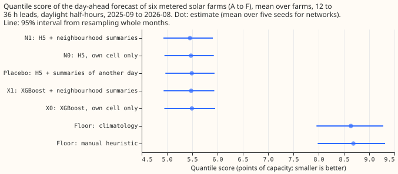
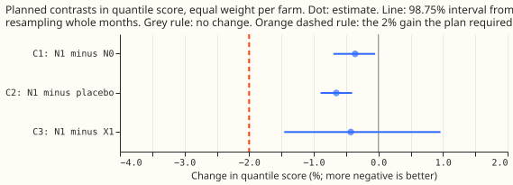
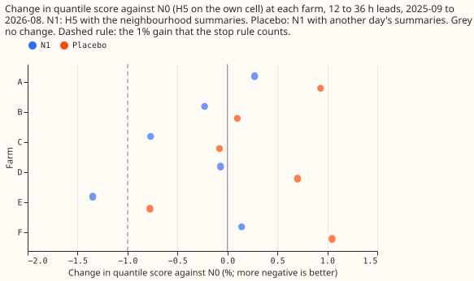
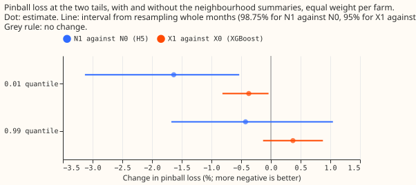

**At the six metered solar farms tested, the ensemble's irradiance on the cells around a farm adds
almost nothing to the day-ahead forecast.** National Grid Electricity Distribution (NGED) meters the
output of six solar farms in its trial area, which this page labels A to F. A day-ahead cloud field
can be right in shape and wrong in position by tens of kilometres, so we asked whether the weather
forecast on the cells around a farm lowers the error of the farm's day-ahead power forecast. The
weather forecast is the 51-member ensemble of the European Centre for Medium-Range Weather Forecasts
(ECMWF), stored on hexagonal cells about 15 km apart. The power forecast, called H5 (from
[experiment 243](../00243-metered-farm-architecture-comparison/result.md)), is a physical solar-farm
power model plus a neural network that adds a correction to each of 11 quantile levels of the
forecast. We gave H5 11 extra inputs per half-hour, computed over the 7 hexagons (the farm's own
hexagon and its 6 neighbours) and the 19 hexagons (two rings of neighbours) around the farm: the
mean, standard deviation, minimum, and maximum of the ensemble-mean irradiance; the share of member-
hexagon pairs with a clear-sky index above 0.8 (the ratio of irradiance to clear-sky irradiance);
and the irradiance at the neighbouring hexagon that the 10 m wind comes from. We scored the forecast
12 to 36 hours ahead on daylight half-hours in 2025-09 to 2026-08, with the quantile score: twice
the mean pinball loss over the 11 quantile levels, in points of capacity (percentage points of the
farm's capacity).

**The prediction fails.** The summaries lower the quantile score by 0.36% (98.75% interval 0.70% to
0.05%) against H5 on the farm's own hexagon, and the plan required 2%. The plan's stop rule (stop if
the gain is under 1% at 4 or more of the 6 farms) fired, because the gain is under 1% at 5 of the 6
farms, so the arm with a convolution over the 19 hexagons (N2) was not fitted. The 0.36% is also
fragile: leaving out farm B, C, or E puts zero inside the interval. Neighbouring hexagons differ
from the farm's own hexagon by only about 8 to 10 W/m² (about 3% of the mean daylight irradiance of
310 W/m²). In this store and at this scale, the ensemble mean is therefore too smooth between
neighbours to show where a cloud edge falls.

## Numbers

- **Arms.** N0: H5 on the own cell (refitted here; its scores equal experiment 243's stored H5 to
  every digit). N1: N0 plus the 11 summaries. Placebo: N1 with the summary vector of another day of
  the same farm, split, month, hour, and own-cell clear-sky band. X0 and X1: XGBoost ([Chen and
  Guestrin, 2016](https://doi.org/10.1145/2939672.2939785)) without and with the summaries. N2 was
  not fitted (stop rule).
- **Rows.** The 41,654 daylight half-hours (sun more than 5 degrees above the horizon) at 12 to 36
  hour leads of experiment 243, six farms, equal weight per farm, 98.75% intervals for the planned
  contrasts and 95% elsewhere, from resampling the 12 scored months 20,000 times. Neural arms are
  means over five seeds.
- **Quantile score (95% interval).** N1 5.455 (4.93 to 5.91); N0 5.475 (4.95 to 5.93); X1 5.479
  (4.93 to 5.94); placebo 5.491 (4.97 to 5.94); X0 5.493 (4.95 to 5.95); climatology 8.64; manual
  heuristic 8.69.
- **Contrasts, quantile score (98.75%).** C1 N1 minus N0 -0.36% (-0.70 to -0.05). C2 N1 minus
  placebo -0.65% (-0.89 to -0.40). C3 N1 minus X1 -0.43% (-1.46 to +0.96). C4 N2 minus N0 not run.
  Outside the plan (95%): X1 minus X0 -0.27% (-0.45 to -0.09); N0 minus X0 -0.34% (-1.30 to +0.81).
- **Per farm, N1 minus N0.** A +0.27%, B -0.23%, C -0.77%, D -0.07%, E -1.35%, F +0.14%. Leaving one
  farm out of C1 gives -0.48% (A), -0.38% (B), -0.29% (C), -0.42% (D), -0.12% (E), -0.45% (F); the
  interval includes zero when B, C, or E is left out.
- **Clear and cloudy half-hours** (own-cell clear-sky index at least 0.5 is clear, under 0.5 is
  cloudy), N1 minus N0: clear -0.39% (-0.78 to -0.02); cloudy -0.28% (-0.58 to +0.21).
- **Error of the median and of the mean forecast (points of capacity).** MAE of the median: N0 9.85,
  N1 9.80 (-0.44%, -0.95 to +0.22). MAE of the mean forecast: N0 9.96, N1 9.94 (-0.21%, -0.40 to
  +0.07).

| Tail (N1 minus N0) | Pinball change (98.75%) | Coverage N0 | Coverage N1 | Nominal |
|---|---|---|---|---|
| 0.01 quantile | -1.6% (-3.1 to -0.5) | 3.3% | 3.2% | 1% |
| 0.05 quantile | -0.7% (-1.6 to +0.1) | 6.0% | 6.1% | 5% |
| 0.95 quantile | 0.0% (-0.9 to +1.1) | 94.5% | 94.5% | 95% |
| 0.99 quantile | -0.4% (-1.7 to +1.0) | 98.5% | 98.5% | 99% |

- **Tail calibration.** The neighbourhood lowers the pinball loss at the 0.01 quantile by 1.6%, the
  one tail result whose interval excludes zero, and leaves the 0.99 quantile unchanged (-0.4%,
  interval spans zero). Both arms over-cover the 0.01 quantile (3.2% to 3.3% of observations fall
  below it, against 1% nominal) and under-cover the 0.99 quantile (98.5% against 99%), so the
  summaries do not fix the tail calibration.
- **Fraction of output fitted by the median forecast** (1 minus the sum of squared errors over the
  sum of squared output, median over farms): 0.912 for N0 and 0.911 for N1 on all scored half-hours,
  and 0.944 and 0.944 on sunny half-hours (clear-sky index at least 0.8). These are out-of-sample
  forecasts, so they are not comparable with [experiment
  218](../00218-metered-solar-farm-plant-fit/result.md)'s in-sample 0.91 (ensemble mean) and 0.973
  (observed weather), which use a different set of half-hours.
- **Curtailment value.** Not scored: the median forecast moves by only 0.44% (interval spans zero),
  and experiment 224 found that its pilot set of grid nodes cannot rank forecasts.

## Neighbourhood data check

- **Store.** The ensemble store holds H3 resolution-5 hexagons (about 15 km between centres) for the
  whole of Great Britain, not a 0.25 degree lattice, so the brief's "3 by 3" block is ring 1 (7
  hexagons) and its "5 by 5" block is rings 1 and 2 (19 hexagons). Every farm has 6 of 6 ring-1
  hexagons and 18 or 19 of 19 hexagons (a missing hexagon is open sea), so no farm was dropped.
- **Variables.** Downward shortwave radiation, 2 m temperature, and 10 m wind exist for all 51
  members. Cloud cover (total or low) is not in the store, so the share of member-hexagon pairs with
  clear-sky index above 0.8 stands in for it, with the farm's clear-sky irradiance applied to every
  hexagon.
- **Orientation.** The farm's own hexagon reproduces experiment 224's ensemble-mean irradiance to
  within 0.5 W/m² on every row, and the mean absolute difference from the own hexagon grows from 8.0
  to 10.4 W/m² in ring 1 to 14.1 to 17.0 W/m² in ring 2 at every farm, which is the pattern expected
  if the hexagons sit where H3 places them. The upwind hexagon is the ring-1 hexagon whose direction
  is closest to the direction the ensemble-mean 10 m wind comes from.

## Checks

- **Median minus mean forecast (points of capacity).** N0 +0.54, N1 +0.52, placebo +0.55, X0 -0.70,
  X1 -0.73. The neighbourhood does not shift either forecast.
- **Mean-forecast error beside the quantile contrast.** C1's MAE of the mean forecast is -0.21%
  (interval includes zero) against -0.36% in the quantile score, so both point the same way (trigger
  3 does not fire).
- **Triggers fired.** The `ml-experiment` skill lists seven audit triggers. Trigger 4 (leaving one
  farm out changes the verdict of a planned contrast) fires: C1's interval includes zero without B,
  C, or E. Trigger 5 fires weakly: the placebo scores 0.29% worse than N0 (95% interval +0.07% to
  +0.55%), a shift larger than the half-width of the placebo's interval (0.24 percentage points).
  The 11 extra inputs, each carrying another day's summary, are enough to worsen the score by that
  much, which also means N1's gain against the placebo (C2, -0.65%) overstates the value of the real
  summaries, and C1 is the cleaner reading. No Opus audit was run, because the result is a null that
  no later design depends on, and the ML manager's brief reserves Opus for a result that changes the
  next step. Triggers 1, 2, 3, 6, and 7 do not fire.
- **Caveat: one fit.** One fit on the months before 2025-09 (the screening schedule of experiment
  243, own history only), 12 scored months, and one set of five seeds, so the intervals are wide.
- **Caveat: placebo donors.** The placebo's donor days come from the same split (tuning or scored)
  as the row, so a scored row's placebo uses another scored day's forecast weather, which exists at
  forecast time. No power values leak.
- **Caveat: coarse neighbours.** The hexagons are about 15 km apart, so a cloud-position error
  smaller than that would not show in them, and the ensemble's native grid resolution is not
  recoverable from the store.
- **Caveat: not run.** N2 (convolution), a zero-history setting, and weekly refits were not run.

## What the next experiment should answer

Whether a weather input of a different kind, such as satellite-derived cloud for the first hours of
the day-ahead window, lowers the quantile score where more views of the ECMWF ensemble do not.

## Plan

- **Neighbourhood and variables.** See "Neighbourhood data check" above. A farm needs 5 of 6 ring-1
  hexagons and 15 of 19 hexagons in the store, or it is dropped from every arm.
- **Weather and forecast time.** ECMWF ensemble, 00 UTC run, 51 members, available at forecast time.
  Lagged power is the farm's own power one day earlier (two when the lead exceeds 24 hours).
- **Arms.** N0: H5 on the own cell, as in experiment 243. N1: N0 plus 11 summaries per half-hour
  (mean, standard deviation, minimum, maximum of the member-mean irradiance over the ring-1 and
  rings-1-2 blocks; the share of member-cell pairs with clear-sky index above 0.8 in each block; the
  member-mean irradiance at the ring-1 cell nearest the direction the 10 m wind blows from). N2: N0
  plus a small convolution over the 19 cells' member mean and member spread (run only if the stop
  rule does not fire). X0 and X1: XGBoost without and with the summaries. Placebo: N1 with the
  summary vector taken from another day of the same farm, month, hour, and own-cell clear-sky band.
- **Schedule.** One fit per arm and seed on the months before 2025-09, five seeds per neural arm,
  the last two tuning months select the epoch (the screening schedule of experiment 243; own history
  only).
- **Advice followed.** Let the neural network output all 11 offsets (H5), leave day of year out,
  give every arm the lagged power and the spread (experiment 243).
