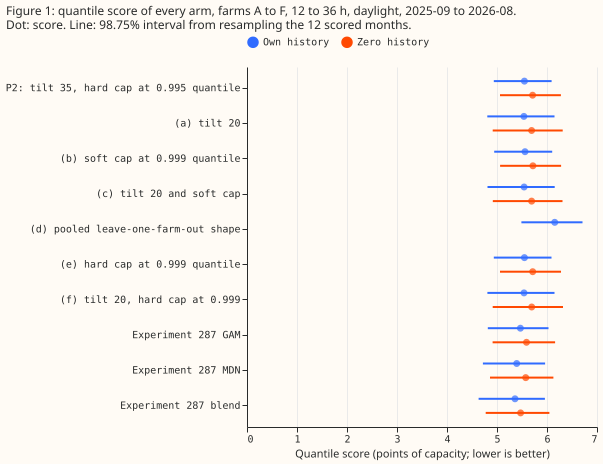
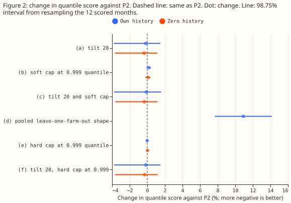
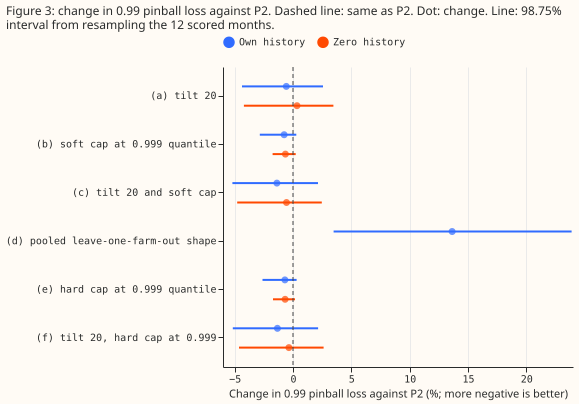
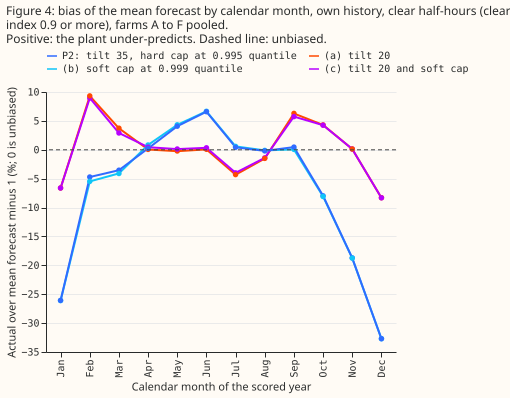

**Changing the plant's panel tilt from 35 to 20 degrees fixes most of its winter over-prediction on
clear half-hours, but the forecast band as a whole does not improve, and a higher or softer power
cap does nothing, so the plant's shape is not what limits the upper tail of the band.** National
Grid
Electricity Distribution (NGED) meters six solar farms, labelled A to F here. The "plant" is the
physical power model of [experiment
224](../00224-metered-farm-dayahead-two-number/result.md), and "P2" is the version from [experiment
270](../00270-metered-farm-xgboost-vs-plant-diagnostic/result.md) that stores residual quantiles for
each cell of 6 bins of the plant's forecast crossed with 3 bins of the spread of its 51 ensemble
members. [Experiment 282](../00282-pv-plant-curve-audit/result.md) found that the farms fit best at
a tilt of 15 to 20 degrees, so we recomputed the 51 members' responses at 20 degrees, tried a
higher cap and a soft cap, and scored the result on [experiment
287](../00287-metered-farm-spread-binned-plant-heads/result.md)'s rows. A "hard cap" stops the
plant's forecast abruptly at a fixed level, and a "soft cap" approaches that level smoothly. The
premise tested is that the best-guess demand stack under-predicts clear-sky solar output by 5 to 8%
from April to July (experiment 282). "Own history" means the forecast uses the farm's own earlier
months, "zero history" means it uses only the other five farms, and "arm c" is defined under Arms.

**The pre-registered pair of tests failed.** The quantile score (twice the mean pinball loss over 11
levels, in points
of capacity; lower is better) moved by under 1% as predicted. But with tilt 20 and a soft cap
(arm c), the 0.99 pinball loss fell by 1.4% (98.75% interval from resampling the 12 scored months,
-5.2% to +2.1%) against the 3% bar, and the April to July under-prediction did not shrink: P2 had
none to shrink, so the bar of a 3-point shrink was unreachable (P2's median absolute bias was 1.5%
before any change). Arm c's median absolute bias on clear half-hours in those months is 2.7%,
against
1.5% for P2. The stop rule did not apply, because the 0.99 gain of 1.4% exceeds 1%, so the result
falls in the rule's middle zone; the interval includes zero, and arm c is not carried to the stack.

## Arms

The arms are P2 with a different plant. Only the tilt and the cap differ between arms. Every arm
fits its scale by the same unclipped least-squares rule as P2, every cap level comes from tuning
rows (the months before 2025-09) only, and each arm's member responses are recomputed with its own
tilt. The tilt of 20 degrees comes from experiment 282's fits, which used the scored year, so arms
a, c,
and f are slightly optimistic.

- **P2:** tilt 35, hard cap at the tuning 0.995 quantile of output. The rebuilt control matches
  experiment 287's stored P2 exactly (own history 5.5483, zero history 5.7112).
- **(a)** tilt 20. **(b)** soft cap (p-norm minimum, exponent 6) at the tuning 0.999 quantile.
  **(c)** both. **(d)** experiment 282's pooled leave-one-farm-out shape, own history only.
  **(e)** and **(f)** are P2 and arm (a) with a hard cap at the tuning 0.999 quantile, added after
  the plan review and before any score was read, to separate a higher cap from a soft one.
- **Row set and schedule.** Experiment 287's scored-year daylight rows at 12 to 36 hour leads, one
  fit on
  the months before 2025-09 with no refits. Weather is the ECMWF ensemble 00 UTC run, available at
  forecast time; no past weather is used.

## Results

- **Quantile score (own history, points of capacity; interval over 12 months).** P2 5.55 (4.94 to
  6.09), (a) 5.54, (b) 5.56, (c) 5.54 (4.81 to 6.16), (d) 6.15, (e) 5.55, (f) 5.54; experiment 287's
  GAM 5.47, MDN 5.39, blend 5.36. Zero history: P2 5.71, (a) 5.69, (b) 5.72, (c) 5.69, (e) 5.71,
  (f) 5.69. The floors are 8.69 (`manual_heuristic`) and 8.64 (`climatology`).
- **Score contrasts against P2 (own history, 98.75% interval).** (a) -0.18% (-3.8 to +1.5); (b)
  +0.19%
  (-0.08 to +0.41); (c) -0.11% (-3.8 to +1.6); (d) +10.9% (7.7 to 14.2); (e) -0.006% (-0.06 to
  +0.03); (f) -0.17% (-3.8 to +1.5). Zero history: (a) -0.35% (-3.7 to +1.1), (b) +0.11%, (c)
  -0.33%.
- **0.99 pinball loss against P2 (own history).** (a) -0.6% (-4.4 to +2.6); (b) -0.8% (-2.8 to
  +0.3); (c) -1.4% (-5.2 to +2.1); (d) +13.6% (3.5 to 23.9); (e) -0.7% (-2.6 to +0.3). Experiment
  287's blend is 7.9% below P2 (-11.2 to -3.4) and its GAM 5.2% below, so the plant's shape closes
  at most about a fifth of the gap.
- **Where tilt 20 helps and hurts (arm c against P2, own history).** December to February score
  -9.0% (-22.3 to +0.5); March to May +0.8% (-0.6 to +2.0); June to August +1.7% (0.6 to 3.1);
  September to November +0.6% (-1.1 to +1.2); March to June +0.8% (-0.2 to +1.7). Tail pinball
  loss: 0.01 quantile -4.3% (-9.7 to -1.9), 0.05 quantile -2.2% (-6.1 to -0.1), 0.95 quantile
  +0.9% (-2.9 to +3.7).
- **Soft against hard cap at the same level.** (b) minus (e): score +0.20% (-0.02 to +0.41), 0.99
  pinball loss -0.06% (-0.25 to +0.04). (c) minus (f): score +0.06% (-0.08 to +0.18), 0.99 pinball
  loss -0.05% (-0.14 to +0.03). The form of the cap does not matter.
- **Tail coverage (own history, nominal 0.01, 0.05, 0.95, 0.99).** P2 0.034, 0.063, 0.951, 0.986;
  arm c 0.034, 0.063, 0.945, 0.987; experiment 287's blend 0.034, 0.068, 0.959, 0.992. The 0.01
  quantile
  covers 3.4% of rows, 3.4 times its nominal 1%, for every arm.
- **Bias of the mean forecast on clear half-hours (own history, actual over forecast minus 1).**
  April to July, P2 per farm A to F: -0.2%, +2.7%, +0.3%, +7.0%, +0.3%, +3.6% (951 to 1,546 rows
  each); arm c: -3.2%, -0.3%, -2.6%, +2.8%, -4.2%, +0.7%. The rows are the scored set of the score
  tables.
  Median absolute bias 1.54% for P2 and
  2.69% for arm c, a shrink of -1.14 points (98.75% interval -1.14 to +4.32 from resampling 4
  months, too coarse to rank). Pooled over farms, P2's bias is -19% in November, -33% in
  December, and -26% in January against 0%, -8%, and -7% for arm c (figure 4).
- **Curtailment cost.** Not scored: these six farms are single series, and the curtailment-cost
  metric
  needs a substation node plus its generators.

## Checks

- **Median minus mean forecast per farm (own history, points of capacity).** P2 0.16 to 0.46, (a)
  0.01 to 0.51, (b) 0.15 to 0.49, (c) 0.03 to 0.53; none of P2, (a), (b), (c), (e), and (f) has a
  median more than 0.6 points from its mean forecast
  (arm (d) reaches -1.2).
- **Mean-forecast error beside the score contrast.** Arm c: mean-forecast absolute error -0.6%
  (-3.9 to +1.5) against a score change of -0.1%, the same direction. Arm (b): +0.22% (0.07 to
  0.36) against +0.19%.
- **Triggers.** Trigger 2 fired: the result contradicts the premise that P2 under-predicts in April
  to July. The explanation tested is that P2 refits its scale on each farm's own tuning months,
  while the stack's capacity is pinned; the April to July bias results above support this
  explanation. Trigger 4 fired for the
  score contrast only: dropping one farm in turn moves arm c's score change between -0.57% and
  +0.46%, around zero. The 0.99 change stays between -0.3% and -3.1%, and the bias criterion fails
  whichever farm is dropped, so the verdict does not depend on which farm is dropped. The other
  triggers did not fire.
  No Opus audit was run, because no contrast that decides the verdict changes sign.
- **Reviews.** One Sonnet plan review changed the plan (same scale rule for every arm, arms e and f,
  the stop-rule middle zone, the bias definition). A Sonnet code review found no leakage and led to
  a bias row-set fix, two added contrasts, and two
  caveats. A Sonnet write-up review led to the clarifications in this page. No Opus review was run.

## Caveats and next steps

- **Scale not refitted through the soft cap.** Arms b and c keep the unclipped least-squares scale,
  so the soft cap lowers their forecast near the cap by up to 11%; arms e and f, which share the cap
  level with a hard cap, show the cap form changes the score by under 0.2%.
- **Arm d mixes weather products.** The pooled table is fitted to CAMS irradiance (estimated past
  weather) and applied to ensemble irradiance, which may explain part of its 10.9% loss; it was not
  refitted on ensemble rows.
- **One fit per arm, no refits.** A weekly refit could change the absolute scores and possibly the
  contrasts, which this experiment did not test.
- **The 20-degree tilt was chosen on the scored year** (experiment 282), so the gains of arms a, c,
  and f are optimistic, and they are still small.
- **Next.** Tilt 20 lowers winter error and raises summer error, which suggests that a tilt between
  20 and 35
  degrees, or a seasonal term (a different diffuse-sky split in winter), would do better than either
  20 or 35 degrees. The
  upper tail's remaining gap to experiment 287's blend comes from the heads' inputs, not the plant.
