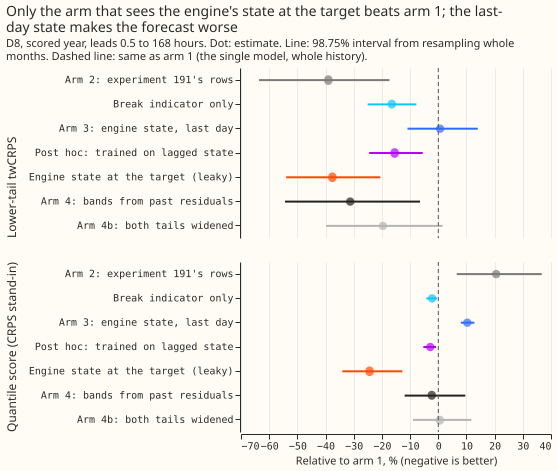
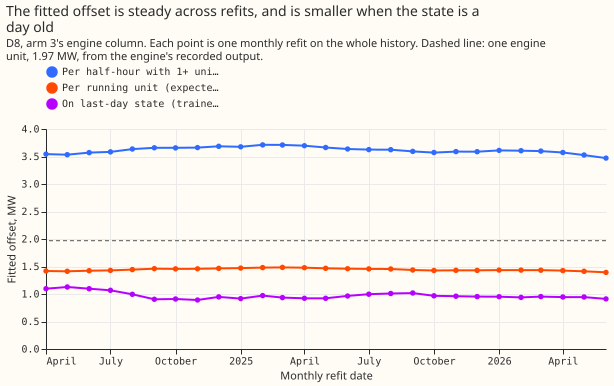
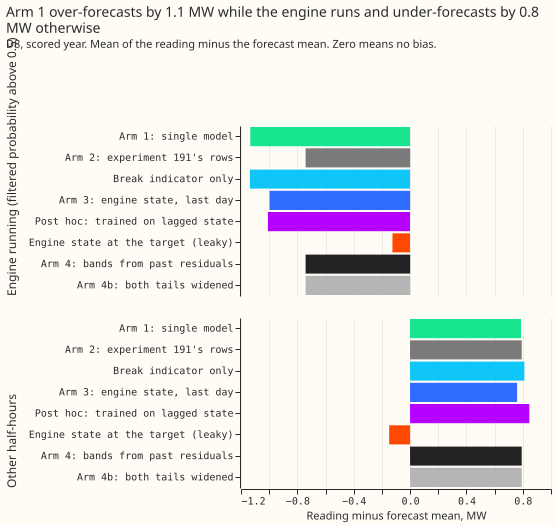
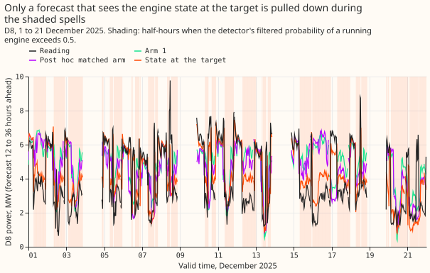
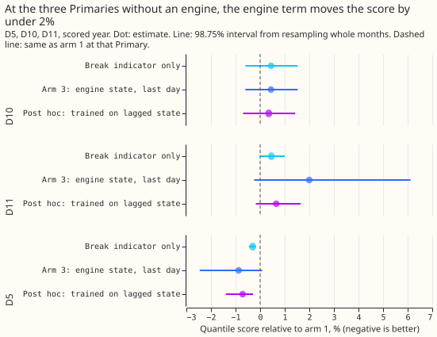

**Telling the forecast when D8's gas engine runs would help a lot, but only when the state is read
at the half-hour being forecast, and that state is built from the reading being forecast.** D8 is
one of the 16 Primary substations of National Grid Electricity Distribution (NGED) in the trial. Its
meter stopped including the output of a gas engine of up to three units of about 2 MW each on
2023-08-15, so we take D8's multi-day drops in power (2 to 19 days, about 2.7 MW) to be the engine
running ([experiment
194](../00194-ps1-ps5-generator-visibility-d8-analogue-break-and-price-following-census/result.md),
[experiment 291](../00291-d8-drops-engine-spells-load-shift/result.md)). We asked whether a forecast
with an extra term for the half-hours when the engine runs beats a forecast without it. Both
forecasts are the same generalised additive model with a Kalman filter on recent errors, trained on
all of D8's history. The engine's running state is estimated by a detector, not observed. We tested
five ways of giving the term its state. The one usable at forecast time, the state of the last day
whose readings had arrived, made the quantile score 10.3% worse than the forecast without the term.
The quantile score is twice the mean pinball loss over 11 quantiles, our stand-in for the continuous
ranked probability score (CRPS), and smaller is better.

**The term's gain on D8 is partly circular, because the engine states and the drops come from the
same residual.** The states are the probabilities of the detector of experiment
[196](../00196-ps2-quantised-engine-detector-on-d8-with-known-answer-gate/result.md), as run in
experiment 291 ([PR 1594, "Experiment 291: are D8's multi-day drops generator-engine
spells?"](https://github.com/openclimatefix/nged-substation-forecast/pull/1594)). Experiment 291
found the drops in the residual that this detector reads, so the states cannot confirm that the
drops are an engine. The detector's filtered probability uses readings only up to each half-hour,
but its inputs are not causal: the expected-power series it reads is centred on a 30-day window, so
a state can carry up to 15 days of later readings. That flatters every arm that uses a state, which
makes arm 3's loss conservative and leaves the post hoc gain at risk.

## Arms and rows

- **Rows.** The 292 daily runs of experiment 191, scored from 2025-07-02 to 2026-06-30, leads 0.5 to
  168 hours, outside the hand-filtered events, seed 0: 97,012 rows at D8, 84,137 at D5, 96,370 at
  D10, 97,046 at D11. Every arm is refitted monthly, as in experiment 191, so no contrast depends on
  weekly refits.
- **Arm 1, the single-model arm.** Experiment 191's generalised additive model with a Kalman filter
  (GAM-K), no 24-month window, D8's whole history, its own tuning months for the spread.
- **Arm 2.** Experiment 191's reference rows (D8 from 2025-04-01, donor spread). Arm 2 reproduces
  experiment 191's stored forecasts exactly (largest difference 0.0). Arm 2 differs from arm 1 in
  both the history and the source of the spread.
- **Arm 3, deciding.** Arm 1 plus a break indicator (1 from 2023-08-15) and the filtered probability
  of one or more running units, with a non-negative coefficient, read from the same half-hour of the
  last settled day at forecast time.
- **Other arms.** Break indicator only. Engine state at the target half-hour from the smoothed
  posterior, which uses the reading (leaky ceiling). Post hoc: expected number of units (arm
  3-units), and arm 3 trained on the filtered probability lagged 1 to 7 days (matched). Arm 3-window
  is arm 3's engine term on arm 2's rows.
- **Arm 4.** Experiment 264's stored `arm_emp` (the median plus the past 365 days' residual
  quantiles) and `arm2b`.
- **Lab shortcuts.** The detector's parameters were fitted on 2023-09 to 2026-01 and its expected
  power comes from a model fitted with hindsight. The filtered probability uses only readings up to
  the half-hour, and the last-day state ignores the 3.5-hour delivery delay of readings, so about 15%
  of target half-hours read a state built from readings not yet delivered.

## Figures

*Figure 1. Only the arm that sees the state at the target half-hour (24% better) gains more than the
post hoc arm trained on the lagged state (3% better). The last-day state, arm 3, is 10% worse.*

*Figure 2. The offset per half-hour with the engine on is 3.5 to 3.6 MW at every refit; per running
unit it is 1.4 to 1.5 MW, against the recorded unit of 1.97 MW. Trained on a day-old state, the
offset is 0.9 to 1.0 MW.*

*Figure 3. The single model reads 1.1 MW below its forecast while the engine runs and 0.8 MW above
it otherwise. Only the target-state arm removes both gaps.*

*Figure 4. In December 2025 the forecast that sees the engine state at the target follows the
readings down during the shaded spells; the others barely move.*

*Figure 5. At the three Primaries without an engine, the arms move the quantile score by -0.9% to
+2.0%.*

## Results

- **Quantile score at D8 (points; smaller is better; one point is 0.1 MW).** Arm 1 9.09; arm 2
  10.95; arm 3 10.02; break indicator only 8.89; matched 8.83; units 9.96; target state 6.87; arm 4
  `arm_emp` 8.88, `arm2b` 9.14.
- **C1, arm 3 against arm 1:** +10.3% (98.75% interval +8.0% to +12.8%). Leaving out any one month
  keeps the sign (+9.8% to +10.8%).
- **C2, arm 3 against arm 4:** +12.9% (+1.2% to +25.0%).
- **C4, lower-tail twCRPS, arm 3 against arm 1:** +0.6% (-10.9% to +14.0%).
- **C3, controls, arm 3 against arm 1:** D5 -0.9% (-2.5% to +0.1%); D10 +0.4% (-0.6% to +1.5%); D11
  +2.0% (-0.2% to +6.1%). The upper ends at D10 and D11 exceed the +0.5% limit, so C3 fails.
- **Post hoc matched arm against arm 1:** quantile score -2.8% (-5.3% to -0.8%), twCRPS -15.5%
  (-24.5% to -5.5%), and against arm 4 -0.5% (-11.1% to +9.5%). The arm is post hoc, so its result
  does not enter the decision.
- **Break indicator only, against arm 1:** -2.2% (-4.2% to -0.5%).
- **Prediction P4, offset of 1 to 3 MW:** P4 fails as registered, because the registered column is
  the probability of one or more units running, and its offset is 3.5 to 3.6 MW (0 of 12 refits in
  range). The post hoc column of expected running units gives 1.4 to 1.5 MW per unit, which is in
  range.
- **The term's value out of sample.** The slope of arm 1's error on the state of the last settled
  day, fitted with an intercept, is 0.15 MW per unit of probability (95% interval -0.06 to 0.32),
  against 3.6 MW fitted, so it cannot be told from zero. On the state at the target it is 2.20 MW
  (1.72 to 2.65), close to one engine unit but circular. The last-day flag (probability above 0.5)
  is set in 65% of engine-running half-hours and 37% of other half-hours.
- **Arm 1 against arm 2.** Arm 1's quantile score is 17% lower than arm 2's, but arm 1's spread
  comes from D8's own tuning months and arm 2's from donor Primaries.

| Quantile | Arm 1 below / pinball | Arm 3 | Matched | Arm 4 `arm_emp` |
|---|---|---|---|---|
| q01 | 0.029 / 0.605 | 0.019 / 0.602 | 0.021 / 0.548 | 0.036 / 0.806 |
| q05 | 0.065 / 2.255 | 0.062 / 2.591 | 0.061 / 2.216 | 0.076 / 2.278 |
| q95 | 0.893 / 2.197 | 0.956 / 2.405 | 0.913 / 2.126 | 0.923 / 2.443 |
| q99 | 0.946 / 0.751 | 0.985 / 0.587 | 0.961 / 0.630 | 0.968 / 0.827 |

*Share of readings below each quantile (the target is the level) and the pinball loss in points, at
D8, all rows.*

## Checks

- **Median minus mean forecast,** per arm: 0.00 points for every arm built here (printed in the
  report); the -0.96 points for arm 4 `arm_emp` comes from experiment 264's stored forecasts.
- **Error of the mean forecast beside the quantile score.** Arm 3's mean absolute error is 17.38
  against arm 1's 16.29 (worse, as is its quantile score); the matched arm's is 15.78 (better, as is
  its score). The two metrics agree.
- **Audit triggers.** One trigger fired: arm 3 contains the single-model arm and the indicator-only
  arm, and both score better than arm 3. We tested an explanation, that the coefficient was trained
  on the state at the half-hour and applied to a day-old state, and the matched arm trained on the
  lagged state removes the loss. No independent audit of the method was run. The other six triggers
  (a failed control, a result against its prediction without a tested explanation, a disagreement
  between the quantile score and the error of the mean forecast, a leave-one-site-out flip, an
  interval width against a sister experiment, and an unreplicated result that a later design depends
  on) did not fire.
- **Row set.** All arms share the same 97,012 D8 rows (keys joined across arms).

## What the next experiment should answer

**The next experiment should answer whether the engine's state can be known before the half-hour it
affects.** The state of the last settled day is worth 0.15 MW out of sample, which cannot be told
from zero. Options that this experiment did not test are a forecast of the state from the gas price,
a longer or lead-dependent lag, and NGED's own record of the engine's running hours. Any of them
should be scored with a state that no reading of the target half-hour enters.
