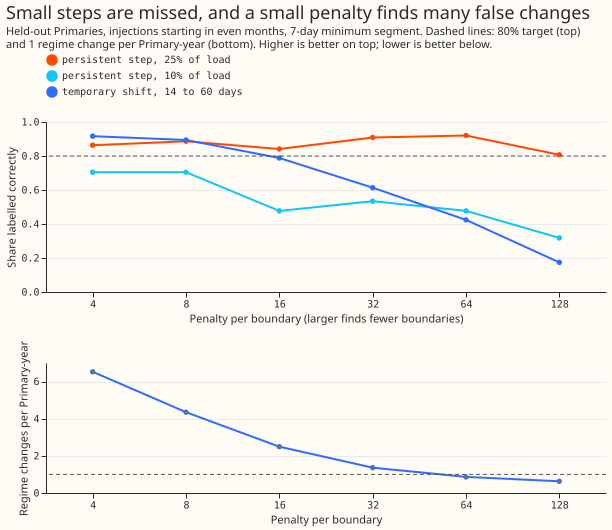
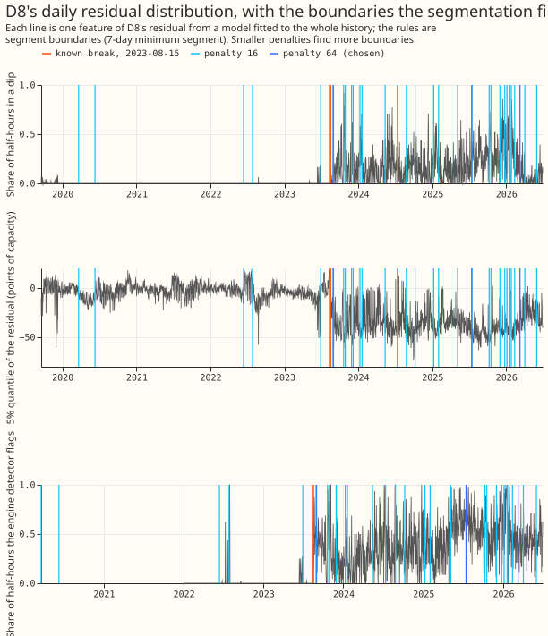
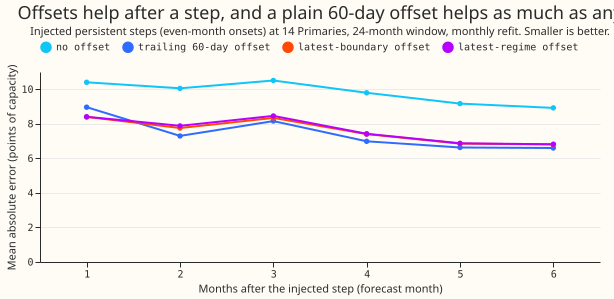

**Reading only the residual of a lagless forecast, a segmentation finds a step of 25% of a Primary's
load and dates it to within a day or two, but finds about half of the 10% steps and cannot reliably
tell a short load shift from a lasting change.** A Primary substation steps 33 kV down to 11 kV for
homes and businesses. A regime is the whole period, without gaps, in which one configuration holds.
Whether a gas engine runs, or a load shift is in force, is a state inside a regime. We fitted a
convex additive model (GAM) with no recent power as an input to each Primary's whole history, took
its residual (reading minus fit), and summarised each day's residual by four numbers: the share of
half-hours in a dip, the 5% and 95% quantiles, and the night-minus-day mean. A penalised
dynamic-programming search ([Killick et al. (2012)](https://doi.org/10.1080/01621459.2012.737745))
then placed boundaries. A boundary is a state change when the features return to their earlier
values within 120 days, or a neighbouring Primary shows the opposite change within 3 days, and a
regime change otherwise. We tested it on D8's break on 2023-08-15, on steps and load shifts that
we injected into the other Primaries, and on the unmodified series.

**Verdict `not supported`: two of the four parts of the prediction held.** The penalty (64) and
the minimum segment length (7 days) were chosen on injections in odd months at 7 tuning Primaries.
Every number below is from the 7 held-out Primaries and even-month injections, except D8.

- **D8's break (failed, narrowly).** The nearest boundary is 2023-08-30, 15 days late. Penalties
  of 16 or less place it on 2023-08-15 exactly (Figure 2).
- **False regime changes (held).** 0.87 per Primary-year (98.75% interval 0.46 to 1.39). Of 33
  regime changes, 8 look like solar capacity steps (a day shift at least twice the night shift)
  and 15 fall in April to August.
- **Persistent steps (failed).** 70% labelled persistent (0.58 to 0.85): 25% steps 89% to 95%, 10%
  steps 45% to 50% (Figure 1). Found steps are dated to a median of 1 day.
- **Temporary shifts (failed).** 42% labelled as states (0.21 to 0.64): 27% at 14 days, 45% at 30,
  55% at 60. A permanent transfer between two Primaries is labelled a state 73% of the time, as
  predicted.
- **Engine spell edges (held, trivially).** At penalty 64, 2% of the 121 on or off spell edges
  after 2023-08-15 have a boundary within 3 days, and 2% at random dates, because only 3
  boundaries remain. At penalty 16, 15% against 12% at random dates, with 19 regime-change
  boundaries inside the regime; at penalty 4, 39% against 29%.
- **The 2026 fade.** Penalties of 32 and above put a boundary on 2026-03-10, labelled unconfirmed,
  where the dip rate falls by 0.15 to 0.23. The engine detector's flagged share falls from 0.53 (October
  2025 to February 2026) to 0.43 (from 15 March 2026), so the residual cannot say whether a regime
  ended or the engine ran less.

## Figures

*Figure 1. Recall of injected steps and shifts against the penalty, and the rate of regime changes
at the unmodified held-out Primaries. A larger penalty finds fewer false changes and fewer real
ones.*

*Figure 2. D8's dip rate, 5% quantile, and engine detector flagged share, with boundaries at
penalties 16 and 64 and the known break.*

*Figure 3. Forecast error after an injected step with no offset, with a trailing 60-day offset, and
with the latest-regime offset.*

## Forecast gain from an offset for the latest regime

- **Setup.** At each monthly cut (24-month window), the GAM's in-sample residual is segmented using
  days before the cut only, and the offset is the mean residual since the latest boundary. Scored
  over the month after the cut, for 6 months after each injected persistent step (14 Primaries, 8
  even-month onsets, 4 step types).
- **Injected steps.** Mean absolute error 9.79 points with no offset, 7.60 with the latest-regime
  offset (difference -2.20, 98.75% interval -2.57 to -1.83), and 7.45 with the trailing 60-day
  offset. The latest-regime offset is 0.15 worse than the trailing offset (0.03 to 0.27).
- **D8's real break.** No offset 16.94, latest-regime 16.93, trailing 16.09. The differences have
  intervals that include zero (6 cuts).

## Checks

- **Mean minus median forecast.** Zero by construction: GAM_ONLY gives one point forecast.
- **Quantile score beside the error of the mean.** No quantile score is contrasted here.
- **Audit triggers.** Trigger 1 fired: D8's known-answer test missed its 14-day bound by one day at
  the chosen penalty. The explanation, that the penalty was set on injections and not on D8, is
  tested by the penalty grid in Figure 2 and above. A fresh Opus audit is still required before
  merge. No other trigger fired, with trigger 7 unchecked because the dependants of this result
  are not known to this session.
- **Comparison with the first design.** The first design segmented the daily mean level. On the 5
  Primaries both designs ran (D10, D11, D12, D14, D16, 14-day minimum segment), recall of 25%
  steps was 0.66 to 0.73 for the level design and 0.65 to 0.71 for the distribution features, at
  similar regime changes per Primary-year (`printed_level_only.txt`).

## Caveats

- **The injected steps are easier and harder than real ones.** They are added to the recorded
  power at a fixed date with no change to the weather, and the GAM is fitted on the injected
  series, so month and weather terms absorb part of the step (a median of 2% for persistent steps
  and 6% for temporary shifts).
- **The engine spells come from a detector that did not pass its gate** (experiment 199,
  night-only `v1`), and the spell-edge share is not a measure of the engine's true spells.
- **D15 has no training rows**, so 14 Primaries other than D8 were used, not the 15 planned. D9 and
  D18 have under two years of readings, so their onsets are fewer.
- **The PV check approximates.** Experiment 207's step path was not refitted. A PV-like change is
  one whose daytime shift is at least twice its night shift.
- **Real regimes in the controls count as false changes**, so 0.87 per Primary-year is an upper
  bound.
- **Embedded Capacity Register context.** The register lists one connected entry of 8.9 MW at D8,
  dated 2019 or later, which is probably the engine. The session did not use the register.

## What the next experiment should answer

- Whether a second signal, such as the engine detector's flagged share together with the dip rate,
  separates a regime change from an engine that is off, because the residual alone cannot.
- Whether a lower penalty with a rule that merges boundaries within 14 days, which keeps the D8
  break exact, brings the false regime changes under 1 per Primary-year.
