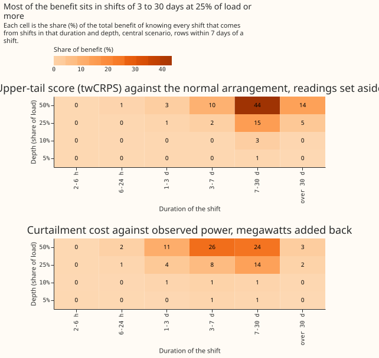
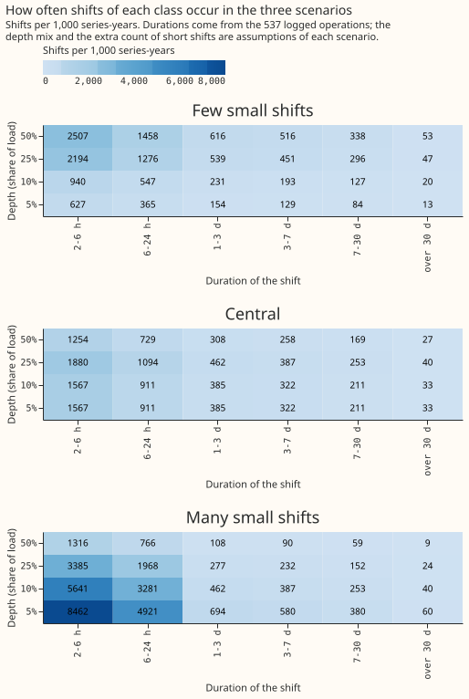
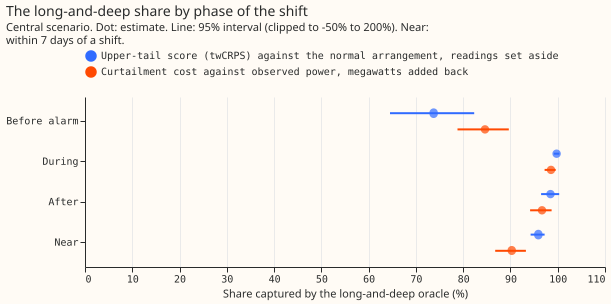

**A load shift moves demand from one Primary substation to its neighbours for hours or days. We asked
how much of the benefit of knowing every shift exactly comes from long and deep shifts, so a
detector that finds only those would still deliver most of the benefit.** We simulated 1,152
shifts at six Primary substations, in a grid of 6 durations (2 hours to 60 days) by 4 depths (5%,
10%, 25%, and 50% of the substation's load), and scored forecasts that know all of them, only the
long and deep ones, or only the others. Knowing only shifts of at least 2 days and at least 10% of
load captures 95.9% (94.3% to 97.2%) of the upper-tail benefit and 90.3% (86.8% to 93.3%) of the
curtailment-cost benefit, in the central frequency scenario. The result rests on simulated shifts and
on assumed frequencies of each depth, so it is a statement about how the benefit is distributed, not
a measurement of how often real shifts occur.

**Curtailment figures are relative comparisons between forecasts at a Primary substation and state
no money saved.** A Primary substation has no published export limit and no known generator beneath
it, so the metric treats its demand as the flow that can breach, as [experiment
283](../00283-lsc-perfect-knowledge-value-to-forecast-and-curtailment/result.md) did.

**Realistic detectors are not scored here.** The shares above assume a detector that finds every
shift of its class at once. Weighting each class by the recall of the long-and-deep detector, and
subtracting its false-alarm harm, is a follow-up that waits for Part 1 of the long-deep detector
experiment (see the plan page of the [LSC detectors theme](../themes/lsc-detectors/plan.md)).

## Share of the benefit by class of shift

**Each cell is the share of the benefit of an oracle that knows every shift (PERFECT) that an oracle
knowing only one class of shift (PERFECT_LD or PERFECT_SMALL) captures, in rows within 7 days of a
shift, with a 95% interval from resampling whole shifts within each cell.** The benefit of an oracle
is the sum over those rows of the no-knowledge score minus the oracle's score. The upper-tail score
is the threshold-weighted continuous ranked probability score (twCRPS) at the 95th percentile of
earlier power, against the power the substation would have carried in its normal running arrangement
(NRA), with readings inside a known shift set aside (the design of experiment 283). The cost column
is the node-only curtailment cost against observed power at the 0.5 scaled limit, with the known
shift's megawatts added back to the forecast (experiment 283's post hoc design, needed because
setting readings aside predicts the wrong series against observed power).

| Scenario | Class | Upper-tail score vs NRA | Curtailment cost vs observed power |
|---|---|---|---|
| Few small shifts | Long and deep (2 days or more, 10% or more) | 96.9% (95.4 to 98.0) | 91.4% (87.6 to 94.6) |
| Few small shifts | Under 12 hours or under 10% of load | 0.6% (0.3 to 1.1) | 0.9% (0.3 to 1.6) |
| Central | Long and deep | 95.9% (94.3 to 97.2) | 90.3% (86.8 to 93.3) |
| Central | Under 12 hours or under 10% of load | 1.6% (0.8 to 2.6) | 2.4% (1.3 to 3.6) |
| Many small shifts | Long and deep | 87.9% (83.0 to 92.2) | 80.8% (74.7 to 86.5) |
| Many small shifts | Under 12 hours or under 10% of load | 7.3% (3.4 to 11.7) | 9.0% (5.0 to 13.2) |

## Results

- **Pre-registered prediction held:** the long-and-deep share is 95.9% (94.3 to 97.2) on the
  upper-tail score and 90.3% (86.8 to 93.3) on cost, against 70% or more, and the share of shifts
  under 12 hours or under 10% of load is 1.6% (0.8 to 2.6) and 2.4% (1.3 to 3.6), against under 15%.
  The three scenarios give the same verdict; in the many-small-shifts scenario the long-and-deep
  share falls to 87.9% and 80.8%.
- **Duration matters more than depth.** An oracle with a minimum duration of 6 hours instead of 2
  days (and a minimum depth of 10%) adds 5.4% (3.0 to 8.5) of the benefit on the upper-tail score
  and 7.7% (4.9 to 11.0) on cost. A minimum depth of 5% instead of 10% adds 3.1% (1.4 to 5.1) and
  1.7% (0.9 to 2.8). A minimum duration of 7 days is too long: it keeps 70.4% (62.7 to 77.2) and
  44.2% (38.5 to 49.8) (figure 2).
- **Break-even:** the shifts outside the long-and-deep class would have to be 10 times as frequent
  (upper-tail score) or 4 times as frequent (cost) as in the central scenario before the
  long-and-deep share fell to 70%.
- **Cells that carry at least 5% of the benefit on their own (central scenario):** for the
  upper-tail score, shifts of 7 to 30 days at 50% of load (43.5%), 7 to 30 days at 25% (14.9%),
  over 30 days at 50% (14.0%), and 3 to 7 days at 50% (10.2%). For cost, 3 to 7 days at 50% (25.5%),
  7 to 30 days at 50% (24.1%), 7 to 30 days at 25% (13.9%), 1 to 3 days at 50% (11.1%), and 3 to 7
  days at 25% (7.8%) (figure 3).
- **By phase (central scenario, long-and-deep share):** before the alarm would arrive, 73.8% (64.5 to
  82.3) of the upper-tail benefit and 84.6% (78.8 to 89.7) of the cost benefit; during the shift
  99.8% and 98.6%; in the 48 hours after it ends 98.5% and 96.7% (94.2 to 98.7) (figure 5). Smaller
  shifts matter most before the alarm arrives.
- **Shape and site:** the long-and-deep share is 97.2% (95.7 to 98.4) for constant shifts and 94.4%
  (91.0 to 96.8) for demand-shaped shifts on the upper-tail score, and 92.5% and 88.2% on cost.
  Leaving out any one of the six Primaries gives 94.6% to 96.8% (upper-tail) and 88.1% to 91.9%
  (cost), so no site decides the result.
- **Cost against observed power needs the megawatts added back:** with readings set aside the
  cost within 7 days of a shift is 87.5% worse than with no knowledge, as in experiment 283, so the
  cost shares use the megawatts-added-back arms. The cost benefit is 16.9% of the no-knowledge cost
  for shifts that add load and 18.1% for shifts that remove it.
- **Absolute scores, rows within 7 days of a shift, points of effective capacity (against the NRA):**
  CRPS 6.098 for no knowledge, 3.050 for PERFECT, 3.070 for PERFECT_LD, and 6.091 for
  PERFECT_SMALL; mean absolute error of the median 9.194, 5.312, 5.340, and 9.186; twCRPS 1.672,
  0.677, 0.683, and 1.669. PERFECT_ADD scores against observed power: CRPS 3.648, twCRPS 1.062.
- **Tail calibration** (the score tables hold the 0.05, 0.5, and 0.95 quantiles only, so 0.01 and
  0.99 are missing): no knowledge puts 15.8% of readings below the 0.05 quantile and 14.8% above the
  0.95 quantile within 7 days of a shift; PERFECT 6.3% and 5.9%; PERFECT_LD 6.6% and 6.1%;
  PERFECT_SMALL 15.7% and 14.7%. Pinball loss at 0.05 and 0.95: 2.131 and 2.017, 0.782 and 0.804,
  0.790 and 0.810, and 2.129 and 2.014.
- **Ordinary rows:** knowing every shift changes CRPS by +0.41% (0.23 to 0.65) and twCRPS by
  +0.47% (0.22 to 0.85) over 3.57 million rows (months resampled). A forecast that knows the shifts
  is not worse on ordinary rows; the small gain comes from rows where no-knowledge forecasts still
  carry the effect of a shift that ended earlier.

## Frequency

- **Duration frequencies come from the log.** The 537 logged operations of 2 hours to 48 days,
  between January 2022 and March 2026, give 926 shift sides on the 16 series, which is 6.27, 3.65,
  1.54, 1.29, 0.84, and 0.13 shifts per series-year for the six duration bins (2 to 6 hours up to
  over 30 days).
- **Depth frequencies are assumptions.** Only 16 of the 537 operations have a measured depth. The
  depth mix (5%, 10%, 25%, and 50% of load) is 10%, 15%, 35%, and 40% in the few-small-shifts
  scenario, 25%, 25%, 30%, and 20% in the central scenario, and 45%, 30%, 18%, and 7% in the
  many-small-shifts scenario, which also multiplies the two shortest duration bins by 3 because the
  log lists short shifts least (figure 4). The break-even multipliers above are the sensitivity
  test.
- **Undercounted classes:** short and small shifts are the hardest to see, and the log lists only
  some of them. The 17 block days and 37 unlabelled worst days of experiment 175, the detectors'
  census, and D8's drops are not added, because none of them records depth in a form this page can
  use, so the long-and-deep class may be undercounted too.

## Checks

- **Median minus mean forecast, per site:** the mean absolute error (MAE) of the median forecast
  minus that of the mean forecast lies between -0.048 and +0.011 points for no knowledge and for
  PERFECT, and changes by at most 0.014 points between them (D5), so no arm's spread shifts its
  forecast.
- **Mean forecast error beside each quantile-score contrast:** within 7 days of a shift PERFECT
  lowers the MAE of the mean forecast by 42.2% and the CRPS by 50.0%, the same direction.
- **Explicit arms against selection:** the explicitly run PERFECT_LD arm captures 96.6% of the
  upper-tail benefit and 91.1% of the cost benefit, against 95.9% and 90.3% from selecting the
  long-and-deep shifts out of the PERFECT arm. The explicit PERFECT_SMALL arm captures 3.0% and 8.8%.
- **Triggers that fired:** trigger 7 fired, because the long-and-deep detector experiments are
  designed on this result and it has not been replicated. A fresh Sonnet audit (Opus was not used,
  as the brief required) re-derived the headline contrasts from the stored score tables with its
  own code. Findings and triage: see "Audit".

## Caveats

- **Shifts are simulated and idealised.** The true start, end, and megawatts are known, shifts at
  one site are at least 7 days apart, and half remove load and half add it. Solar-shaped shifts are
  not run.
- **Rows within 7 days of two shifts are left out.** The score table gives such a row to the later
  shift, so its score would credit that shift with the effect of the earlier one. The rule drops
  697,129 of 6,563,096 near-shift rows (10.6%). Before the rule the explicit and selected
  long-and-deep shares disagreed by 9 points.
- **Cells are uneven.** 1,079 of the 1,152 shifts have scored rows after the rule, 37 to 48 per
  (duration, depth) cell with both shapes pooled. The two shapes are not scored separately beyond the
  check above.
- **Benefit weights rows equally.** A long shift has more rows, so its benefit grows with its
  length. The share is a share of forecast skill summed over rows, not over shifts.
- **The forecasts are experiment 208's cached member forecasts with a Kalman filter on recent
  errors,** with no retraining, so the contrast cannot depend on a retraining schedule.

## What to try next

- **Weight the shares by realistic recall.** Multiply each cell's benefit by the recall of the
  long-and-deep detector in that cell, and subtract its false-alarm harm, once Part 1 of the
  long-deep detector experiment reports.
- **Measure depth for the log of operations.** A measured depth for every logged operation would
  replace the assumed depth mixes.

## Arms and rows

- **Arms:** no knowledge (K0); PERFECT, PERFECT_LAG, PERFECT_LD, and PERFECT_SMALL with readings set
  aside; the same four with the known megawatts subtracted from the readings and added back to the
  forecast (post hoc). Ladder arms (minimum duration and depth) are computed by selection.
- **Rows:** 143 simulated worlds, 1,079 scored shifts, six Primaries (D5, D9, D10, D11, D14, D16),
  rows within 7 days of a shift (target times from August 2024 to June 2026), plus every fourth daily
  run's ordinary rows.
- **Cost:** node-only, 12 to 36 hour leads, scaled limit 0.5 (0.75 and 0.9 give 91.2% and 93.1%),
  GBP 2,000 per MWh.
