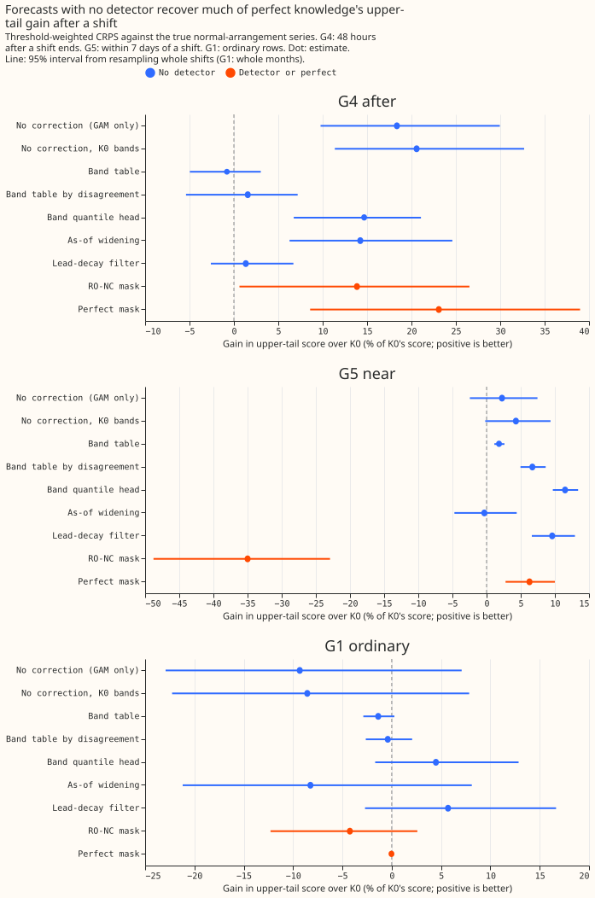
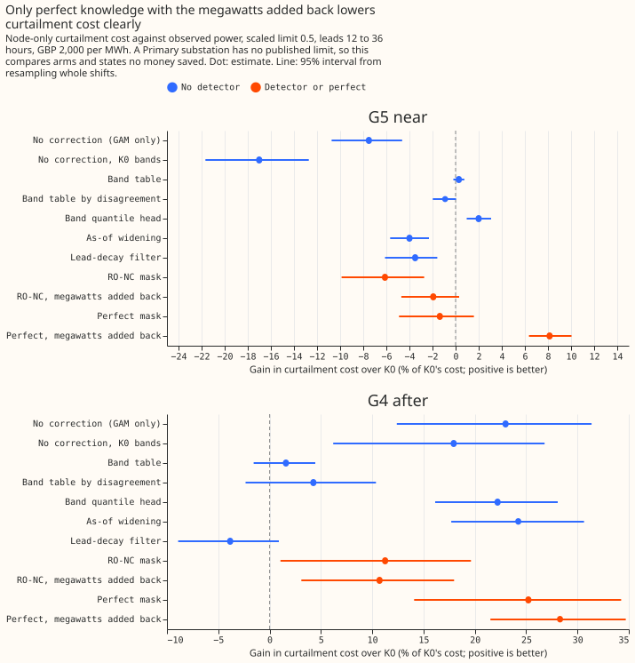
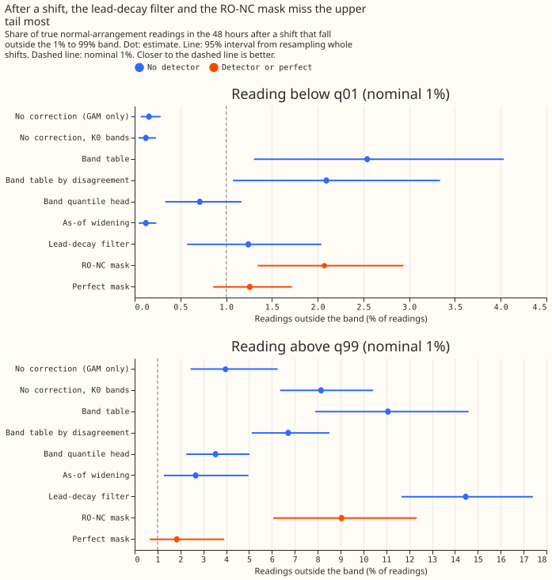

**This experiment asks whether a forecast needs a load shift detector at all.** A load shift moves
demand from one Primary substation to its neighbours for
hours or days. A detector finds those shifts in the power readings, and the forecast then sets aside
the readings inside each detected shift (a "mask"). We simulated 411 load shifts (44 copies of the
real power record, six Primary substations labelled D5, D9, D10, D11, D14, and D16, from [experiment
141](../00141-switching-detector-fed-into-gam-k/result.md)). We compared forecasts that use a
detector with seven forecasts that use none, scored as in [experiment
283](../00283-lsc-perfect-knowledge-value-to-forecast-and-curtailment/result.md). The detector is
RO-NC (the refit-offset neighbour-count detector), because LR_b20 (a learned detector built on RO-NC's
alarms) was never run on the simulated shifts. **Against RO-NC, a detector is not shown to be
needed.** The page does not conclude that no detector is needed, because RO-NC is the weaker of the
two detectors.

**K0 is the Kalman filter on recent power with no knowledge of shifts; every gain is a percentage of
K0's score, and positive is better.** The "upper-tail score" is the continuous ranked probability
score weighted towards values above the 95th percentile of earlier power (twCRPS). G1 is ordinary
rows, G4 is the 48 hours after a shift ends, G5 is the 7 days either side of a shift and the shift
itself, and "shift rows" are the before-alarm, during, and after rows of G5. Primary substations have
no published export limit, so curtailment figures compare forecasts and state no money saved.
Intervals resample whole shifts, or whole calendar months for ordinary rows.

## Gains over K0 near a shift

| Arm | Upper-tail score, 48 h after (G4) | Upper-tail score, within 7 days (G5) | Curtailment cost, within 7 days (G5) |
|---|---|---|---|
| GAM_ONLY (no correction) | +18.4 (9.8 to 30.0) | +2.3 (-2.5 to 7.5) | -7.5 (-10.8 to -4.6) |
| Band table by disagreement | +1.6 (-5.4 to 7.2) | +6.7 (5.0 to 8.7) | -0.9 (-2.0 to +0.0) |
| Band quantile head | +14.7 (6.7 to 20.9) | +11.5 (9.7 to 13.4) | +2.0 (1.0 to 3.1) |
| As-of widening | +14.2 (6.3 to 24.6) | -0.3 (-4.6 to 4.5) | -4.0 (-5.7 to -2.3) |
| Lead-decay filter | +1.3 (-2.6 to 6.6) | +9.6 (6.7 to 12.9) | -3.5 (-6.0 to -1.6) |
| RO-NC mask | +13.9 (0.9 to 26.5) | -35.0 (-48.8 to -23.0) | -6.1 (-9.9 to -2.7) |
| Perfect mask | +23.1 (8.7 to 39.1) | +6.3 (2.8 to 10.0) | -1.4 (-4.9 to +1.6) |
| Perfect, megawatts added back (post hoc, scored against observed power) | +18.1 (6.0 to 31.5) | +6.6 (3.3 to 9.7) | +8.1 (6.4 to 10.0) |

Every cell is a percentage gain over K0 with a 95% interval.

## Decision contrasts

- **Decision rule against RO-NC (half B of the worlds; the best no-detector arm, the band quantile
  head, was chosen on half A).** The RO-NC mask loses 57.9% (34.1 to 88.8) of the upper-tail score
  against the head within 7 days of a shift, and scores 0.178 points (0.070 to 0.298) worse on
  ordinary rows. RO-NC with megawatts added back loses 3.9% (0.1 to 9.1) of curtailment cost. The
  decision rule is not met.
- **Perfect knowledge against the same head.** On the upper-tail score within 7 days it loses 5.7%
  (1.1 to 10.9). On the 10.4% of those rows where a shift acts it gains 10.2% (-7.0 to +25.0), so
  the interval spans zero. On curtailment cost, with the true megawatts added back, it gains 6.5%
  (3.9 to 9.2) in G5 and 14.9% (6.3 to 23.4) on shift rows. The ordinary-row clause fails: the
  perfect mask scores 0.048 points worse than the head on ordinary rows (interval for perfect minus
  head: -0.149 to +0.019). The head also costs 2.9% (0.7 to 5.7) more curtailment than K0 on
  ordinary rows.
- **Leaving out one Primary substation changes the contrasts.** Without D16, the perfect mask
  against the head moves from -5.7% to +0.4% (-5.1 to +5.6) on the upper-tail score in G5. Without
  D11, RO-NC with megawatts added back moves from -3.9% to +1.4% (-2.4 to +5.2) on cost.
- **Held-out check of the head (post hoc).** The head's fit used the same worlds as its scoring, on
  the other month parity. Refitting it on even-seed worlds only and scoring odd-seed worlds only
  keeps the gain: +10.1% (8.2 to 12.3) within 7 days against +11.8% (9.2 to 14.9) for the
  cross-fitted head on the same worlds, and 4.07% (2.44 to 5.94) of readings above q99 after a
  shift against 3.85% (2.30 to 5.68). The injector and the real record are shared, so a leak
  through either is not removed.

## Predictions

- **P1 failed.** GAM_ONLY loses 0.222 points (0.029 to 0.374) of CRPS on ordinary rows at leads of
  24 to 168 hours, against the bar of 0.10. In the 48 hours after a shift 0.16% (0.07 to 0.28) of
  true readings fall below its q01 and 3.97% (2.46 to 6.25) rise above its q99, outside the
  2-percentage-point bar.
- **P2 failed as written.** K0's share below q01 after a shift is 2.24% (1.14 to 3.55), not the
  brief's 9.1%, so K0 meets the 3% bar. The share above q99 is the real fault: 14.23% (10.92 to
  17.74) for K0 and 3.54% (2.22 to 5.05) for the head. The head lowers ordinary-row CRPS by 0.046
  points (-0.023 to +0.150), more than the 0.01 bar allows.
- **P3 failed.** The lead-decay filter recovers 5.8% (-11.9 to 30.0) of the perfect mask's gain in
  the 48 hours after a shift, against 60%. Arms outside the prediction recover more: GAM_ONLY 79.5%
  (57.2 to 134.1), as-of widening 61.7% (41.5 to 93.4), and the head 63.6% (22.4 to 210.6).

## Checks

- **Median minus mean forecast, per site:** the mean absolute error of the median forecast minus
  that of the mean forecast lies between -0.274 (band head) and +0.088 (band table, plain) points.
  The band arms keep K0's mean forecast, so their mean-forecast error equals K0's by construction,
  and the head moves the median by design.
- **Absolute CRPS against the true series (points of effective capacity, K0 / head / perfect
  mask):** 2.71 / 2.66 / 2.71 on ordinary rows, 4.14 / 3.43 / 2.69 in G4, and 2.96 / 2.74 / 2.64 in
  G5. The printed report holds every arm.
- **Triggers that fired:** the prediction-contradiction trigger (all three predictions failed; the
  tested explanation is K0's measured 2.24% below q01 against the brief's 9.1%), the
  leave-one-site-out trigger (D16 and D11 flip contrasts), and the replication trigger (the next
  program step builds its bar on the best no-detector arm). An audit by a fresh Sonnet reviewer
  reproduced the headline contrasts from the stored scores. Its main finding, that the head's
  advantage over the perfect mask in G5 sits in margin rows (89.6% of G5), is in the contrasts
  above. Its estimate that the head's gain falls from +11.5% to +4.9% when ordinary rows are
  reweighted like near-shift rows is not in the printed report, and BAND_TABLE_PLAIN (+1.8%, 1.1 to
  2.6, the same arm without the filter level) is the printed control.

## How BAND_HEAD was trained, and its real-record results (added by experiment 312)

- **Training:** every head is fitted on the rows of all 44 worlds whose month has one parity and
  scored on the other parity, then the roles swap. Rows near a shift take the parity of the shift's
  onset month, and ordinary rows weigh 4. A world shares the injector, the real record, and the
  months with the other worlds, so the held-out check above removes the scored worlds and seeds
  from fitting but not the injector.
- **Real record ([experiment
  312](../00312-lsc-how-good-must-a-detector-be-against-the-band-head/result.md)):** against K0 the
  head changes the quantile score on ordinary rows by +1.1% (-1.1 to +3.7), so it does no harm.
  Readings fall below q01 in 0.9% of ordinary rows and above q99 in 0.9%, against 1.8% and 1.1% for
  K0. In the 48 hours after a logged transfer the shares are 1.3% and 1.1%, against 2.4% and 1.0%.
- **Not compared:** experiment 264's rows are at D8 and experiment 209's heads belong to arm D, so
  neither shares rows with BAND_HEAD.

## Caveats

- **RO-NC is a weak stand-in.** Its false alarms are the likely cause of the 35% loss, although the
  report does not separate them from late ends. LR_b20 may behave differently, and experiment 208
  noted that its learned score was trained on the real record.
- **The comparison is not like for like on bands.** The detector arms keep K0's bands, and the head
  has refitted bands, so part of the head's lead is a calibration gain that a detector forecast
  could also have.
- **Lab conditions.** The megawatts-added-back arms use the true megawatts and the true end of each
  shift, and the detector arms use hindsight ends.
- **The simulated shifts are all 25% of load or more and last over a day.**
- **Not done.** The head was not scored on the real record (7 logged transfers), which resolves no
  curtailment difference ([experiment
  277](../00277-lsc-curtailment-metric-on-existing-forecasts/result.md)). The as-of widening arm is
  a simplified port of [experiment 264](../00264-dp-gas-engine-asymmetric-bands-at-d8/result.md)'s
  idea, and no comparison with experiment 209's heads was made.
- **Spreads and folds.** GAM_ONLY and as-of widening fit their spreads on the clean series, which
  flatters both arms slightly. Rows near a shift are folded by onset month, so a few target
  timestamps fall in the other parity's months.

## Arms and rows

- **Arms:** K0; GAM_ONLY (no correction, spread fitted on the other month parity); the same with
  K0's bands; a band table (lead band by hour band); a band table by disagreement (also binned by the
  filter's correction in units of its own history); the band quantile head (XGBoost, 11 quantiles,
  depth 3, 100 rounds, trained on residuals against observed power); as-of widening; the lead-decay
  filter; RO-NC with and without megawatts added back; perfect knowledge with and without megawatts
  added back.
- **Training:** every fitted arm is trained on all worlds' rows of one month parity and scored on the
  other parity, then the roles swap. Rows near a shift take the parity of the shift's onset month.
- **Rows and schedule:** experiment 283's rows (22.9 million weighted rows, 411 shifts); no
  retraining, the forecasts are cached member forecasts of experiments 111 and 115.
- **Weather:** the cached ensemble member forecasts; the readings are the real residual stream plus
  injected megawatts.

## What to try next

- **Run LR_b20 on the injected worlds**, after checking whether the learned score needs retraining
  there, and judge it against the head and against perfect knowledge on shift rows.
- **Give the detector arms the recalibrated bands**, so that detector and no-detector forecasts
  differ only in the detector.
