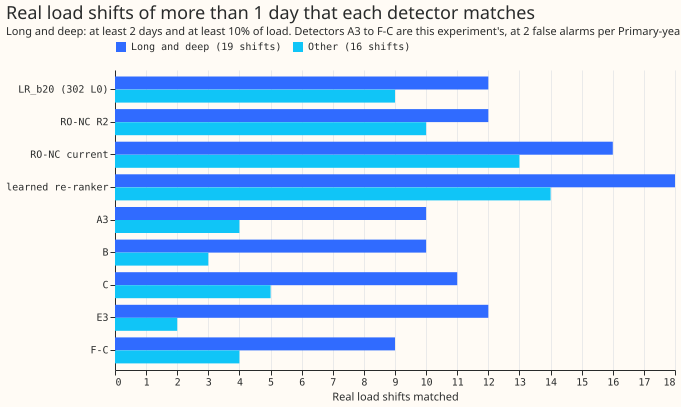
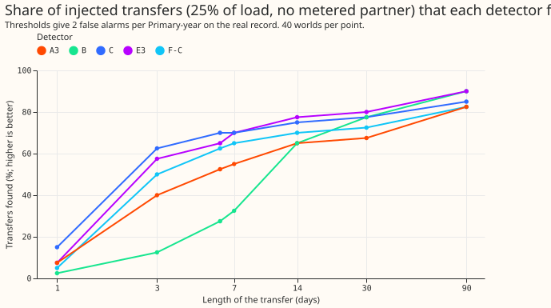
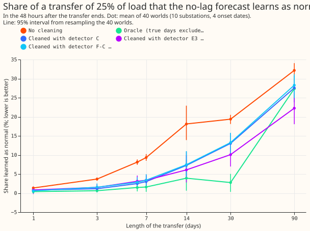

**A simple detector on the daily mean error of the no-lag forecast finds as many long, deep real
load shifts as the learned score LR_b20 does, and leaving its flagged days out of the monthly refit
cuts what the forecast learns of a 30-day transfer by a third to a half, but does not reach the 5%
the plan predicted.** A load shift (also called a transfer) is a spell in which an operator moves
part of one Primary substation's demand onto a neighbour. We built six detectors (A to F) that read
the daily mean of the forecast error of the generalised additive model with no lagged power
(GAM_ONLY). We scored them on the real record and on shifts we added to the series. We then refitted
GAM_ONLY every month with the days a detector had flagged left out of training. The verdict is `not
supported`, because predictions 1 and 2 and the 5% target of prediction 3 all failed. The ceiling is
visible, though: leaving out the true shift days cuts the share learned to 2.8%.

## Long-and-deep stratum

The headline comparison is on the 19 real load shifts that last at least 2 days and move at least
10% of load, the stratum that [experiment
302](../00302-lsc-learned-score-without-nged-labels/result.md) fixed before this experiment's
results were read. "Matches" counts shifts with an alarm during them or within a day. "Alarms per
match" is every alarm over the whole record divided by the matches. "MW-weighted" weights each match
by the shift's recorded megawatts. `printed_stratum.txt` holds the full table.

| Detector | Matches, stratum (19) | Alarms per match | MW-weighted | Matches, other 16 | MW-weighted |
|---|---|---|---|---|---|
| LR_b20 (experiment 302) | 12 | 8.8 | 0.72 | 9 | 0.69 |
| RO-NC, 2nd operating point | 12 | 10.8 | 0.71 | 10 | 0.80 |
| RO-NC, carried operating point | 16 | 18.1 | 0.86 | 13 | 0.92 |
| Learned re-ranker | 18 | 21.3 | 0.95 | 14 | 0.94 |
| A3 (mean of 3 days) | 10 | 13.3 | 0.65 | 4 | 0.43 |
| B (cumulative sum) | 10 | 15.0 | 0.66 | 3 | 0.18 |
| C (3 days against 28) | 11 | 11.4 | 0.67 | 5 | 0.38 |
| E3 (pair test) | 12 | 11.4 | 0.68 | 2 | 0.09 |
| D-A3 (neighbour check) | 8 | 16.4 | 0.54 | 4 | 0.34 |
| F-C (neighbour cover) | 9 | 13.8 | 0.58 | 4 | 0.22 |

**On the stratum the daily-mean detectors match 7 to 12 of 19, against 12 for LR_b20, with more
alarms per match; on the other 16 shifts they are clearly worse.** RO-NC (the refit-offset
neighbour-count detector) and the learned re-ranker match more at their carried operating points,
but at 18 to 21 alarms per match.

The same split on the injected shifts (25% of load, no metered partner, even-month onsets, 2 or more
days against 1 day): variant C finds 62% of 1,440 long shifts (3.2 alarms per match, MW-weighted
0.85) and 13% of 240 one-day shifts; E3 finds 61% and 6%; F-C finds 55% and 8%.

## Part 1: the detectors

- **Real record, tuned to 2 false alarms per Primary-year in odd months.** Variant C (the
  pre-registered best any-alarm variant, chosen on odd-month injected shifts) found 0 of 17 block
  days, 11 of 29 D8 drops and 16 of 35 real transfers, with 1.48 false alarms per Primary-year in
  even months. Variant B found 27 of 29 D8 drops and 1 of 17 block days at 1.59 false alarms. The
  block days are 12 hours or less, so a daily mean cannot see them. Prediction 1 fails on the block
  days and holds on the drops and the false-alarm rate. The drops are probably a gas engine
  ([experiment 291](../00291-d8-drops-engine-spells-load-shift/result.md)), so they are not counted
  as load shifts.
- **Neighbour checks at the same threshold** cut false alarms by 68% to 73% (D-A3 against A3: 76 to
  24 over the record), but lose 27% to 56% of the 22 real transfers that have two metered sides.
  Prediction 2's limit of a 20% recall loss fails.
- **The pair test E3 does not check neighbours.** On injected shifts its recall is 73% with no
  metered partner, 81% with one, and 74% with a shifted-week placebo. D and F separate better (F-C
  at the same threshold: 65% with the partner, 42% with none, 39% with the placebo).
- **Permanent steps are not rejected.** Variants D to F alarm on 50% to 99% of injected steps whose
  receiver is unmetered, against the 20% or less the plan allowed.
- **Timing.** For found injected shifts of 6 days or more, the median alarm comes 24 to 48 hours
  after the start for A2, A3, C, E3 and F-C and 72 to 96 hours for A7 and B; the median start and
  end errors are 0 hours at day resolution.
- **Depth.** Recall for 7 to 90 days at 10% of load is 16% to 44%, at 25% it is 66% to 83%, and at
  50% it is 66% to 92%.

## Part 2: cleaning the refit

| 30 days, 25% of load | Share learned, 48 h after the end | 2 to 33 days after |
|---|---|---|
| No cleaning | 19.4% (18.2 to 20.5) | 12.0% |
| Oracle | 2.8% (0.4 to 5.1) | 2.0% |
| Detector C | 13.0% (10.4 to 15.6) | 6.0% |
| Detector E3 | 10.1% (7.0 to 13.5) | 4.5% |
| Detector F-C | 13.2% (10.4 to 15.9) | 5.9% |

- **Paired difference from no cleaning:** oracle -16.6 points (-18.8 to -14.4), C -6.3 (-9.1 to
  -3.5), E3 -9.3 (-12.8 to -6.2), F-C -6.1 (-9.1 to -3.5). Prediction 3's target of under 5% fails
  for every detector.
- **Short shifts.** Cleaning helps most for 3 to 14 days (14 days: 18.1% uncleaned, 3.9% oracle,
  6.1% to 7.4% detectors). A shift of 25% and 7 days falls from 9.3% to 3.0% to 3.4%.
- **Long shifts and steps.** A 90-day shift stays at 22% to 28% learned with any arm, because the
  run of excluded days is capped at 60. A permanent step of 25% is 45% learned after 12 months with
  no cleaning, 24% with the oracle, and 24% (E3) to 34% (F-C) with detectors.
- **Clean rows.** On the 14 Primaries with no shift, cleaning changes the mean absolute error by
  +0.013 (-0.029 to +0.070) points for C, +0.007 (-0.029 to +0.055) for E3, and -0.008 (-0.033 to
  +0.021) for F-C. D8 (+0.31 for C) and D12 (+0.16 to +0.26 for E3 and F-C) carry the positive
  values.
- **Self-reinforcement.** Refitting without the flagged days and re-running the detector on the new
  residuals flags 74% to 97% of the same days again, so the exclusion is stable. The recheck uses
  in-sample residuals for the days that stayed in training.
- **Wrong exclusions.** Over the whole run each detector flags 7 to 8 days per 30-day world, and 5
  to 7 days per world of 1 to 7 days, outside the true shift.
- **Near-a-shift scores** against the true normal-arrangement series (30 days, 25%): mean continuous
  ranked probability score 4.66 points with no cleaning, 4.54 oracle, 4.61 to 4.59 detectors. The
  threshold-weighted score is 0.63 for every arm. The spread is a fixed Gaussian width fitted to the
  clean forecast's own error, so these scores rank the centres only.

## Checks

- **Median minus mean forecast.** GAM_ONLY forecasts the mean, so the gap does not exist.
- **Error of the mean forecast beside the scores.** The mean absolute error against the true series
  falls in step with the continuous ranked probability score (6.26 uncleaned, 6.11 oracle, 6.17 to
  6.20 detectors).
- **Audit triggers fired:** (1) a control: E3 does no neighbour check (73% unmetered, 81% metered,
  74% placebo); (2) the result contradicts predictions 1, 2 and 3, and the explanation we tested
  (the detector's delay of 1 to 3 days) fits but was not isolated; (5) the oracle, which should
  contain every detector arm, scores 27.4% learned for a 90-day 25% shift against 22.3% for E3
  (intervals 24.7 to 30.9 and 18.1 to 26.5), because the oracle run of excluded days is capped at 60
  while the detectors' separate runs are not. No Opus audit was run, because this session was
  limited to Sonnet models.
- **Reviews.** One Sonnet code review found 12 issues. We fixed four (a pair-noise cache shared
  between worlds, a placebo shifted by less than the transfer, hits that ignored the sign of the
  alarm, and stored-alarm counts on a different basis) and documented the rest below.

## Caveats and what to try next

- Thresholds for D-A7, D-C and F-A7 reach the bottom of the grid, so they are not at equal
  false-alarm rate with A to C. Recall on the real record is counted in all months, so it is partly
  in the tuning months. Variant B's long spans count as hits on any overlap.
- The hindsight start moves back by up to the window length minus one (6 days for A7 and E7), not
  the planned 2. The partner in a metered world is refitted but never cleaned, and the load level
  used by the depth rule is the clean level.
- Permanent steps start at the four fixed onsets and run 15 months, not 3, 6 and 12 months before
  the end of the data. The weather is ERA5 and CAMS, which arrive days late, so the numbers are a
  ceiling.
- D15 has no panel because its history starts in 2025, so 15 of the 16 Primaries are scored.
- **Next.** The gap between the detectors (10% to 13%) and the oracle (2.8%) is mostly the 1 to 3
  days before a detector fires and the third of transfers it misses. A detector that fires on the
  first day, or a refit that downweights the most recent days when the residual is high, is the
  experiment this result narrows the search to.
