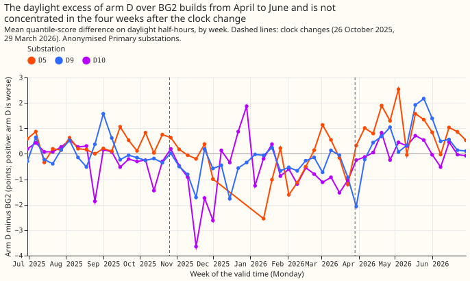
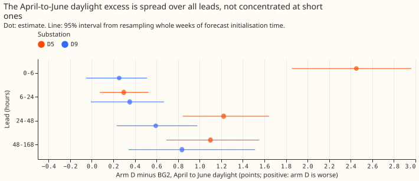
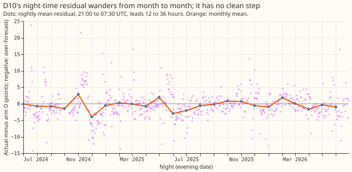
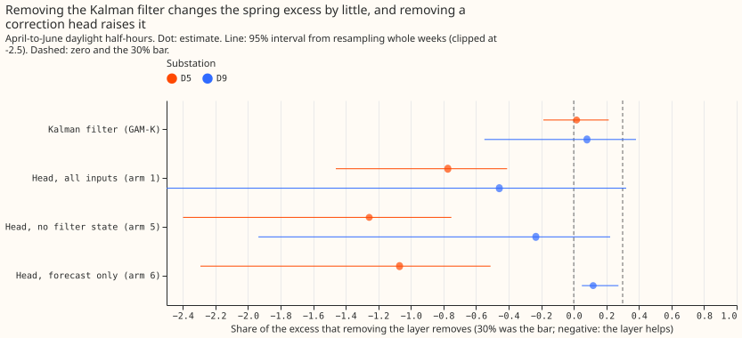

**The spring excess of the convex demand model (arm D) over BG2 follows the sun, not the clock.** We
asked three questions of experiment 266's stored forecasts. When does arm D fall behind BG2, the
production-style XGBoost forecast? What is D10's night-time level error? Do the Kalman filter on
recent errors and the neural-network correction heads make the spring excess larger? Nothing is
refitted. The excess sits on clear midday half-hours at D5 (+1.67 points) and across the whole day at
D9, at every lead, so a clock-change mismatch and BG2's use of recent power do not explain it. The
Kalman filter changes it by +0.02 and +0.06 points, and the three correction heads lower it. D10's
night residual has no single step. D5, D9, and D10 are anonymised Primary substations. The scores
are quantile scores in points of effective capacity, over experiment 266's 561,207 rows (six
substations, 2025-07-02 to 2026-06-30, 09:00 UTC runs, leads 0.5 to 168 hours, outside hand-filtered
load shifts), and intervals resample whole ISO weeks of forecast initialisation time (14 weeks in
April to June).

The pre-registered predictions all failed: the excess is not concentrated within four weeks of the
clock change or at short leads (Part 1), D10's offset is not one step (Part 3), and removing the
filter or a head does not lower the excess by 30% (Part 2).

## Results

- **Gate:** arm D minus BG2 in April to June is +0.319 (+0.198 to +0.430), the figure of experiment
  266.
- **Part 1, timing (predicted, and failed):** the first four weeks after 29 March 2026 hold 29% of
  D5's April-to-June daylight excess (27% of its rows) and 10% of D9's (26% of rows); the required
  share was 50%. Leads under 24 hours hold 14% of D5's excess (14% of rows) and 6% of D9's (14% of
  rows); the required share was 50%. Both halves fail at both substations, so the excess is gradual.
- **Lead and sunshine, April to June daylight (points):** D5 +2.45 at 0 to 6 hours, +0.30 at 6 to
  24, +1.22 at 24 to 48, +1.10 at 48 to 168; D9 +0.25, +0.35, +0.59, +0.84. By realised clear-sky
  index at D5: clear +1.67 (+1.23 to +2.11), mixed +0.72, overcast -0.31 (-0.90 to +0.35). At D9:
  clear +1.02, mixed +0.47, overcast +0.25.
- **Hour of day, April to June, local time:** D5's excess peaks at 12:00 to 15:00 (+3.0 to +3.7
  points) and is near zero at night. D9's is +0.5 to +1.0 from 08:00 to 23:00 and +0.2 to +0.4 at
  night, so it is not shaped like solar output alone.
- **Clock-change comparison (descriptive):** D5's daylight gap is -0.03 in the four weeks before
  29 March 2026 and +1.12 in the four weeks after, but in the autumn it falls from +0.52 to +0.13
  across 26 October 2025. The jump at D5 and the fall in autumn both match sun elevation and
  sunshine, and this design cannot separate a clock-change effect from them.
- **Season at D5 and D9:** July to September daylight excess is +0.31 (D5) and +0.17 (D9), against
  +1.12 and +0.73 in April to June. D10: +0.20 daylight and +0.60 night in April to June.
- **Part 3, D10 night level (predicted, and failed):** over 635 nights (2024-07 to 2026-06, leads 12
  to 36 hours, rows outside hand-filtered load shifts, which is a subset of the rows the earlier
  experiments scored), the best single-step fit explains 0.9% of the variance of the nightly mean
  residual; a fit on month explains 12.7% and on temperature band and month 13.3%. Within the scored
  year the step explains 2.6% and temperature band and month 11.1%. The change-point date has a 95%
  interval of 623 days (whole period) and 310 days (scored year), far above the 2-week bar. The
  April-to-June mean residual is -0.55 points in 2025 and -0.95 in 2026. Day of week explains 1.2%
  (Sunday and Monday evening nights -1.0 to -1.2 points). No candidate date is inferred.
- **Part 2, error correction (predicted, and failed), April-to-June daylight:** removing the Kalman
  filter from GAM-K (experiment 111's GAM-K against its filterless GAM0) lowers the excess by
  1.7% at D5 (-18.7% to +21.5%) and 8.1% at D9 (-54.9% to +38.3%), both under the 30% bar, and
  changes July to September by -0.04 (D5) and +0.60 (D9) points, so the July-to-September condition
  also fails. Removing a correction head (experiment 201's arms 1, 5, and 6 against arm D) raises
  the D5 excess: arm 1 by 0.49 points (-0.71 to -0.28 for the head's own effect), arm 5 by 0.63,
  arm 6 by 0.58. At D9 the head's effect is -0.23 (-0.54 to +0.16), -0.14, and +0.10 points.
- **Filter by season, all six substations, GAM-K minus GAM0:** -0.14 (-0.39 to +0.06) points in
  April to June daylight and -0.30 (-0.42 to -0.19) in July to September daylight.

## Checks

- **Median minus mean forecast, arm D, per substation:** exactly 0.000 points at D5, D9, D10, D11,
  D14, and D16, because arm D's median is its mean. The mean-forecast error equals the
  median-forecast error at every substation (mean absolute error of arm D: D5 6.01, D9 4.21, D10
  5.31, D11 4.21, D14 3.69, D16 4.48 MW).
- **Triggers:** 1 (a control fails), 3 (quantile score against mean-error direction), 4
  (leave-one-out), 5 (nested arm), and 6 (interval width) do not apply, because the experiment has
  no controls, no leave-one-out contrast, and no sister experiment on these contrasts. Trigger 2
  (a result contradicts its prediction) fired for every prediction; the page records an explanation
  for each (sun elevation and sunshine, a month-scale drift, and the heads helping), and the head
  result agrees with experiments 200, 201, and 266. Trigger 7 holds for the planned
  solar-times-temperature experiment, whose design depends on the D5 and D9 excess being a
  clear-sky effect that the additive model cannot give different weights; the manager decides
  whether that needs an audit.

## Caveats

- **Part 2 is stored pairs only.** Arm D without its filter is not stored, so the filter test uses
  the older GAM-K and GAM0 of experiment 111, which differ from arm D (no night offset, no recipe R).
  A refit of arm D without the filter was not run.
- **D10's night residual here is smaller than the -2 points of experiment 281.** This page uses arm D
  at leads 12 to 36 hours over 21:00 to 07:30 UTC outside load shifts; experiment 281 used a different
  arm and lead set.
- **Intervals are wide.** April to June holds 14 weeks of forecast initialisation, and the
  nightly series are noisy; the single-step test has little power, which the page reports through
  the interval width.
- **Retraining schedule:** not applicable, because nothing is refitted.

## What to try next

- Test the solar term's response on clear, high-sun half-hours at D5 and D9 directly, for example
  with the experiment 4 interaction terms of `dp_summer_gap_next_experiments.md`, using realised
  clear-sky index strata as the first read.
- Test a night term that varies by month at D10 instead of looking for a date.

## Code

- `ml-experiments/00299-summer-gap-timing-night-level-and-error-correction/`: `e00299_timing.py`,
  `e00299_night.py`, `e00299_correction.py`, and `e00299_charts.py`.
