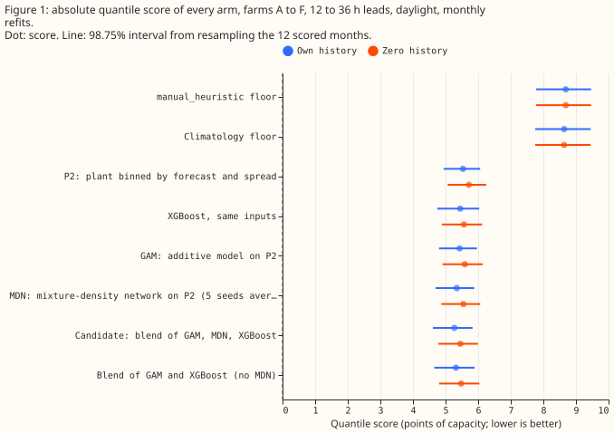
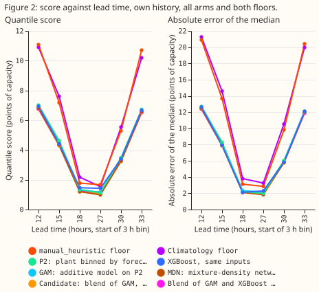
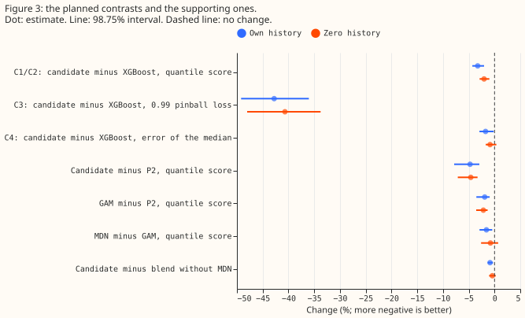
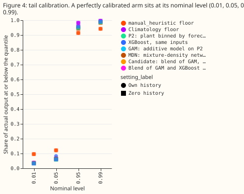
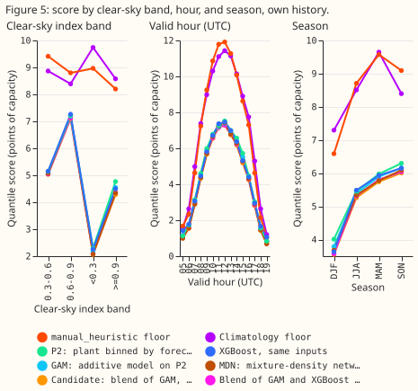
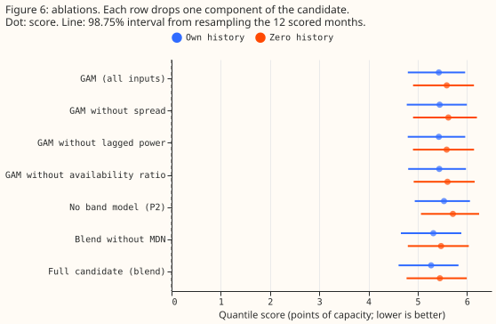

**The assembled forecast scores 3.3% better than XGBoost on the quantile score (lower is better)
and 43% better at the 0.99 pinball loss when a farm trains on its own history.** With no history for
the farm, it scores 2.0% better than XGBoost on the quantile score. National Grid Electricity
Distribution (NGED) meters six solar farms, labelled A to F here. We scored the forecast that
experiments [270](../00270-metered-farm-xgboost-vs-plant-diagnostic/result.md),
[287](../00287-metered-farm-spread-binned-plant-heads/result.md), and
[260](../00260-metered-farm-quantile-combination/result.md) selected against four references: XGBoost
(a gradient-boosted tree model, [Chen and Guestrin, 2016](https://doi.org/10.1145/2939672.2939785)),
`manual_heuristic`, `climatology`, and the physical power model alone. The forecast starts from a
physical power model of each farm, called "P2". A generalised additive model (GAM) and a
mixture-density neural network (MDN) each correct P2's 11 quantiles. The forecast blends the GAM's,
the MDN's, and XGBoost's quantiles, level by level. The quantile score is twice the mean pinball
loss over the 11 quantile levels, in points of capacity, and a negative change in it is an
improvement. We refitted every forecasting method each month for the 12 scored months, September
2025 to August 2026. "Own history" means a model trains on the farm's earlier months, and "zero
history" means a model trains on the other five farms only.

**The verdict is partly supported.** The own-history score gain (-3.3%, 98.75% interval -4.3% to
-2.0%) and the 0.99 pinball-loss gain (-42.8%, -49.2% to -36.0%) cleared the bars in the decision
rule. The zero-history gain (-2.0%, -2.8% to -1.0%) did not reach the 3% we predicted, although
its interval excludes zero. The own-history score gain is larger than the 1% to 2% we predicted.
The Audit triggers bullet under Checks compares it with experiment 287's XGBoost score and explains
the difference.

**The scores cover leads of 12 to 36 hours only, and NGED cares about 1 day to 10 days ahead.** The
stored ensemble tables hold only the 00 UTC run's first 36 hours, so nothing here says how the
candidate compares with XGBoost at 2 to 10 days.

## Each model family alone beside the blend

The fits for every row of this table are stored, so the table needs no new run. A negative change
is an improvement. The best single family is chosen on the scored year, which favours it slightly.

| Model | Score, own history | 0.99 pinball loss, own | Score, zero history | 0.99 pinball loss, zero |
|---|---|---|---|---|
| GAM alone | 5.43 | 0.331 | 5.59 | 0.348 |
| MDN alone (5 seeds averaged) | 5.34 | 0.300 | 5.55 | 0.321 |
| XGBoost alone | 5.45 | 0.541 | 5.56 | 0.549 |
| Blend of the three | 5.27 | 0.310 | 5.45 | 0.327 |

- **The MDN is the best single family** on the quantile score in both settings.
- **The blend adds 1.3% over the MDN in own history** (98.75% interval -2.6% to -0.2%) and **1.7% in
  zero history** (-2.5% to -0.6%).
- **The blend adds nothing at the 0.99 quantile.** The blend's 0.99 pinball loss is 3.1% higher than
  the MDN's in own history (-0.5% to +8.5%) and 1.9% higher in zero history (-3.9% to +8.0%).
- **XGBoost alone is the weakest family at the 0.99 quantile** (0.54, against 0.30 to 0.35 for the
  other two) and scores within 0.4% of the GAM on the quantile score in own history.

## Results

- **Quantile score (points of capacity; own history, then zero history).** Candidate blend 5.27 and
  5.45, blend of GAM and XGBoost 5.32 and 5.47, MDN (five seeds averaged) 5.34 and 5.55, XGBoost
  5.45 and 5.56, GAM 5.43 and 5.59, P2 5.54 and 5.71, `climatology` 8.64, `manual_heuristic` 8.69.
  The candidate is 39% below `manual_heuristic` in own history (-42.3% to -36.3%) and 37% below in
  zero history.
- **Planned contrasts, candidate minus XGBoost (98.75% interval).** Own history: score -3.27%
  (-4.30 to -2.04); 0.99 pinball loss -42.8% (-49.2 to -36.0); error of the median -1.74%
  (-2.92 to -0.15). Zero history: score -1.99% (-2.84 to -0.96).
- **What each stage adds (own history).** Candidate minus P2 -4.75% (-7.84 to -2.96). GAM minus P2
  -1.9% (the ablations' reference). MDN minus GAM -1.57% (-2.91 to -0.44). Candidate minus the
  blend without the MDN -0.87% (-1.32 to -0.31). In zero history MDN minus GAM is -0.80% (-2.61 to
  +0.70) and the candidate minus the blend without the MDN is -0.46% (-1.12 to +0.21).
- **Inputs.** The ensemble spread is the standard deviation of the plant's response across the 51
  ensemble members. The availability ratio is the farm's output one or two days earlier divided by
  the plant's forecast for that time. The plant scale and output ceiling scale P2's forecast and cap
  it.
- **Ablations on the GAM (score change against the full GAM; own history, zero history).** No
  spread +0.31% (-0.83 to +1.09) and +0.58% (-0.38 to +1.24). No lagged power +0.01% (-0.06 to
  +0.07) and -0.01%. No availability ratio +0.17% (-0.01 to +0.35) and +0.27% (+0.13 to +0.42).
  Lagged power and the availability ratio add almost nothing.
- **Tail calibration (own history; nominal 0.01, 0.05, 0.95, 0.99).** Candidate coverage 0.036,
  0.070, 0.957, 0.990; XGBoost 0.035, 0.083, 0.946, 0.991. Pinball loss at 0.99: candidate 0.31,
  XGBoost 0.54, `manual_heuristic` 0.58, `climatology` 0.43. Actual output falls below the
  0.01 quantile 3.4 to 3.6 times as often as the nominal 1% for every forecast arm (the
  `manual_heuristic` floor: 9.6 times). It falls below the 0.05 quantile 1.3 to 1.5 times as often as
  the nominal 5% for most arms, and 1.7 times as often for XGBoost.
- **Where the gain sits (own history).** By season the candidate beats XGBoost by 4.1% in June to
  August (-5.5 to -2.9), 3.2% in March to May, and 2.3% in September to November and in December to
  February, where the December to February interval includes zero. By clear-sky band the candidate
  is 8% below XGBoost under cloud (index below 0.3), 5% below under clear sky (0.9 and above), and
  2% below in between. In each setting the candidate is
  worse than XGBoost in one month: December 2025 in own history and April 2026 in zero history.
- **Lead axis.** The stored ensemble tables cover leads of 12 to 36 hours from the 00 UTC run, and
  daylight leaves 3-hour bins starting at 12, 15, 18, 27, 30, and 33 hours. The candidate scores
  6.7 at the lowest bin and 6.5 at the highest, and about 1.1 to 1.2 at the 18 and 27 hour bins.
  The lead range of 0.5 to 54 hours that the brief asked for needs other ensemble runs and was not
  scored.
- **Farm cards (own history, August 2026 refit; fractions of capacity).** The plant scale is 1.00
  to 1.16 and the output ceiling 1.05 to 1.11. The mean width of the 5% to 95% band is 16 to 23
  points of capacity under cloud (clear-sky index below 0.3), 48 to 55 under partly clear sky (0.6
  to 0.9), and 29 to 39 under clear sky (0.9 and above). Across farms and bands, the band holds 85%
  to 95% of actual output against a nominal 90%. The per-farm tables are in the private data folder.
- **What the candidate cannot do.** It cannot forecast outages or curtailment by the network
  operator, and a 25% loss of capacity is detected too slowly to act on. A drift under about
  0.5% per year is invisible to it ([experiment 286](../00286-metered-farm-drift-soiling-injection/result.md)).
- **Curtailment value.** Not scored. The node-plus-generators metric needs a substation node with
  its generators, and these six farms are single series, so the comparison against
  `capacity_forecast` could not be run. Experiments 255, 268, and 277 give the metric's limited
  power.
- **Reference rows, quoted and not refitted.** The plant given observed weather explains a sunny
  fraction of 0.973, and the plant given the ensemble mean 0.91 ([experiment 218](../00218-metered-solar-farm-plant-fit/result.md)).
- **Schedule and weather.** The models are refitted monthly on all earlier months, and each month's
  training rows end one day before the month starts. The forecast weather comes only from the ECMWF
  ensemble 00 UTC run, and the farm's own power comes from one or two days earlier; both exist at
  forecast time. Weekly refits were not run,
  so the absolute scores could shift a little. The MDN has five seeds, and the ablations use the
  GAM only.

## Checks

- **Median minus mean forecast, own history (points of capacity, farms pooled).** Candidate +0.01,
  XGBoost -0.92, GAM +0.29, MDN +0.37, P2 +0.40. XGBoost's median sits below its mean forecast; no
  other arm's does by more than 0.4.
- **Error of the mean forecast beside each score contrast.** Candidate minus XGBoost in own
  history: mean-forecast error -3.78% (-5.82 to -2.43), against a score change of -3.27%. The score
  and the mean-forecast error point the same way, so trigger 3 did not fire.
- **Audit triggers.** Trigger 2 (a result contradicting its prediction) fired in size only: the
  own-history gain is 3.3% against the predicted 1% to 2%. The XGBoost arm here has no past-weather
  rows, because those arrive about 5 days late. [Experiment 287](../00287-metered-farm-spread-binned-plant-heads/result.md)'s
  XGBoost scored 5.40 with past weather in a single fit, and the candidate is 2.4% below that
  figure, which brings the result into the predicted range. The two schedules differ, so the
  comparison is approximate. Trigger 4 did not fire: dropping each farm in turn leaves the
  own-history score change between -2.9% and -3.5%, and the zero-history change between -1.8% and
  -2.2%. Trigger 5 did not fire: the ablated GAMs score within 0.6% of the full GAM, and none
  scores better by more than the interval's half-width. Triggers 1, 3, 6, and 7 did not fire. No
  audit ran.
- **Row set.** Every arm holds the same 41,676 rows in each setting (the code checks equal counts).

## Caveats and next steps

- **Zero history is not fully blind.** In zero history the blend's weights for a farm are fitted on
  the other five farms' earlier rows only. The lagged-power inputs still use the scored farm's own
  power from one or two days before the run, which exists at forecast time.
- **Post hoc.** The blend without the MDN is an added arm and not a planned contrast. The 98.75%
  level covers the four planned contrasts only.
- **Not covered.** This experiment did not cover leads under 12 hours, leads over 36 hours, weekly
  refits, or the curtailment value.
- **Next.** The next experiment should score the candidate and XGBoost at leads of up to 10 days,
  which is the horizon NGED cares about. After that, score the candidate with the node metric once
  a farm is paired with its substation.
