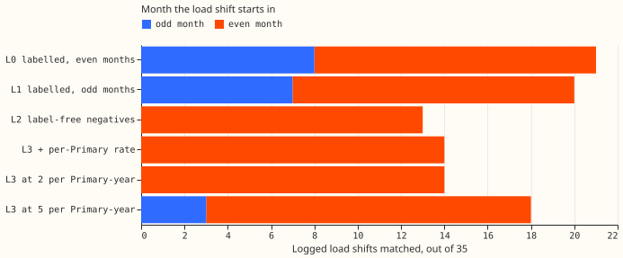
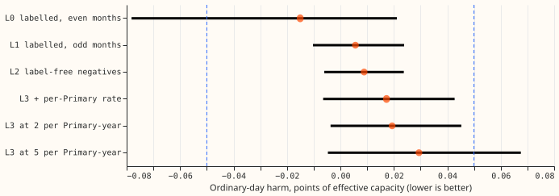
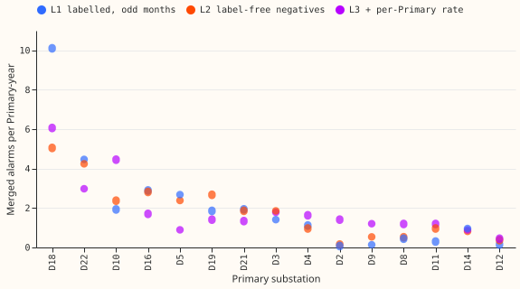
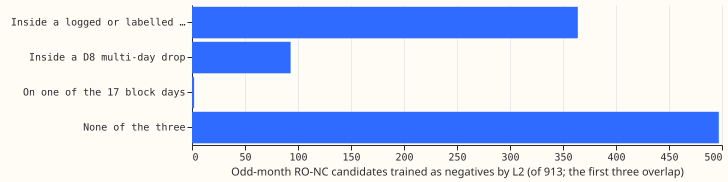

**A learned load-shift score trained without NGED labels in its negatives, with an alarm count taken
from the labelled score, matched 14 of the 35 logged load shifts, against 20 to 21 with labels. The
loss comes from the training negatives, not from the threshold.** A load shift is demand that the
electricity network operator moves between neighbouring Primary substations for hours or days. The
35 are the load shifts lasting over 1 day in NGED's switching log and hand labels. The score is the
re-ranker of [experiment 195](../00195-switching-neural-plus-detector-features/result.md), a small
neural network that re-scores the candidate alarms of the refit-offset neighbour-count detector
(RO-NC). A training negative is a candidate alarm that the network is taught is not a load shift.

**Two arms use NGED labels and four do not.** L0 is the carried setting of [experiment
227](../00227-lsc-fewer-false-alarms-and-softer-use-part-2/result.md) (LR_b20). It drops every
logged or labelled span, every multi-day drop of the Primary substation named D8, and the 17 block
days from its training negatives, and it sets its alarm threshold by counting candidates that no
logged closure explains. L1 repeats L0 with the months swapped. L2 keeps every real candidate as a
negative, and L3 adds an alarm rate per Primary. Terms defines the arms and a match. Flexpectation
version 2 will have no NGED labels, so we asked whether L3 still matches about as many load shifts.

**The prediction failed.** We predicted that L3 would match at least 18 of the 35 at no more than
6.5 alarms per match. It matched 14 at 7.5. Its ordinary-day harm point estimate and 95% interval
stayed inside the limit of 0.05 points (+0.017, -0.006 to +0.043). Points are percentages of a
substation's effective capacity, and a lower score is better. Against the labelled score trained on
the same months (L1), L3 lost 6 matches. The label-free negatives lowered matches by 7 (L2 against
L1), and the label-free threshold raised them by 1 (L3 against L2). The verdict is `not supported`.

**The whole loss sits in the load shifts that start in a month the score trained on (post hoc).** In
those 15 load shifts the labelled score L1 finds 7 and the label-free scores L2 and L3 find 0. Of
the 15, 12 have a real onset candidate that L2 trains as a negative and L1 drops, which is a
plausible mechanism that this page did not test. In the 20 load shifts that start in months the
score never saw, L1, L2, and L3 find 13, 13, and 14. A service for future months resembles this
split more than the whole 35, although the unseen months lie between trained months. Twenty load
shifts cannot separate a difference of one or two matches.

## Terms

- **Arms.** L0 is the stored re-ranker of experiment 195, trained on even months, with a threshold
  that leaves 20 unexplained odd-month candidates. L1 is the same recipe trained on odd months, with
  a threshold that leaves 20 unexplained even-month candidates. L2 trains on the same odd months as
  L1, but keeps every real candidate that lies outside an injected span as a negative, and its
  threshold leaves as many merged alarms over the whole record as L0 raises in the same fold. L3
  uses L2's score with one threshold per Primary: the fold's total alarm count is shared in
  proportion to each Primary's predicted RO-NC alarm rate times its years of residual. L3_5 and L3_2
  pin the total at 5 and at 2 merged alarms per Primary-year, so they read no label in their alarm
  count.
- **The predicted rate.** For Primary p, the base-2 logarithm of RO-NC's alarm rate at 4.35 noise
  units ([experiment 217](../00217-switching-label-free-thresholds-in-noise-units/result.md)) is
  fitted on the base-2 logarithm of the share of days on which the demand model's daily mean error
  exceeds 3 noise units (plus 0.01), by a straight line fitted on the other 14 Primaries.
- **Match and alarm.** A load shift is matched when an alarm's step is within 2 hours of its start
  and its estimated end within the larger of 6 hours and 10% of its duration (experiment 195's
  rule), scored with the fold that holds out the load shift's Primary pair. Alarms on one series
  within 24 hours merge, and the alarm count is the mean over the three folds.
- **Long and deep.** A load shift of at least 2 days that moves at least 10% of load (19 of the 35;
  8 load shifts of at least 2 days have no recorded share of load).
- **Confirmed.** An alarm with at least one opposite step at a metered neighbour.

## Results

- **Verdict: `not supported`.** L3 matches 14 of 35, below the bar of 18, and at 7.5 alarms per
  match, above 6.5. The harm bar holds.
- **Positive control reproduced.** L0 recomputed from experiment 227's stored scores matches 21 of
  35 at 5.0 alarms per match, and its harm on odd months is -0.015, as in experiment 227's odd-month
  figure (its all-month figure is -0.007).
- **Arms, all 35 load shifts (alarms are the mean over folds, over 15 Primaries and 61.8
  Primary-years):**

| Arm | Matched | Alarms | Alarms per match | MW-weighted recall |
|---|---|---|---|---|
| L0 labelled, even months | 21 | 105.0 | 5.0 | 0.707 |
| L1 labelled, odd months | 20 | 101.0 | 5.0 | 0.662 |
| L2 label-free negatives | 13 | 105.0 | 8.1 | 0.413 |
| L3 + per-Primary rate | 14 | 104.7 | 7.5 | 0.444 |
| L3 at 2 per Primary-year | 14 | 123.0 | 8.8 | 0.444 |
| L3 at 5 per Primary-year | 18 | 311.0 | 17.3 | 0.537 |

- **Decisive contrast and its parts (pairs resampled, 95% interval).** L3 minus L1: -6 matches
  (-10.0 to -2.6; lost 7, gained 1). L2 minus L1 (the negatives): -7 (-10.9 to -2.8). L3 minus L2
  (the threshold): +1 (0.0 to +2.6). L1 minus L0 (months swapped): -1 (-5.5 to +3.3). The
  decision rule asked for L3 within 3 matches of L1, and L3 is 6 below.
- **Long-and-deep load shifts (primary stratum, 19).** L0 12 (8.8 alarms per match), L1 10 (10.1),
  L2 8 (13.1), L3 8 (13.1), L3 at 5 per Primary-year 10 (31.1). L3 minus L1 is -2 (-5.6 to 0.0).
  MW-weighted recall in this stratum is 0.724 for L0, 0.634 for L1, and 0.469 for L3.
- **Neighbour-confirmed alarms.** L0 9 of 35 (4.8 alarms per match), L1 11 (4.8), L2 7 (5.9), L3 7
  (5.6). In the long-and-deep stratum L1 finds 7 of 19 and L3 6. Confirmed alarms lose fewer
  matches from label-free training (L1 minus L3 is 4 against 6) but match half as many load shifts.
- **Alarm rates (merged alarms per Primary-year).** The overall rate is 1.7 for L0, 1.6 for L1, 1.7
  for L2, and 1.7 for L3: the labelled budget of 20 is about 1.7 alarms per Primary-year, a third
  of the 5 per Primary-year chosen before the run. The number of Primaries within a
  factor of 2 of the median rate is 7 of 15 for L0 and L1, 8 for L2, and 11 for L3, L3_2, and L3_5.
  The per-Primary rule moves D10 from 2.4 (L2) to 4.5 (L3) alarms per Primary-year and D2 from 0.15
  to 1.4. Leave-one-Primary-out predictions of RO-NC's rate run from 1.35 (D12) to 16.3 (D18).
- **Injected load shifts of held-out pairs (even months, 1,009 load shifts; start and end found).**
  L1 0.248, L2 0.274, L3 0.270, L3 at 2 per Primary-year 0.272, L3 at 5 per Primary-year 0.289.
  Experiment 195's stored re-ranker (budget 80, odd-month injections, 998 load shifts) found 0.265.
  The label-free arms find at least as many injected load shifts as L1 and fewer real ones, so
  injected recall again cannot rank the arms (experiment 195 found the same).
- **Ordinary-day harm (arm minus no mask, 6 Primaries, whole-month 95% intervals, months the arm did
  not train on).** L0 -0.015 (-0.078 to +0.021, 13 odd months), L1 +0.006 (-0.010 to +0.024, 14 even
  months), L2 +0.009 (-0.006 to +0.024), L3 +0.017 (-0.006 to +0.043), L3 at 2 per Primary-year
  +0.019 (-0.004 to +0.045), L3 at 5 per Primary-year +0.029 (-0.005 to +0.068). All point estimates
  are inside +/-0.05. The 95% intervals of L0 to L3 and L3 at 2 per Primary-year are inside it too;
  the interval of L3 at 5 per Primary-year (to +0.068) is not. Paired on the same months: L3 minus
  L1 +0.012 (-0.017 to +0.041), L2 minus L1 +0.003 (-0.019 to +0.024), L3 minus L2 +0.008 (-0.005 to
  +0.029).
- **Label contamination of L2's training negatives.** Of 913 odd-month RO-NC candidates, 364 lie
  inside a logged or labelled span, 93 inside a D8 drop, and 2 on a block day (416, or 45.6%, in
  any of the three). Of the 15 logged load shifts that start in an odd month, 12 have a real
  candidate at the onset that L2 trains as a negative and L1 drops.
- **Forecast and training schedule.** Harm uses experiment 227's harness unchanged: Kalman filter
  correction on cached daily 09:00 UTC forecasts, readings set missing inside known alarms,
  alarms known 192 half-hours after the step. The re-rankers train on 40 worlds of 200 injected
  load shifts, three seeds, early stopping on 8 validation worlds. No demand model is refitted.

## Checks

- **Audit triggers.** Trigger 1: no control failed (L0 reproduces 21 of 35, 5.0 alarms per match,
  and harm -0.015 on odd months). Trigger 2: the failure of the prediction is explained by a tested
  split of matches by whether the load shift starts in a training month (post hoc; 15 and 20 load
  shifts). Trigger 3: the mean-forecast absolute-error contrast against no mask agrees in sign with
  the quantile-score harm for L1 (+0.014 against +0.006), L3 (+0.003 against +0.017), and L3_5, and
  disagrees for L2 (-0.005 against +0.009), where both are inside 0.01 points and inside the
  intervals. Trigger 4: leaving out any one Primary keeps L3's harm between +0.011 and +0.022 and
  L1's between +0.001 and +0.007. Trigger 5: L2 finds more injected load shifts than L1 (0.274
  against 0.248) while matching fewer real ones, a pattern that this page reads as injected recall
  failing to rank arms. Triggers 6 and 7 do not apply. No Opus audit was run: the verdict rests on a
  count of matches, which the L0 control reproduces exactly.
- **Median minus mean forecast for L3 (megawatts, per Primary).** D5 -0.177, D9 -0.017, D10
  -0.057, D11 -0.025, D14 +0.044, D16 +0.026.
- **Tail calibration and curtailment cost** are not reported: the harm harness stores no quantile
  predictions beyond the mean quantile score, and this experiment tests an alarm source, not a
  forecast.

## Caveats

- **The odd and even month split is post hoc and small, and the threshold may add to it.** L2 and L3
  set their alarm count on scores over the whole record, and in the training months those scores are
  in-sample, so the shared alarm count falls mostly on the months the score never saw. It uses 15
  and 20 load shifts. The pre-registered contrast is on all 35.
- **Matches are scored in every month,** as in experiment 195, so every arm is partly in-sample
  in the months it trained on. L1's thresholds use even-month labels, L0's use odd-month labels.
- **Label uses that remain.** The demand model behind the residuals was trained with the labelled
  load shifts masked. The injector is fitted on the 66 labelled load shifts, the logged closures,
  and D8's drops (leaving out the held-out fold's pairs), and places positives only in stretches
  with no logged or labelled event within 7 days. Version 2 could not copy either step without
  labels. Experiment 212's unmasked fits cover 5 of the 15 Primaries and a 15-series residual panel
  is not stored, so L4 (the unmasked demand model) was not run.
- **Pins use one labelled number.** L2 and L3 take their alarm count from L0. L3 at 2 and 5 alarms
  per Primary-year do not. L3 at 2 per Primary-year was added to the plan before any match was
  counted, to bracket L0's 1.7.
- **The per-Primary rule predicts RO-NC's rate, not the learned score's,** and RO-NC's threshold of
  4.35 noise units was tuned on labels in experiment 130.
- **Folds share Primaries.** A Primary of a held-out pair can sit in another fold's training pair,
  as in experiment 195.

## What to try next

- **Re-run the comparison on months the score never trained on,** with L1 and L2 trained on a block
  of months and every load shift scored in later months. Twenty load shifts cannot separate a
  difference of one or two matches, so the test needs the other Primaries' logged load shifts or a
  longer record.
- **Test a negative-cleaning rule that needs no log.** Logged or labelled spans hold 364 of L2's 913
  negatives. Dropping negatives that sit within 4 days of a high-scoring candidate is one rule to
  try, scored on months the score never trained on.
- **Keep the per-Primary alarm rate unchanged for now:** the per-Primary rate loses no matches and
  brings more Primaries within a factor of 2 of the median alarm rate (11 of 15), and its harm is
  inside the limit.

Code: `ml-experiments/00302-lsc-learned-score-without-nged-labels/`; the printed numbers are in
`printed_score.txt`, `printed_inj.txt`, `printed_report.txt`, and `printed_checks.txt` in that
folder.
