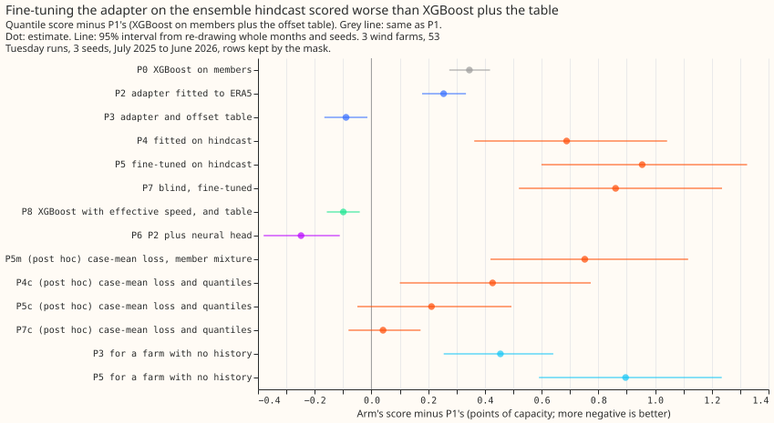
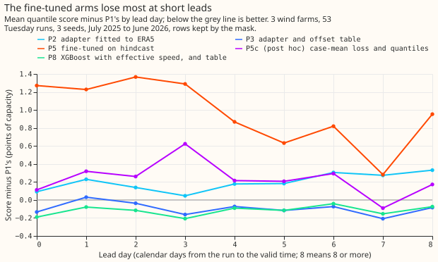
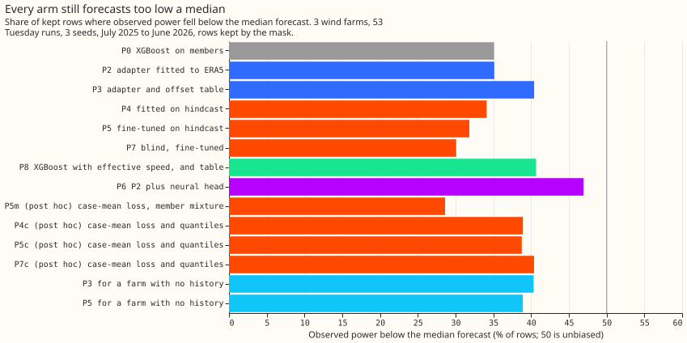

**Take-home: a small neural correction of the wind speed, fitted to ERA5 and run on the 51 ensemble
members, matches XGBoost plus a lookup table of offsets, and fitting the correction on the ensemble
hindcast made it worse.** Scores are quantile scores (an estimate of the continuous ranked
probability score) in points of capacity (1 point is 1% of a farm's capacity); lower is better. With
the offset table of [experiment 259](../00259-wind-plant-plus-quantile-offset-head/result.md) on
top, the ERA5-trained adapter (P3) scored 0.09 points better than XGBoost plus the table (P1; 95%
interval -0.17 to -0.02). Fine-tuning the adapter on 442 days of ensemble hindcast runs (P5) scored
0.95 points worse than P1 (0.60 to 1.32). A repair of the way the 51 members are mixed (post hoc)
cut the loss to 0.21 points (-0.05 to 0.49), which still is no gain. Observed power at a given wind
speed was higher in the scored year than in the hindcast year, so a correction fitted to the
hindcast year learns a relation that no longer holds.

We asked whether the small neural adapter of [experiment
285](../00285-wind-effective-wind-adapters/result.md), which scored better than XGBoost with ERA5 as
the weather, also wins on the production weather input, the ensemble forecast, in the scored year.
The adapter scales and shifts the wind speed that the physics model of a wind farm reads; it is a
method from experiment 285 and the offset table is from experiment 259. We fitted it to ERA5, ran it
on every member, mixed the 51 members with equal weights, and added experiment 259's offset table.
We also fitted it directly to the ensemble hindcast, which is the case the brief asked about. The
three metered wind farms (W1, W2, W3) are scored on 53 Tuesday runs from July 2025 to June 2026.
Verdict `partly supported`: the decision rule (P5 beats P1 by at least 0.10) failed, and its
fallback (P8 or P5 beats P1 by under 0.10, with an interval above zero) held for P8.

## Arms and rows

- **Arms (all on the 51 members, then the spread factor of experiment 33).** P0 is XGBoost trained on
  ERA5 before 2024-04-01, and P1 is P0 plus experiment 259's offset table (both read from experiment
  285; this folder's code reproduces them exactly). P2 is the adapter (inputs: wind direction, the
  10 m to 100 m speed ratio, 2 m temperature, hour of day) fitted to ERA5; P3 is P2 plus the table.
  P4 fits the whole physics model and an adapter on the hindcast alone, and P5 fine-tunes P2 on the
  hindcast; both adapters also see the lead day and the members' standard deviation of the 100 m
  speed. P7 is P5 with an adapter that sees the 100 m speed only. P8 is XGBoost with the adapter's
  effective speed as an extra column, plus the table. P6 is P2 plus experiment 259's neural head.
- **Cross-fit.** P4, P5, and P7 take their hindcast predictions from models fitted without the
  held-out third of the hindcast runs (purged for overlapping valid times), so the spread factor and
  the residual quantiles never see an in-sample prediction. The scored predictions come from a model
  fitted to the whole hindcast, stopping on its last 90 days.
- **Post hoc arms (labelled in the plan).** P4m, P5m, P7m use a loss on the members' mean power. The
  Sonnet audit found that the fine-tuned arms count the ensemble spread twice (the residual
  quantiles are fitted to the case-mean forecast and applied to each member before mixing), which
  raised P5's score by about 0.4 points at W1. P4c, P5c, P7c repair this by applying the case-mean
  residual quantiles to the members' mean power and not mixing members.
- **Rows.** Experiment 33's 53 Tuesday runs, 3 seeds, three farms; "kept" rows (96,479 of 107,121)
  are those outside experiment 210's idle-band mask. Intervals resample whole months of the run date
  and the three seeds (50,000 resamples); farms are not resampled. Eight contrasts were planned, so
  the Bonferroni level is 99.375%; the 95% intervals the brief asks for are quoted below, and the
  planned contrasts' Bonferroni intervals are in `work/score.json`.
- **Weather at lag times.** The adapters and XGBoost read the ensemble's own wind, temperature, and
  hour of day at forecast time; ERA5 is used only to fit models before 2024-04-01, so no lagged
  past weather is read at forecast time.

## Planned contrasts (kept rows, points of capacity, first minus second; negative means the first arm is better)

- **C1, P2 minus P0: -0.091 (-0.167 to -0.017).** Predicted -0.05 to -0.2. Held.
- **C2, P3 minus P1: -0.090 (-0.166 to -0.015).** Predicted no better than -0.1. Held: the table takes
  most of the gain.
- **C3, P5 minus P3: +1.044 (0.721 to 1.365).** Predicted at most -0.05. Failed in the opposite
  direction.
- **C4, P4 minus P5: -0.266 (-0.361 to -0.188).** Predicted positive (P4 worse). Failed: training from
  scratch scored better than fine-tuning.
- **C5, P6 minus P3: -0.159 (-0.283 to -0.041) on the quantile score, +0.005 (-0.037 to 0.043) at the
  0.99 pinball loss.** Predicted -10% or better at 0.99 and within 0.1 on the score. Failed on both:
  the head helped the middle of the distribution (median error 15.75 against 16.01) and not the tail.
- **C6, P8 minus P3: -0.010 (-0.034 to 0.014).** Predicted at least as good. Held (a tie).
- **C7, share of the P3-to-P5 gap that P7 closes: 0.91 (0.77 to 1.06).** Predicted under a third.
  Failed: the blind adapter did as badly as P5, so the extra inputs gave the fine-tuned arm nothing.
- **C8, P5 minus P1: +0.954 (0.599 to 1.324).** The decision-rule contrast. Failed.

## Scores and tail calibration (kept rows unless stated)

| Arm | Kept | All rows | Lead 12 to 36 h | q01 pinball | q99 pinball | 5-95% coverage | Below median |
|---|---|---|---|---|---|---|---|
| P1 XGBoost, table | 11.352 | 10.825 | 6.144 | 0.284 | 0.640 | 92.1% | 40.4% |
| P0 XGBoost | 11.697 | 11.061 | 6.292 | 0.284 | 0.681 | 90.8% | 35.1% |
| P2 adapter, ERA5 | 11.606 | 10.988 | 6.323 | 0.287 | 0.683 | 91.3% | 35.1% |
| P3 adapter, table | 11.262 | 10.756 | 6.165 | 0.287 | 0.644 | 92.6% | 40.4% |
| P4 hindcast only | 12.040 | 11.388 | 6.594 | 0.287 | 0.703 | 91.5% | 34.1% |
| P5 fine-tuned | 12.306 | 11.559 | 7.267 | 0.289 | 0.726 | 90.8% | 31.8% |
| P7 blind, fine-tuned | 12.213 | 11.513 | 7.516 | 0.290 | 0.702 | 91.4% | 30.1% |
| P8 XGBoost with effective speed, table | 11.253 | 10.746 | 6.062 | 0.283 | 0.639 | 92.0% | 40.7% |
| P6 P2 plus neural head | 11.104 | 10.801 | 5.891 | 0.284 | 0.649 | 88.5% | 46.9% |
| P5m post hoc, mixture | 12.104 | 11.351 | 6.536 | 0.287 | 0.691 | 91.8% | 28.6% |
| P4c post hoc | 11.779 | 11.199 | 6.350 | 0.287 | 0.690 | 90.9% | 38.9% |
| P5c post hoc | 11.564 | 11.009 | 6.435 | 0.287 | 0.692 | 91.2% | 38.8% |
| P7c post hoc | 11.393 | 10.916 | 6.498 | 0.287 | 0.669 | 91.6% | 40.4% |

- **P5c against the other arms (post hoc).** P5c minus P3 is +0.301 (0.071 to 0.539), P5c minus P1 is
  +0.212 (-0.049 to 0.493), and P5c minus P2 is -0.043 (-0.282 to 0.219): once the double counting
  is repaired, fine-tuning on the hindcast adds nothing over the ERA5 adapter, and the blind P7c
  scores 0.171 better than P5c (0.007 to 0.342), so the adapter's inputs again earn nothing.
- **The tails.** Every arm's 0.99 pinball loss is between 0.639 and 0.726, and the best arms (P1, P3,
  P8) are within 0.01 of each other. Every arm's median forecast is too low: observed power was below
  the median forecast on 28.6% to 46.9% of rows (50% is unbiased), and P6 is the closest at 46.9%
  with the narrowest coverage (88.5%).
- **A farm with no history.** Fitted to the other two farms with no idle layer, P3 scored 11.807
  (+0.544, 0.373 to 0.721 against P3) and P5 scored 12.248 (+0.441, 0.232 to 0.686 against the
  P3 version); the no-history version is a pooled pipeline, so the contrast mixes pooling, no idle
  layer, and a fixed spread factor. Only the REPD turbine count and rating would be known for such a
  farm; the adapter above was not given them.
- **Curtailment cost.** Not scored: no arm's output was run through `studies.node_curtailment`
  because the metric scores a node with its generators and not three farms alone.

## Checks and the audit

- **Median minus mean forecast** (kept rows, pooled over the farms, points of capacity): P0 -4.97,
  P1 -4.81, P2 -4.82, P3 -4.71, P5c -4.61, P6 -3.91, P8 -4.72. No arm shifts the forecast by an
  unexplained amount; the table moves the median, as experiment 259 found.
- **Mean-forecast error beside each quantile contrast (C2, C3, C5, C6).** The mean-forecast
  absolute error moves the same way as the score in C2 (-0.116), C3 (+0.888), and C6 (-0.006), and
  in the opposite direction in C5 (+0.133 against a score change of -0.159), because the head lowers
  the median's error (-0.258) and not the mean's.
- **Triggers fired:** trigger 1 (the blind control P7 scored no worse than P5), trigger 2 (C3 and C4
  contradicted the prediction), and trigger 5 (P4 beat P5, which starts from more). A fresh Sonnet
  agent audited the code and the results; the maintainer asked for Sonnet only, so no Opus audit ran.
  Its findings and their triage:
    - **The member mixture counts the ensemble spread twice for P4, P5, and P7. Accepted.** A re-run
      of P5 at W1 scored 11.72 with the mixture and 11.33 with the case-mean quantiles. The repaired
      arms P4c, P5c, and P7c are post hoc, and the table above shows they do not change the
      conclusion.
    - **The hindcast year differs from the scored year. Accepted.** The shift table below
      (`work/shift.json`, from `e00303_shift.py`) shows that the mean observed fraction of capacity and
      the ensemble-mean speed both rose.
    - **No mismatch between the hindcast and scored adapter inputs, and early stopping on one spring
      season is not the cause. No change.**
    - **P5 has two extra inputs that P2 lacks (lead day and spread), so C3 mixes the inputs with
      fine-tuning. Accepted as a caveat.** P7, which has none of them, scored the same as P5 (C7).
    - **P6's base was chosen from P2, P4, and P5 on their hindcast scores (P3 is P2 plus the table
      the head replaces). Accepted as designed.** The hindcast scores of P4 and P5 are slightly in
      sample for the residual quantiles, and P2 won regardless.

| Farm | Mean ensemble 100 m speed, hindcast to scored (m/s) | Mean observed fraction of capacity, hindcast to scored |
|---|---|---|
| W1 | 6.73 to 7.02 | 0.198 to 0.254 |
| W2 | 7.42 to 7.70 | 0.246 to 0.284 |
| W3 | 7.74 to 8.09 | 0.214 to 0.251 |

## What to try next

- **Fit the correction to many years of ERA5 and to the ensemble hindcast together,** with a flag for
  the source, so the correction does not depend on one year's relation between speed and power.
- **Find the reason the scored year produced more power at the same ensemble-mean speed** (turbine
  availability, a change of ensemble model cycle, or ERA5 drift) before trusting a one-year fit.
- **Give XGBoost the effective speed (P8) if the small gain of 0.099 points is wanted.** It needs
  no second training stage, and the threshold for porting a change that adds a neural network is
  0.10 points, so the gain falls just below it.
