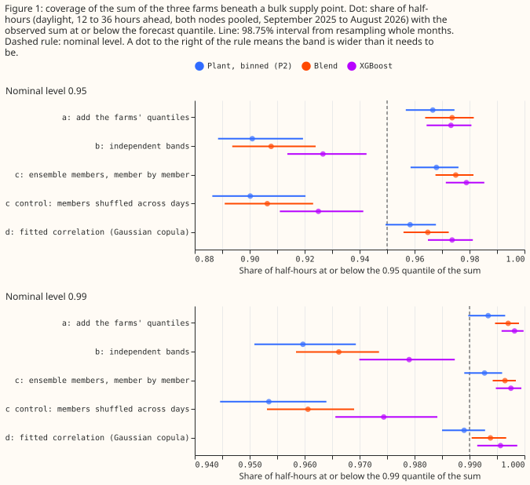
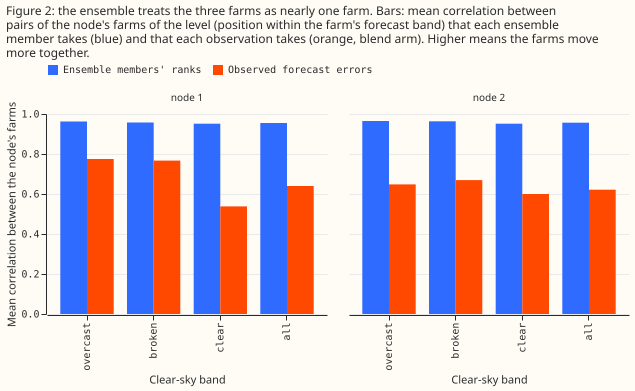

**Summing the 51 members of the weather forecast farm by farm gives a band for the three farms'
total output that is almost as wide as adding the farms' quantiles, and both bands are too wide. A
band from a Gaussian copula with a correlation fitted on the errors of the other 11 months comes
closest to the stated probability.** National Grid Electricity Distribution (NGED) meters six solar
farms, labelled A to F on this page. They sit beneath two bulk supply points (132 kV to 33 kV
substations), which this page calls nodes: farms A, C, and E beneath node 1, and farms B, D, and F
beneath node 2. Curtailment acts at a node, so the tail of the three farms' summed output matters
more than each farm's own tail. The weather forecast is the 00 UTC run of the European Centre for
Medium-Range Weather Forecasts (ECMWF) ensemble, which has 51 members.

Each farm has a band of 11 quantiles of its output in MW, at levels 0.01 to 0.99, 12 to 36 hours
ahead. Three sources of that band come from earlier experiments, and this page calls each source an
arm. "P2" is the solar-farm power model whose band is binned by the forecast and the ensemble spread
([experiment 270](../00270-metered-farm-xgboost-vs-plant-diagnostic/result.md)). "Blend" is the
per-quantile blend of an additive model, a mixture-density neural network, and XGBoost
([experiment 287](../00287-metered-farm-spread-binned-plant-heads/result.md)). "XGBoost" is [XGBoost
(Chen and Guestrin, 2016)](https://doi.org/10.1145/2939672.2939785) alone, also from experiment 287.
For each arm we formed the node's band four ways, which this page calls sum methods. Method (a) adds
the three farms' quantiles at the same level. Method (b) draws each farm's quantile level
independently at random and sums the three values. Method (c) runs each of the 51 members through the
three farms' forecasts, sums the three outputs for each member, and reads the quantiles off the 51
sums. Method (d) draws the three farms' quantile levels from a Gaussian copula, a distribution that
keeps each farm's own band and sets how closely the farms' errors move together, with its correlation
fitted on the errors of the other 11 months. We then measured coverage: the share of half-hours in
which the observed total output of the three farms was at or below a quantile of the node's band. A
0.95 quantile is correct when its coverage is 95%.

**Verdict: not supported.** The prediction was that the coverage of (c) lands within 0.5 percentage
points of the stated probability at both 0.95 and 0.99. At 0.95 it does not for any arm. At 0.99 it
holds for P2 only. Method (b) is too narrow, as predicted, for every arm. Method (a) is above 99.5%
at 0.99 for the blend and XGBoost but not for P2, so that part of the prediction held for two of the
three arms. The table gives coverage pooled over both nodes, as a percentage of half-hours, with the
98.75% interval from resampling whole months in brackets for (c) and (d).

| Arm | Level | (a) add quantiles | (b) independent | (c) members | (d) fitted copula |
|---|---|---|---|---|---|
| P2 | 0.95 | 96.66 | 90.10 | 96.79 [95.85, 97.60] | 95.84 [94.94, 96.78] |
| P2 | 0.99 | 99.34 | 95.97 | 99.27 [98.90, 99.59] | 98.90 [98.50, 99.28] |
| Blend | 0.95 | 97.36 | 90.78 | 97.50 [96.76, 98.14] | 96.48 [95.60, 97.24] |
| Blend | 0.99 | 99.70 | 96.62 | 99.64 [99.42, 99.84] | 99.38 [99.04, 99.67] |
| XGBoost | 0.95 | 97.32 | 92.66 | 97.89 [97.14, 98.53] | 97.36 [96.48, 98.12] |
| XGBoost | 0.99 | 99.82 | 97.90 | 99.75 [99.48, 99.94] | 99.56 [99.14, 99.87] |

## Results

- **Rows.** 5,569 half-hours at node 1 and 6,536 at node 2 hold all three farms (daylight, sun more
  than 5 degrees above the horizon, 12 to 36 hours ahead, 2025-09 to 2026-08). The stop rule
  (under 2,000) did not fire. Node 2 holds a farm of 1.19 MW beside farms of 6.03 and 7.80 MW.
- **Why (c) is as wide as (a) (tested explanation).** The ensemble's ranks imply a mean correlation
  of 0.95 to 0.97 between the node's farms in every clear-sky band, while the farms' forecast errors
  correlate 0.54 to 0.78 (Figure 2; blend arm). Summing members therefore treats the three farms
  as nearly one farm, which is the perfect dependence that (a) assumes. The control agrees:
  shuffling the members across days (breaking the dependence) gives 90.02% at 0.95 and 95.35% at
  0.99 for P2, close to the independent form (b).
- **The fitted copula (d) is the closest form.** Coverage of (d) at 0.95 is 95.84% for P2 (94.94% to
  96.78%), 96.48% for the blend (95.60% to 97.24%), and 97.36% for XGBoost (96.48% to 98.12%). At 0.99
  it is 98.90% (P2), 99.38% (blend), and 99.56% (XGBoost). (d) scores lower pinball loss at 0.99 than
  (c) for the blend by 6.5% (interval -0.0070 to -0.0020 MW per half-hour, excluding zero) and for
  XGBoost by 15.6% (-0.0214 to -0.0122), and by 1.6% for P2 (-0.0034 to +0.0011, includes zero).
- **Lower tail.** At the 0.01 quantile the forms cover 0.3% (a), 5.5% to 5.9% (b), 0.4% to 0.5% (c),
  and 1.0% to 1.2% (d) of half-hours, against 1.0% intended. The sum of quantiles (a) and the member-wise
  sum (c) are far too wide below, as above.
- **Planned contrasts on pinball loss at 0.99 (MW per half-hour, 98.75% intervals).** (c) minus (a):
  P2 -0.0002 (-0.3%, -0.0009 to +0.0010), blend -0.0004 (-0.6%, -0.0011 to +0.0007), so the two
  forms score alike; for XGBoost -0.0037 (-3.5%, -0.0045 to -0.0027). (c) minus (b): P2 -0.0268
  (-27.2%, -0.0421 to -0.0107) and blend -0.0162 (-19.2%, -0.0306 to -0.0032), lower because the
  independent band is too narrow; for XGBoost +0.0116 (+12.5%, -0.0070 to +0.0304, includes zero).
- **Both nodes agree.** Coverage of (c) at 0.95 is 97.0% and 96.6% (P2), 97.7% and 97.4% (blend),
  and 98.0% and 97.8% (XGBoost), at node 1 and node 2. The order of the forms
  is the same at both nodes, except that XGBoost's (a) and (d) swap places at 0.95 (97.45% against
  97.65% at node 1, 97.22% against 97.12% at node 2).
- **Residual correlations** (blend arm, pairs of farms beneath one node, all bands): 0.45 to 0.83 at
  node 1 and 0.64 to 0.68 at node 2. Correlation is higher under overcast skies (0.68 to 0.95) than
  under clear skies (0.33 to 0.78), and the all-band correlations differ by at most 0.08 between 12 to
  24 and 24 to 36 hours ahead (within one clear-sky band the gap reaches 0.19 for one pair).
- **One-farm control** (blend arm, a farm's own band): the 0.95 quantile covers 94.6% to 97.3% and the
  0.99 quantile 98.8% to 99.6% of half-hours, so each farm's own band already over-covers, and
  every sum inherits that. The 0.01 quantile of the 1.19 MW farm D covers 12.1% and that of the
  17.6 MW farm E covers 5.6%, both too narrow below. Farm D's small share keeps its excess from
  reaching node 2's sum. Farm E's large share may add to the lower tail at node 1.
- **Curtailment cost not scored.** The event census of [experiment
  255](../00255-metered-farm-node-curtailment-value/result.md) holds 5 half-hours beyond 0.75 times
  each node's maximum export and 2 beyond 0.9, under the 20 the plan required, so the coverage
  result stands alone.

## Checks

- **Median minus mean forecast per farm** (blend arm, mean taken as the average of the stored
  quantiles weighted by level spacing, MW): A -0.018, C +0.012, E +0.103, B +0.030, D +0.004,
  F +0.030, against capacities of 5.96, 7.88, 17.6, 7.80, 1.19, and 6.03 MW. The largest is 0.6% of
  capacity, so the shape of the band barely moves the median forecast.
- **Error of the median forecast beside the pinball contrasts.** The mean absolute error of the sum's
  median is 2.088 (a), 2.079 (b), 2.090 (c), and 2.078 (d) MW for P2, with overlapping intervals,
  so the contrasts on the tail do not come from a shifted median.
- **Audit triggers.** Audit trigger 2 (a result that contradicts its prediction) applied once: (c)
  over-covers. The comparison of correlations in Results (Figure 2) tests the explanation, so no
  audit ran. Triggers 1, 3, 4, 5, 6, and 7 did not apply: the shuffled-members control behaves as a control should, the quantile and median errors do
  not disagree, neither node flips a verdict, no nested arm beats its container, there is no sister
  experiment on the same rows, and no later experiment depends on this result yet.

## Caveats

- **The copula (d) used future months.** Its correlation for each month comes from the other 11
  scored months, because the stored predictions cover only the scored year. A production copula would
  use earlier months only.
- **(d) does not use the ensemble.** Method (d) is a Gaussian copula whose correlation is fitted by
  clear-sky band, and the ensemble's ranks play no part in it.
- **Two nodes and six farms.** The intervals resample 12 months.
  The two nodes share the same weather forecasts, so the nodes are not independent evidence.
- **Each farm's own band.** The bands come from experiments 270 and 287 at seed 0, trained on each
  farm's own earlier months. No refits ran, so the retraining schedule is the one those experiments
  used.
- **No lookahead in the weather forecast.** The ensemble members are from the 00 UTC run, available
  before the forecast is used. No past-weather data enters.

## What the next experiment should answer

- Does a copula with correlation fitted on earlier months only keep its coverage within 1 percentage
  point of the stated probability at 0.95 and 0.99 on months it has not seen?
- Does recalibrating each farm's own band, which over-covers slightly, bring the sum closer to
  the stated probability than the choice of copula does?
