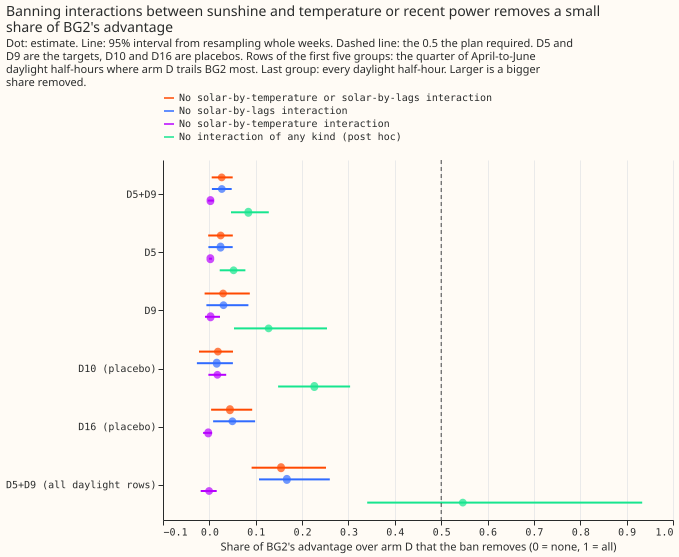
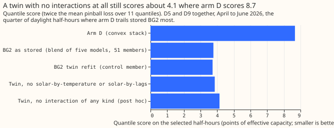
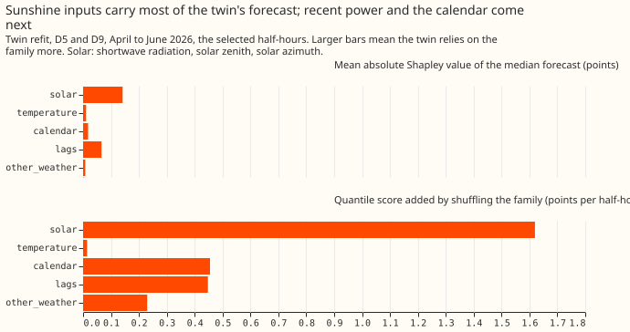

**Take-home: BG2 does not beat arm D at D5 and D9 in April to June through interactions of sunshine
with temperature or with recent power.** Forbidding them removes 2.7% of its advantage on the
half-hours where arm D trails most, and 16% on all daylight half-hours. A refit allowed no
interactions at all keeps 92% of the advantage on the worst half-hours but only 45% on all daylight
half-hours. The result rules out the two planned interactions, and narrows the worst half-hours to
arm D's single-input terms. Verdict: refuted.

BG2 is the production-style forecast, an XGBoost model per substation (experiment 87). Arm D is the
convex best-guess demand model, which adds its terms up (an additive model); D5 and D9 are two
anonymised Primary substations where arm D trails BG2 in April to June. We asked whether BG2 does
better because XGBoost combines inputs, which an additive model cannot do. BG2's fitted models are
not stored, so we refitted its recipe on CPU (one refit each for April, May, and June 2026, on the
control ensemble member only). We then refitted it again with XGBoost forbidden from combining
certain input families, and measured how much of the gap to arm D each ban removes. The gap is the
quantile score (twice the mean pinball loss over 11 quantiles, in percentage points of effective
capacity; smaller is better). The refit follows experiment 87's recipe, and the ban uses XGBoost's
`interaction_constraints`.

**The rows are the 6,755 half-hours where arm D trails stored BG2 most.** They are the quarter of
each substation's daylight half-hours (09:00 UTC runs of April to June 2026, leads 0.5 to 168
hours, experiment 266's row set) where arm D's quantile score exceeds stored BG2's by the most.
The "share removed" S is (score with the ban - score of the unrestricted refit) / (score of arm D -
score of the unrestricted refit). Intervals resample the 14 ISO weeks of forecast initialisation.
The refits were monthly, so the contrast could shift slightly under weekly retraining. The five
input families are solar (shortwave radiation, solar zenith, solar azimuth), temperature (air
temperature, dew point), the three recent-power lags, the calendar (hour, day of week, lockdown
flag, days to Christmas, lead time), and other weather (longwave radiation, pressure,
precipitation, wind speed).

Figure 1 shows each ban's share removed, with placebos. Figure 2 shows each arm's score. Figure 3
shows how much the refit relies on each input family.

## Results

- **Gate (planned prediction P0) passed.** The refit's median error on all April-to-June daylight
  half-hours is 6.91 at D5 and 5.59 at D9, against 6.69 and 5.47 for stored BG2 (3.4% and 2.3%
  higher), and arm D's is 8.90 and 6.69. The refit is a close but not identical copy of BG2, which
  blends five XGBoost models over 51 ensemble members.
- **Headline (P1) refuted.** Banning both solar-by-temperature and solar-by-lags interactions
  removes S = 0.027 (95% interval 0.005 to 0.050) at D5 and D9 together. The plan required at least
  0.5. Quantile scores: arm D 8.67, stored BG2 3.77, unrestricted refit 3.72, refit with both bans
  3.86.
- **By substation.** S is 0.024 at D5 (-0.002 to 0.051) and 0.030 at D9 (-0.010 to 0.087).
- **Single bans (P2) failed.** Solar-by-lags alone removes 0.027 (0.005 to 0.048) and
  solar-by-temperature alone removes 0.002 (-0.004 to 0.010), against the 0.25 predicted for each.
- **Placebos (P3) held for the planned bans.** D10 and D16 are substations where the gap to BG2 has
  another source. S is 0.018 at D10 (-0.022 to 0.051) and 0.044 at D16 (0.004 to 0.092), under 0.25.
- **Shapley and shuffling (P4) held.** The solar family has the largest mean absolute Shapley value
  of the median forecast (0.142 points, against 0.066 for the lags, 0.018 calendar, 0.011
  temperature, 0.008 other weather). The largest Shapley interaction is solar-by-lags (0.035, then
  solar-by-calendar 0.022). Banning that interaction removes under 3% of the advantage, so BG2 uses
  the interaction but arm D does not lose to BG2 for lack of it. Shuffling the solar family adds
  1.62 quantile score points per half-hour, the calendar 0.46, the lags 0.45, other weather 0.23,
  and temperature 0.01.
- **Post hoc: an XGBoost refit that may use no interaction.** Depth-1 trees (2,000 rounds) remove
  S = 0.084 (0.047 to 0.128) at D5 and D9 together, 0.052 at D5 and 0.128 at D9 (0.053 to 0.254).
  So 92% of the advantage on these rows needs no interaction. At D10 the same refit removes
  S = 0.226 (0.148 to
  0.304) of a small gap, a hint that interactions matter more where arm D and BG2 are close. The
  hint is weak, because the absolute loss added at D10 (0.61) is close to D9's (0.52). This refit
  was run after the headline to explain a prediction that failed.
- **Sensitivity: all daylight rows at D5 and D9 (27,015 half-hours).** The selection uses stored
  BG2's realised loss, so we also scored every daylight half-hour, where arm D scores 4.37 and the
  unrestricted refit 3.47. Both bans together remove S = 0.155 (0.091 to 0.252), solar-by-lags alone
  0.167 (0.107 to 0.260), solar-by-temperature alone -0.001 (-0.019 to 0.016), and the refit that
  may use no interaction 0.547 (0.340 to 0.934). The planned bans stay under the 0.5 threshold on
  both row sets, so the refutation holds. The no-interaction refit does not: on typical rows about
  half of the advantage needs an interaction that the bans leave free (solar-by-calendar,
  solar-by-lead-time, or interactions inside the solar family). This sensitivity was added after the
  code review raised the selection effect.
- **No decomposition against arm D's own terms.** The additive model's term contributions are not
  stored, so the comparison rests on the forecasts. The correlation between BG2's median minus arm
  D's median and each family's Shapley sum lies between -0.13 and 0.00, so no single family
  explains the difference row by row.

## Checks

- **Median minus mean forecast per site:** not applicable, because the refit is one control member
  with quantile outputs and has no mean forecast.
- **Median-error contrasts and quantile-score contrasts:** on the selected rows the median error is
  15.55 for arm D, 6.80 for stored BG2, 6.70 for the unrestricted refit, 6.98 with both bans, and
  7.29 with no interaction. The solar-by-temperature ban alone is the exception: its median error
  (6.69) is 0.01 below the unrestricted refit's while its quantile score is 0.01 above, a difference
  inside the noise of S = 0.002.
- **Triggers fired:** trigger 2 (a result contradicts its prediction). The explanation tested is
  the post hoc refit above, which supports the refuted verdict, so no Opus audit was run. Leaving
  D5 out leaves S = 0.030 at D9 and leaving D9 out leaves S = 0.024 at D5 (both bans), so trigger 4
  did not fire. The placebos stayed under their predicted bound, so trigger 1 did not fire.

## Caveats and next steps

- The bans leave solar-by-calendar, solar-by-lead-time, and interactions inside the solar family
  free, so what is refuted is an interaction between sunshine and temperature or recent power. The
  post hoc refit covers every interaction.
- The rows are the quarter where arm D trails most, so the 92% describes those half-hours; on all
  April-to-June daylight half-hours the figure is 45%, with a wide interval (7% to 66%).
- BG2's fitted models are not stored, so these are monthly refits of its recipe on the control
  member only.
- Next, refit with the solar family, the lags, and the calendar dropped in turn, to say which
  main effect carries the advantage. Then re-run experiments 3 and 5 of the sunny-daylight fix
  design (private brief `dp_sunny_daylight_fix_design.md`) over April-to-June rows.
- Compute: 69 CPU refits of about 6 minutes each on 2 threads, and no GPU.
