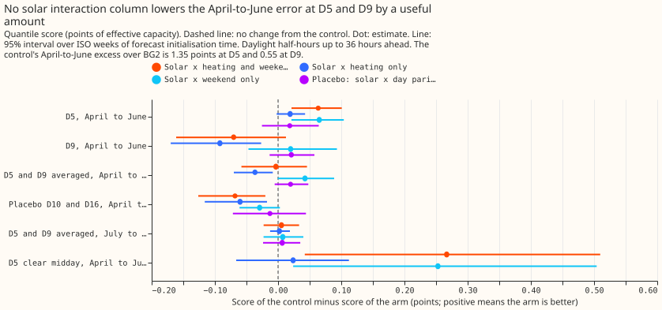
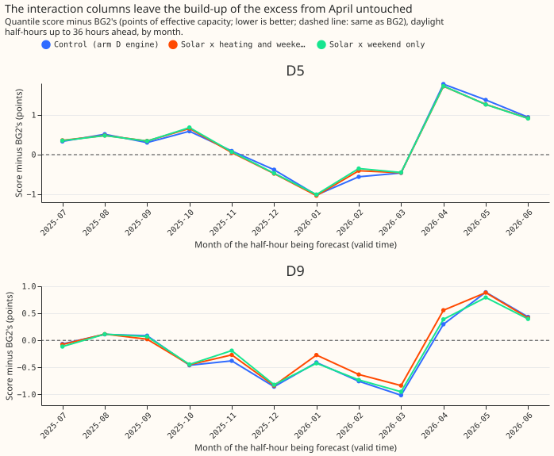

**Letting rooftop solar interact with temperature and with the day of the week does not close the
April-to-June gap to BG2.** We added two columns to the demand model that experiment 136 calls arm
A2 (a monthly refit of experiment 114's T-all convex model, with a Kalman filter on recent errors).
One column is the solar shape times a heating hinge, and the other is the solar shape times a
weekend indicator. We then compared the model's April-to-June quantile score with BG2's on the
same half-hours as before. At D5 and D9 (anonymised Primary substations) the two columns close
-0.4% of the gap (95% interval -6.3% to +4.7%). The gap is not an additive-structure problem of
those two kinds, and the next test is what BG2 uses that the convex model does not.

**The scores are quantile scores on the 561,207 rows of experiments 228 and 266.** The quantile
score is twice the mean pinball loss over 11 quantiles, in points of effective capacity (percentage
points of a substation's rated demand), and lower is better. "Excess" is the control's score minus
BG2's, and "closure" is the share of the excess that an arm removes. Rows are daylight half-hours
up to 36 hours ahead, as in [experiment
289](../00289-summer-gap-weather-input-discriminator/result.md), and intervals resample whole ISO
weeks of forecast initialisation time (14 weeks in April to June). The control is experiment 136's
stored A2 fits run through this folder's forecast pipeline, which reproduces A2's stored forecasts
to 0.0.

## Results

- **Verdict `refuted`.** Prediction P1 (closure of at least 30% at each of D5 and D9) fails:
  closure is +4.7% at D5 (95% interval +1.6% to +7.7%) and -12.7% at D9 (-39.3% to +1.9%). The
  D5-and-D9 average is -0.4%, under the 10% bar for "not an additive-structure problem".
- **P2 fails.** At D10 and D16 the both-column arm worsens the score by 0.068 points (95% interval
  -0.126 to -0.020), more than 0.02.
- **P3 holds.** July to September at D5 and D9 moves by +0.005 points (interval -0.023 to +0.033).
- **P4 holds.** The placebo column (solar shape times day-of-year parity) closes +2.1% (interval
  -0.6% to +5.7%) at D5 and D9.
- **Excess of the control, April to June.** D5 +1.354 (95% interval +1.032 to +1.652); D9 +0.555
  (+0.336 to +0.780); D5 and D9 averaged +0.954 (+0.723 to +1.172). BG2 scores 3.419 at D5 and
  2.762 at D9; the control scores 4.772 and 3.317.
- **Reduction against the control (points; positive is better), D5 and D9 averaged.** Both columns
  -0.003 (-0.058 to +0.046); heating only -0.037 (-0.070 to -0.008); weekend only +0.043 (-0.000
  to +0.089); placebo +0.020 (-0.005 to +0.048). At D5 alone the weekend column lowers the score by
  0.065 (+0.021 to +0.104), and the placebo column lowers it by 0.019 (-0.025 to +0.064).
- **Clear midday half-hours at D5** (realised clear-sky index above 0.8, hours 10 to 14 of experiment 178's rows, 643
  rows): the control's excess is +3.50 (interval +2.65 to +4.21); the both-column arm lowers the
  score by 0.267 (+0.042 to +0.510), 7.6% of it. Heating alone lowers it by 0.024 (-0.066 to
  +0.112).
- **Tail calibration, April to June, daylight, up to 36 hours ahead, D5 and D9 pooled (control /
  both-column arm).** Share of actuals at or below the 0.01 quantile 1.84% / 1.82%; the 0.05
  quantile 7.95% / 8.87%; the 0.95 quantile 91.0% / 91.3%; the 0.99 quantile 96.4% / 96.3%. Pinball
  loss at 0.01 is 0.249 / 0.244, at 0.05 0.943 / 0.935, at 0.95 1.060 / 1.066, and at 0.99
  0.326 / 0.343. Both arms are too narrow in the upper tail, with 3.6% of actuals above the 0.99
  quantile, and the interaction does not change that.
- **Post hoc: stored arm D.** Stored arm D (experiment 220's engine) is a close relative of the
  control, not the control: their per-row scores differ by 0.51 points on average, with a
  difference of 0.04 points in the mean score. Shifting stored arm D's quantiles by each arm's
  change in the engine mean, as experiments 251 and 289 do, gives the same answer: the both-column
  arm closes +0.6% at D5 and D9 averaged, with stored arm D's excess at 0.951.
- **Fitted coefficients.** The weekend column's coefficient is positive in the last monthly fit at
  every substation (3 to 11 points per unit of solar shape), so on weekends the fit gives the
  pinned solar subtraction a smaller weight. The placebo column's is positive too (3.1 at D5), so a
  part of that coefficient is a level correction to the solar shape that holds on every day.
- **What the figures show.** The excess at D5 and D9 steps up between March and April and the
  interaction arms follow the control closely (figure 2); the gain of the weekend column at D5 is
  too small to move the monthly curve.

## Checks

- **Median minus mean forecast, per site.** The quantiles are the mean forecast plus a residual
  table with median zero, so the difference is 0.0 at every site, for the control and the
  both-column arm. This check cannot expose a shifted forecast here.
- **Error of the mean forecast beside the score.** Mean absolute error of the mean forecast, April
  to June, daylight, up to 36 hours ahead, control / both-column arm: D5 8.45 / 8.33, D9 5.97 /
  6.12, D10 6.51 / 6.60, D16 6.09 / 6.27. The signs agree with the score contrasts (better at D5,
  worse elsewhere).
- **Triggers fired.** Trigger 4 (leaving one site out flips the sign of a contrast): the both-column
  closure is +4.7% at D5 alone and -12.7% at D9 alone, and both are under the 10% bar, so the
  verdict does not change. Trigger 5 (a nested arm beats the arm that contains it): weekend only
  (+0.043) beats both columns (-0.003), because the heating column worsens D9 (heating only: -0.092,
  interval -0.170 to -0.027). The manager chose a Sonnet audit and no Opus audit (credits); the
  audit's findings are triaged in the pull request. Trigger 1 (control failure) does not fire: the placebo closes
  2.1%, under 10%, and the control reproduces experiment 136's A2 exactly.

## Method and caveats

- **Arms.** Control (`a2`): experiment 136's stored monthly T-all fits. `s_both`, `s_heat`,
  `s_wknd`, `s_placebo`: T-all refitted at the same 27 monthly cuts with the extra column or
  columns, free in sign, with the heating columns' ridge (0.1). The columns multiply the derated
  unit solar shape by the mean heating hinge `relu(15.5 - T) / 10` over the four smoothed
  temperatures, by the weekend indicator (Saturday, Sunday, or bank holiday), or by the day-of-year
  parity. The filter noise, the calibration, the spread table, and the tuning months are as in arm
  A2, and no head, clip, or coasting is applied.
- **Schedule.** Monthly refits on a rolling 24-month window, as arm D. Weekly refits were not run.
- **The columns live in this experiment's copy of experiment 114's design code**, not as a
  `studies.dp_gam` option. The one-averaged-hinge form and free signs are one defensible design of
  several. A per-smoothing-window hinge or a sign-bounded column is untested.
- **Only 14 weeks of April to June** are in the intervals, and two substations carry the gap.
- **Control versus stored arm D.** The control differs from stored arm D (see above); the headline
  closure is against the control.

## What the next experiment should answer

- **Item 5 of the summer-gap brief (what BG2 knows that arm D does not).** The additive
  solar shape is not the cause, so the candidates left are BG2's interactions between irradiance
  and recent power, and its use of the realised past.
- **A small neural interaction term (ranked suggestion, per the common brief).** A learned
  smooth response of demand to (solar shape, temperature, hour) inside the convex fit, with the
  convex arm as the comparison. The prediction that could fail: it closes under 10% of the D5 and
  D9 excess, as the two linear terms did. A run is worth the effort only if the maintainer wants
  to rule out a smooth interaction of any shape.
