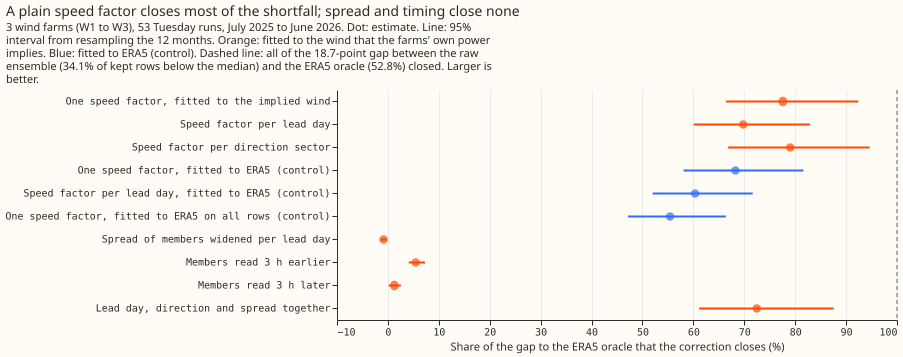
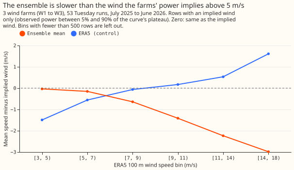
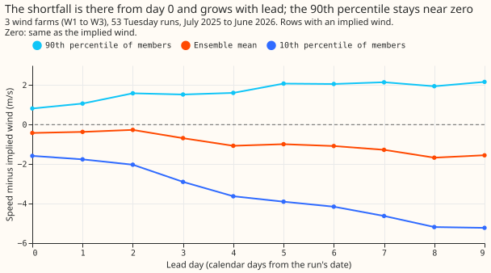
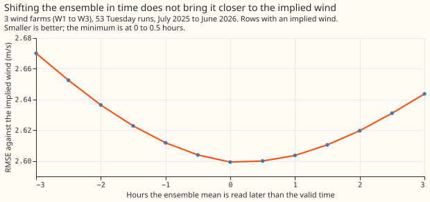
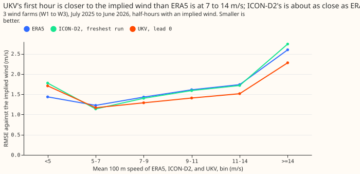

**Take-home: the ensemble's low wind-power forecast is mostly a wind-speed level error, not a spread
or timing error.** The forecast for three metered wind farms (W1 to W3) takes each of the 51 members
of the ECMWF ensemble weather forecast (separate forecast scenarios), turns each member's wind into
power with a fitted physics core (a wind-speed-to-power curve fitted to ERA5, our estimate of past
weather, before 2024-04-01), and mixes the 51 power forecasts. Observed power was below the mixture's
median on 34.1% of kept farm half-hours, where 50% is calibrated. A kept half-hour is one that the
idle-row mask of experiment 210 does not remove, and the page counts every row as one farm
half-hour of one forecast run.

We ran the core's curve backwards on the observed power to get the 100 m wind speed that each farm's
own output implies (the implied wind). The members are on average 1.1 m/s slower than the implied
wind, 0.4 m/s at day 0 (the first forecast day) and 1.6 m/s at day 9. Multiplying every member's wind
speed by one factor of 1.13, fitted on the 442 daily forecast runs of 2024-04 to 2025-06, raised the
share below the median on the scored year (53 Tuesday runs, 2025-07 to 2026-06) from 34.1% to 48.6%.
The core fed ERA5 wind directly (the ERA5 oracle) has 52.8%, so the factor closes 77.6% of the
18.7-percentage-point difference. Widening the spread of the members closed none of it, and shifting
the members in time by up to 3 hours closed at most 5.5%.

The hypothesis said that spread and timing would carry at least half of the difference, so the
verdict is `not supported`. It also said that the high-resolution Met Office UKV (2 km, UK model)
and DWD ICON-D2 (2 km, German model) forecasts would be closer than ERA5 to the implied wind. UKV is,
and ICON-D2 is about as close. The question follows [experiment
261](../00261-wind-low-bias-decomposition/result.md), which put 89% of the low median in the
ensemble's weather, and [experiment 285](https://github.com/openclimatefix/nged-substation-forecast/pull/1602),
whose quantile mapping of member speeds to the ERA5 speed distribution closed about 18% of the
difference. The physics core is from [experiment 230](../00230-wind-physics-core-part-1/result.md),
and the idle-row mask from [experiment 210](../00210-wind-idle-noise-mva-artefact/result.md). The
forecasts and offsets they build on are from experiment 259.

**The wind speed that the farms imply is a slightly better target than ERA5 for calibrating the
median.** On the same rows (half-hours with an implied wind), a factor fitted to ERA5 closed 68.3%
(58.1% to 81.6%) of the gap and the factor fitted to the implied wind closed 77.6%. The paired
difference is 1.7 percentage points of share below the median (1.6 to 1.9). Fitted on all unmasked
half-hours instead, the ERA5 factor closed 55.4%, so most of the difference between 55% and 78% is
the choice of rows. The quantile score gives no preference: the ERA5-fitted factor scored 11.410 and
the implied-wind factor 11.439 (lower is better).

**The high-resolution check gives a mixed answer.** The first forecast hour of UKV (from the AWS
open-data bucket, the live feed) is closer to the implied wind than ERA5 is at 7 to 14 m/s
(root-mean-square error 1.29, 1.41, and 1.52 m/s against ERA5's 1.43, 1.61, and 1.74 at 7 to 9, 9
to 11, and 11 to 14 m/s). The freshest ICON-D2 value is about as close as ERA5 at 5 to 14 m/s
(1.40, 1.59, and 1.72 m/s at 7 to 9, 9 to 11, and 11 to 14 m/s) and further away below 5 m/s and
above 14 m/s.

## Design and results

- **Implied wind (step 1).** The core (experiment 261's R1, fitted to ERA5 before 2024-04-01) is run
  backwards. The rows used are farm half-hours outside experiment 210's mask and outside stretches
  of 48 or more half-hours below 1% of capacity, where observed power lies between 5% and 90% of
  the curve's plateau. These filters leave hub-height speeds of about 3 to 11.4 m/s (W1), 12.4 m/s
  (W2), and 15.8 m/s (W3), and 79,000 to 82,000 half-hours per farm. The share of half-hours that
  can be inverted is 75% at ERA5 speeds of 5 to 7 m/s, 95% to 99% at 7 to 11 m/s, 91% at 11 to 14
  m/s, 60% at 14 to 18 m/s, and 42% above 18 m/s. Near the plateau the curve is almost flat, so a
  small power error becomes a large speed error, which adds noise at the top of the range.
- **Stop rule.** The rule asked whether the implied wind differs from ERA5 by more than 1 m/s on
  average at the invertible bins. We read it on the overall mean, which is +0.04 m/s (84,785
  half-hours, 2024-04 to 2026-06, out of sample; root-mean-square error 1.61 m/s, correlation 0.80)
  and +0.16 m/s in sample. Read bin by bin, the difference exceeds 1 m/s at the edges (next bullet),
  which selection explains. The implied-minus-ERA5 difference by farm is +0.17, +0.11, and -0.14
  m/s (W1, W2, W3). By season it is -0.36 (winter), +0.29, +0.27, and -0.10 m/s (autumn). Per
  direction sector it ranges from -0.14 to +0.37 m/s.
- **Selection effect.** Binned by ERA5 speed, the implied wind is +1.5 m/s above ERA5 at 3 to 5 m/s
  and 1.9 m/s below it at 14 to 18 m/s (figure 2, blue). Selecting half-hours by observed power
  pulls every product's bin means towards the middle. Differences between products on the same
  half-hours are the comparison that survives this selection.
- **Ensemble against implied wind (step 2, scored year, 79,461 farm half-hours).** The ensemble mean
  is 1.11 m/s slower than the implied wind; ERA5 is 0.04 m/s faster. The root-mean-square error is
  2.60 m/s for the ensemble and 1.56 m/s for ERA5. By lead day the ensemble-mean gap is -0.42,
  -0.37, -0.26, -0.69, -1.07, -0.99, -1.08, -1.27, -1.67, and -1.55 m/s (days 0 to 9). The implied
  wind is below the members' 10th percentile on 4.3% of half-hours and above the 90th percentile on
  21.7% (10% each if calibrated). The members' mean standard deviation (the 10th-to-90th percentile
  range divided by 2.56) is 2.38 m/s, and the standard deviation of the implied wind about the
  ensemble mean is 2.35 m/s. At day 0 the members' standard deviation is 0.94 m/s against 1.61
  m/s.
- **Timing.** The root-mean-square error of the ensemble mean against the implied wind is 2.599
  m/s at 0 h and 2.600 m/s at +0.5 h, which the changing row set between shifts does not
  resolve. It rises to 2.67 m/s at -3 h and 2.64 m/s at +3 h.
- **Corrections (step 3).** Each factor multiplies the 10 m and 100 m speeds alike and was fitted on
  the 442 daily forecast runs of 2024-04 to 2025-06. One factor is 1.13 (ERA5-fitted on the same
  rows 1.11, on all rows 1.09). The factor per lead day runs from 1.06 at day 0 to 1.17 at day 9. The
  factor per direction sector (ensemble-mean direction, eight sectors of 45 degrees) is 1.09 to
  1.21, largest in sectors 0 to 3. The widening factor per lead day is 2.09 at day 0, falling to
  0.83 at day 9, applied to each member's deviation from the case mean. It is the standard
  deviation of the implied wind about the ensemble mean over the members' standard deviation, so it
  includes the noise of the implied wind itself and over-states the widening needed.
- **Share of kept rows below the median, scored year (95% interval).** Raw 34.1% (31.5 to 37.1);
  one factor 48.6% (45.8 to 51.6); factor per lead day 47.1% (44.4 to 50.1); factor per direction
  sector 48.9% (46.1 to 51.9); spread widened 33.9% (31.3 to 37.0); lead day, direction and spread
  together 47.6% (44.9 to 50.8); ERA5-fitted one factor 46.8% (44.1 to 49.9) on the same rows and
  44.4% (41.7 to 47.5) on all rows; ERA5-fitted per lead day 45.4% (42.7 to 48.3) and 43.3% (40.7
  to 46.3); ERA5 oracle 52.8% (50.3 to 55.1). Shifts: 35.1% at -3 h, 34.7% at -2 h, 34.3% at -1 h,
  34.1% at +1 h, 34.2% at +2 h, 34.3% at +3 h.
- **Percentage points of the 18.7-point gap closed.** One factor 77.6% (66.4 to 92.4); per lead day
  69.8% (60.1 to 82.9); per direction sector 79.0% (66.8 to 94.6); spread -0.9% (-1.4 to -0.2);
  all three together 72.5% (61.1 to 87.6); shifts 5.5% (-3 h), 3.3%, 1.1%, 0.2%, 0.8%, and 1.3%
  (+3 h); ERA5-fitted one factor 68.3% (58.1 to 81.6) on the same rows and 55.4% on all rows;
  ERA5-fitted per lead day 60.3% and 49.4%. The direction-sector factor against one factor is +0.3
  percentage points (-0.6 to +1.4), so splitting by direction adds nothing beyond the mean-speed
  correction.
- **The single factor over-corrects early leads.** At days 0 to 2 it gives 60.8% of rows below the
  median, against 46.9% for the factor per lead day (days 3 to 6: 49.0% and 46.2%; days 7 and later:
  44.2% and 47.7%).
- **Quantile score (twice the mass-weighted pinball loss at the nine levels of experiment 33, points
  of capacity, kept rows, no spread factor).** Raw 11.823; one factor 11.439; per lead day 11.361;
  per direction sector 11.462; spread widened 11.993; all three together 11.456; ERA5-fitted 11.410
  and 11.356 on the same rows (11.402 and 11.361 on all rows); shifts 11.84 to 12.18. Widening the
  members and shifting them both worsen the score (raise its value).
- **By farm (share of kept rows below the median: raw, one factor, ERA5 oracle).** W1 32.9%, 47.8%,
  50.3%; W2 28.0%, 42.0%, 50.9%; W3 41.8%, 56.5%, 57.5%. W2 stays furthest from its oracle.
- **High-resolution check (step 4, 51,797 farm half-hours of the scored year, 46,580 kept).**
  ICON-D2 (Open-Meteo previous-runs archive, freshest value of each hour, converted from km/h) and
  UKV (AWS lead 0, 100 m level) cover 2024-01 to 2026-09 and 2024-10 to 2026-10, so both cover the
  scored year. Share of kept rows below the core's median with each product as the weather: ERA5
  52.9%, ICON-D2 41.7%, UKV lead 0 34.1%, UKV lead 2 36.2%. Quantile score on these rows: ERA5 6.19,
  ICON-D2 5.74, UKV lead 0 6.21. The shares are not comparable in level, because the core's hub
  height and shear exponent were fitted to ERA5's 10 m and 100 m speeds, and another product's 10 m
  to 100 m ratio changes the exponent. The comparison with the implied wind does not depend on that
  fit.
- **Distance to the implied wind (root-mean-square error in m/s, 38,303 half-hours, binned by the
  mean 100 m speed of the three products so that no product's own speed defines the bins).**

  | Speed bin (m/s) | Half-hours | ERA5 | ICON-D2 | UKV lead 0 |
  |---|---|---|---|---|
  | below 5 | 920 | 1.44 | 1.78 | 1.71 |
  | 5 to 7 | 7,662 | 1.23 | 1.14 | 1.17 |
  | 7 to 9 | 11,183 | 1.43 | 1.40 | 1.29 |
  | 9 to 11 | 9,636 | 1.61 | 1.59 | 1.41 |
  | 11 to 14 | 7,529 | 1.74 | 1.72 | 1.52 |
  | 14 and above | 1,373 | 2.60 | 2.74 | 2.28 |

- **Schedule.** One core fit before 2024-04-01 and one set of corrections fitted before 2025-06-17,
  with no refits, so the contrasts say nothing about retraining cadence.

## Checks

- **Median minus mean forecast.** This experiment does not store a mean forecast, so the per-farm
  median-minus-mean check is not repeated. Experiment 261 gives -4.7, -4.5, and -3.8 points for the
  raw mixture at W1, W2, and W3, and the mean of the median forecast moves from 17.7 points (raw)
  to 24.2 (one factor), against 29.2 for the oracle and an observed mean of 28.9 (experiment 261).
- **Mean-forecast error beside the quantile score.** Not computed. The quantile score and the
  share below the median rank the corrections differently: the ERA5-fitted factor has the better
  quantile score and the worse median than the implied-wind factor, and the per-lead-day factor has
  the best quantile score and closes less of the gap than the single factor.
- **Tail calibration and curtailment cost.** Not run: no arm is a production candidate, and the
  scores here are medians and one quantile score.
- **Control.** The recomputed raw mixture median equals experiment 259's stored R1 median on every
  kept row (largest difference 0.0000), so the refit reproduces the earlier forecasts.
- **Triggers.** Trigger 2 (a result contradicting an earlier experiment's finding) fired against
  experiment 285. A plain factor fitted to ERA5 closes 55% to 68% of the gap where experiment 285's
  quantile mapping closed about 18%, and this experiment has not tested why the mapping fell short.
  No audit has run. No other trigger fired: the one factor raises the share by 14.9, 14.0, and
  14.7 percentage points at W1, W2, and W3, and no nested arm beat its container.

## Caveats

- **The implied wind exists only where observed power is between 5% and 90% of the plateau.**
  Hub-height speeds above about 12 to 16 m/s are not invertible (the ERA5 speed bins above 14 m/s
  hold rows because ERA5's 100 m speed and the hub-height speed are different axes), so the finding
  says nothing about the highest speeds, which matter for curtailment.
- **The implied wind inherits the core fitted to ERA5.** The core's hub height absorbs ERA5's own
  bias, and the implied 100 m speed uses ERA5's shear and air-density factor, so the implied wind
  is not independent of ERA5. The result says the ensemble is slower than that effective wind, not
  that ERA5 or the ensemble matches the wind at the turbines.
- **The corrections are fitted on observed power and so are a calibration, not a physics fix.** The
  fit uses only the hindcast before 2025-06-17, so the scored year is out of sample, but a factor
  fitted to observed power would be expected to calibrate the median.
- **The spread test is weak.** The widening factor includes the implied wind's own noise, and
  widening members symmetrically about their mean moves a median only through the curvature of
  the power curve. The result says that this widening does not help the median, not that the
  members' spread is right: at day 0 the members' spread is well below the implied wind's.
- **Direction sectors use the ensemble-mean direction,** and the 10 m and 100 m speeds are scaled
  together so the shear exponent is unchanged.
- **Three farms and one weather year.** Intervals resample the 12 months and not the farms.

## What the next experiment should answer

- **Does a per-lead-day speed factor survive in the production chain?** Apply it before the core and
  XGBoost on the same rows, score with the offset table of experiment 259 on top, and include the
  tail levels (0.01 and 0.99).
- **Why did experiment 285's quantile mapping fall short?** Re-run its mapping next to a plain factor
  on identical rows, and check whether mapping to the marginal ERA5 distribution flattens the members.
