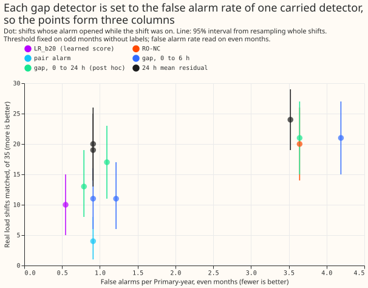
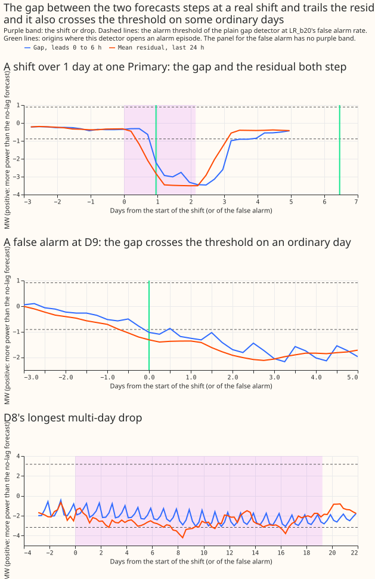

**This experiment asks whether the gap between two forecasts can find load shifts.** A load shift
moves demand from one Primary substation to its neighbours for hours or days. NGED cannot see the
true switching state, so the only signal it has is how far a forecast that uses recent power (K0,
a Kalman filter on the recent readings) differs from a forecast that uses none (GAM_ONLY, which
forecasts the normal running arrangement). We turned that gap, and simpler averages of the recent
residual, into alarms, set each alarm's threshold on odd calendar months without using any label,
and scored the alarms on the 35 real load shifts over 1 day, on 411 shifts injected into 44 copies
of the record, and on false alarms in ordinary rows. **The gap finds as many real shifts as the
learned score (LR_b20) and RO-NC do at their false alarm rates, with wide intervals.** The
24-hour mean residual finds more.

## Matched real shifts (35 shifts over 1 day)

"While on" means an alarm episode opened from 2 hours before the onset to the end of the shift.
"Within 4 days" (post hoc) also allows the 4 days by which the learned score trails a step. Each gap
row uses the threshold that gives the carried detector's false alarm rate on odd months.

| Detector | Matched while on (95% interval) | Within 4 days (post hoc) | Share of moved MW | False alarms per Primary-year, even months | Alarms per match | Median lag (hours) |
|---|---|---|---|---|---|---|
| LR_b20, learned score | 10 (5 to 15) | 27 | 25% | 0.55 | 4.0 | 96 |
| Plain gap, leads 0 to 6 h, at LR_b20's rate | 11 (6 to 17) | 16 | 47% | 1.21 | 4.5 | 41 |
| Gap with 6 hour minimum, at LR_b20's rate | 15 (9 to 21) | 18 | 54% | 1.09 | 3.6 | 62 |
| Gap with neighbour check, at LR_b20's rate | 11 (6 to 17) | 15 | 35% | 1.64 | 5.0 | 83 |
| 24 h mean residual, at LR_b20's rate | 20 (14 to 26) | 20 | 78% | 0.91 | 2.8 | 29 |
| RO-NC (RO_b80) | 20 (14 to 26) | 27 | 68% | 3.64 | 7.3 | 48 |
| Plain gap, leads 0 to 6 h, at RO-NC's rate | 21 (15 to 27) | 22 | 76% | 4.19 | 7.3 | 47 |
| Gap with neighbour check, at RO-NC's rate | 15 (9 to 21) | 18 | 43% | 4.68 | 10.4 | 49 |
| Pair alarm (PG_g70) | 4 (1 to 8) | 6 | 14% | 0.91 | 8.2 | 7 |
| Plain gap, leads 0 to 6 h, at the pair alarm's rate | 11 (6 to 16) | 16 | 47% | 0.91 | 3.6 | 41 |

## Checks and caveats

- **Prediction (point estimates):** variant (a) matches 11 against LR_b20's 10, and 21 against
  RO-NC's 20. The differences are +1 (-5 to 7) and +1 (-6 to 7) shifts. The prediction holds as
  written but cannot rank the detectors.
- **Where the false alarms fall (plain gap at LR_b20's rate, 39 episodes in 32.8 Primary-years of
  ordinary rows):** D9 5 (2.7 per Primary-year, against 1.2 over all series), D8 0, calendar days 3,
  November to March 8, other 23. Holidays, clock changes, D8, and D9 do not dominate. The report
  cannot separate weather error from other causes inside the "other" group.
- **Other row groups at LR_b20's rate:** D8's 29 multi-day drops, 1 matched; the 17 block days, 0
  (the 24-hour mean residual on those days stays under 2 noise units, and no detector, carried or
  gap, matches one). Injected shifts, 182 of 1,063 site events matched (17%), and only 5% of those
  up to 2 days long, 39% of those over 5 days; the median injected step is under 1 MW.
- **Neighbour check:** 29 of the 35 shifts have both Primaries metered. The check kept the matched
  count at 11 and raised false alarms per Primary-year to 1.64, because its threshold had to fall
  from 3.2 to 2.1 to hold the false alarm rate; it does not apply to injected shifts, whose
  receivers are unmetered.
- **Match rule changes the ranking:** the learned score trails a step by 4 days by design (its mask
  reaches back to the step). Allowed to alarm up to 4 days after the shift ends, it matches 27 and
  the gap 16.
- **Data:** the filter's correction is zero before a series' first reading (series 13 and 7 start
  late), so the gap is undefined there and those rows count for neither alarms nor exposure.
- **Median minus mean forecast, per site, and quantile-score contrasts:** not applicable, because no
  quantile forecast is scored. **Audit triggers that fired:** none of the seven fire on this result.
  Trigger 7 applies to part 2 (experiment 309), which reads the gap, and the maintainer excluded an
  Opus audit.
- **Lab conditions:** the injected worlds, the GAM and the filter hyperparameters are those of
  experiments 130, 141, and 258, with past weather, not ENS weather. The carried detectors' 4-day
  delay and the thresholds' fit on the same real record are shared by every detector.

## What to try next

- **Part 2 (experiment 309):** use the gap, and the 24-hour residual, to choose between the two
  forecasts, scored against observed power and against the true normal running arrangement.
- **Post hoc:** a detector that combines the 24-hour residual with the gap.
