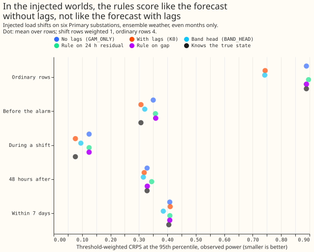
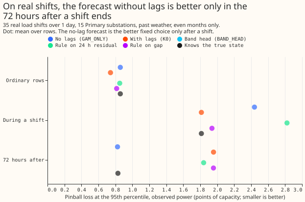

**This experiment asks whether NGED, which cannot see which switching arrangement is in force, can choose between two forecasts using only the forecasts and recent power.** The forecast without lags (GAM_ONLY) predicts the normal running arrangement. The forecast with lags (K0) adds a Kalman filter on recent power readings to GAM_ONLY, so it predicts what will flow while an abnormal arrangement lasts. A rule that switches to K0 when a signal says "abnormal" and back to GAM_ONLY otherwise recovered **none** of the gain that choosing correctly would give, in the injected worlds and in the real record. Which weather feeds each part matters. The real record uses the frozen past-weather forecast of [experiment 130](../00130-ml-experiment-convex-model/result.md) (ERA5 and CAMS) through [experiment 258](../00258-lsc-mask-out-of-sample-all-primaries-whole-history/result.md)'s harness, scored against observed power only. The injected worlds use the cached ensemble-weather member forecasts (ENS) of [experiment 297](../00297-lsc-need-a-detector-no-detector-arms-against-the-mask/result.md), scored against both observed power and the true normal arrangement.

## Does the gap carry more than the residual? (maintainer's question)

**The residual (measured power minus GAM_ONLY) flagged more real shifts than the gap, clearly at the learned score's false alarm rate.** K0 is GAM_ONLY plus a filter fitted to recent residuals, so the gap is a smoothed copy of the same residual, filtered through the Kalman filter's gain. It can add no information that the measured power lacks, and it loses some because the filter damps a step it takes to be noise. The differences below come from the stored per-shift flags of [experiment 308](../00308-lsc-two-forecast-gap-as-a-detector/result.md), with whole shifts resampled; no model was refitted. In both rows the thresholds were set on odd months to the false alarm rate of the named detector, so each pair shares an operating point to within one threshold step (the odd-month rates sit within 0.2 per Primary-year of each other).

| At the false alarm rate of | Signal | Matched while on, of 35 | Difference from the gap (95%) | Matched within 4 days of the end | Difference from the gap (95%) | False alarms per Primary-year, odd then even months |
|---|---|---|---|---|---|---|
| Learned score LR_b20 | Gap, leads 0 to 6 h | 11 | n/a | 16 | n/a | 1.17, 1.21 |
| Learned score LR_b20 | Residual, last 6 h | 14 | +3 (-1 to 7) | 17 | +1 (-3 to 5) | 1.23, 1.03 |
| Learned score LR_b20 | Residual, last 24 h | 20 | +9 (4 to 14) | 20 | +4 (0 to 9) | 1.23, 0.91 |
| Learned score LR_b20 | Residual, last 72 h | 17 | +6 (1 to 11) | 18 | +2 (-2 to 6) | 1.10, 1.28 |
| RO-NC | Gap, leads 0 to 6 h | 21 | n/a | 22 | n/a | 3.93, 4.19 |
| RO-NC | Residual, last 6 h | 23 | +2 (-2 to 6) | 23 | +1 (-2 to 4) | 3.87, 3.70 |
| RO-NC | Residual, last 24 h | 24 | +3 (-1 to 7) | 24 | +2 (-2 to 6) | 3.74, 3.52 |
| RO-NC | Residual, last 72 h | 22 | +1 (-2 to 4) | 23 | +1 (-2 to 5) | 3.74, 3.16 |

**Experiment 308's "supported" verdict rested on point estimates.** Its rule asked the gap to match at least as many shifts as the carried detector at equal false alarm rates (11 against 10, and 21 against 20), with intervals reported beside. The intervals on those differences include zero, so "as many as" is the claim and "more than" is not. The operating points in 308 were equal in that sense, so the 11 of 35 and 20 of 35 figures need no correction.

## Results

**In the injected worlds, the rules never beat the forecast without lags in the rows near a shift.** On even months, against observed power, the threshold-weighted CRPS at the 95th percentile (twCRPS95) in the rows within 7 days of a shift is 0.408 for GAM_ONLY, 0.410 for K0, 0.385 for BAND_HEAD, 0.409 for the rule on the 24-hour residual, 0.408 for the rule on the gap, and 0.405 for an oracle that knows the true state. The oracle that picks the better of the two forecasts on each row scores 0.330, but it gains in ordinary rows too (2.11 against 2.60 for K0 in quantile score), so it is picking noise, not the arrangement. Both thresholds chosen on odd months were the strictest on offer (4.5), where the rule almost never leaves GAM_ONLY. The recovery of the per-row oracle's gain in the rows within 7 days is 0.0% for the residual rule (-4% to 3%) and 0.0% for the gap rule (-3% to 3%), against the pre-registered 60%.

**In ordinary rows, the forecast with lags is better than the forecast without lags, so falling back to GAM_ONLY costs score.** In injected ordinary rows the quantile score is 2.60 for K0 and 2.96 for GAM_ONLY, and the residual rule scores 2.98. The rule is 0.38 points worse than K0 (0.29 to 0.48) and 0.02 points worse than GAM_ONLY (0 to 0.06), so it fails the pre-registered limit of 0.02 points whichever forecast is the reference. The quantile score is twice the mean pinball loss over 11 quantiles, which approximates the CRPS.

**In the real record, the forecast without lags is better only in the 72 hours after a shift ends.** Pinball loss at the 95th percentile (points of capacity, even months, 29 shifts and 53 months resampled) is, for GAM_ONLY, K0, the rule on the 24-hour residual, the rule on the gap, and the oracle that knows the state: 2.44, 1.81, 2.82, 1.94, and 1.81 during a shift; 0.83, 1.96, 1.84, 1.96, and 0.83 in the 72 hours after; and 0.86, 0.74, 0.85, 0.81, and 0.86 in ordinary rows. K0 minus GAM_ONLY is +1.13 points after a shift (0.03 to 2.84) and -0.12 points in ordinary rows (-0.17 to -0.06). During a shift the true-state oracle equals K0, so a perfect state flag helps only after the shift ends. The rules did not recover that gain: the residual rule scored 1.84 and the gap rule 1.96 after a shift, because neither signal drops back below its exit threshold until days later.

**For curtailment cost, always using K0 or BAND_HEAD is better than any rule.** In the injected rows within 7 days at 12 to 36 hour leads, against observed power, the cost at the scaled limit 0.5 is 2,488 for K0, 2,478 for BAND_HEAD, 2,698 for GAM_ONLY, and 2,670 for the residual rule (units of the cost model: pounds per scored half-hour at a price of 2,000 pounds per megawatt-hour and a 20-times breach penalty). The residual rule costs 7.3% more than K0 (3.6% to 12%). The cost was scored on the injected worlds only.

**Against the true normal arrangement, no arm gained.** The target NGED wants for scenario studies is the true normal-arrangement series. GAM_ONLY is the arm built for it, and in the rows near a shift K0 scored about the same (twCRPS95 0.340 for both). The page does not recommend an arm for that target.

## Checks and deviations

- **Median against mean forecast error:** the absolute error of the median and of the mean forecast differ by at most 0.03 points for GAM_ONLY and K0 at every substation, so no arm's median is biased against its mean.
- **Leave one substation out:** with any of the six injected substations removed, the residual rule's recovery in the rows near a shift stays between -0.06 and 0.00, so no one substation drives the result.
- **The planned neighbour-check variant was not run.** The plan named a rule with the neighbour check on the real record. Because the plain rules already failed at every threshold, the extra variant could not change the verdict, and the check cannot apply in the injected worlds.
- **The band-position arm was not run.** The maintainer asked for the position of measured power inside GAM_ONLY's own predictive bands. GAM_ONLY's bands are stored only for the sampled injected rows (131 non-contiguous runs per world, so no trailing 24 hours), and the real-record harness stores one K0 offset table per series, hour band, and lead band, not GAM_ONLY bands. Scoring the arm needs new fits.
- **Not run:** the persistent-regime descriptive item (D8's engine spell and a permanent step), the BSP cost proxy, the real-record cost, the 24 hours to 10 days ensemble range, and the before-alarm group on the real record. The real record has 29 even-month shifts, so its intervals are wide, and the odd-month threshold choice on 35 shifts is noisy.
- **Both ENS and past-weather scores are upper bounds** for a live service, because past weather is more accurate than a forecast and the injected worlds replay one ensemble run per day.

## What to try next

**A flag for the end of a shift is what the data call for.** The only group where the forecast without lags won is the 72 hours after a shift ends, so a detector that opens its alarm at the shift's end, such as one reading the step back to the old level, would be tested directly against these rows. A selector built from the signals here does not do that.
