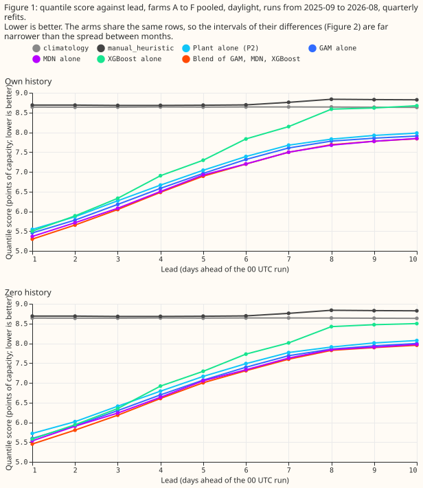
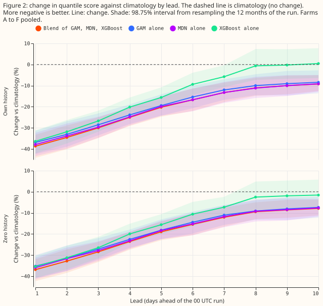
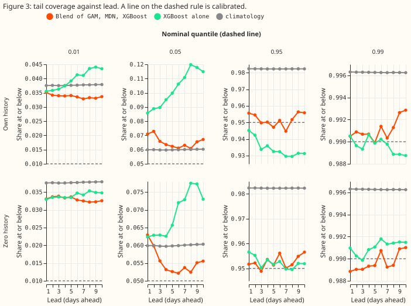
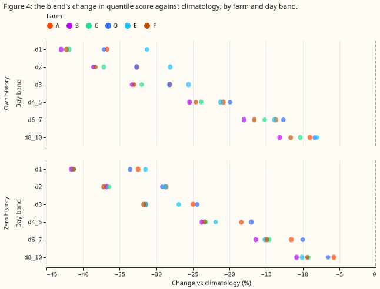

**The assembled forecast still beats climatology at day 10, so it can serve forecasts of
solar-farm power from 1 to 10 days ahead; XGBoost alone cannot.** National Grid Electricity
Distribution (NGED) meters six solar farms, labelled A to F here. [Experiment
300](../00300-metered-farm-best-guess-assembly/result.md) scored a forecast of each farm's power
at leads of 12 to 36 hours. The forecast starts from a physics model of the farm's output (the
"plant"), corrects the plant's 11 quantiles with a generalised additive model (GAM) and a
mixture-density neural network (MDN), and blends those two with XGBoost. We refitted the same
forecast at leads of 12 to 252 hours (day 1 to day 10), in six groups of lead times (day 1, day 2,
day 3, days 4 to 5, days 6 to 7, and days 8 to 10). We scored it against `climatology` (the farm's
power for the same month and half-hour of day in earlier history), `manual_heuristic` (quantiles
of 13 earlier observed powers), and the GAM, the MDN, and XGBoost alone. "Own history" means the
forecast trains on the farm's earlier months, and "zero history" means it trains on the other five
farms only. The quantile score is twice the mean pinball loss over the 11 quantiles, in points of
capacity (1 point is 1% of the farm's capacity), and lower is better.

**The verdict is partly supported.** The blend beat XGBoost in every day band, and removing the
farm's own power from earlier days changed the score by less than its interval, as predicted. The
blend's improvement in quantile score over `climatology` did not fall under 5% by days 8 to 10, so
that part of the prediction failed: the improvement is 10.1% (98.75% interval -13.8% to -5.6%, own
history). The stop rule did not fire.

## Single families and the blend, by lead

**The mixture-density network (MDN) on the plant is the best single family at every day band, and
the blend beats it by more than 1% only at days 1 and 2.** Scores are quantile scores in points of
capacity (lower is better). "Blend vs MDN" is the blend's score change against the MDN alone, and
the "MDN vs" columns are the MDN's score change against `climatology` and `manual_heuristic`. All
intervals are 98.75%, resampling the 12 months of the run.

Own history:

| Day band | GAM | MDN | XGBoost | Blend | `climatology` | `manual_heuristic` | Blend vs MDN | MDN vs `climatology` | MDN vs `manual_heuristic` |
|---|---|---|---|---|---|---|---|---|---|
| 1 | 5.45 | 5.36 | 5.50 | 5.30 | 8.64 | 8.69 | -1.2% (-2.4 to -0.3) | -37.9% (-43.4 to -32.3) | -38.3% (-41.2 to -35.3) |
| 2 | 5.78 | 5.71 | 5.89 | 5.65 | 8.64 | 8.69 | -1.0% (-1.9 to -0.2) | -33.8% (-39.8 to -27.9) | -34.2% (-37.7 to -30.8) |
| 3 | 6.18 | 6.08 | 6.33 | 6.05 | 8.64 | 8.68 | -0.5% (-1.4 to +0.3) | -29.7% (-34.7 to -24.7) | -30.0% (-32.4 to -27.5) |
| 4 to 5 | 6.77 | 6.71 | 7.10 | 6.69 | 8.64 | 8.68 | -0.4% (-0.9 to +0.3) | -22.3% (-26.5 to -17.9) | -22.7% (-26.2 to -19.6) |
| 6 to 7 | 7.46 | 7.35 | 7.99 | 7.35 | 8.64 | 8.73 | 0.0% (-0.7 to +0.9) | -15.0% (-20.1 to -9.9) | -15.8% (-20.9 to -10.1) |
| 8 to 10 | 7.85 | 7.76 | 8.62 | 7.77 | 8.64 | 8.83 | 0.0% (-0.8 to +1.6) | -10.1% (-14.5 to -5.4) | -12.1% (-16.6 to -7.6) |

Zero history:

| Day band | GAM | MDN | XGBoost | Blend | `climatology` | `manual_heuristic` | Blend vs MDN | MDN vs `climatology` | MDN vs `manual_heuristic` |
|---|---|---|---|---|---|---|---|---|---|
| 1 | 5.60 | 5.53 | 5.58 | 5.45 | 8.64 | 8.69 | -1.5% (-2.2 to -0.4) | -35.9% (-41.4 to -31.1) | -36.3% (-39.2 to -33.6) |
| 2 | 5.91 | 5.90 | 5.94 | 5.80 | 8.64 | 8.69 | -1.7% (-2.6 to -0.6) | -31.7% (-37.5 to -26.4) | -32.1% (-35.6 to -28.7) |
| 3 | 6.30 | 6.23 | 6.35 | 6.18 | 8.64 | 8.68 | -0.9% (-2.0 to +0.4) | -27.8% (-32.7 to -23.4) | -28.2% (-30.7 to -25.8) |
| 4 to 5 | 6.88 | 6.84 | 7.10 | 6.80 | 8.64 | 8.68 | -0.6% (-1.0 to -0.1) | -20.8% (-24.7 to -16.3) | -21.2% (-24.4 to -18.1) |
| 6 to 7 | 7.54 | 7.48 | 7.87 | 7.45 | 8.64 | 8.73 | -0.3% (-1.1 to +0.5) | -13.5% (-18.6 to -8.3) | -14.3% (-19.5 to -8.2) |
| 8 to 10 | 7.93 | 7.91 | 8.46 | 7.89 | 8.64 | 8.83 | -0.2% (-1.5 to +2.2) | -8.4% (-12.9 to -3.6) | -10.5% (-15.2 to -5.5) |

- **Best single family.** The MDN scores lowest of GAM, MDN, and XGBoost in all 12 combinations of
  day band and history setting. The GAM is within 1.7% of the MDN in every combination. XGBoost is
  the worst family from day 3 onward.
- **What the blend adds over the best single family.** The blend scores 1.0% to 1.7% below the MDN
  at days 1 and 2 (intervals below zero in both settings), 0.4% to 0.9% below it at days 3 to 5, and
  0.0% to 0.3% below it at days 6 to 10, where every interval includes zero. The 1% threshold in the
  decision rule is met at days 1 and 2 only.
- **XGBoost alone.** Its change against `climatology` is -36.3% at day 1 in own history. At days 8
  to 10 the change is -0.1% (-6.7% to +7.5%) in own history and -2.0% (-8.1% to +5.1%) in zero
  history, so both intervals include zero. XGBoost alone shows no skill over `climatology` from day
  8.

## Results

- **Planned contrasts, own history (98.75% interval).**
    - C1, blend minus XGBoost: -3.7% (-4.7 to -2.4) at day 1, -3.9% at day 2, -4.5% at day 3, -5.8%
      at days 4 to 5, -8.0% (-12.1 to -3.9) at days 6 to 7, and -10.0% (-15.6 to -4.0) at days 8 to
      10. Every interval is below zero. In zero history the changes run from -2.3% (-3.2 to -1.4) at
      day 1 to -6.8% (-11.4 to -2.1) at days 8 to 10.
    - C2, blend minus `climatology`: -38.7% (-44.2 to -33.3) at day 1, -34.5% at day 2, -30.0% at
      day 3, -22.6% at days 4 to 5, -15.0% (-19.9 to -10.0) at days 6 to 7, and -10.1% (-13.8 to
      -5.6) at days 8 to 10. In zero history the changes run from -36.9% to -8.7% (-12.0 to -4.2).
    - C3, blend minus blend without lagged power: -0.25% (-0.71 to +0.35) at day 1, and +0.2% to
      +0.3% at days 4 to 10. Every interval includes zero.
    - C4, blend minus the best single family: the table above.
- **Day by day (own history, blend minus `climatology`).** The change is -38.7% at day 1, -30.0% at
  day 3, -20.3% at day 5, -13.3% at day 7, -11.0% at day 8, -10.0% at day 9, and -9.2% (-12.6 to
  -5.1) at day 10. The blend's margin over `climatology` is still shrinking at day 10 but is far
  from zero.
- **Per farm.** The blend beats `climatology` and XGBoost at every farm and every day band in both
  settings (Figure 4). The margin over `climatology` at days 8 to 10 runs from -8.0% (farm E) to
  -13.2% (farm B) in own history.
- **Tail calibration (own history).** Coverage of the 0.01 quantile (nominal 0.01) is 0.033 to 0.035
  for the blend, 0.036 to 0.044 for XGBoost, and 0.038 for `climatology`. Coverage of the 0.05
  quantile is 0.062 to 0.073 for the blend and rises with lead for XGBoost from 0.086 to 0.117.
  Coverage of the 0.95 quantile is 0.948 to 0.956 for the blend and 0.931 to 0.945 for XGBoost.
  Coverage of the 0.99 quantile is 0.990 to 0.992 for the blend. The pinball loss at the 0.99
  quantile is 0.31 at day 1 and 0.35 at days 8 to 10 for the blend, against 0.54 to 0.56 for
  XGBoost, 0.43 for `climatology`, and 0.57 to 0.64 for `manual_heuristic`.
- **Reference floors.** `climatology` scores 8.64 and `manual_heuristic` 8.69 to 8.83 at every band.
  Their difference is -0.6% (-5.0 to +5.2) at day 1 and -2.2% (-7.2 to +3.4) at days 8 to 10, so
  neither is the better floor.

## Method and schedule

- **Lead bands.** Day `d` takes, for each half-hour, the 00 UTC ensemble run whose lead is `12 +
  24(d-1)` to `36 + 24(d-1)` hours. A run is usable 9 hours after its `init_time`, and the first
  half-hour scored is 12 hours after it. Bands pool days 4 and 5, days 6 and 7, and days 8 to 10.
  Each band has its own fit, blend weights, and scores. Day 1 reproduces experiment 300's weather
  exactly, and its blend scores 5.30 against 5.27 there, a difference that fits the change of refit
  schedule.
- **Ensemble step.** The ensemble's stamps are 3-hourly to lead 144 hours and 6-hourly after. From
  day 6 the shortwave value is a 6-hour mean, spread over the 12 half-hours of its period by the
  cosine of the sun's zenith angle (the angle between the sun and the vertical), and the temperature
  is interpolated linearly between 6-hourly stamps. The plant's response to each of 51 members is
  computed per half-hour.
- **Own power.** The farm's observed power enters at a lag of `ceil(lead / 24)` days. That power is
  known at run time. The weather at every lead is the ensemble run itself, which exists at forecast
  time.
- **Schedule.** Quarterly refits (the screening schedule) on all earlier months, each refit's
  training rows ending one day before the quarter starts, predicting the runs of its 3 months.
  Weekly refits were not run, so absolute scores could shift a little. We did not test whether the
  contrasts between arms depend on the schedule. The MDN has three seeds, averaged. A run belongs to
  the month of its `init_time`, and the 12 scored months are the months of the runs.
- **Arms.** `climatology`, `manual_heuristic`, the plant alone ("P2", binned by forecast and
  ensemble spread), the GAM (depth-1 boosted trees on P2's 11 quantiles as base margin), the MDN
  (three-component Gaussian mixture on the residual from P2), XGBoost (depth 6, same inputs, no base
  margin), the blend (per-level simplex weights fitted on earlier months, equal weights for the
  first three months), and the GAM, MDN, XGBoost, and blend without lagged power (own history only).
- **Row set.** The scored-year runs (2025-09 to 2026-08) with finite quantiles in every arm,
  including both floors; the code checks equal row counts. Quantiles are sorted before any loss.
- **Reference floors.** The `manual_heuristic` takes the quantiles of 13 earlier observed powers
  (analogues 1 to 6 weeks and 49 to 55 weeks before the half-hour). An analogue counts only when it
  was observed before the run, so the 1-week analogue is dropped at leads over 7 days. `climatology`
  uses the farm's powers before the scored year.

## Checks

- **Median minus mean forecast, own history (points of capacity, farms pooled).** Blend +0.04 at day
  1 and +0.72 at days 8 to 10, GAM +0.27 and +0.51, MDN +0.42 and +0.32, XGBoost -0.91 and -0.78,
  `climatology` -2.07 at every band. XGBoost's median sits below its mean forecast, as in experiment
  300; the blend's median sits above it by under 0.8 points.
- **Error of the mean forecast beside each score contrast.** Blend minus XGBoost on the absolute
  error of the mean forecast is -4.0% at day 1 (9.92 against 10.34) and -4.5% at days 8 to 10 (15.60
  against 16.34). Blend minus `climatology` is -42.8% at day 1 and -10.1% at days 8 to 10 (15.60
  against 17.35). The error of the mean forecast and the score point the same way in every band, so
  trigger 3 did not fire.
- **Audit triggers.** Trigger 2 (a result contradicting its prediction) fired: the margin over
  `climatology` stays near 10% at days 8 to 10 against a predicted fall under 5%. We tested an
  explanation after the fact. We refitted P2 (own history, days 8 to 10) with each row's plant
  forecast and spread replaced by their average over the training rows of the same month and
  half-hour. That plant (P2 alone), which carries the season and the sun's path but none of the
  ensemble's day-specific weather, scores 8.24 against 8.63 for `climatology` (-4.6%). P2 alone with
  the real ensemble weather scores 7.91 (-8.4%), against the blend's 7.77 (-10.1%). So about 4.6
  percentage points of the plant's 8.4% margin come from conditioning on season and sun geometry,
  which `climatology`'s coarse cells (one year of farm history per month and half-hour) do not do,
  and about 3.8 points come from the ensemble's forecast weather. At day 1 the same check scores
  8.41 for P2 alone with averaged weather and 5.55 with the real ensemble weather, so the weather
  matters most at short leads. The check is post hoc (`e00310_climatological_plant.py`). **Other
  triggers.** Trigger 4 (leaving one farm out flips a contrast) did not fire: the blend beats
  `climatology` and XGBoost at all six farms in every band, so dropping a farm cannot flip a sign
  (Figure 4). Trigger 5 did not fire: no ablated arm beats its full arm by more than its interval's
  half-width. Triggers 1 (a failed control), 3 (the mean-forecast error disagrees), 6 (an interval
  more than twice or under half as wide as a sister experiment's: day 1's interval for blend minus
  XGBoost is 2.3 points wide against 2.3 in experiment 300), and 7 (a later design depends on the
  result) did not fire. No audit was required.

## Caveats and next steps

- **Post hoc.** The climatological-plant check and the day-by-day slices were added after the
  scores. The 98.75% level covers the four planned contrasts per band only.
- **Not covered.** Weekly refits, leads under 12 hours or over 252 hours, the curtailment value
  (the farms are single series and the node metric needs a substation with its generators), and the
  GAM, MDN, and XGBoost without lagged power in zero history.
- **Climatology uses older history.** `climatology` is frozen at the data before 2025-09, while the
  forecasts refit each quarter on all earlier months. The margins over `climatology` in later
  quarters therefore include the forecasts' use of newer history.
- **Intervals.** Only the four planned contrasts per band are at the 98.75% level. The per-farm,
  per-day, and extra contrasts use the same interval width and are descriptive. Every arm holds the
  same row count in each band and setting, the `_nolag` arms included.
- **Ensemble fields after lead 144 hours.** The shortwave value is treated as a 6-hour mean there.
  The eight extra ensemble fields (humidity, longwave, precipitation, pressure, wind, and
  500 hPa height) come from experiment 270's extraction, and we did not check that their period
  meaning is the same across lead 144 hours.
- **Lower tail.** Actual output falls below the 0.01 quantile 3.2 to 3.5 times too often for the
  blend, and up to 4.4 times too often for XGBoost, at every lead, as in experiment 300.
- **Next.** Weekly refits of the MDN alone at days 1 to 10 would give the absolute scores for a
  first production model; a longer ensemble history would replace the farm history behind
  `climatology`'s coarse cells.
