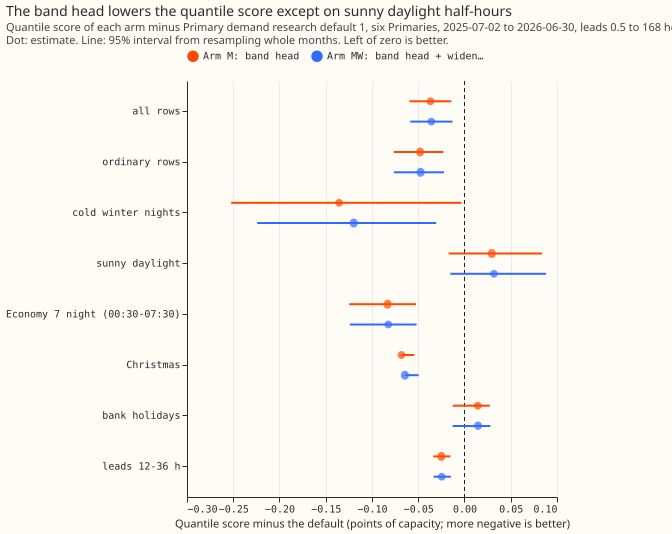
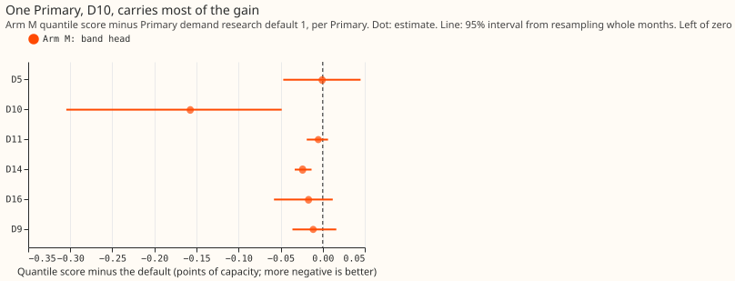
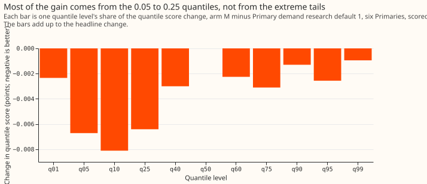
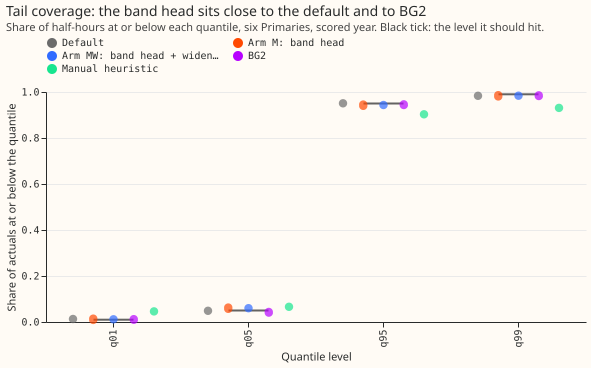
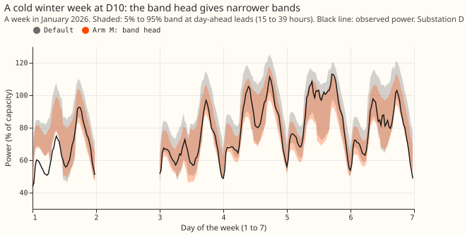
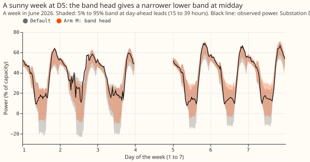
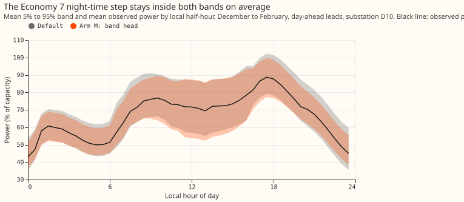

**Replacing the forecast bands of Primary demand research default 1 with bands from a neural network
lowers the quantile score by 0.037 points of capacity over the scored year, but the gain comes
almost entirely from one Primary, D10, and the new bands are worse on sunny daylight half-hours, so
we do not adopt them.** A similar gain, 0.034 points, appears in the even months of 2024-25,
measured against the stored bands of experiment 169 and not against Primary demand research default
1. The next test should keep the
current bands on sunny daylight half-hours, or train the head on the quantile score itself, because
the head's gain sits in the 0.05 to 0.25 quantiles and not in the extreme tails.

A band is the range between two quantile levels of the forecast, and a forecast here is 11 quantile
levels from 0.01 to 0.99 for each half-hour. The quantile score is twice the mean pinball loss over
those 11 levels, in points, meaning percentage points of the substation's effective capacity (its
rated demand); lower is better. A Primary is a primary substation, D5 to D16 are anonymised
Primaries, and the scored year runs from 2025-07-02 to 2026-06-30. Sunny daylight half-hours are
daylight half-hours that a solar-radiation threshold marks as sunny, and ordinary rows are all rows
that are neither sunny daylight half-hours nor cold winter nights (days with a mean temperature
below 2 °C, night hours only).

We asked whether the bands of Primary demand research default 1 (the GAM stack A+H+S of experiments
[220](../00220-dp-bg-stage4-assembly-with-drop-one/result.md) and
[251](../00251-dp-final-best-guess-assembly-clip-and-coast-against-bg2/result.md)) can be improved
by a small neural network that outputs a mixture of three bell curves. The default's median stays as
it is, so only the width and skew of the bands change. We trained the network on the stack's own
past errors, refitted it every month on the preceding 24 months, and scored it on the same 561,207
half-hours as experiment 251. The mixture-density design follows [experiment
287](../00287-metered-farm-spread-binned-plant-heads/result.md) and [experiment
300](../00300-metered-farm-best-guess-assembly/result.md) for metered solar farms, and the input
features and monthly cuts are those of [experiment
278](../00278-stack-retraining-cadence/result.md). **The quantile score of the six Primaries fell
from 2.579 to 2.542 points of capacity (lower is better), in 9 of 12 months, but the condition on
harm to sunny daylight half-hours failed, so the result is a candidate under the [research default
rule](../research-default.md).**

**Verdict `partly supported`.** Conditions 1 (gain), 3 (replication), and 5 (serving) hold.
Condition 2 (no harm) fails on sunny daylight half-hours. Condition 4 (controls, with no audit
trigger open) is also not met, because trigger 4 fired and no Opus audit was run, so no arm is
adopted. The
plan's verdict rule named no wording for this case, so `partly supported` is the closest of the six
verdict words. Nothing is added to the [log of versions](../research-default-log.md).

## Design

- **Arms.** Default: arm 1 of experiments 220 and 251 (stored; median, bands, and solar summary
  unchanged). Arm M: the default's median, with every other quantile set by the mixture-density head
  (average of three seeds). Arm MW: arm M with the default's cold-day widening applied to the head's
  upper offsets (multipliers 1.653, 1.363, 1.261, and 1.162 at q75, q90, q95, and q99 on rows whose
  ensemble-mean 24-hour temperature is below 2 C, read from experiment 169's stored arms). At most
  one arm may be adopted, so the gain is read at 99.5%.
- **The head.** A three-component Gaussian mixture on the residual of arm D's mean forecast (arm D
  is the convex model with a Kalman filter of experiment 155), in
  units of the stored 5% to 95% width over 3.29, with the inputs of experiment 278's arm 2: arm D's
  mean, the Kalman filter's level and anomaly, the stored width, lead, ensemble-driver weather,
  calendar flags, and the Economy 7 flag. The head is trained on the negative log-likelihood, and
  its
  quantiles are shifted so that its median equals the default's median. The shift keeps the median
  unchanged and avoids training on the in-sample residuals of the neural median head.
- **Cadence.** A refit at each month start on the rows of the preceding 24 months whose longest
  target lies before the refit date, with every fourth month held out for early stopping, as
  experiment 278 does.

## Results

- **Kind and tier.** `kind: change`, family Primary demand, starting from Primary demand research
  default 1. The change is a tier 2 change (a new fitted head, with the feature code of experiment
  278
  imported), and the new-head minimum gain of 0.03 points applies. The brief for this experiment
  quoted 0.02 points; the rule page owns the value, and the point estimate (-0.037) clears both.
- **Absolute scores, six Primaries (quantile score; twCRPS at the 95th percentile of earlier
  power).** Default 2.579; 0.1708. Arm M 2.542; 0.1703. Arm MW 2.543; 0.1705. BG2 2.715; 0.2024 (BG2
  is the XGBoost research benchmark, not the production forecast). Manual heuristic 3.397; 0.2463.
  Climatology 3.665; 0.2627. The default scored 2.579 (six) and 2.617 (five decision Primaries),
  matching experiment 251 within 0.005, so the reproduction gate passed.
- **Arm M minus default, quantile score.** -0.037 (95% interval -0.060 to -0.014; 99.5% interval
  -0.070 to -0.005), 9 of 12 months better. The three worse months are February, March, and April
  2026 (+0.011, +0.031, +0.011). Arm MW minus default is -0.036 (99.5% interval -0.070 to -0.004).
  Arm M minus arm MW is -0.001 (-0.003 to +0.000), so keeping the cold-day widening changes the
  score by at most 0.003 points here.
- **Against BG2 and the manual heuristic.** Arm M minus BG2 is -0.173 (95% interval -0.314 to
  -0.040), against -0.136 (-0.278 to -0.005) for the default. Arm M minus the manual heuristic is
  -0.855 (-1.123 to -0.613).
- **Gate on harm (one-sided 95% upper bound of arm M minus default, pooled six Primaries).**
  Headline -0.018, passes (tolerance 0.02). Pinball loss at q01 -0.006 and at q99 +0.001, passes
  (0.05). Cold winter nights -0.064 (estimate -0.136), passes (0.05). twCRPS at the 95th percentile
  +1.3% relative, passes (2%). **Sunny daylight half-hours +0.074 (estimate +0.029, 95% interval
  -0.017 to +0.084), fails (0.05).** Arm MW gives the same pattern (sunny daylight bound +0.077;
  twCRPS +1.8%).
- **Replicate year (condition 3).** The even months of 2024-25, 360,122 rows. Research default 1's
  neural median head and solar summary exist for the scored year only, so the comparison is the head
  against the stored bands of arm A (experiment 169) around arm A's own median. Arm M minus the arm
  A
  bands is -0.034 (95% interval -0.052 to -0.016, resampling origin days, not months, so it is
  narrower than a month-block interval would be); arm MW -0.034. The sign matches and the size
  exceeds half of 0.03.
- **P1 and P3 held, P2 failed, and P4 does not apply.** P1 held (-0.037 against at least -0.02). P2
  failed: the 0.01 and 0.99 levels give
  9% of the gain and cold winter night rows give 5%, against 60% predicted. The prediction P2 mixed
  levels and row groups, so we scored it both ways before reading any score: the 0.01 and 0.99
  levels give 9% of the gain, and the cold winter night rows give 5%, and both fall short of 60%. P3
  held: the 0.95 coverage on ordinary rows is 0.935 against 0.945
  for the default, within 2 points of 95%. P4 is not applicable. The stop rule did not fire: the
  first six months improved by 0.059.
- **Where the gain is.** By Primary: D10 -0.157 (-0.305 to -0.049), D14 -0.024 (-0.033 to -0.013),
  D16 -0.017, D9 -0.011, D11 -0.005, D5 -0.001 (none of the six Primaries has a pass or fail).
  Leaving D10 out
  gives -0.012 (-0.028 to +0.005); leaving any other Primary out keeps -0.039 to -0.043. By level
  the gain is largest at q05 (-0.007), q10 (-0.008), and q25 (-0.006). By group: ordinary rows
  -0.048, Economy 7 nights -0.083, Christmas -0.068, leads 12 to 36 hours -0.025, bank holidays
  +0.014 (-0.013 to +0.028).
- **Tails.** The table below gives coverage and pinball loss at the four tail levels. On cold winter
  nights the q95 coverage is 0.970 for the default, 0.941 for arm M, and 0.973 for arm MW. On sunny
  daylight half-hours the q05 coverage is 0.081 for the default and 0.126 for both new arms (nominal
  0.05). q01 means the 0.01 quantile level, and so on.
- **Operator-visible behaviour.** Figure 7 shows the winter profile at D10: the Economy 7 step at
  about 00:30 local time stays inside both sets of bands, and arm M's bands are narrower than the
  default's overnight. Figure 5 shows the narrower cold-night bands in one January week, and figure
  6 shows the narrower lower band at midday in one June week, and the q05 coverage on sunny daylight
  half-hours rises above its nominal 5% at those midday half-hours.
- **The head makes the bands skewed upward.** The mean of arm M's 11 quantiles sits 0.20 points
  above its median, against 0.02 for the
  default, so the head makes the bands skewed upward.
- **Rows and schedule.** `fold_a_daily_gap_v1`, six Primaries D5, D9, D10, D11, D14, D16; scored
  year 2025-07-02 to 2026-06-30; leads 0.5 to 168 hours, so leads of 7 to 10 days are not scored and
  NGED's horizon is 1 to 10 days. Outside hand-filtered events. The head is refitted monthly on 24
  rolling months, three seeds averaged, on the CPU (about 25 s per fit). The default's stored
  forecasts are not refitted. Weather at lag times is the ensemble weather available at forecast
  time. The GAM stack still trails BG2 on sunny April to June half-hours (experiment 251); this
  experiment did not change that.
- **Weather in the training rows.** The 24-month pool of the earliest scored refits holds up to
  about a year of past-weather rows (origins before 2024-07), while the scored rows use ensemble
  weather, as in experiment 278.
- **Code reused.** `ml-experiments/00278-stack-retraining-cadence/` (`e00278_h_data.py` for the rows
  and inputs) and the scoring pattern of experiment 251, copied into this folder. No earlier folder
  was edited.
- **What to try next.** (1) Train the head on the pinball loss of the 11 levels, which is the
  quantity the quantile score averages (twice the mean),
  and not on the likelihood. (2) Keep the default's bands on sunny daylight half-hours and use the
  head elsewhere, as a new pre-registered experiment, because the research default rule does not let
  a failed arm be adjusted after its result is known. (3) Find why D10 gains 0.157 points:
  experiment 220 also located the gap between the neural median head's own bands and the default's
  at D10.

## Tails, six Primaries

| Level | Default coverage | Default pinball | Arm M coverage | Arm M pinball | BG2 coverage | BG2 pinball |
|---|---|---|---|---|---|---|
| q01 | 0.013 | 0.172 | 0.012 | 0.159 | 0.010 | 0.211 |
| q05 | 0.049 | 0.622 | 0.060 | 0.585 | 0.041 | 0.623 |
| q95 | 0.951 | 0.692 | 0.943 | 0.678 | 0.944 | 0.751 |
| q99 | 0.984 | 0.211 | 0.984 | 0.206 | 0.983 | 0.253 |

## Checks

- **Median minus the mean forecast, per Primary (points; the mean is arm D's, and the median is the
  default's, which every arm shares).** D10 +0.72, D11 -0.50, D14 -0.20, D16 -0.84, D5 +0.01, D9
  -0.75.
- **Error of the median beside the quantile-score contrasts.** The median is the default's in every
  arm, so the mean absolute error of the median is identical (4.510) and trigger 3 cannot fire.
- **Controls.** The reproduction gate passed. The assertion that every training target precedes its
  refit date held in all 54 fits (18 monthly refits times 3 seeds). Arm MW equals arm M on every row
  at or above 2 C, and the median
  of arm M equals the default's on every row.
- **Triggers.** Trigger 4 fired: leaving D10 out moves the interval of arm M minus default across
  zero (-0.012, -0.028 to +0.005). No Opus audit was run, by the maintainer's instruction on
  2026-10-23; a fresh Sonnet reviewer re-derived the headline contrasts from the stored arrays and
  found no difference. Trigger 5 did not fire (arm M differs from its nested arm MW by 0.001, and
  the interval includes zero).
  Triggers 1, 2, 6, and 7 did not fire.
