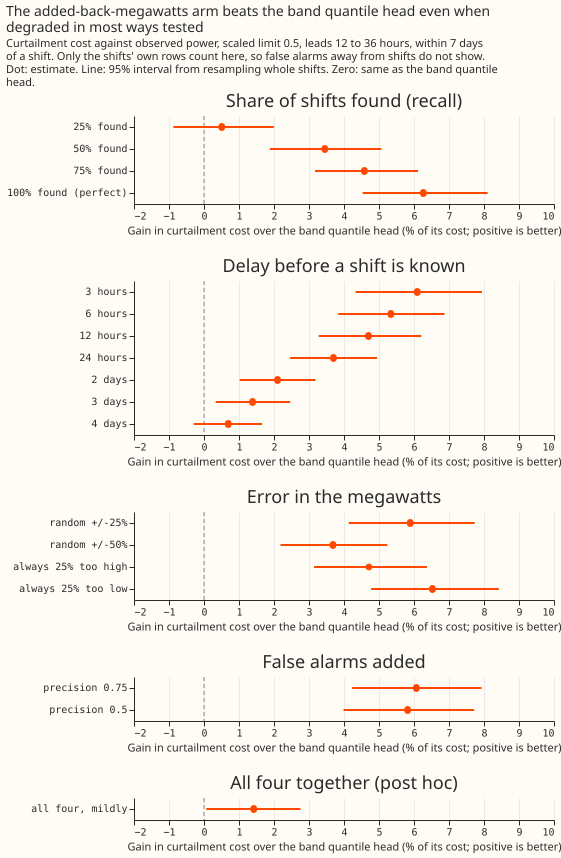
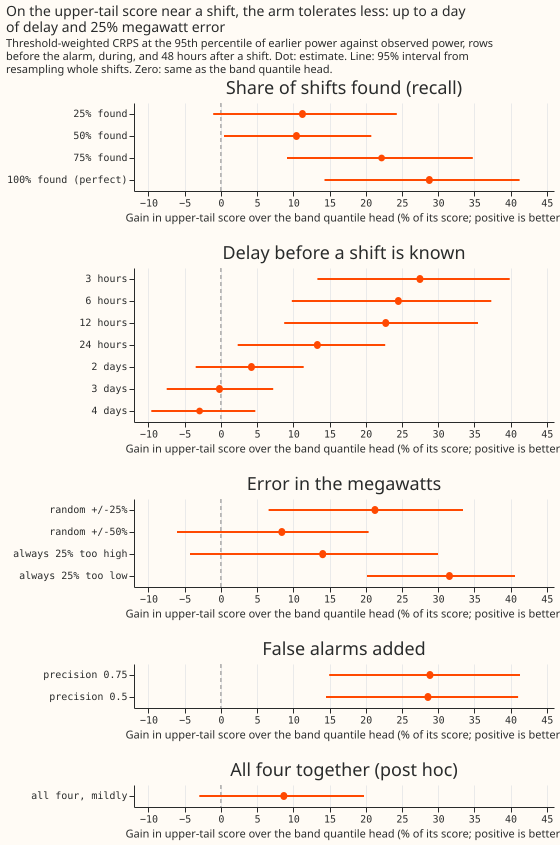
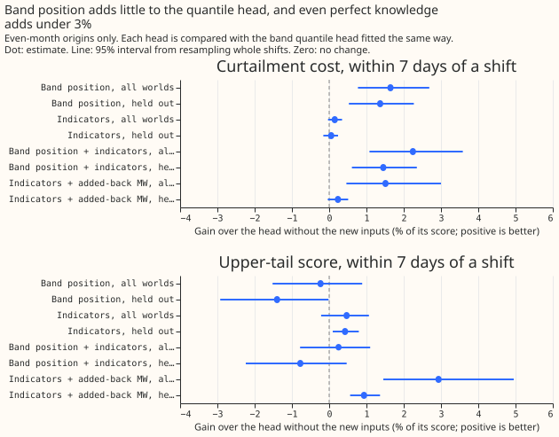
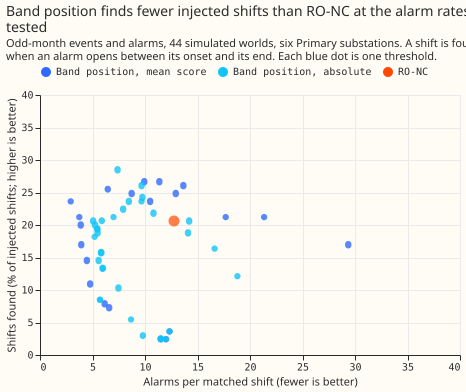
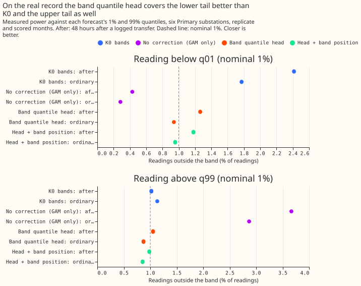

**This experiment asks how accurate a load shift detector has to be to improve on a forecast that
uses no detector.** A load shift moves demand from one Primary substation to its neighbours for
hours or days. We worked on the 44 simulated copies of the real power record from [experiment
297](../00297-lsc-need-a-detector-no-detector-arms-against-the-mask/result.md), with 411 injected
shifts at six Primary substations (labelled D5, D9, D10, D11, D14, and D16). Experiment 297 found
that a quantile model of the forecast's error (BAND_HEAD) beats the RO-NC mask (RO-NC is the
refit-offset neighbour-count detector). Only perfect knowledge, with the true megawatts of each
shift subtracted from the readings the Kalman filter sees and added back to the forecast, still beat
BAND_HEAD on curtailment cost. We spoilt that perfect arm one property at a time: the share of
shifts found, the delay before a shift is known, the error in the megawatts, and false alarms. We
report the worst level that still beats BAND_HEAD. We also tested whether band position (how
surprising recent readings are against the no-lag forecast's own error bands) can detect shifts, and
whether it or perfect knowledge improves BAND_HEAD as an input.

**The arm tolerates much more than we predicted.** It still beats BAND_HEAD within 7 days of a shift
when it finds half the shifts, learns of each shift 3 days late, has the megawatts wrong by 50%, or
raises false alarms at 1 in 2. It stops winning at 25% of shifts found. RO-NC found 33% (28 to 38)
of the shifts on these worlds. Band position finds fewer shifts than RO-NC at every alarm rate, and
as an input it lowers the quantile head's
curtailment cost by under 2.5% and leaves its upper-tail score unchanged.

Every figure is the lab-condition arm: the true megawatts and the true end of each shift are used,
and a Primary substation has no published limit, so cost figures compare forecasts and state no
money saved. Gains are percentages of BAND_HEAD's score, and positive is better for the arm.
Intervals resample whole shifts, or whole calendar months for ordinary rows, 95%.

## Break-even against BAND_HEAD

- **Headline cell (curtailment cost, scaled limit 0.5, within 7 days of a shift):** perfect
  knowledge gains 6.3% (4.5 to 8.1) over BAND_HEAD, the figure of experiment 297. Without D11 it
  gains 9.0% (6.0 to 12.2), and without D16 7.2% (4.9 to 9.6).
- **Recall:** 75% found gains 4.6% (3.2 to 6.1), 50% found 3.5% (1.9 to 5.1), and 25% found 0.5%
  (-0.9 to 2.0). The break-even is 50%. Without D11 the 25% level wins, at 3.1% (1.0 to 5.5).
- **Delay:** 6 hours gains 5.3%, 24 hours 3.7% (2.5 to 4.9), 2 days 2.1% (1.0 to 3.2), 3 days 1.4%
  (0.3 to 2.5), and 4 days 0.7% (-0.3 to 1.7). The break-even is 3 days, and 2 days without D16 (3
  days without D16 gains 1.0%, -0.2 to 2.3). Delays of 6 to 48 half-hours act only on the rows
  before the alarm; the delays of 2 to 4 days also reach the rows during and after a shift.
- **Megawatt error:** random errors of 25% and 50% gain 5.9% (4.1 to 7.7) and 3.7% (2.2 to 5.2), an
  error of 25% too high 4.7% (3.1 to 6.4), and 25% too low 6.5% (4.8 to 8.4). Every level tested
  wins.
- **False alarms:** precision 0.75 gains 6.1% (4.2 to 7.9) and precision 0.5 gains 5.8% (4.0 to 7.7)
  near shifts, because the near-shift rows seldom overlap a false span (a false span avoids every
  shift and its 72-hour tail). On ordinary rows (G1), precision 0.75 raises the quantile score by
  0.9% (0.7 to 1.1) and the cost by 0.6% (0.4 to 0.7) against the perfect arm, and precision 0.5 by
  2.5% (2.1 to 3.0) and 1.6% (1.2 to 2.0). K0 plus spread alone is 2.8% (0.7 to 5.3) cheaper than
  BAND_HEAD on ordinary-row cost.
- **All four mildly together (recall 0.5, 6-hour delay, 25% random error, precision 0.75; post
  hoc):** 1.4% (0.1 to 2.8), and -0.4 to 2.9 without D16.
- **Upper-tail score on shift rows (before the alarm, during, and 48 hours after a shift):** perfect
  knowledge gains 28.8% (14.3 to 41.3). The tolerances are narrower: 50% found gains 10.4% (0.4 to
  20.8) and 25% found does not, a delay of 24 hours gains 13.3% (2.3 to 22.7) and 2 days does not,
  and a 25% random error gains 21.3% (6.6 to 33.4) and 50% does not. Within 7 days of a shift every
  degraded arm scores worse than, or no better than, BAND_HEAD on the upper tail (perfect knowledge
  -2.8%, -7.2 to +1.2), because the arms keep K0's bands.
- **RO-NC on these worlds:** it found 33% (28 to 38) of the shifts, a median 48 hours after onset,
  with about 10 alarms per matched shift, below the recall break-even of 50%.

## Band position and the head inputs

- **As a detector:** at RO-NC's rate of about 10.6 alarms per match (odd months) the mean normal
  score finds 17% (13 to 21) of even-month shifts, with a median delay of 48 hours, and the mean
  absolute score finds 19% (15 to 23). Neither threshold reaches 2.7 alarms per match or fewer than
  4: at higher thresholds recall falls to 0.
- **As a head input (even-month origins):** the upper-tail score within 7 days of a shift changes by
  -0.2% (-1.5 to +0.9) and the cost gains 1.6% (0.8 to 2.7). Held out (fitted on even-seed worlds
  only, scored on odd-seed worlds) the score changes by -1.4% (-2.9 to -0.0) and the cost gains 1.4%
  (0.5 to 2.3).
- **Perfect-knowledge indicators:** the upper-tail score changes by +0.5% (-0.2 to +1.1) and the
  cost by +0.2% (-0.0 to +0.4). With the added-back megawatts as well, the score gains 2.9% (1.5 to
  5.0) and the cost 1.5% (0.5 to 3.0). The 2% and 5% bars of P5 are not met, and these heads read
  inputs no detector has, so they are upper bounds.
- **Injector-leak controls:** fitting on even-seed worlds and scoring odd-seed worlds, and fitting
  on shifts smaller than the median size and scoring larger ones, leave the numbers within their
  intervals. The injector and the real record are shared by every fit.
- **Head trained on:** all 44 worlds' rows of one month parity, scored on the other, then swapped
  (experiment 297); ordinary rows weigh 4. The head's inputs are K0's filter level, K0's correction,
  lead, hour band, quarter, and the as-of ratio. Refitting reproduces experiment 297's scores
  exactly.

## Real record

- **Rows:** the six substations' real record with no injection, scored with the head fitted on the
  other month parity. These rows overlap the injected worlds' background. The 190 logged transfers
  touching the six series in the replicate and scored months are descriptive; the 7 transfers of the
  brief could not be told apart from them.
- **Ordinary rows:** the head against K0 changes the quantile score by +1.1% (-1.1 to +3.7), so
  there is no harm. Readings fall below q01 in 0.9% of rows and above q99 in 0.9%, against 1.8% and
  1.1% for K0.
- **After a transfer (48 hours):** the head gains 4.7% (-2.6 to +13.2) over K0, and readings fall
  below q01 in 1.3% of rows and above q99 in 1.1% (K0: 2.4% and 1.0%). The no-correction forecast
  leaves 3.7% of readings above q99.
- **Experiments 264 and 209:** experiment 264's rows are at D8, outside these six substations, and
  experiment 209's heads belong to arm D, so no placement is possible. Experiment 297's as-of
  widening arm is the nearest comparison, and BAND_HEAD beat it there.

## Predictions

- **P1 held.** 50% found beats BAND_HEAD on cost and 25% found does not.
- **P2 failed.** A 25% random error and a 6-hour delay beat BAND_HEAD, but so does a 24-hour delay
  (3.7%, 2.5 to 4.9), against the prediction that it would not.
- **P3 failed.** Precision 0.75 wins, and ordinary-row cost stays within 3%, but precision 0.5 also
  beats BAND_HEAD near shifts.
- **P4 failed.** Band position finds 17% to 19% of shifts at RO-NC's alarm rate against RO-NC's 33%,
  with a median delay of 46 to 48 hours.
- **P5 failed.** Band position lowers the upper-tail score by 0.2% (not 2%), and the indicators
  raise it by 0.5% (not 5%).

## Checks

- **Reproduction:** the degraded arm at full quality reproduces experiment 297's PERFECT_ADD, and
  the refitted base head reproduces BAND_HEAD, both exactly (largest score difference 0.0 over
  6,879,769 rows).
- **Median minus mean forecast, per site:** for the head the median forecast's absolute error is
  0.29 points lower than the mean forecast's at D16 and 0.11 lower at D11, by design. For K0 and the
  added-back arm it lies within 0.02 points at every site.
- **Mean-forecast error beside the contrasts:** printed for every arm in the report.
- **Triggers that fired:** a result contradicting its prediction (P2 and P3: the false-alarm cell
  cannot see false spans, which is the tested explanation, and the delay arm uses the true end), and
  leave-one-site-out (D11 and D16 move the break-even levels but not the sign of the headline
  contrast). A fresh Sonnet reviewer re-derived the headline contrasts; no Opus audit ran, because
  the brief limits the work to Sonnet.

## Caveats

- **Lab conditions.** The arm uses the true megawatts and the true end of each shift. A real
  detector's timing, size, and recall errors are not independent of each other.
- **False alarms are drawn at random.** A false span avoids shifts, carries a constant size drawn
  from true shifts, and is known at its onset. The cost cell near shifts cannot show the harm of
  false alarms; the ordinary-row figures do.
- **The shifts are 25% of load or more and last over a day**, and the real record's own transfers
  inside the stream count as false alarms in the detector test.
- **Not done.** BAND_HEAD with the added-back centre, a retrained LR_b20 on the injected worlds, and
  a head built on the added-back forecast.

## Arms and rows

- **Arms:** BAND_HEAD, K0, and PERFECT_ADD from experiment 297; 17 degraded versions of PERFECT_ADD
  (recall 0.25, 0.5, 0.75; delays of 3, 6, 12, 24 hours and 2, 3, 4 days; random megawatt error of
  25% and 50%, always 25% too high or too low; precision 0.75 and 0.5; all four mildly); the head
  with band position, with the three indicators, with both, and with the indicators and the
  added-back megawatts, each fitted three ways (all worlds, held out, small shifts only).
- **Code reused:** [experiment
  297](../00297-lsc-need-a-detector-no-detector-arms-against-the-mask/result.md)'s harness, scores,
  and head, and experiment 309's band-position method.
- **Rows and weather:** experiment 297's 6,879,769 rows (411 shifts, ensemble-weather member
  forecasts), no retraining.

## What to try next

- **Build a detector that finds at least half the shifts**, and test it by degrading nothing: run
  LR_b20 on the injected worlds and read its recall against the break-even of 50%.
- **Put the added-back centre under the head**, so the recalibrated bands and the megawatt
  correction come together.
