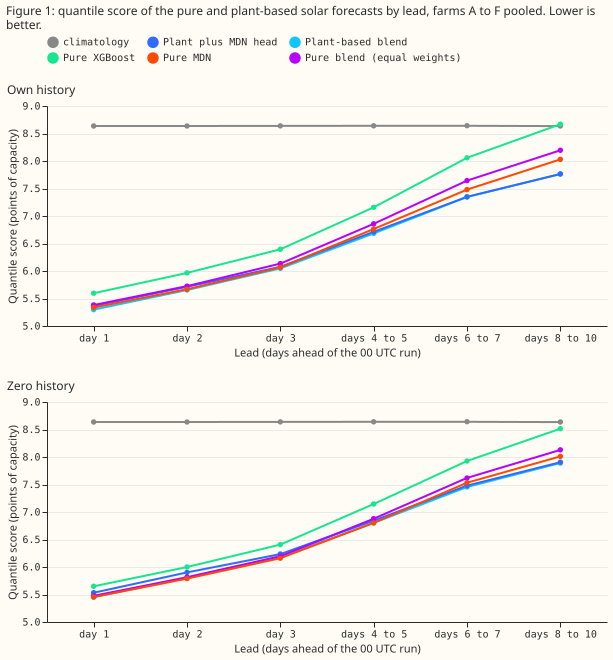
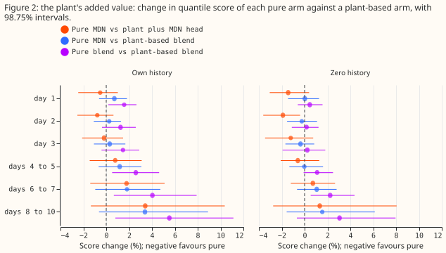
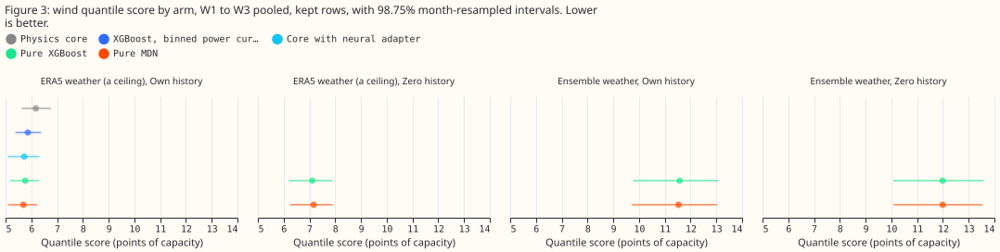

---

**A mixture-density network that sees only weather and the calendar forecasts almost as well as the
plant-based forecasts, for the six metered solar farms and the three metered wind farms.** The plant
adds between 0% and 3.4% to the solar quantile score, and adds nothing we can measure in zero
history. These results do not rule out a single weather-only model for the first production
update.

In this page, "the plant" is a physical power model of one farm, "points of capacity" are
percentages of the farm's capacity, and ERA5 is the ECMWF reanalysis of past weather, which arrives
about 5 days late.

We asked whether predictors built from weather and calendar inputs only, with no plant model
anywhere in the pipeline, match forecasts built on a plant model (a physical power model of the
farm: the solar plant of experiments [218](../00218-metered-solar-farm-plant-fit/result.md) and
[287](../00287-metered-farm-spread-binned-plant-heads/result.md), or the wind physics core of
experiment [230](../00230-wind-physics-core-part-1/result.md)). We fitted XGBoost
([Chen and Guestrin, 2016](https://doi.org/10.1145/2939672.2939785)) and a three-component Gaussian
mixture-density network (MDN, as in experiment
[300](../00300-metered-farm-best-guess-assembly/result.md))
on the same rows as experiments [310](../00310-metered-farm-long-lead-scoring/result.md) (solar,
leads of 1 to 10 days) and [285](../00285-wind-effective-wind-adapters/result.md) (wind). Scores are
quantile scores in points of capacity (lower is better), and intervals resample the 12 scored months
at 98.75%. "Own history" trains on the farm's earlier months and "zero history" on the other
farms only.

**The verdict is partly supported.** The plan made four predictions (full text and bounds in the
front matter). P1: the pure MDN scores within 2% of the plant plus MDN head in own history and at
least 3% worse in zero history (solar, 12 to 36 hours). P2: the pure XGBoost is no better than the
pure MDN at the 0.99 pinball loss (solar). P3: for wind, the pure MDN is within 2% of the pure
XGBoost.
P4: at days 8 to 10 the pure XGBoost is no better than `climatology` and the pure MDN is at least 5%
worse than the plant-based blend (solar). P2 and P3 held, and P1 and P4 held in part. We read each
bound on the point estimate and report the 98.75% interval beside it, so a bound can hold on the
point estimate while its interval crosses the bound.

## Weather-only models against plant-based models, solar (own history / zero history)

| Day band | Pure XGBoost | Pure MDN | Plant plus MDN head | Plant plus XGBoost | Plant-based blend
  | `climatology` |
|---|---|---|---|---|---|---|
| 1 | 5.60 / 5.65 | 5.34 / 5.45 | 5.36 / 5.53 | 5.50 / 5.58 | 5.30 / 5.45 | 8.64 |
| 3 | 6.39 / 6.41 | 6.07 / 6.16 | 6.08 / 6.23 | 6.33 / 6.35 | 6.05 / 6.18 | 8.64 |
| 6 to 7 | 8.06 / 7.93 | 7.48 / 7.53 | 7.35 / 7.48 | 7.99 / 7.87 | 7.35 / 7.45 | 8.64 |
| 8 to 10 | 8.67 / 8.52 | 8.03 / 8.01 | 7.76 / 7.91 | 8.62 / 8.46 | 7.77 / 7.89 | 8.64 |

The pure blend (equal weights of the pure XGBoost and the pure MDN) scores 5.38 / 5.48 at day 1 and
8.19 / 8.13 at days 8 to 10, which is worse than the pure MDN alone, so the pure families are best
used singly. The "plant plus" columns are experiment 310's stored arms: the MDN head sees seven
inputs (the plant forecast, its spread, the lagged-power ratio, lagged power, a flag for missing
lagged power, the clear-sky index, and lead), and the plant plus XGBoost sees the weather columns
the pure XGBoost sees, plus the plant's
response and lagged power. `manual_heuristic` scores 8.69 at day 1 and 8.83 at days 8 to 10.

## Solar results

- **Pre-registered predictions (98.75% intervals).**
    - P1 partly failed. Pure MDN minus plant plus MDN head, own history: -0.5% (-2.4 to +1.0) at day
      1, within the 2% bound. Zero history: -1.4% (-3.0 to +0.4) at day 1, so the pure MDN is not 3%
      worse, and the bound fails.
    - P2 held. The pure XGBoost scores 0.54 at the 0.99 pinball loss against 0.31 for the pure MDN
      (-42.8%, -50.1 to -35.5, own history day 1), and the gap stays between -37% and -43% to days 8
      to 10.
    - P4 partly failed. The pure XGBoost against `climatology` at days 8 to 10 is +0.4% (-6.2 to
      +8.0) in own history and -1.4% (-7.7 to +5.9) in zero history, so it shows no skill (the
      intervals straddle zero, so this is not a strict hold). The pure MDN against the plant-based blend is +3.4% (-0.6 to +8.9) in own history
      and +1.5% (-1.6 to +6.1) in zero history, short of the predicted 5%.
- **The plant's value, like for like.** Pure XGBoost minus plant plus XGBoost: +1.8% (0.7 to 3.1) at
  day 1, +0.9% (0.3 to 1.6) at days 6 to 7, and +0.5% (-0.0 to +1.1) at days 8 to 10 in own history.
  Zero history: +1.3% (0.6 to 2.0), +0.7% (0.2 to 1.4), +0.6% (0.1 to 1.2).
- **The plant's value against the best blend.** Pure MDN minus plant-based blend, own history: +0.7%
  (-0.6 to +1.8) at day 1, +1.8% (-1.0 to +4.7) at days 6 to 7, and +3.4% at days 8 to 10. Every
  interval includes zero.
- **The pure MDN keeps skill to day 10.** Against `climatology` it is -38.2% at day 1 and -7.0% at
  days 8 to 10 in own history, and -36.9% and -7.2% in zero history. Against `manual_heuristic` it
  is -38.6% (-41.6 to -35.6) at day 1 and -9.1% (-15.3 to +0.2) at days 8 to 10.
- **Tails (own history, day 1 / days 8 to 10).** 0.99 pinball loss: pure MDN 0.31 / 0.33, pure
  XGBoost 0.54 / 0.56, plant plus MDN head 0.30 / 0.34, `climatology` 0.43. Coverage of the 0.01
  quantile: pure MDN 0.037 / 0.036, pure XGBoost 0.035 / 0.044. Coverage of the 0.99 quantile: pure
  MDN
  0.985 / 0.987, pure XGBoost 0.990 / 0.989.
- **Lead range.** The solar rows cover leads of 12 hours to 10 days, which is NGED's horizon.

## Wind results (W1 to W3 pooled, kept rows, 53 Tuesday runs)

| Arm | ERA5 weather, own | ERA5, zero history | Ensemble, own | Ensemble, zero history |
|---|---|---|---|---|
| Physics core | 6.17 | | | |
| XGBoost on a binned power curve | 5.86 | | | |
| Core with neural adapter | 5.72 | | | |
| Pure XGBoost | 5.76 | 7.11 | 11.58 | 11.99 |
| Pure MDN | 5.69 | 7.16 | 11.53 | 11.99 |

- **P3 held.** Pure MDN minus pure XGBoost: -1.2% (-0.15 to +0.04 points) with ERA5 own history,
  -0.4% (-0.13 to +0.01) on ensemble weather own history, and +0.8% (-0.05 to +0.15) with ERA5 in
  zero history. All three point estimates are within the 2% bound. The intervals of the two ERA5 rows reach about -2.6% to +2.1% and cross the bound.
- **Against the physics core and the adapter (ERA5, own history).** The pure MDN is 0.48 points
  (-0.71 to -0.27) below the physics core, matches the core with the neural adapter (-0.03, -0.18 to
  +0.05), and the pure XGBoost is 0.41 below the core (-0.60 to -0.23). Experiment 276's XGBoost
  with a binned-curve margin scores 5.86, 0.10 above the pure XGBoost's 5.76 (pure XGBoost minus
  binned-curve XGBoost: -0.10, -0.28 to +0.07).
- **Tails.** 0.99 pinball loss with ERA5, own history: pure MDN 0.34, pure XGBoost 0.50, physics
  core
  0.36, adapter 0.35. The pure MDN's 0.99 loss is 32.5% below the pure XGBoost's (-0.20 to -0.13
  points).
- **Zero history is 1.4 points worse for wind** (7.11 to 7.16 against 5.69 to 5.76) when the
  models train on the other two metered farms. Experiment 288's public wind farms were not used.
- **Ensemble weather.** Experiment 285's physics core on raw members scored 11.82 and its XGBoost
  11.70 on these rows, but those models trained to 2024-04-01 and these to 2025-06-17, so the
  comparison is not like for like and no contrast is stated.

## Checks

- **Median forecast minus mean forecast (points of capacity, own history, solar day 1).** Pure MDN
  +0.56, pure XGBoost -0.95, plant plus MDN head +0.42, plant plus XGBoost -0.91. Wind with
  ensemble weather: -5.1 for the pure MDN and -5.3 for the pure XGBoost, the right skew of the
  member mixture that experiment 285 also found.
- **Error of the mean forecast beside each score contrast.** Pure MDN minus plant plus MDN head, own
  history day 1: error of the mean forecast -0.5%, score -0.5%. Pure MDN minus pure XGBoost: -5.5%
  against -4.7%. The directions agree, so trigger 3 did not fire.
- **Audit triggers.** The triggers are the seven conditions in the `ml-experiment` skill's "Audit
  before merge" section. Trigger 2 (a result contradicts its own prediction or an earlier
  experiment's finding) fired: P1's zero-history bound failed and contradicts experiment
  300's finding that the plant helps a farm without history. We tested part of an explanation. The
  plant plus MDN head of experiment 310 sees seven inputs and no raw weather, while the pure MDN
  sees 20
  weather columns, so the contrast mixes the plant with the input list. The like-for-like contrast
  (pure XGBoost against plant plus XGBoost, same weather columns) shows the plant adds 0.6% to 1.3%
  in
  zero history. We did not run a pure-weather MDN with the plant forecast added. A fresh Sonnet
  agent (not Opus, by instruction) then ran the audit: it re-derived the headline contrasts from the
  raw stored predictions with its own code and matched every point estimate to within 0.01 points or
  0.05 percentage points. Its interval endpoints differ by up to 0.3 percentage points (own history
  day 1, -2.7 against -2.4), because its resampling used different draws, and no verdict changes. It
  confirmed that the P1 zero-history bound failed, and it found that the pure XGBoost against
  `climatology` intervals straddle zero, so that part of P4 is "no skill shown" and not a strict
  hold. It also confirmed that no pure column carries the plant or the farm's past power. The `csi`
  column divides the ensemble irradiance by the clear-sky irradiance of the farm's location, which
  is no plant output.
  Triggers 1, 4, 5, 6, and 7 did not fire.

## Method and caveats

- **Inputs.** Solar pure inputs are 20 columns: irradiance means and spread, 2 m temperature, sun
  elevation and azimuth, humidity, longwave, precipitation, pressure, 10 m and 100 m wind, 500 hPa
  height, the clear-sky index, lead, hour, and day of year. Lagged power and every plant-derived
  column are absent. Experiment 300's XGBoost used the plant forecast, its spread, and the plant's
  unit response, so it is not a pure comparator. Wind pure inputs are experiment 276's six wind
  columns plus the 2 m temperature, hour, and day of year.
- **Schedule.** Solar copies experiment 310's three-monthly refits (not weekly) on its day bands,
  with five MDN seeds and one XGBoost fit. Wind trains once on ERA5 to 2025-06-17 as in experiment
  285, applies the models to ERA5 (a ceiling, because ERA5 arrives about 5 days late) and to the 51
  ensemble members, and mixes the members with equal weights and experiment 285's spread factor.
- **Calendar inputs.** The hour and day of year are inputs, and no control without them was run, so
  some of the pure models' skill may be calendar memorisation. Experiment 310 found that dropping
  lagged power changed scores by under 0.6%.
- **Wind intervals** resample the 12 months of the run with farms pooled, and the comparators
  (physics core, adapter, binned-curve XGBoost) are stored from experiments 276 and 285.
- **Seed averaging favours the pure MDN slightly.** The pure MDN is scored on the average of five
  seeds' quantiles, while `mdn_ens` averages three seeds' quantiles and the wind comparators and the
  pure XGBoost average per-seed scores over three seeds. Averaging quantiles usually scores a little
  better, so the pure MDN's margins over the plant-based arms are, if anything, slightly flattered.
- **Idle rows in wind.** The pure wind models train on all rows with no idle-band layer, and the
  physics core and adapter drop idle-band rows in training; the scores use kept rows only.
- **Not covered.** Weekly refits, a pure MDN with the plant added, the public wind farms, and the
  curtailment-cost metric.

## What to try next

- **Run a pure-weather MDN with the plant forecast as one more input**, which separates the plant's
  value from the input list, and test whether the plant helps more at the 0.99 tail.
- **Rerun the best weather-only models with weekly refits and without hour and day of year**, which
  tests the schedule and calendar-memorisation caveats.
