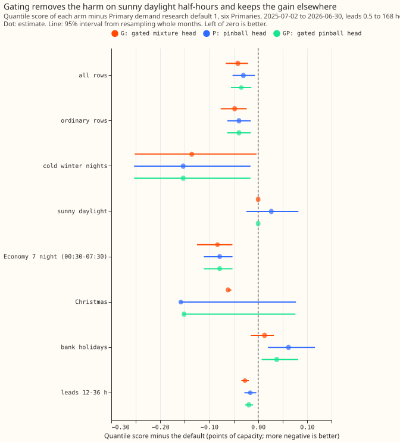
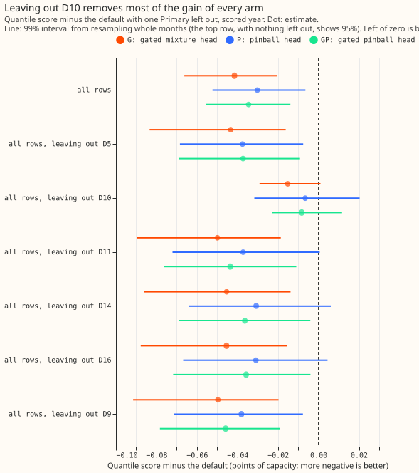
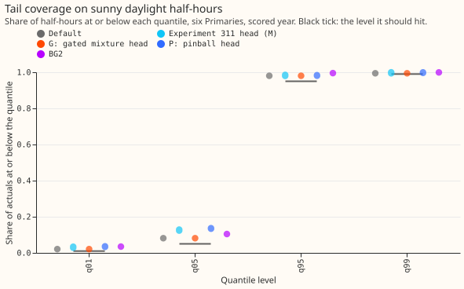
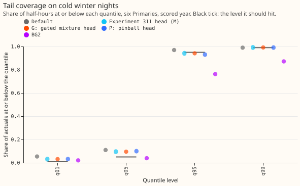
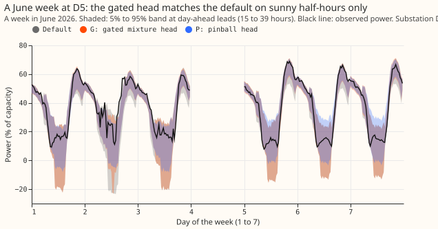
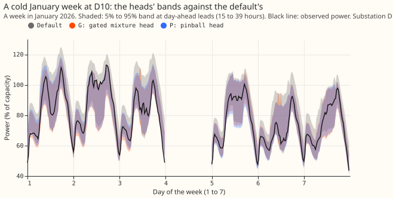

 **Caveat: only forecasts up to 7 days ahead (leads 0.5 to 168 hours) are scored, but NGED needs 1
to 10 days ahead, so days 8 to 10 are not covered.** A neural network that sets the forecast bands
(the 11 quantiles of demand around the median), with the current bands kept on sunny daylight
half-hours, scores 0.041 points of capacity better than Primary demand research default 1 over the
scored year and cannot be worse on sunny daylight half-hours (it returns the current bands there),
but the gain is still almost entirely one substation, D10, so we do not adopt it.** Without D10 the
gain is 0.015 points, and its 99% interval runs from -0.029 to +0.001. Training the network on the
quantile score directly, instead of on a likelihood, did not help.

[Experiment 311](../00311-primary-demand-mixture-density-band-head/result.md) found a
mixture-density band head that lowered the quantile score by 0.037 points but harmed sunny daylight
half-hours and leaned on D10. We tested two repairs on the same rows, the same monthly refits, and
the same inputs. Arm G keeps the default's bands on sunny daylight half-hours and uses the head's
bands everywhere else. Arm P replaces the mixture by a neural network that outputs the 11 quantiles
directly (the median, then positive gaps outwards, so the quantiles never cross) and trains it on
the mean pinball loss of the 11 levels. Arm GP is arm P with the same gate. The median of every arm
is the default's median, so only the bands change. A quantile score is twice the mean pinball loss
over 11 quantile levels, in points (percentage points of the substation's effective capacity); lower
is better. Sunny daylight half-hours are the group experiment 311 protected: daylight half-hours
that the stored solar-radiation flag marks as sunny (90,143 of 561,207 rows).

**Verdict `partly supported`.** Condition 4 requires the gain to stay at or below -0.02 points when
any one Primary is left out. Arm G meets condition 1 (gain), condition 2 (no harm), and condition 5
(serving). Condition 3 (replication) can only be read on the ungated heads, because the 2024-25 rows
carry no sunny flag. Condition 4 (controls) fails, because leaving out D10 takes the estimate to
-0.015, short of the -0.02 the condition requires. At most one arm is adopted, so nothing is added
to the [log of versions](../research-default-log.md).

## Results

- **Kind and tier.** `kind: change`, family Primary demand, default plus x against Primary demand
  research default 1. Tier 2 (a new fitted head, with experiment 278's feature code imported); the
  new-head minimum gain of 0.03 points applies.
- **Predictions.** P1 held: arm G keeps 113% of experiment 311's gain. P2 held, but by construction,
  because arm G equals the default on every sunny daylight half-hour. P3 failed: without D10, arm G
  gains 0.015 points (99% interval -0.029 to +0.001) against at least 0.020 predicted. P4 held on
  the estimate: arm P minus experiment 311's head is +0.007 (95% interval -0.004 to +0.016), so the
  interval cannot rule out a 0.016 difference. The stop rule did not fire because arms G and GP pass
  the sunny-daylight test. Arm S (a sun-elevation-by-cloudiness input) was not run.
- **Absolute scores, six Primaries (quantile score).** Default 2.579, experiment 311 head (M) 2.542,
  G 2.537, P 2.549, GP 2.544, BG2 2.715, manual heuristic 3.397, climatology 3.665. BG2 is the
  XGBoost research benchmark and not the production forecast. The default reproduces experiment
  251's 2.579 (six Primaries) and 2.617 (five), so the reproduction gate passed.
- **Contrasts against the default (99.67% intervals, k = 3).** G -0.041 (-0.081 to -0.012), 11 of 12
  months better. P -0.030 (-0.062 to +0.006), 10 of 12. GP -0.035 (-0.066 to -0.003), 11 of 12.
  Against BG2: G -0.178, P -0.167, GP -0.171.
- **No-harm bounds (one-sided 95% upper bound, arm minus default).** G: headline -0.023, q01 pinball
  -0.012, q99 pinball +0.002, cold winter nights -0.064, sunny daylight 0.000, twCRPS +1.4%
  relative; all pass. GP passes the same tests (headline -0.017, sunny daylight 0.000, twCRPS
  +1.3%). Arm P fails on sunny daylight, as experiment 311's head did (estimate +0.027, bound +0.073
  against 0.05).
- **Leave-one-Primary-out, quantile score minus the default.** Estimates with nothing left out and
  with each Primary left out, in the order none, D5, D9, D10, D11, D14, D16: G -0.041, -0.043,
  -0.050, **-0.015**, -0.050, -0.045, -0.045. P -0.030, -0.037, -0.038, **-0.007**, -0.037, -0.031,
  -0.031. GP -0.035, -0.037, -0.046, **-0.008**, -0.044, -0.036, -0.036. Each Primary alone (arm G):
  D10 -0.168, D5 -0.031, D14 -0.022, D16 -0.021, D9 -0.002, D11 -0.001.
- **Replicate year (even months of 2024-25, 360,122 rows).** Rows carry no sunny flag, so only the
  ungated heads are scored, against experiment 169's stored arm A bands: M -0.034 (95% interval
  -0.051 to -0.016), P -0.054 (-0.069 to -0.038), resampling origin days. Both ungated heads match
  the sign of the main estimate and exceed 0.015. The pinball head gains more than the mixture head
  in this year.
- **Where the gain is (arm G).** By quantile level the gain is largest at q10 (-0.013), q25
  (-0.011), and q05 (-0.009). By group: cold winter nights -0.136, Economy 7 nights -0.083,
  Christmas -0.062, ordinary rows -0.048, leads 12 to 36 hours -0.027, bank holidays +0.013.
- **Tails, six Primaries.** On sunny daylight half-hours, coverage at q05 is 0.081 for the default
  and for G and GP, 0.126 for M, and 0.134 for P (nominal 0.05). On cold winter nights, coverage at
  q95 is 0.970 for the default, 0.941 for M and G, and 0.929 for P and GP, and at q05 it is 0.110
  for the default, 0.095 for G, and 0.098 for P (the figures give all four levels).
- **Rows and schedule.** `fold_a_daily_gap_v1`, Primaries D5, D9, D10, D11, D14, and D16, scored
  year 2025-07-02 to 2026-06-30, leads 0.5 to 168 hours. Monthly refits on 24 rolling months, three
  seeds averaged, on the CPU (about 20 s per fit); the contrast could depend on this schedule
  because the heads were not refitted weekly. Weather at lag times is the ensemble weather available
  at forecast time.
- **Code reused.** `ml-experiments/00311-primary-demand-mixture-density-band-head/` (scoring
  machinery, arms, stored mixture-head forecasts and arrays) and
  `ml-experiments/00278-stack-retraining-cadence/` (inputs). No earlier folder was edited.
- **What to try next.** (1) Find what D10 has that the other five Primaries lack (experiment 220
  also found a D10-specific gap), since each of the four heads gains 0.14 to 0.17 points there and
  about 0.015 elsewhere. (2) Add a sun-elevation-by-cloudiness input (arm S), so a head can learn
  the sunny regime without a gate. (3) A neural head that also reads D10's Economy 7 profile is one
  candidate; it would fail if D10's gain stays below 0.10 points.

## Checks

- **Median minus the mean forecast, per Primary (points; the mean is arm D's, and the median is the
  default's, which every arm shares).** D10 +0.72, D11 -0.50, D14 -0.20, D16 -0.84, D5 +0.01, D9
  -0.75. The mean of the 11 quantiles sits above the median by 0.02 points for the default, 0.20 for
  M, and 0.15 for P.
- **Error of the median beside the quantile-score contrasts.** The median is the default's in every
  arm (asserted), so the mean absolute error of the median is identical across arms and trigger 3
  cannot fire.
- **Controls.** The reproduction gate passed. Arm G equals the default on every sunny daylight
  half-hour and equals arm M elsewhere. Arm GP equals arm P elsewhere. Every training target
  precedes its refit date in all 54 fits (18 refits times 3 seeds).
- **Triggers.** Trigger 4 fired: leaving out D10 moves the 99% interval of arm G minus the default
  to -0.029 to +0.001 and fails condition 4. A fresh Sonnet agent re-derived the pooled contrasts,
  the leave-one-Primary-out contrasts, and the sunny-daylight contrast from the stored arrays with
  its own code and found no difference above 0.002 points; its code review found no leakage.
  Triggers 1, 2, 3, 5, 6, and 7 did not fire.
- **Caveats from the audit.** (1) The gate was chosen because experiment 311 found harm on those
  rows, so "no harm on sunny daylight" holds by construction; a random 16% hold-back of rows would
  give about -0.031, so the gate adds about 0.010 points over a random hold-back. (2) The sunny flag
  comes from experiment 178's per-Primary two-thirds quantile of the PV unit shape over the whole
  period; whether that flag is available at forecast time was not traced, so condition 5 is not
  confirmed for the gated arms. (3) The replicate-year intervals resample origin days, not months,
  so they are narrower than month-block intervals. (4) Whether arm D's mean and scale inputs are
  out-of-fold was inherited from experiment 311 and not re-checked.
