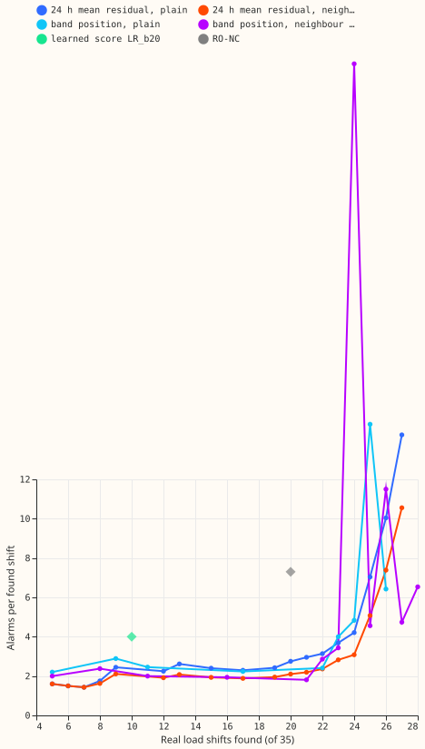

 **Checking whether neighbouring substations contradict an alarm removes about a third of the
24-hour residual detector's false alarms and loses none of the real load shifts it found.** A found
shift is a logged real load shift that the detector flagged. Alarms per found shift fall by about a
quarter, but the target was a fall of at least 25% with the whole 95% interval below it, and the
interval's upper end is still 0.94 of the plain detector's rate. The two Primary substations that
raise 17% to 20% of the residual's false alarms (anonymised as D8 and D9) keep the same number of
false alarms. For NGED's event labels the filter is a usable improvement that needs no fitted
parameter and no labels. For the forecast it does not matter, because experiment 312 showed that the
forecast that adds the shifted megawatts back stays more accurate than the forecast that ignores
shifts, even when half of its alarms are false. Verdict: small gain.

## Question and answer

We asked whether a real load shift, which moves load between two neighbouring substations, can be
told from weather and forecast error by the sign of the neighbours' residuals. The detectors flag a
substation (an alarm) when the mean of its last 24 hours of residual exceeds a set number of robust
scales. The residual is measured power minus the forecast of GAM_ONLY, the generalised additive
model without lagged power. We kept a flagged origin unless two or more interconnected, metered
neighbours had a residual of the same sign and at least 25% of its size, and no neighbour had the
opposite sign at that size. We scored the 35 labelled real load shifts of over 1 day on 15 Primary
substations. Two of the 15 (D8 and D9) raise 17% (6 of 35) and 20% (24 of 119) of the residual's
false alarms at the two alarm rates.

The filter removed 13 of 35 false alarms at the learned score's alarm rate and 36 of 119 at RO-NC's
(the refit-offset neighbour-count detector), and it kept all 20 and 24 found shifts. The filter
therefore cut false alarms by 30% to 37% and alarms per found shift by about 25%. The same filter on
the band-position signal of experiment 309, which raised 2.3 times as many held-out false alarms as
the residual, cut the band-position signal's false alarms by 43% and 37%, brought the band-position
signal below the plain residual's alarms per found shift at the same threshold, and lost one found
shift.

## Figure

## Ceiling count (step 0)

- The neighbour list is experiment 37's interconnection list, limited to the 15 Primaries with a
  stored residual series, fixed in `neighbours.json` before any alarm was scored.
- Of the 35 shifts, all have an interconnected metered neighbour and 22 have both Primaries of their
  logged pair metered: 15 of the 19 in the long-and-deep stratum, 7 of the other 16. The stop rule
  did not fire.
- The hierarchy files were not used, because the grid-flow series above the Primaries have no stored
  residual series.

## Headline numbers (95% intervals resample whole shifts and whole calendar months, 20,000 draws)

- **At the learned score's alarm rate (24-hour residual, k = 3.5 robust scales):** found shifts 20
  and 20; false alarms 35 and 22; megawatt-weighted share found 0.78 both; alarms per found shift in
  the long-and-deep stratum with a metered counterpart (9 of 15 found) 6.1 and 4.7, ratio 0.76 (0.56
  to 0.94); pooled ratio 0.76 (0.57 to 0.94).
- **At RO-NC's alarm rate (k = 2.6):** found shifts 24 and 24; false alarms 119 and 83; found in
  that stratum 10 and 10; alarms per found shift 14.3 and 10.7, ratio 0.75 (0.64 to 0.86); pooled
  ratio 0.75 (0.64 to 0.86).
- **Learned score and RO-NC as stored (unfiltered, pooled over all shifts):** the learned score
  found 10 shifts at 4.0 alarms per found shift, and RO-NC found 20 at 7.3.
- **Alarms per found shift at fixed recall, read from each curve (pooled):** at 18 or more found
  (recall 0.5), plain 2.4 and filtered 1.9 for the residual, 2.4 and 1.8 for the band position; at
  12 or more found (recall 0.33), plain 2.2 and filtered 1.9 for the residual, 2.2 and 1.9 for the
  band position.
- **Band-position arm at the same thresholds (k = 2.8 and 2.4):** false alarms 54 to 31 and 141 to
  89, found shifts 22 to 21 and 26 to 25, ratio in the stratum 0.68 (0.55 to 0.84) and 0.68 (0.51
  to 0.91). At recall of 0.5 its filtered alarms per found shift (1.8) are below the plain
residual's (2.4); at the same thresholds the filtered band position has 2.5 and 4.6 alarms per found
  shift against the plain residual's 2.8 and 6.0.
- **Where the filter acts (residual, k = 2.6):** of 2,485 flagged origins, 949 were confirmed by an
  opposite-sign neighbour, 675 were contradicted by two or more and dropped, and 861 were neither
  and kept. No flagged origin lacked a finite neighbour residual.
- **D8 and D9:** their false alarms in the residual arm are unchanged by the filter (D8 17 and 17,
  D9 7 and 7 at k = 2.6; 3 and 3 each at k = 3.5). Alarms on probable unlogged events (D8's
  multi-day drops and the 17 block days) are counted separately and were unchanged (4 at k = 3.5, 12
  at k = 2.6).
- **Not tabulated here:** the split of matches between the long-and-deep stratum and the rest
  (`printed_report.txt` has it), and alarms per found shift without a metered counterpart (for
  example 6.0 against 3.2 with one at k = 3.5).

## Verdict

- **Prediction (alarms per found shift in the stratum with a metered counterpart fall by at least
  25% at equal recall, interval wholly below 0.75):** not met. The ratios are 0.76 and 0.75, and the
  upper ends of the intervals are 0.94 and 0.86. The direction is established, so the verdict is
  small gain.
- **Sensitivity (not the result):** a neighbour-size threshold of 10% of the alarm's size gives 21
  false alarms instead of 22 at k = 3.5, and 50% gives 28 false alarms. Dropping an alarm when one
  neighbour contradicts it, instead of two, gives 20 false alarms at k = 3.5 but finds 18 shifts
  instead of 20.

## Checks

- Median minus mean forecast, and the error of the mean forecast beside a quantile-score contrast:
  not applicable, because no forecast is scored.
- Audit triggers: none fired. The result agrees in direction with its prediction and with
  experiment 308's neighbour check, whose different rule (a 30% size and a summed-cancellation test
  on a per-origin flag) found fewer shifts (17 of 35 against 20) and raised the even-month false
  alarm rate (2.25 against 0.91).
- Plan review (Sonnet) and its triage are in the next section.

## Deviations and caveats

- **Plan review, triaged.** The plan review found, and I accepted, that comparing the filtered arm
  at the largest grid threshold that matches the plain arm's found shifts is tuned on the scored
  shifts, and a plain detector at a stricter threshold also cuts alarms. The headline therefore
compares both arms at the same threshold, and reads the curves at fixed recall. The equal-recall
  read-out at RO-NC's rate (ratio 0.47, 0.34 to 0.61, run as first planned) is an artefact of that
  tuning and is not used. The filter rule keeps a flagged origin when any neighbour confirms, and is
  applied before alarms merge into episodes; That rule differs slightly from the brief's wording. I
  rejected using the existing neighbour check of experiment 308, whose rule differs and has a
  summed-cancellation test.
- **Alarms per found shift** is (false alarms in ordinary rows over all months plus found shifts)
  divided by found shifts in the group, so false alarms are pooled over all 15 Primaries and not
  attributed to a group. The group ratios therefore move with the pooled false-alarm cut.
- **Odd months set the plain thresholds**, and the alarm counts here span all months, so the plain
  arm is flattered in sample; the filter adds no fitted parameter.
- **Residuals are lab residuals.** They come from the past-weather generalised additive model (GAM)
  of experiment 130 (ERA5 and CAMS), so a live detector with ensemble weather would see larger
  residuals.
- **Lead range.** The detector reads recent observed power, so no forecast lead range applies.

## What to try next

- Explain D8's and D9's false alarms, which the neighbour filter cannot touch.
- Feed the filtered 24-hour residual to the event-label work (aim 3) as the cheap first pass.

Reuses the code of experiments 308 and 309 (folder
`00309-lsc-two-forecast-gap-choosing-without-truth` for the harness; experiment 308 for the 24-hour
mean residual and experiment 227's stored alarms for the learned score and RO-NC).
