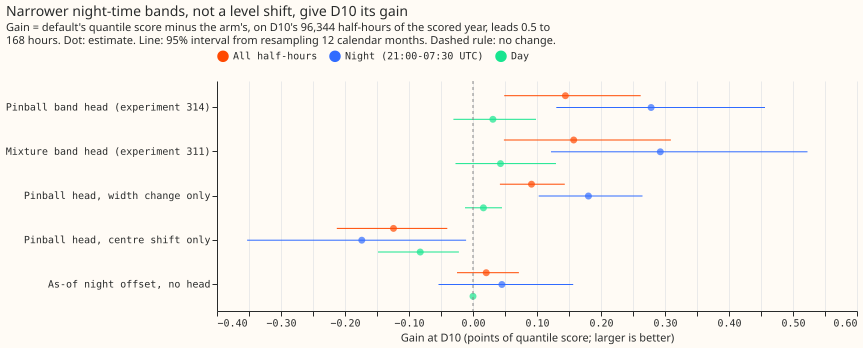
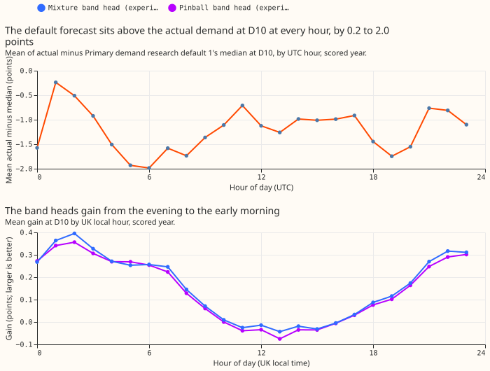
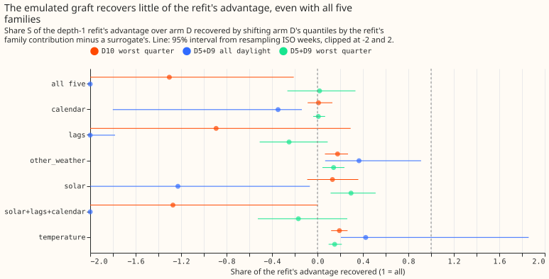
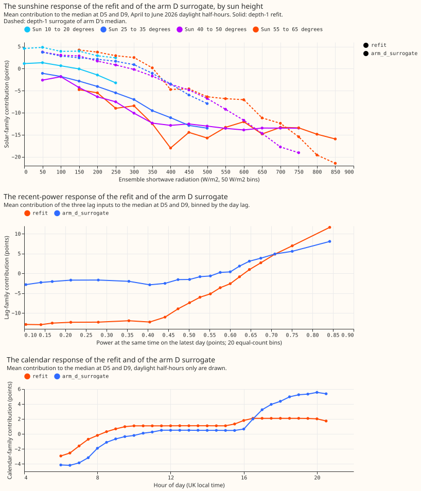

**Take-home: the band heads help at D10, an anonymised Primary substation, mainly by narrowing its
night-time forecast bands, and not by correcting a level error.** The forecast of Primary demand
research default 1 sits above the actual demand at D10 at every hour, by 0.2 to 2.0 points. Adding a
night-time level correction to that forecast, with no head, reproduces only 14% of the heads' gain
(95% interval -16% to 99%). The heads narrow D10's night-time 5% to 95% band by 7.5 points on
average, and applying only that narrowing scores 63% of the gain (42% to 116%). The second question,
which family of single-input terms of the best-guess forecast trails BG2 in April to June, has a
post hoc lead: the sunshine response recovers 0.36 of the gap on the worst half-hours (0.30 to
0.44), but only 0.19 at one of the two Primaries. The verdict is inconclusive, and stage 2 was not
run.

**Terms.** The default is the stack of additive terms and neural-network layers that forecasts
Primary substation demand. A band head is an extra neural-network layer that reshapes the default's
forecast quantiles, and experiments 311 (mixture head, arm M) and 314 (pinball head, arm P) trained
two of them. Their gain is nearly all at D10. BG2 is the production-style XGBoost forecast of
experiment 87, and arm D is the best-guess stack of experiment 251. D5, D9, and D10 are anonymised
Primary substations. The forecasts look 0.5 to 168 hours (7 days) ahead, short of the 1 to 10 days
that the electricity distribution network operator NGED needs.

**What we did.** Stage 0 split D10's gain by hour and by what the head changes, and scored an
as-of night offset: the median residual of the previous 28 nights, added to all 11 quantiles of
D10's night half-hours (21:00 to 07:30 UTC) with no head. Stage 1 asked which family of arm D's
single-input terms (sunshine, recent power, calendar, temperature, other weather) accounts for the
April-to-June advantage that a depth-1 XGBoost refit (experiment 305) has over arm D. Arm D's own
term contributions are not stored, so a depth-1 XGBoost surrogate of arm D's median stands in for
them. A graft of family k shifts all 11 of arm D's quantiles by the refit's family-k contribution
minus the surrogate's. S is the share of the refit's advantage that a graft recovers: (quantile
score of arm D minus that of the graft) divided by (quantile score of arm D minus that of the refit).

**Scores.** Quantile score is twice the mean pinball loss over 11 quantiles, in percentage points of
effective capacity (output relative to the substation's rated capacity); smaller is better. Gain is
the default's score minus the arm's, so positive is better. Stage 0 uses the 561,207 rows (half-hours
of forecast) of experiment 251 across six Primaries, 2025-07-02 to 2026-06-30, outside hand-filtered
events, with month-block intervals (12 blocks). Stage 1 uses experiment 305's April-to-June rows
with ISO-week blocks (14 weeks), because three month blocks are too few.

## Results

- **Stage 0: the gain is at night.** Of the pinball head's D10 gain, 88% is on night half-hours
  (95% interval 78% to 132%), and the mixture head gives 85% (74% to 126%). The mean gain per
  half-hour is 0.278 points at night (0.130 to 0.456) and 0.031 by day (-0.031 to 0.098); night is
  46% of D10's half-hours.
- **Stage 0: the night offset reproduces little.** The offset (mean -1.13 points at night) scores
  3.148 at D10 against the default's 3.169 and the pinball head's 3.024. A share of 14% of the head's
  gain (-16% to 99%) is under the 30% line below which the head is judged to act through another
  mechanism, but the interval is wide and also spans the 70% line.
- **Stage 0: the head narrows the bands.** The head's median equals the default's. At night the 5%
  to 95% band narrows by 7.5 points on average and its centre moves up by 0.22 points. By day the
  band narrows by 3.5 points and the centre moves up by 0.55. Applying only the width change scores
  3.077 (63% of the gain). Adding only the centre shift to all 11 quantiles, which also moves the
  median, scores 3.293, worse than the default (-86% of the gain, -237% to -30%). That arm is not
  the head's centre shift, because the head leaves the median fixed.
- **Stage 0: by level.** At night the largest gains are at the 0.10, 0.25, and 0.40 quantiles
  (0.044, 0.057, and 0.040 points of quantile score each).
- **Stage 0: the other five Primaries** together gain 0.007 points (-0.014 to 0.026) under the
  pinball head and 0.012 (-0.005 to 0.028) under the mixture head.
- **Stage 0: absolute D10 scores** are 3.169 for the default, 3.024 for the pinball head, 3.011 for
  the mixture head, and 3.148 for the offset. The default's six-Primary score, 2.579, matches
  experiment 314's gate.
- **Stage 1, as pre-registered: the gate failed.** The surrogate reproduces arm D's median with
  R-squared 0.82 to 0.93 (mean root-mean-square error 4.6 points). The graft added only the
  families' contributions and dropped each model's constant term, which differs by 12.3 points on
  average, so the graft of all five families moved arm D's quantiles by about -10 points. It scored
  S = 0.018 (-0.265 to 0.335) on the worst quarter at D5 and D9, against the 0.50 the plan required,
  and S = -8.3 on all daylight half-hours. The grafts of solar, lags, and calendar together scored
  -0.168.
- **Stage 1, post hoc level-matched graft.** After a reviewer pointed out the level error, each
  family's contribution was averaged to zero over its site and month before grafting. On the worst
  quarter of April-to-June daylight half-hours at D5 and D9 (6,755 half-hours), the graft of all five
  families recovers S = 0.59 (0.51 to 0.66), which passes the 0.50 gate. Per family: sunshine 0.36
  (0.30 to 0.44), temperature 0.15, other weather 0.14, calendar 0.01, recent power -0.06
  (-0.12 to 0.00); solar, lags, and calendar together 0.38. Sunshine meets the plan's 0.30 line but
  not its 0.50 prediction, and lags and calendar each stay under the 0.25 prediction.
- **Stage 1: it differs by Primary and row set.** The sunshine graft recovers 0.48 at D5
  (0.41 to 0.56) and 0.19 at D9 (0.07 to 0.36), and 0.14 at the placebo D10 (0.05 to 0.22). On all
  daylight half-hours at D5 and D9 the intervals are very wide (sunshine 0.63, 0.35 to 2.56; all five
  0.50, -0.72 to 0.80; recent power -1.13), so that row set cannot name a family.
- **Stage 1: the curves.** Figure 4 shows the refit's recent-power response is steeper than the
  surrogate's (about -13 to +12 points against -3 to +8). Arm D carries recent power through its own
  filter, which the surrogate cannot see.
- **Stage 2 was not run.** The pre-registered analysis failed its gate, and the post hoc lead rests
  on one Primary. A stage 2 correction head would first need the lead replicated.

## Checks

- **Median minus mean forecast per site** (default, points): D5 0.01, D9 -0.75, D10 0.72, D11 -0.50,
  D14 -0.20, D16 -0.84.
- **Mean-forecast error beside the contrast.** At D10 the mean absolute error of the median is 5.362
  for both the default and the head, because the head keeps the median. The mean absolute error of
  the mean of the 11 quantiles is 5.680 for the default and 5.526 for the head, in the same direction
  as the quantile score.
- **Refit contributions.** The refit's contributions sum to its raw median to within 0.0001 at some
  site-months and by up to 9 points at others (D5 May 2026), probably because the stored quantiles
  were sorted where the raw outputs cross. This was not examined.
- **Triggers that fired:** a control failed (the stage 1 gate), a result contradicted its
  prediction (the night offset), and later experiments depend on the result (the ranked list's
  night-level and pooled-solar-term experiments). No Opus audit was run.

## Caveats and next steps

- The offset's interval is wide (12 months, one substation).
- The offset used the shortest-lead residuals of the default. A lead-matched or
  temperature-smooth offset was not tried.
- The level-matched graft was chosen after seeing the failed one, so it is post hoc. It is an
  emulation, and the true graft needs arm D's own term contributions.
- The narrowing of D10's bands is the measured change. No coverage of the default's night bands is
  reported, so "too wide" is not established.
- Candidate follow-ups: a band-width correction for D10's night half-hours without a neural head;
  replicating the sunshine lead at D9 and over more weeks; refitting the XGBoost with one family
  removed at a time.
