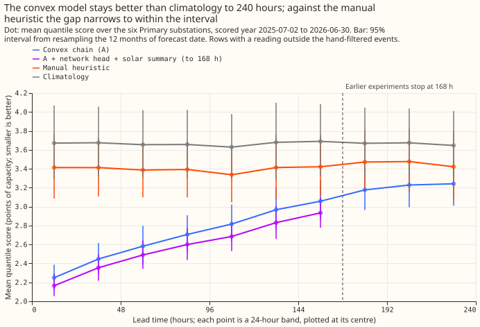
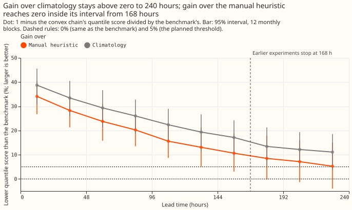
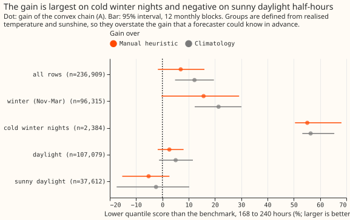
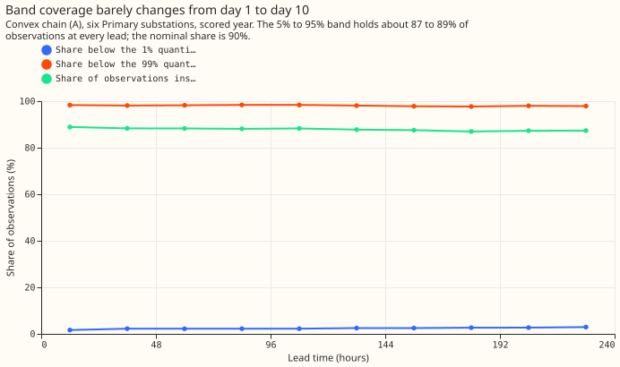
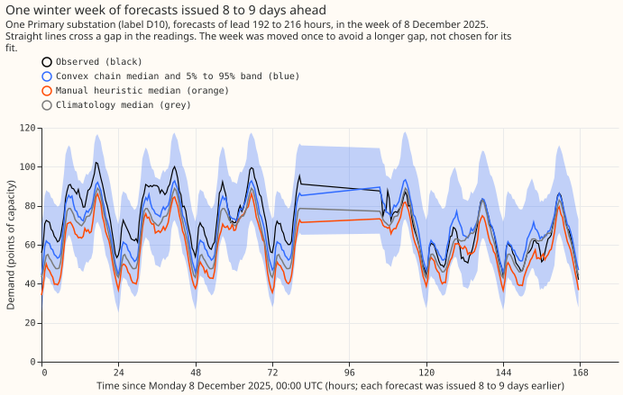

## Take-home message

**The research-default forecast keeps real skill to 10 days, but only against climatology.**
Primary demand research default 1 is the demand forecast we use for research. Its convex model
(an additive model with a Kalman filter on recent errors) has a 11.1% to 13.4% lower quantile
score than climatology (a table of typical demand by month, time of day, and day type) at 168 to
240 hours, because the ensemble temperature forecast still carries information at 9 to 10 days.
Against NGED's manual heuristic (an average of demand at the same time on earlier weeks) the
gain is 5.3% to 8.5%, and its 95% interval includes zero. The gain sits in winter and at two
substations, D11 and D14. On sunny daylight half-hours the convex model scores worse than both
benchmarks. Verdict: partly supported. The gain over the heuristic is clearly above zero only to
168 hours.

## Question and answer

We asked how far past 7 days the convex model of Primary demand research default 1 still beats the
two benchmarks. The demand experiments we ran earlier (136, 155, 160, 164, and 251) all stop at
168 hours. We rebuilt the convex chain of experiments
[136](../00136-dp-bg-stage1-assembly-on-the-ensemble-mean/result.md),
[155](../00155-dp-bg-stage2-assembly-night-offset-and-error-correction/result.md),
[160](../00160-calibration-band-width-fix-on-stage-2-winner/result.md), and
[164](../00164-calibration-cold-night-tail-under-coverage/result.md) with a 240-hour forecast window
and one new spread-table lead band per day. Below 168 hours the rebuilt chain reproduces the stored
forecasts to within 0.00002 points. The research default beats climatology across NGED's 1 to 10
day horizon. Against the manual heuristic, the 95% interval includes zero from 168 hours.

Terms used below: the **quantile score** is twice the mean pinball loss over 11 quantiles, in
points of effective capacity (percentage of a substation's capacity), and smaller is better. The
**gain** is one minus the convex chain's quantile score divided by the benchmark's. Every interval
is a 95% interval from resampling the 12 months of forecast date. **A** is the convex chain, **H**
is the neural-network median correction of experiment 201, **S** is the two-number solar summary
of experiment 202, and **BG2** is the XGBoost best-guess forecast of experiment 87. D5 to D16 are
anonymised labels of six Primary substations.

## Figures

## Forecasts compared and rows scored

- **Arm 1, default extended.** Below 168 hours the stored A+H+S (the convex chain A plus the neural
  network's median correction H and the two-number solar summary S) scores 2.579 on six Primaries
  and 2.617 on five, reproducing experiment [251](../00251-dp-final-best-guess-assembly-clip-and-coast-against-bg2/result.md).
  Beyond 168 hours only A exists, because H was trained at day-ahead leads and S below 168 hours
  and neither was refitted; the plan states this. Over 0 to 168 hours H and S lower the score by
  0.09 to 0.14 points in every band, so the A+H+S gain at 168 to 240 hours would probably be about
  0.1 points larger. That estimate is an extrapolation, not a measurement.
- **Arms 2 and 3.** The manual heuristic and climatology are experiment 87's stored forecasts, which
  hold leads to 351 hours on the same runs. BG2 was not extended.
- **Rows.** Six Primaries (D5, D9, D10, D11, D14, D16), runs from 2025-07-02 to 2026-06-29 at 09:00
  UTC (291 origins per site; every fifth run is held out of the scored set), rows with a reading
  outside the hand-filtered events: 798,116 rows, 561,207 at 168 hours or less (the same rows as
  experiment 251) and 236,909 beyond. Rows per 24-hour band fall by 2.5% from 0 to 24 hours to 216
  to 240 hours because late origins have no reading yet.
- **Weather calibration.** The weather calibration has four lead bands. Its last band, 144 to 168
  hours, is used for every longer lead, so days 8 to 10 use the 144 to 168 hour calibration.
- **Ensemble steps.** The stored ensemble is 3-hourly to 144 hours and 6-hourly after, linearly
  interpolated to half-hours: 83% of half-hours to 120 hours lie on a straight line between ensemble
  steps, and 92% from 144 hours.
- **Retraining and lab conditions.** Monthly refits of the convex model on a 24-month window, as in
  experiments 136 to 164. Weather is the Dynamical.org ECMWF ensemble mean, available at forecast
  time. No lab shortcut beyond the stored fits of earlier experiments.

## Headline numbers

Quantile score (points of effective capacity; smaller is better), six Primaries, with the 95%
interval of the gain from resampling the 12 months of forecast date.

| Lead band | A | Manual heuristic | Climatology | Gain over heuristic | Gain over climatology |
|---|---|---|---|---|---|
| 144-168 h | 3.058 | 3.421 | 3.689 | 10.6% (3.0 to 18.7) | 17.1% (9.6 to 24.3) |
| 168-192 h | 3.177 | 3.471 | 3.669 | 8.5% (-0.2 to 17.8) | 13.4% (5.5 to 21.3) |
| 192-216 h | 3.228 | 3.477 | 3.674 | 7.1% (-1.3 to 15.9) | 12.1% (5.0 to 19.3) |
| 216-240 h | 3.242 | 3.421 | 3.646 | 5.3% (-4.0 to 15.1) | 11.1% (3.8 to 18.5) |

- **The contrast in median-forecast error agrees.** The mean absolute error of the median at 168 to
  240 hours is 5.47 (A), 6.12 (heuristic), and 6.56 (climatology) points.
- **P1** (gain of at least 5% over both benchmarks in the bands to 216 hours, and a tie with
  climatology at 216 to 240 hours). The first half holds as a point estimate: 8.5% (168 to 192
  hours) and 7.1% (192 to 216 hours) over the heuristic, and 12.1% to 13.4% over climatology. No
  interval over the heuristic is wholly above zero from 168 hours. The second half fails: the chain
  beats climatology by 11.1% at 216 to 240 hours, not within 2%.
- **P2** (tails and coverage stay near their 0 to 168 hour values, then degrade at 216 to 240
  hours). The first half holds. The second half fails, because the band does not degrade at 216 to
  240 hours.
- **P3** (the gain is largest on cold winter nights and smallest on sunny daylight). Holds.
- **Tails (A).** Share of observations below q01 and q99, 5% to 95% band coverage, and pinball loss
  at q01 and q99:

| Lead band | Below q01 | Below q99 | In 5% to 95% band | Pinball q01 | Pinball q99 |
|---|---|---|---|---|---|
| 0-24 h | 1.7% | 98.3% | 88.9% | 0.170 | 0.189 |
| 144-168 h | 2.5% | 97.8% | 87.5% | 0.236 | 0.257 |
| 168-192 h | 2.6% | 97.7% | 87.0% | 0.243 | 0.265 |
| 192-216 h | 2.7% | 98.0% | 87.3% | 0.258 | 0.257 |
| 216-240 h | 2.9% | 97.9% | 87.3% | 0.256 | 0.259 |

## Gain by group

Gain of A at 168 to 240 hours, with the 95% interval. The groups use realised temperature and
sunshine, so they overstate what a forecaster could know in advance.

- **Cold winter nights** (2,384 rows, daily temperature below 2 C, local 18:00 to 07:00, November to
  March): 55.1% over the heuristic (50.4 to 68.1) and 56.4% over climatology (53.2 to 65.4).
- **Winter, November to March** (96,315 rows): 15.7% (-0.3 to 29.1) and 21.4% (12.3 to 29.7).
- **Sunny daylight** (37,612 rows): -5.2% (-15.3 to 2.7) and -2.4% (-17.4 to 10.2).
- **April to October** (140,594 rows): -0.7% over the heuristic and 4.0% over climatology (no
  interval computed).

## Robustness checks and audit

- **Median forecast minus the mean of the 11 quantiles, per site, in points:** D10 -0.53, D9 -0.29,
  D11 -0.02, D14 +0.16, D16 +0.15, D5 +0.15.
- **Sites.** The gain at 168 to 240 hours over the heuristic is +24% at D11, +21% at D14, +2.9% at
  D10, +1.6% at D9, -3.2% at D16, and -3.8% at D5. Leaving D11 out cuts the gain at 216 to 240 hours
  from 5.3% to 1.8%, and leaving D14 out cuts it to 2.8%.
- **Trigger 2 fired** (a result contradicts its own prediction: the chain beats climatology at 216
  to 240 hours instead of tying it). The explanation was tested. The ensemble temperature
  forecast's anomaly correlation with ERA5 is 0.97 at 0 to 24 hours, 0.82 at 144 to 168, 0.76 at
  168 to 192, 0.71 at 192 to 216, and 0.67 at 216 to 240. The gain over climatology is 21% in
  November to March and 4% in April to October.
- **Trigger 4 fired** (leaving one site out changes a verdict): leaving D11 or D14 out takes the
  gain over the heuristic below the 5% threshold.
- **Triggers 3, 5, 6, and 7 did not fire.** Trigger 3 is a quantile-score contrast and a
  median-error contrast pointing in different directions, trigger 5 a nested arm beating the arm
  containing it, trigger 6 an interval more than twice or less than half the width of a sister
  experiment's, and trigger 7 a later design depending on an unreplicated result. For trigger 6,
  the reproduction of experiment 251's contrast gives -0.818 with interval -1.087 to -0.572,
  against its -0.818 with -1.080 to -0.574.
- **Audit.** A fresh Sonnet auditor re-derived the per-band scores, gains, and intervals from the
  raw chain files and experiment 87's stored benchmarks. Scores matched to 3 decimals, gains to 0.1
  percentage points, and interval ends to 0.3 percentage points (a different random seed). It found
  no leakage (lead equals valid time minus origin on all 245,463 chain rows beyond 168 hours, before
  the row filters, and the day-10 and day-1 errors at one valid time correlate at 0.64), a heuristic
  whose score and band width are flat in lead, and no site scoring over twice the median. It
  confirmed that D11 and D14 carry the gain over the heuristic. It did not re-derive the sunny-
  daylight result. Triage: all findings accepted; its two minor notes are recorded here (48 rows of
  experiment 87's `actual` are NaN, so scoring uses the chain's `actual`, and `report.json`'s two
  `actual_gap` entries are NaN for that reason).

## What to try next

- Refit H and S to leads of 168 to 240 hours, or extend BG2, to remove the departure from the
  default's full recipe.
- Fit the cold-day widening of fix O on leads beyond 168 hours; this run reuses its multipliers.
- Look at why D5 and D16 lose to the heuristic beyond 168 hours.
