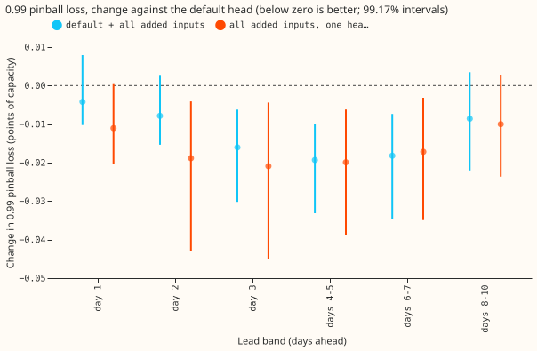
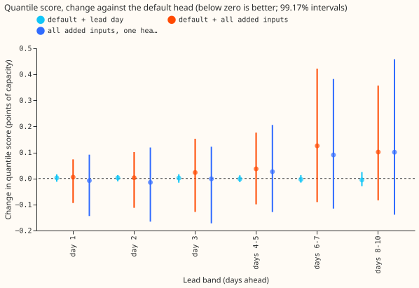
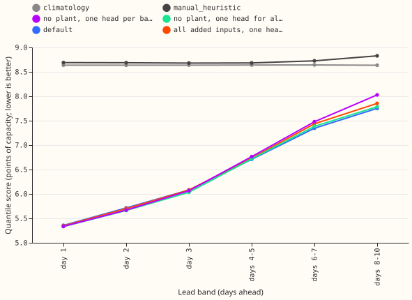
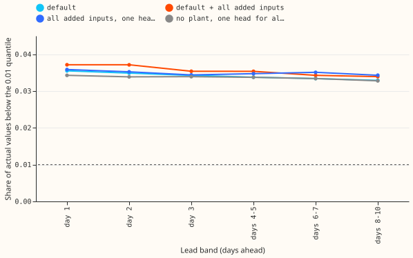

**Giving the mixture-density head of the solar-farm forecast more inputs does not lower its quantile
score at any lead from 1 to 10 days. It lowers only the 0.99 pinball loss (the loss on the upper
tail), by about 5% at days 3 to 7.** National Grid Electricity
Distribution (NGED) meters six solar farms, labelled A to F. Metered solar farms research default 1
([experiment 300](../00300-metered-farm-best-guess-assembly/result.md), scored to 10 days by
[experiment 310](../00310-metered-farm-long-lead-scoring/result.md)) starts from a physical model of
the farm's output (the "plant") and corrects the plant's 11 quantiles with a three-component mixture
density network (the "head"). We refitted that head with more inputs: the lead in whole days, the
hour of day and day of year as sine and cosine pairs, and the ensemble's spread of shortwave
irradiance. We also trained one head for all six lead bands instead of one head per band, and added
the two arms that [experiment 313](../00313-metered-farm-pure-xgboost-and-mdn-vs-plant/result.md)
motivates: the network with no plant, and the same network given the plant forecast as a column. The
quantile score is twice the mean pinball loss over the 11 quantiles, in points of capacity (1 point
is 1% of the farm's capacity), and lower is better. "Own history" means the head trains on the
  farm's
earlier months, and "zero history" means it trains on the other five farms only.

**The verdict is partly supported, and nothing is adopted.** The extra inputs fail the research
default's minimum gain of 0.02 points on the quantile score at every band, so the head of research
default 1 stays as it is. The gain that appears is on the 0.99 pinball loss, which replicates in
both halves
  of
the scored year and in zero history. Scores are at leads of 12 to 252 hours (days 1 to 10), with
quarterly refits.

## Results

- **Arms.** "default" is experiment 310's head (plant forecast, plant spread, availability ratio,
  lagged power and its missing flag, clear-sky index, lead hours). "lead" adds the lead in whole
  days.
  "full" adds the lead in whole days, the hour-of-day and day-of-year sine and cosine pairs, and the
  irradiance spread (cloud cover itself is
  not stored, and the clear-sky index was already an input). "full_pooled" and "default_pooled"
  train
  one head on all six bands. "full_shuffled" shuffles the added columns (control), and "full_nolag"
  drops lagged power and the availability ratio (the named control for the previous day's plant
  error, which experiment 310 found adds nothing). "pure_pooled" and "pure_lead_pooled" are the
  network with experiment 313's no-plant inputs, pooled, without and with the lead day.
  "pure_plant" is the no-plant inputs plus the plant forecast as a column, per band.
- **Absolute scores, own history (default; climatology; `manual_heuristic`).** 5.36 (8.64; 8.69) at
  day
  1, 6.08 (8.64; 8.68) at day 3, 7.35 (8.64; 8.73) at days 6 to 7, and 7.75 (8.64; 8.83) at days 8
  to
  10. Zero-history default scores 5.53 points at day 1 and 7.91 points at days 8 to 10. Experiment
  313's pure
  network scores 5.34 and 8.03.
- **C1, lead minus default, quantile score (own history).** +0.002 at day 1 to -0.006 at days 8 to
  10; every interval lies within ±0.03 points. The 0.99 pinball loss changes by at most 0.002.
  Prediction P1 (a gain of 0.02 points beyond 36 hours) fails.
- **C2, full minus default, quantile score (own history).** +0.005 (-0.094 to +0.073) at day 1,
  +0.023 at day 3, +0.037 at days 4 to 5, +0.125 (-0.091 to +0.422) at days 6 to 7, and +0.102 at
  days
  8 to 10. No interval excludes zero, and the point estimates are above the no-harm tolerance of
  0.02
  points from day 3. The second half-year drives the rise (+0.20 at days 6 to 7); the first half-
  year
  is flat. In zero history the change is -0.024 to +0.082.
- **C2, 0.99 pinball loss (own history).** -4.8% (-0.016 points, interval -0.030 to -0.006) at day
  3,
  -5.6% at days 4 to 5, -5.3% at days 6 to 7, and -2.6% (interval includes zero) at days 8 to 10;
  -1.4% and -2.4% at days 1 and 2 (intervals include zero). The change replicates: in the first
  half-year it is -6.2% to -8.1% at days 3 to 7, and in the second half-year -2.9% to -4.2% at days
  1 to 7. In zero history it is -2.9% to -4.7% at every band. Prediction P2 (3% or more, pooled over
  days 3 to 10) holds at -4.6%.
- **C3, one head for all leads (own history).** `full_pooled` minus `full`: -0.024 to -0.001 points
  at days 1 to 3 and days 8 to 10, -0.035 (-0.083 to +0.014) at days 6 to 7; no interval excludes
  zero.
  `default_pooled` minus `default` is -0.015 at day 1 and -0.005 at days 8 to 10. `full_pooled`
  minus
  `default` lowers the 0.99 pinball loss by 5.0% to 6.3% at days 2 to 7 and 3.0% at days 8 to 10.
  Pooling alone does nothing for the plant-based head.
- **C4/C5, the network with no plant.** `pure_pooled` minus experiment 313's per-band `pure_mdn`:
  -0.04% at day 1 and -3.0% (-0.24 points, interval -0.69 to -0.03) at days 8 to 10, so one head for
  all leads closes most of experiment 313's gap: `pure_pooled` scores 0.4% above the default at days
  8 to 10 and 0.4% below it at day 1. Adding the lead day to `pure_pooled` (`pure_lead_pooled` minus
  `pure_pooled`) makes the score worse by 0.008 to 0.033 points (days 8 to 10 interval +0.003 to
  +0.063). Prediction P5 (a gap under 1.5% at days 8 to 10) holds, at 0.85% (`pure_lead_pooled`
  against the default), but pooling did the
  work and the lead day did not.
- **C6, the plant forecast as a column of the no-plant network (`pure_plant`).** `pure_plant`
  differs from experiment 313's pure network by -0.4% to +0.2% at every band (intervals include
  zero), so the
  plant column adds nothing measurable to the network. Against the default it scores 0.244 points
  (3.1%) worse at days 8 to 10 (interval includes zero) and 0.012 better at day 1. Prediction P6
  holds only for the first comparison; the comparison with the default mixes in a different
  parametrisation (the default models the residual from the plant, `pure_plant` models the output).
- **Controls.** `full_shuffled` minus default is +0.009 at day 1 and -0.003 at days 8 to 10
  (intervals
  within ±0.04), so P3 holds and the 0.99 gain comes from the added inputs. `full_nolag` minus
  `full`
  is +0.006 and +0.007 points at days 1 and 8 to 10 (intervals include zero), so the previous day's
  plant error adds nothing again.
- **Lower tail (P4).** The share of actual values below the 0.01 quantile is 0.0355 for the default
  at day 1 and 0.0329 at days 8 to 10; 0.0371 and 0.0339 for `full`; 0.0358 and 0.0343 for
  `full_pooled`; 0.0343 and 0.0328 for `pure_pooled`. Against a nominal 0.01 every arm is 3.3 to 3.7
  times too high, and no arm moves it by more than 0.2 points, so P4 fails. Coverage of the 0.99
  quantile is 0.982 to 0.989 for every arm.

## Checks

- **Median minus mean forecast, own history, farms pooled (points of capacity).** Default +0.40 at
  day 1 and +0.30 at days 8 to 10; `full` +0.36 and +0.51; `full_pooled` +0.40 and +0.31. Per farm
  at
  day 1 (default): A -0.10, B +0.22, C +0.12, D +0.61, E +1.15, F +0.41.
- **Error of the mean forecast beside each score contrast.** `full` minus default on the absolute
  error of the mean forecast is -0.015 at day 1 and +0.113 at days 6 to 7 (intervals include zero),
  the same direction as the quantile score; the 0.99 gain has no counterpart because it concerns a
  tail the mean does not see.
- **Audit triggers fired: 2 and 5.** Trigger 2 (a result contradicts its prediction): P1 and P4
  failed. We tested the explanation that the head already holds the lead in hours (C1, and
  `pure_lead_pooled` getting worse). Trigger 5 (a nested arm beats the arm containing it): default
  beats `full` by 0.10 to 0.13 points at days 6 to 10, inside the interval's half-width (about 0.25
  points). A fresh Sonnet agent re-derived the quantile score, the 0.99 pinball loss, and the 0.01
  coverage from the raw predictions and found every contrast within 0.0013 points of the stored
  value (stored absolute scores run 0.002 to 0.003 points above the agent's, an unexplained gap that
  affects both arms of a contrast alike), no duplicate keys, no missing values, and identical row
  counts across arms. Bands d1, d2, and d4 to 5, the zero-history setting, and the interval limits
  were not re-derived. Trigger 4 did not fire: dropping any one farm
  leaves the 0.99 change of `full` negative at days 3 to 10 (-0.0035 to -0.023). Triggers 1 (a
  failed control), 3 (the mean-forecast error disagrees), 6 (an interval much wider or narrower than
  a sister experiment's), and 7 (a later design depends on this result) did not fire.

## Method and schedule

- **Schedule.** Quarterly refits on all earlier months (screening schedule), so absolute scores
  could
  shift slightly under weekly refits, and the contrasts were not tested for dependence on the
  schedule. The head is the mixture network of experiment 310 (copied from its fitter), with five
  seeds averaged in own history and three in zero history. The default reproduces experiment 310's
  head (-0.14%, from two extra seeds).
- **Rows.** Experiment 310's scored-year rows (2025-09 to 2026-08, farms A to F, 12 to 252 hours),
  common to every arm and to the floors; intervals resample the 12 scored months at 99.17%
  (Bonferroni, six planned contrasts per band and setting). The half-year intervals resample six
  months and are coarse. The pooled arms and the arms `lead`, `full_shuffled`, `full_nolag`, and
  `pure_plant` ran in own history only.
- **Reuse.** The scripts import experiment 310's folder; the no-plant columns are copied from
  experiment 313.

## Caveats and next steps

- **Leads.** The scored range is 12 to 252 hours (days 1 to 10), which covers NGED's horizon.
- **The blend was not rescored.** The head is one of three blend members, so a head gain of 0.05
  points or more at the 0.99 quantile may shrink in the blend.
- **Experiment 313's caveats stand.** Experiment 313's intervals (-2.4% to +1.0% at day 1, -1.3% to
  +10.4% at
  days 8 to 10) show no detectable difference, not equivalence. Its zero-history test uses six farms
  in
  one region with one fleet-shape plant, so it cannot show whether a physical plant transfers better
  to
  a farm with a different tilt or climate. The plant also keeps value that is not accuracy:
  explainable
  parameters, a farm card, and a ceiling check.
- **Lead day is redundant.** `lead_day` is a step function of `lead_hours`, which every arm already
  holds, so C1 and `pure_lead_pooled` test only a coarser copy; the effect of an hour-of-lead
  feature
  cannot be separated here.
- **Pooled arms confound pooling with training budget.** A pooled head sees about six times the rows
  at the same number of epochs, so `full_pooled` and `pure_pooled` also take more gradient steps.
- **Next.** The lower tail needs a different remedy, such as a dedicated tail head or recalibration
  of
  the 0.01 quantile on the farm's own history; the 0.99 gain should be retested inside the blend.
