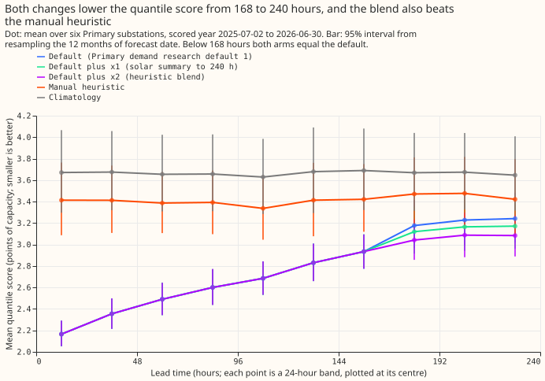
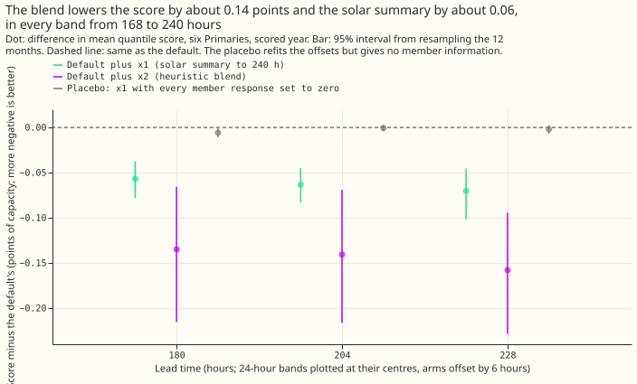
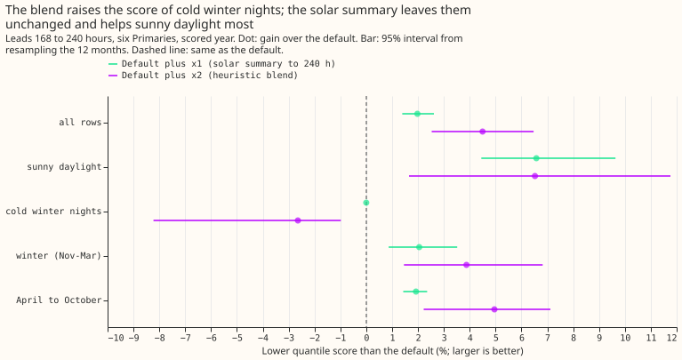
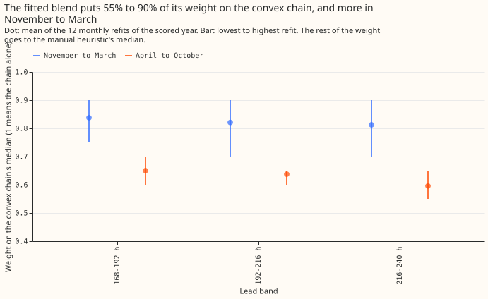
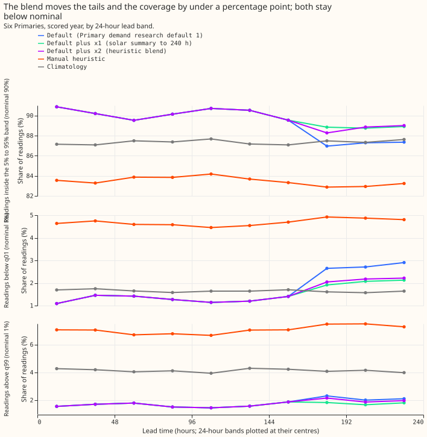

## Take-home message

**Using the spread of the 51 weather-forecast members in the solar term of the demand forecast
still helps at 7 to 10 days, and a blend with the manual heuristic helps more but worsens cold
winter nights.** Primary demand research default 1 is the demand forecast for the six Primary
substations that we use for research. Extending its two-number solar summary (the mean and the
standard deviation of the 51 weather-forecast members' solar responses, each response being the
change in the forecast when that member's sunshine replaces the average member's) from 168 to 240
hours ahead lowers the quantile score by 2.0% and by 6.6% on sunny daylight half-hours. The default
had scored 5.2% worse than the manual heuristic on those half-hours. Blending the median of the
convex chain (the additive model with a Kalman filter on recent errors) with the manual heuristic's
median lowers the quantile score by 4.5%, and the blend's score is 11% lower than the heuristic's.
The blend scores 0.076 points of capacity worse on cold winter nights, past the family's tolerance
of 0.05 points, so only the solar summary is adopted, as Primary demand research default 2. The
verdict is partly supported: the solar summary held on every pre-registered part, and the blend
held on all but its no-harm bound and the share of its gain in April to October. A blend that
leaves cold winter nights alone is an option for a later experiment.

## Question and answer

Experiment [317](../00317-primary-demand-default-1-at-7-to-10-days/result.md) showed two weak spots
of Primary demand research default 1 at 168 to 240 hours: sunny daylight half-hours, and April to
October, where the convex chain beats climatology (a table of typical demand by month and time of
day) by only 4%. We tested one fix for each, as two pre-registered arms against the default. Arm x1
extends the two-number solar summary S of experiments
[193](../00193-dp-ens-two-number-solar-summary/result.md) and
[202](../00202-dp-ens-two-number-rolling-replay/result.md) from 168 to 240 hours. Arm x2 blends the
convex chain's median with the median of NGED's manual heuristic (an ensemble of demand at the same
time of day on earlier weeks), with a weight fitted per 24-hour lead band and season. Below 168
hours both arms equal the default. The **quantile score** is twice the mean pinball loss over 11
quantiles, in points of effective capacity (one point is 1% of a substation's capacity; smaller is
better). **Cold winter nights** are November to March half-hours after dark on days the ensemble
forecast to be cold, and **sunny daylight half-hours** are daylight half-hours with a high clear-sky
index. The **convex chain** is the additive model with a Kalman filter on recent errors that
experiment 317 extended to 240 hours. D5 to D16 are anonymised Primary substations. Every interval
resamples the 12 months of forecast date.

## Figures

## Results at 168 to 240 hours

Lead range: 0.5 to 240 hours, scored year 2025-07-02 to 2026-06-30, six Primaries, 798,116 rows
(236,909 of them past 168 hours). Each row is one half-hour at one Primary for one forecast origin.
Retraining: monthly refits of the arms' factors and weights on the trailing 12 months of completed
runs (experiment 202's rule); the convex chain is experiment 317's stored forecasts. Whether either
contrast depends on that schedule was not tested.

- **Absolute scores, 168 to 240 hours.** Default 3.215, x1 3.152, x2 3.071, manual heuristic 3.456,
  climatology 3.663. At 0.5 to 240 hours: 2.768, 2.749, 2.725, 3.414, and 3.664.
- **x1 minus default.** -0.064 points (2.0%) at 168 to 240 hours, 99.5% interval -0.095 to -0.037;
  -0.019 points at 0.5 to 240 hours, 99.5% interval -0.028 to -0.011. Each 24-hour band's 99.5%
  interval is wholly below zero (168 to 192 hours: -0.089 to -0.030).
- **x2 minus default.** -0.145 points (4.5%) at 168 to 240 hours, 99.5% interval -0.251 to -0.056
  (by band: -0.252 to -0.043, -0.249 to -0.043, and -0.261 to -0.073); -0.043 points at 0.5 to 240
  hours. The gain over the manual heuristic is 12.4%, 11.2%, and 9.9% in the three bands, each 95%
  interval wholly below zero.
- **Gain by group.** Sunny daylight: x1 6.6% (99.5% interval -0.678 to -0.169 points), x2 6.5%
  (-0.703 to +0.007). The chain's deficit against the heuristic turns into x1 +1.7% and x2 +1.6%,
  both with 95% intervals that include zero (x1 -8.4% to 10.4%). Cold winter nights: x1 0.0 points
  (it changes daylight rows only), x2 -2.6% (+0.076 points, one-sided 95% upper bound +0.189).
  November to March: x1 2.1%, x2 3.9%. April to October: x1 1.9%, x2 5.0%.
- **Where x2's gain sits.** 63% of x2's gain at 168 to 240 hours is in April to October, under the
  pre-registered 70%.
- **No-harm bounds (one-sided 95% upper bound of the harm, tolerance in brackets).** x1 passes
  every one at 0.5 to 240 and 168 to 240 hours: pooled -0.047 (0.02), sunny-daylight q99 pinball
  +0.039 (0.05), cold winter nights 0.0 (0.05), twCRPS gain 1.2% or better. x2 fails cold winter
  nights at 168 to 240 hours (+0.189 against 0.05); at 0.5 to 240 hours its bound is +0.037, inside
  the tolerance.
- **Leave one Primary out, 168 to 240 hours.** The sign of every contrast holds when any one of
  the six Primaries is left out (x1 -0.057 to -0.071, x2 -0.132 to -0.157 points). Per Primary,
  x1 ranges from -0.026 (D11) to -0.098 (D5).
- **Replicate year (2024-25).** Fitted on the odd months, applied to the even months of 2024-25
  (155,202 rows past 168 hours): x1 -0.034 points (95% interval -0.050 to -0.017), x2 -0.079 points
  (-0.143 to -0.017), the same sign as the scored year.
- **Tails and coverage, 216 to 240 hours.** Share of readings inside the 5% to 95% band: default
  87.3%, x1 88.9%, x2 89.0% (nominal 90%). Share below q01: 2.9%, 2.1%, 2.2% (nominal 1%).
- **Benchmark rows and gates.** Below 168 hours the default scores 2.579 (experiment 251's
  2.579) and x1 and x2 equal it to 0.0. The default at 168 to 240 hours equals experiment 317
  (3.177, 3.228, 3.242 by band). The rebuilt heuristic median differs from experiment 87's stored
  median by 0.002 points on average (maximum 2.45 over 245,343 rows). The member-response code
  reproduces experiment 184's stored responses to 0.0 on 1,344 rows of two Primaries below 168
  hours. BG2 is not scored past 168 hours.

## Checks

- **Median minus mean forecast, per site (points, mean of the 11 quantiles).** D5 +0.06, D9 -0.27,
  D10 -0.48, D11 -0.02, D14 +0.18, D16 +0.18 for the default and x2 (x2 shifts all quantiles
  together); x1 changes D10 to -0.43 and D9 to -0.24.
- **Mean absolute error of the median forecast at 168 to 240 hours.** Default 5.474, x1 5.460, x2
  5.225, manual heuristic 6.122, climatology 6.555. Both arms move in the same direction as the
  quantile score.
- **Placebo for x1.** Setting every member response to zero and refitting the offsets (post hoc
  control) changes the score by -0.003 points (95% interval -0.007 to +0.001); x1 beats the placebo
  by 0.061 points (interval -0.080 to -0.044), so the gain comes from the member information.
- **Audit triggers.** Trigger 2 of the audit rule (a result contradicts its own prediction) fired
  for one sub-prediction, the share of x2's gain in April to October (63% against 70%). No other
  trigger fired. A fresh Sonnet agent re-derived the numbers from the stored forecasts: all five
  checks agreed (pooled scores, leakage in the fits, the rebuilt heuristic, the cold-night sign, and
  quantile ordering) (report in the private `briefs/e319_audit_report.md`). Pooled scores matched to
  0.001 points; the fits never see rows whose run ends after the month they are applied to; the
  rebuilt heuristic uses only readings at least 3.5 hours before the origin; the quantiles are
  monotone. One nuance: the cold-winter-night harm of x2 (+0.076 points) rests on 3 month blocks. It
  holds for the stored flag that marks half-hours the ensemble forecast to be cold, and not for a
  proxy of winter nights with demand of winter nights with demand below the monthly median, where x2
  helps (-0.151 points). Whether the harm is a property of cold nights or of that flag was not
  resolved, and the no-harm verdict for x2 uses the stored flag, as the family rule does.
- **Adoption conditions for x1.** Gain (99.5% interval wholly below zero, point estimate above
  the minimum gain of 0); no harm (above); replication (above); controls (placebo above, audit
  below); serving: the change reuses the ensemble member responses that Primary demand research
  default 1 already computes to 168 hours, and needs no inputs beyond what exists at forecast time.
  x2 fails the no-harm condition and stays a candidate.
- **Pre-registered predictions.** P1 holds on all four parts (6.6% on sunny daylight against 3%;
  within 2% of the heuristic; pooled 2.0% against 1%; equal below 168 hours). P2 holds on three
  of four parts (4.5% against 2%; 9.9% to 12.4% against 7% with intervals above zero; not the 70%
  share in April to October). P3 was not tested, because the combination runs only if both arms
  pass; the sum of the two gains is 6.5%.

## What to try next

- An option: a blend that excludes cold winter nights from its weight, or gives them a separate
  weight, tested against Primary demand research default 2.
- Sunny daylight half-hours remain the weakest group at 168 to 240 hours (4.74 points against the
  heuristic's 4.82): the graft of a sunshine response, tried in experiment 316 on a few April to
  June weeks, replicated on more weeks.
- An option: narrowing the forecast bands at night, which experiment 316 found gave 63% of the
  gain of its larger band change.
- A small neural layer for the heuristic's weight as a function of the forecast temperature (it
  would have to beat the convex blend on cold winter nights).

## Code and data

Scripts in
`ml-experiments/00319-primary-demand-default-1-solar-summary-and-heuristic-blend-at-7-to-10-days/`:
`e00319_members.py` calls experiment [184](../00184-dp-ens-daylight-calibration/result.md)'s member
code with the 480-half-hour window of experiment 317; `e00319_arms.py` builds x1 and x2 with
experiment 202's arm code; `e00319_score.py` scores them with experiment 317's scoring helpers and
`e00319_charts.py` draws the figures. The stored forecasts of the two arms are the private files
`work/arms/scored_long_lead.parquet` and `replicate_long_lead.parquet`.

## Pre-registered plan (written before any score was read)

Lead range of every figure: 0.5 to 240 hours (NGED's 1 to 10 days). Schedule: monthly refits as
in experiment 202; the default's chain is experiment 317's stored forecasts.

- **x1.** Member-level solar responses are built past 168 hours by running experiment 184's
  member code with the 480-half-hour forecast window of experiment 317. Offset factor `f` and
  spread factor `s` are fitted per 24-hour lead band (168 to 192, 192 to 216, 216 to 240 hours)
  on the trailing 12 months whose runs had completed before each scored month (experiment 202's
  rolling rule), and the daylight bands are rebuilt as in experiment 193.
- **x2.** The heuristic is rebuilt for 2024-07 onward from the feature cache with the recipe of
  experiment 161 (weekly lags 1 to 6 and annual lags 49 to 55 weeks, 3.5-hour telemetry delay),
  and gated against experiment 87's stored heuristic on the scored year. The chain's weight is
  fitted per 24-hour lead band and season group by minimising pinball loss on the same
  trailing-12-month completed-history rule, and shifts all 11 quantiles by the change in the median.
- **Stop rules.** The gate fails, or a member response cannot be built past 168 hours at one of
  the six Primaries.
