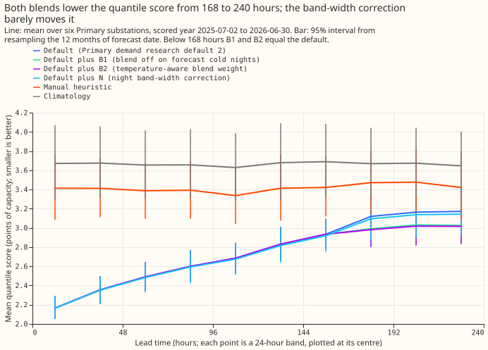
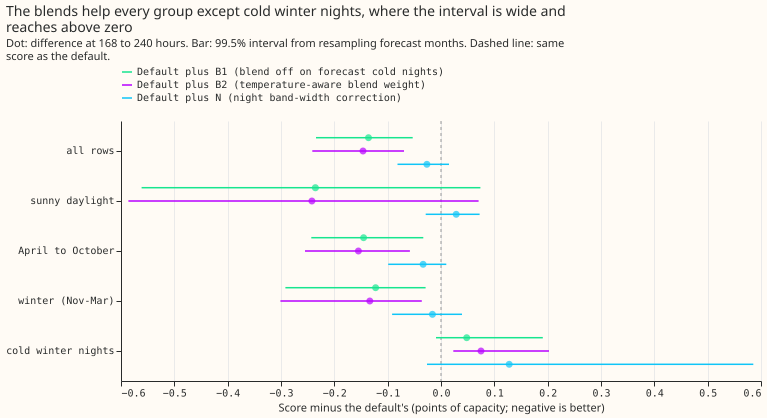
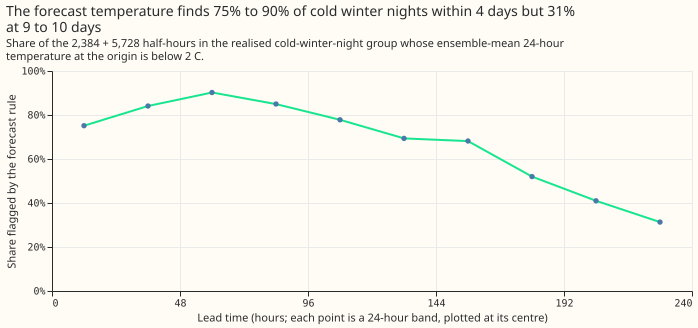
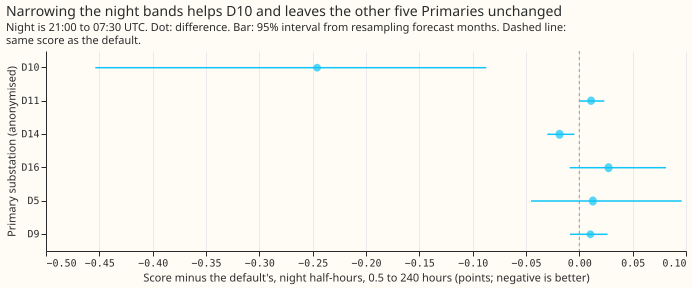
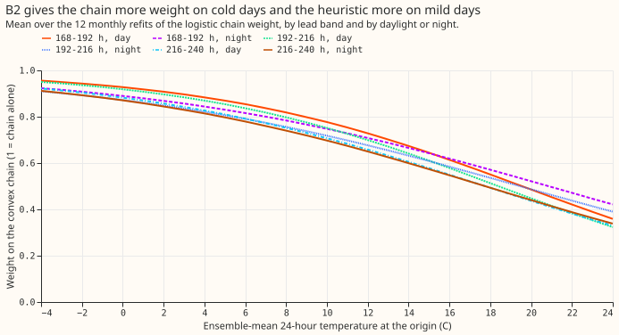
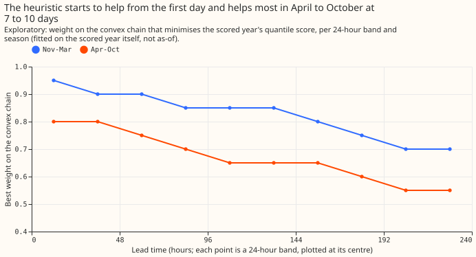
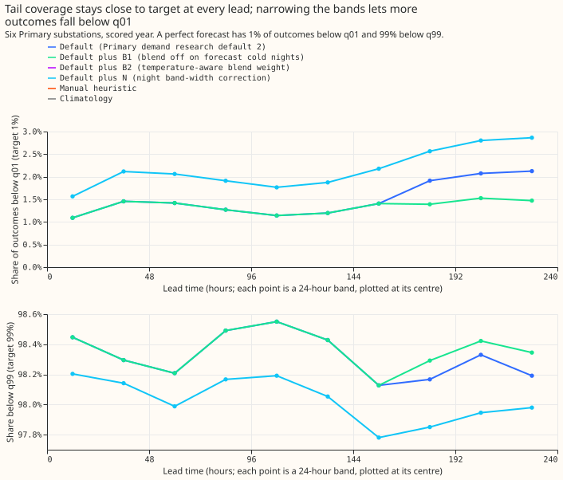

## Take-home message

**The blend with the manual heuristic still gains about 4% at 7 to 10 days, but its harm on the
coldest winter nights cannot be removed by switching it off where the weather forecast predicts a
cold night, and a night band-width correction helps one substation only.** Primary demand research
default 2 is our research demand forecast for six Primary substations (anonymised as D5, D9, D10,
D11, D14, and D16), up to 10 days ahead. It is a convex additive model (the convex chain) with a
Kalman filter on recent errors, and it gives 11 quantiles per half-hour. Experiment
[319](../00319-primary-demand-default-1-solar-summary-and-heuristic-blend-at-7-to-10-days/result.md)
found that blending the default's median with the manual heuristic's median lowers the quantile
score (twice the mean pinball loss over the 11 quantiles, in points of the substation's effective
capacity) by 4.5% at 168 to 240 hours but scores 0.076 points worse on cold winter nights. Here,
switching the blend off on half-hours that the ECMWF ensemble weather forecast calls cold winter
nights (B1) keeps the whole gain (-0.136 points, 4.3%, the same as the blend without the rule on the
same base) and cuts the harm only to +0.048 points, because at 7 to 10 days the forecast temperature
rule flags only 31% to 52% of the realised cold winter nights, depending on the lead band, and the
unflagged ones carry the harm. A blend weight that varies smoothly with the forecast temperature
(B2) gains slightly more (-0.146 points) and harms cold nights by +0.075 points. A width multiplier
on the night bands (N) lowers D10's score by 0.117 points (0.246 on night half-hours) and moves the
other five Primaries by +0.008 points on average.

**Verdict: partly supported.** B1 and B2 remain candidates, and no arm is adopted.

## Question and answer

We tested three pre-registered changes against Primary demand research default 2 (experiment 319's
solar summary to 240 hours). B1 and B2 act at 168 to 240 hours. B1 uses experiment 319's blend
weights but sets the chain weight to 1 on forecast cold winter nights (November to March, after
dark, local 18:00 to 07:00, ensemble-mean 24-hour temperature at the forecast time (09:00 UTC) below
2 °C). B2 replaces the weight table by a logistic function of the same temperature, fitted per lead
band and per daylight or night. N multiplies every quantile's offset from the median by a factor
between 0.6 and 1.2, fitted per Primary and per night or day block on the previous 90 days, at 0.5
to 240 hours. The **quantile score** is twice the mean pinball loss over 11 quantiles, in points of
effective capacity (smaller is better). **Cold winter nights** are experiment 317's realised group:
2,384 half-hours at 168 to 240 hours. The weights and factors are fitted on the convex chain's rows
and applied to the default's quantiles. The six Primaries are anonymised as D5, D9, D10, D11, D14,
and D16.

## Figures

## Results

- **Lead range:** 0.5 to 240 hours (1 to 10 days). B1 and B2 equal the default below 168 hours.
  Rows: six Primaries, scored year 2025-07-02 to 2026-06-30, origin 09:00 UTC, rows outside the
  hand-filtered events (798,116 rows, 236,909 at 168 to 240 hours). Retraining: the convex chain is
  not refitted here; blend weights and band factors are refitted monthly as-of.
- **Reproduction gate passed:** the default scores 2.749 at 0.5 to 240 hours and 3.152 at 168 to 240
  hours (experiment 319: 2.749 and 3.152). The 319 blend with no rule reproduces its harm on cold
  winter nights, +0.076 points.
- **Absolute scores, 168 to 240 hours (95% interval):** default 3.152 (2.940 to 3.393), B1 3.016
  (2.829 to 3.211), B2 3.006 (2.818 to 3.203), N 3.125 (2.900 to 3.382), manual heuristic 3.456
  (3.127 to 3.805), climatology 3.663 (3.318 to 4.027). At 0.5 to 240 hours: default 2.749, B1
  2.709, B2 2.705, N 2.735, heuristic 3.414, climatology 3.664. BG2 (to 168 hours only) scores 2.375
  at 0 to 24 hours and 3.016 at 144 to 168 hours.
- **B1 (PB1):** -0.136 points at 168 to 240 hours (99.5% interval -0.235 to -0.053), -0.040 at 0.5
  to 240 hours. It keeps 100% of the blend's gain and beats the manual heuristic by 12.7%, so two
  parts of PB1 hold. Cold winter nights are +0.048 at 168 to 240 hours, against the predicted +0.03
  or less, so PB1 fails; the one-sided 95% upper bound is +0.168 against the tolerance of 0.05.
- **B2 (PB2):** -0.146 points at 168 to 240 hours, and B2 minus B1 is -0.010 (-0.024 to +0.004). The
  point estimate meets the 0.01 threshold and the interval includes zero. Cold winter nights are
  +0.075, past the tolerance.
- **N (PN):** D10 -0.117 points at 0.5 to 240 hours (predicted at least 0.08, so this holds, and it
  is above the 0.04 that would have refuted the hour-of-day explanation), the other five Primaries
  +0.008 on average (predicted under 0.02 together, so this holds), pooled -0.014 (99.5% interval
  -0.054 to +0.016; predicted at least 0.013, so the point estimate holds and the interval includes
  zero). On cold winter nights the q01 and q99 pinball rise by 0.068 and 0.093 points (tolerance
  0.05), so PN fails on its tail clause.
- **PX:** neither arm of each pair passes the no-harm gate, so the combination is exploratory: N
  with B2 scores -0.057 points at 0.5 to 240 hours, with +0.088 on cold winter nights.
- **Replicate year (fits on the tuning months, 168 to 240 hours):** B1 -0.071, B2 -0.054, N +0.011
  against the default; the blend arms keep their sign and N does not.

### Why B1 keeps most of the harm

- The forecast rule flags 75%, 84%, 90%, 85%, 78%, 69%, and 68% of the realised cold-winter-night
  half-hours at 0 to 168 hours, and 52%, 41%, and 31% in the three bands past 168 hours.
- At 168 to 240 hours, the 966 realised cold half-hours the rule flags have B1 minus default of
  0.000 (the blend is off), and the 1,418 it misses have +0.081, the same as experiment 319's blend.
- The exploratory best chain weight (fitted in-sample on the scored year) falls with lead from 0.80
  at 0 to 24 hours to 0.55 at 216 to 240 hours in April to October, and from 0.95 to 0.70 in
  November to March.

### Gain by group, 168 to 240 hours (difference from the default, points)

| Group | B1 | B2 | N |
|---|---|---|---|
| All rows | -0.136 | -0.146 | -0.026 |
| Sunny daylight | -0.236 | -0.242 | +0.029 |
| April to October | -0.145 | -0.155 | -0.034 |
| November to March | -0.123 | -0.134 | -0.016 |
| Cold winter nights | +0.048 | +0.075 | +0.128 |

### Band-width correction N

- D10 night half-hours gain 0.246 points and D10 day half-hours 0.008; the other five Primaries'
  night contrasts range from -0.019 (D14) to +0.027 (D16). At 168 to 240 hours D10 gains 0.189 and
  the other five Primaries move by 0.000 to +0.016, so leaving D10 out flips the sign of the pooled
  contrast to +0.007.
- Tail coverage at 216 to 240 hours: share below q01 is 2.1% for the default, 2.9% for N, and 1.5%
  for B1; share below q99 is 98.2% for the default, 98.0% for N, and 98.3% for B1.

### Tail calibration (0.5 to 240 hours, cold winter nights, difference from the default)

| Arm | q01 pinball | q99 pinball | twCRPS relative |
|---|---|---|---|
| B1 | -0.003 | -0.001 | -0.8% |
| B2 | -0.002 | -0.002 | -0.4% |
| N | +0.068 | +0.093 | +2.3% |

## Checks

- **Median minus mean forecast, per site (points, 0.5 to 240 hours, default):** D5 +0.04, D9 -0.24,
  D10 -0.43, D11 -0.02, D14 +0.18, D16 +0.19. B1 and B2 shift all quantiles together, so these are
  unchanged; N moves D10 by +0.04, D5 by +0.07, and D16 by +0.02.
- **Mean absolute error of the median beside each contrast, 168 to 240 hours:** default 5.460, B1
  5.224, B2 5.203, N 5.460, manual heuristic 6.122. N does not move the median, so its error is
  unchanged, and the blend arms' error and score both fall.
- **Triggers:** the check that a result depends on one Primary fired for N: leaving D10 out changes
  the pooled 168 to 240 hour contrast from -0.026 to +0.007. The check that a result contradicts its
  own prediction was considered for PB1 and PN, and the explanations were tested (the flag-share
  figure, and the night-and-day split for N), so it did not fire.
- **Audit:** a fresh Sonnet sub-agent re-derived the headline contrasts from the stored files and
  found no discrepancy over 0.005 points: default 3.151 at 168 to 240 hours, B1 -0.136, B2 -0.146, N
  -0.026, D10 -0.189, and 2,057 half-hours flagged by the rule at 168 to 240 hours, of which 966
  fall in the 2,384-half-hour realised group. It found no leakage, no shifted quantiles, no crossing
  quantiles, and no integer overflow in the night-block calculation. Its notes: the fits ignore the
  210-minute delay with which telemetry arrives (harmless, because the fitted rows end 240 hours
  before the month starts), it scored 120 of 237,029 rows more than this page (no effect on any
  score), and the replicate year is a held-out set of days, not an as-of replay.

## Caveats and what to try next

- **Not adopted.** B1 and B2 pass the gain condition but fail the cold-winter-night non-inferiority
  bound at 168 to 240 hours; the group has only 2,384 half-hours there, so the bound is wide enough
  that it cannot pass unless the harm is clearly negative. N fails the tail and cold-night bounds.
  The research-default log is unchanged.
- **Intervals** use 99.5% (the level of experiment 319), a little narrower than the 99.67% that
  three pre-registered arms set; no conclusion depends on the difference.
- **Fits on the chain:** the weights, logistic fits, and width factors are fitted on the convex
  chain's rows and applied to the default's quantiles, because the default's own rows exist for the
  scored year only.
- **No example-week figure** of D10's night bands before and after N is drawn, because the scoring
  files keep only the median of each arm.
- **Options for later work:** switching the blend off on the realised cold nights is unavailable at
  forecast time, because it uses the observed temperature. A cold-night rule that works at 7 to 10
  days would need a better predictor than the ensemble-mean temperature. Alternatively the
  cold-night harm can be accepted for the pooled gain, which is the maintainer's decision. The
  sunshine-response term of experiment 316 (D5 and D9 only) could be replicated over more April to
  June weeks.
