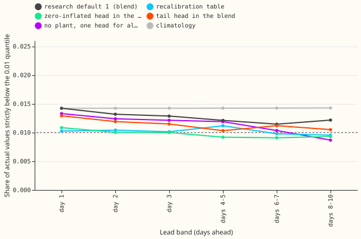
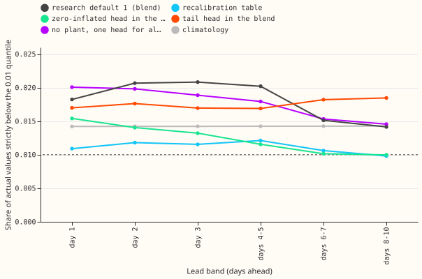
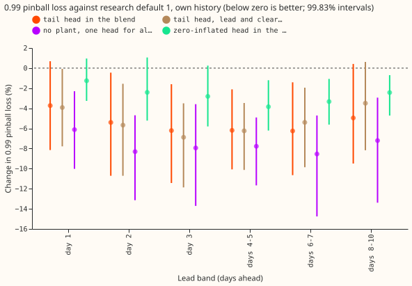
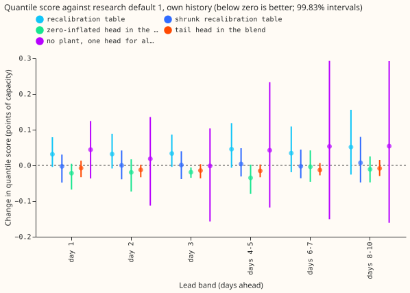
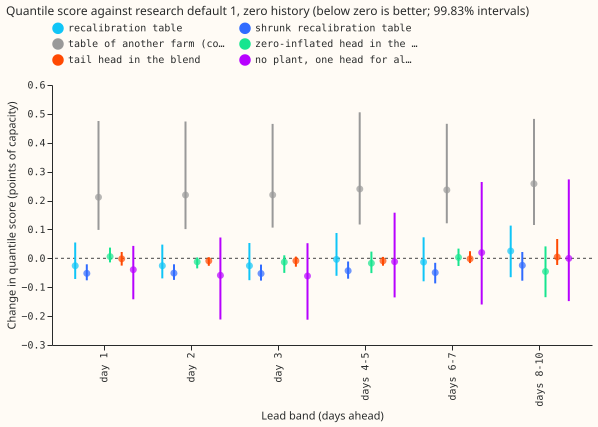
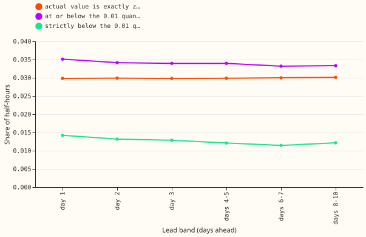

**The lowest quantile of the solar-farm forecast needs no fix for a farm with its own earlier data,
because the earlier "3.3 times too many misses" counted half-hours that read exactly zero.**
National Grid Electricity Distribution (NGED) meters six solar farms, labelled A to F. Metered solar
farms research default 1 is the fixed reference forecast for these farms ([experiment
300](../00300-metered-farm-best-guess-assembly/result.md), scored to 10 days by [experiment
310](../00310-metered-farm-long-lead-scoring/result.md)). It blends a generalised additive model, a
mixture-density neural network (the "head"), and XGBoost fed with the physical model of the farm's
output (the "plant"). A "0.01 quantile" is the output below which the forecast says 1% of actual
values should fall. Experiment 310 found 3.3% to 3.5% of actual values at or below the 0.01 quantile
of research default 1, and [experiment 318](../00318-metered-farm-mdn-head-more-features/result.md)
found 3.3% to 3.7% for its heads. We tested four changes: a recalibration table (arm 1), a head that
also predicts an exact zero (arm 2), a head for the tail quantiles only (arm 3), and one head for
all leads with no plant forecast (arm 4).

"Own history" means a farm's forecast trains on that farm's earlier months, and "zero history" means
it trains on the other five farms only, as for a new farm. Scores cover leads of 12 to 252 hours in
six bands (day 1, day 2, day 3, days 4 to 5, days 6 to 7, and days 8 to 10), with quarterly refits.
The quantile score is twice the mean pinball loss over 11 quantile levels, in points of capacity (1
point is 1% of the farm's capacity), and lower is better. Intervals come from resampling the 12
scored months in blocks, and each is a 99.83% interval, the level that corrects for six planned
contrasts per band.

**The verdict is partly supported, and nothing is adopted.** Counting only values strictly below the
0.01 quantile, research default 1 already sits at 1.2% to 1.4% in own history and 1.4% to 2.1% in
zero history (Figures 1, 2, and 6). The recalibration table brings the zero-history share to 1.0% to
1.2% and costs nothing there, but unshrunk it raises the own-history score by 0.03 to 0.05 points.
No arm lowers the own-history score by the 0.03 points that the research-default rule asks of a new
head. This family also has no pre-agreed subset of farms or leads on which a change that helps only
that subset could be adopted. So the shrunk table for zero history, the tail-targeted head (arm 3),
and the no-plant head (arm 4) stay candidates.

## Results

- **Absolute scores, own history (day 1 to days 8 to 10).** Research default 1 scores 5.30, 5.65,
  6.05, 6.69, 7.35, and 7.77 by band. `climatology` scores 8.64 and `manual_heuristic` 8.69 to 8.83
  at
  every band; research default 1 is 0.9 to 3.3 points below `climatology` (intervals below zero).
  Zero history: 5.45 to 7.89.
- **Each family alone, own history (days 1, 3, and 8 to 10).** The mixture-density head scores 5.36,
  6.08, 7.76; the GAM 5.46, 6.18, 7.85; plant-fed XGBoost 5.50, 6.33, 8.63. The blend beats the
  best single family (the head) by 0.07 points at day 1 and by 0.03 points or less at days 3 to 10.
- **Strict 0.01 share, research default 1 against nominal 1%.** Own history: 1.42%, 1.32%, 1.29%,
  1.21%, 1.15%, 1.22% by band. Zero history: 1.82%, 2.07%, 2.08%, 2.02%, 1.51%, 1.41%. The share
  at or below the quantile is 3.3% to 3.5% because 3.0% of half-hours read exactly zero.
- **C1, arm 1 (recalibration table), minus research default 1.** Own history, score: +0.031 to
  +0.051 points (intervals include zero); strict 0.01 share 0.95% to 1.12%. Zero history, score
  -0.025 to +0.026 (intervals include zero), strict share 0.98% to 1.21%. The shrunk table
  (k/(k+3)) changes the own-history score by at most 0.007 points. P1 holds for the coverage in both
  settings and fails for "under 0.02 points" (full table in own history; both tables in zero
  history, where the score falls).
- **C2, shrunk table in zero history.** The score falls by 0.052 (interval -0.076 to -0.021), 0.051,
  0.052, 0.043, 0.049 (-0.087 to -0.015), and 0.024 (-0.077 to +0.022) points by band, and it falls
  in both halves of the year (first half -0.018 to -0.044, second half -0.011 to -0.067). The
  one-week-stale table matches the table (own history +0.05 to +0.08, zero history within ±0.06 of
  zero), and the table of another farm is worse by 0.08 to 0.26 points (intervals above zero), so
  the gain is farm-specific and not a calendar artefact.
- **C3, arm 2 (zero-inflated head in the blend).** The score falls by 0.004 to 0.035 points (only
  day 3 has an interval below zero, -0.035 to -0.006); the 0.01 pinball loss falls 3.7% at day 1
  (interval -9.1% to -0.2%) and changes by -1.5% to 0.0% from day 2. P2 (at least 5% against
  research default 1) fails. The head alone puts 0.5% to 0.9% strictly below its 0.01 quantile,
  below nominal. In zero history the change is -0.045 to +0.006 points. The 0.99 pinball loss falls
  2.4% to 3.8% at days 4 to 10 (intervals below zero).
- **C4, arm 3 (tail head in the blend).** The 0.99 pinball loss falls 3.7% (interval -8.1% to
  +0.7%),
  5.4%, 6.2%, 6.2%, 6.3%, and 5.0% by band, with intervals below zero at days 2 to 7; the score
  falls
  by 0.008 to 0.015 points (intervals include zero). P3 holds for the numbers (at least 4.8% at days
  3 to 7, and 3.7% to 5.4% at days 1 and 2) but the control undoes the attribution: the head with
  lead and clear-sky index shuffled lowers the 0.99 loss by 3.5% to 6.9%, and tail minus shuffled
  is -1.5% to +0.7% (intervals include zero). Coverage of the 0.99 quantile (strictly below) is
  98.3% to 98.7% for the tail head against 99.05% to 99.2% for research default 1. In zero history
  the 0.99 pinball loss changes by -5.5% to -7.3%, and the 0.01 pinball loss rises 2.9% to 9.0%
  (intervals include zero).
- **C5, arm 4 (one head for all leads, no plant).** The score is within 1% of research default 1 at
  every band in own history (+0.044 at day 1, -0.002 at day 3, +0.054 at days 8 to 10; intervals
  include zero), so P4 holds. The 0.99 pinball loss falls 6.1% to 8.5% at every band (intervals
  below
  zero), and its 0.99 coverage is 98.4% to 98.9%. Zero history: the score changes by -0.061 to
  +0.020
  points, and the 0.99 loss falls 7.2% to 8.5%.
- **Arm 5 was not run.** Its precondition (arms 1 and 3 each pass their own prediction) failed,
  because arm 1's table fails its "under 0.02 points" condition in own history.
- **Adoption test, one line per arm.** Arm 1 (tier 0, minimum gain 0): no gain in own history
  (+0.03 to +0.05), so not adopted. Arm 2 (new head, 0.03 points): condition 1 needs an interval
  wholly below zero and a gain of 0.03 points, and the gains are 0.004 to 0.035 with intervals
  including zero at five of six bands, so not adopted. Arm 3 (new head, 0.03 points):
  gains of 0.008 to 0.015, so not adopted. Arm 4: no gain. No arm reaches condition 1, so
  conditions 2 to 5 are moot, and no row is added to the research-default log.
- **Wind cross-breed (descriptive only).** We applied the same table, fitted on earlier months, to
  the stored forecasts of the three metered wind farms from [experiment
  259](../00259-wind-plant-plus-quantile-offset-head/result.md): R1 (the physics model of the farm),
  R0 (XGBoost), and H5c (R1 plus a neural quantile head), on its 53 Tuesday runs from 2025-07 to
  2026-06. The table lowers the score of R1 by 0.28 points at day 1 and 0.36 at days 5 and later,
  and of R0 by 0.22 and 0.31. It lowers the score of H5c by 0.03 points at day 1 and raises it by
  0.04 to 0.14 points beyond day 1. The table moves the share of values strictly below the 0.05
  quantile of R1 and R0 from 1% to 2% up to 4% to 6%, close to the nominal 5%. The strict
  0.01 share stays at 0.4% to 1.7% before and after. All three arms use the neural head's kept rows
  (6,885 at day 1 to 69,555 at day 5 and later). The full table is `wind_recalibration.csv` in the
  private data folder.

## Checks

- **Median minus mean forecast, own history (points of capacity, farms pooled, day 1 and days 8 to
  10).** Research default 1: +0.05 and +0.72; tail head: +0.17 and +0.81; zero-inflated blend: +0.05
  and +0.79; no-plant head: +0.68 and +0.88. At day 3 the tail head raises the median relative to
  the mean by 0.1 to 0.2 points on every farm; its median ends above its mean on five of the six
  farms (farm A stays below, -0.28 against -0.48).
- **Error of the mean forecast beside each score contrast.** Absolute error of the mean forecast
  against research default 1, own history: table +0.3% to +0.6% (shrunk table -0.1% to +0.1%), tail
  head -0.1% to +0.1%, zero-inflated blend -0.4% to +0.2%, no-plant head -0.1% to +1.9%. Every
  own-history interval includes zero. In zero history the shrunk table lowers the error of the mean
  forecast by 0.7% to 0.8% at days 1 to 3 (intervals below zero). In every row, the sign of the
  error matches the sign of the score contrast.
- **Farm E drives the lower-tail share.** A fresh Sonnet agent found 4.6% of farm E's values
  strictly below the 0.01 quantile for research default 1 and 4.0% for the zero-inflated blend,
  against under 1% at the other farms, so more than half of the farm-equal 1.2% to 1.4% comes from
  farm E.
- **Audit.** Triggers 1 (the shuffled-input control keeps the 0.99 gain), 2 (P1, P2 failed), and 5
  (the shuffled control moves the score by 0.004 to 0.011 points, more than its interval's
  half-width at day 1) fired. A fresh Sonnet agent re-derived the scores, the 0.99 pinball loss, and
  the strict 0.01 share from the stored forecasts: scores agree within 0.002 points, the 0.99 loss
  within 0.0005, and the strict share within 0.0005 (0.0133 against 0.0129 at day 3, the difference
  comes from the row set, because the audit intersected the rows of 6 arms rather than 15). It found
  no crossed or negative quantiles and no
  sign flip when any one farm is left out for the tail head's 0.99 loss, the shrunk table's
  zero-history score, or the no-plant head's 0.99 loss; farm A is worse than research default 1 on
  the tail head's 0.99 loss and on the no-plant head's 0.99 loss. The audit agent did not check
  other bands, other metrics, or seeds beyond the first.
  Triggers 3, 4, 6, and 7 did not fire (trigger 6 was not compared against a sister experiment).
- **Reviews.** One Sonnet code review found no leakage or bug; its two suggestions (row-count and
  seed-count assertions) were applied. The default is read from stored forecasts, so the plan's
  reproduction gate was not needed; the blend with experiment 318's five-seed head (`rd1_5seed`)
  scores within 0.003 points of research default 1.

## Method and schedule

- **Arms.** Arm 1: offsets per farm, lead day, and level, the empirical quantile of actual minus
  forecast over rows whose valid time precedes the month's first run (30 rows minimum per cell),
  clipped at zero and re-sorted; the shrunk version multiplies by k/(k+3). Arm 2: the head gains a
  logit for an exact-zero half-hour (output at or below 0.002 of the scale) with the default inputs
  plus hour as sine and cosine, and the blend uses it in place of the mixture head. Arm 3: a
  network on experiment 318's full inputs outputs offsets from the plant forecast at 0.01, 0.02,
  0.05, 0.95, 0.98, and 0.99, trained pooled with the pinball loss and a non-crossing penalty, and
  replaces the blend's 0.01, 0.05, 0.95, and 0.99 quantiles. Arm 4: experiment 318's
  `pure_lead_pooled`
  (own history from its stored forecasts; zero history fitted here).
- **Schedule and seeds.** Quarterly refits on all earlier months (the screening schedule); five
  seeds in own history and three in zero history (three for the shuffled control). Absolute scores
  could shift under weekly refits and the contrasts were not tested for dependence on the schedule.
- **Rows.** Experiment 310's scored-year rows (2025-09 to 2026-08), common to every arm and to the
  floors; weather at every lead is the 00 UTC ECMWF ensemble run, available at forecast time, and
  the farm's own power enters at a lag of `ceil(lead / 24)` days.
- **Reuse.** The scripts import experiment 310's folder for rows, `Setting`, the head, and the
  rolling blend, and experiment 318's folder for the added columns, batches, and training loop.

## Caveats and next steps

- **Leads.** The scored range is 12 to 252 hours (days 1 to 10), which covers NGED's horizon.
- **Coverage definition.** The strict share is the headline because zero actuals sit on a point
  mass. The "at or below" shares of experiments 310 and 318 are in the private score tables.
- **Months without history.** Months with no earlier rows, and cells under 30 rows, pass through
  unchanged, which dilutes the table's effect in the first months.
- **Upper-tail trade.** The tail head and the no-plant head lower the 0.99 pinball loss while
  covering the 0.99 quantile less often (98.3% to 98.9% against 99.05% to 99.2%). For curtailment
  the missed events matter, so the cost of curtailment at a substation and its generators (the node
  metric) should be scored before porting the tail head or the no-plant head.
- **Not tested.** Weekly refits, the blend rescored with the new tail head's gain per farm (farm A
  is worse), and a table fitted on more than the 12 scored months.
- **Next.** Score arm 3's and arm 4's forecasts on the node curtailment metric, and test the shrunk
  table on a farm genuinely absent from the training set.
