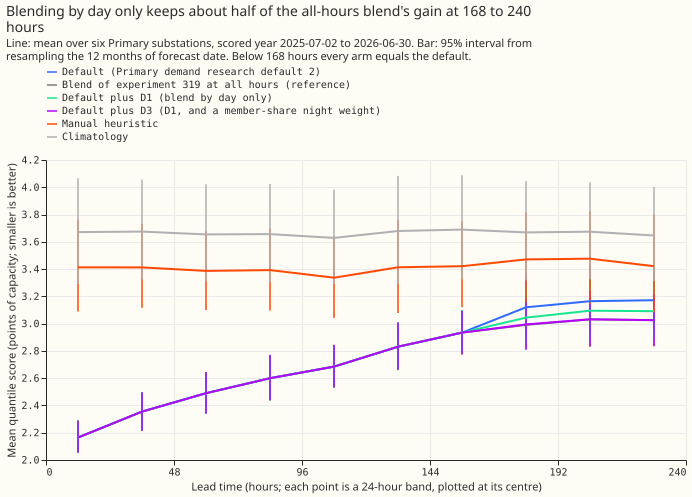
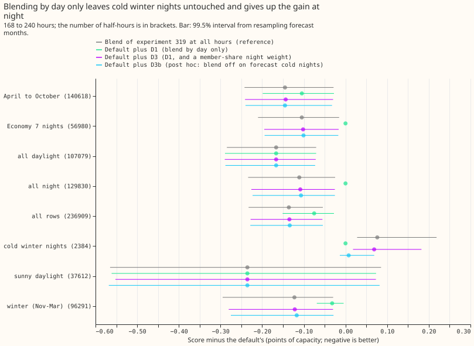
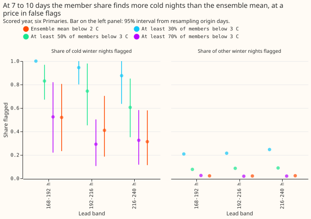
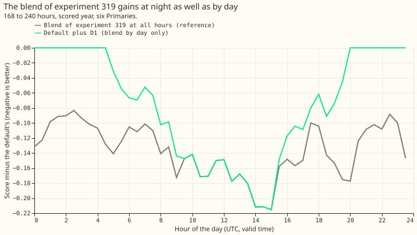
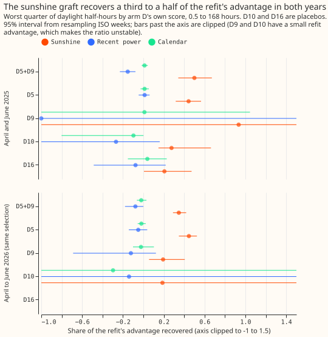

## Take-home message

**Using the manual-heuristic blend only by day causes no harm on cold winter nights but gives up
nearly half of the blend's gain, and a hard switch on the share of cold ensemble members keeps the whole gain with almost no cold-night harm, though that switch was not pre-registered.** Primary demand research default 2 is our research demand forecast for six Primary
substations (anonymised as D5, D9, D10, D11, D14, and D16), up to 10 days ahead. Experiment
[319](../00319-primary-demand-default-1-solar-summary-and-heuristic-blend-at-7-to-10-days/result.md)
found that blending the median of Primary demand research default 2 with the median of the manual heuristic (NGED's rule of thumb, built from the same half-hour in earlier weeks and years) lowers the quantile score (twice
the mean pinball loss over 11 quantiles, in percentage points of the substation's capacity) by 4.5%
at 168 to 240 hours, and experiment
[320](../00320-primary-demand-default-2-night-aware-heuristic-blend-and-night-band-width/result.md)
found that the blend harms cold winter nights (winter half-hours after dark, from 18:00 to 06:30 local time, that turn out to have a 24-hour mean temperature under 2 °C). We asked whether confining the blend to daylight
half-hours (the daylight-only blend, D1) removes the harm, whether a night weight built from the share of the 51 ensemble
members below 3 °C (D3) recovers the night gain without the harm, and whether the sunshine graft of
experiment [316](../00316-primary-demand-night-level-and-single-input-terms/result.md) replicates.
D1 lowers the score by 0.075 points (99.5% interval 0.028 to 0.151) at 168 to 240 hours, against the default's 3.152, which is 55% of the all-hours blend's 0.136, and is 11.0% better than the manual heuristic. D3 keeps the whole gain (0.135 points) and raises the score on cold winter nights by 0.069 points, over the 0.05-point bound on harm there. The sunshine graft (the sunshine response of a depth-1 XGBoost refit, added to the convex fit's forecast) recovers 0.50 of the refit's advantage over the convex fit at D5 and D9 in April and June 2025.

**Verdict: partly supported.** D1 meets the five adoption conditions and becomes Primary demand
research default 3. D3 fails the cold-night bound. Lead range: 0.5 to 240 hours for stages 1 and 2,
0.5 to 168 hours for stage 3, where arm D is stored to 168 hours only. The research default's
[absolute scores](../research-default-log.md) are in the first figure.

## Figures

## Results

- **Reproduction gate passed.** The default scores 2.749 at 0.5 to 240 hours and 3.152 at 168 to 240
  hours, as in experiment 319. All arms equal the default below 168 hours.
- **Single forecast sources at 168 to 240 hours (stage 1 row set, 236,909 half-hours):** default 3.152
  (2.940 to 3.391), manual heuristic 3.456, climatology 3.663, all-hours blend 3.016, D1 3.077, D2
  3.013, D3 3.017. D1's added value over the best single family (the default) is -0.075 (99.5%
  interval -0.151 to -0.028). At 0.5 to 240 hours D1 scores 2.727 against 2.749 (-0.022, -0.044 to
  -0.008).
- **D1 by group, difference from the default at 168 to 240 hours (all-hours blend in brackets):**
  sunny daylight -0.236 (-0.236); all daylight -0.166 (-0.166); all night 0.000 (-0.111);
  Economy 7 nights (01:00 to 07:00 local, 56,980 half-hours) 0.000 (-0.105); April to October
  -0.105 (-0.145); November to March -0.032 (-0.123); cold winter nights 0.000 (+0.076, one-sided
  95% bound +0.189). D1 therefore keeps all of the gain on sunny daylight, 55% of the pooled gain,
  and none of the night gain.
- **D2 (day and night weights refitted separately):** -0.139 pooled and +0.112 on cold winter nights
  (bound +0.230). Freeing the night weight reproduces the harm, as predicted.
- **The member-share rule (flag: at least half of the members below 3 °C) at 168 to 240 hours:**
  flags 71.6% of the 2,384 realised cold winter-night half-hours (83%, 74%, and 61% in the three
  24-hour bands) against 40.5% for the ensemble-mean rule, at a false-flag rate of 8.4% against a
  base rate of 4.6% (1.7 to 1.9 times). The prediction (at least 65%, at most twice the base rate)
  holds pooled and fails in the 216 to 240 hour band (61%).
- **D3:** -0.135 pooled, -0.059 against D1 (99.5% interval -0.130 to -0.015, so at least the 0.02
  predicted), and +0.069 on cold winter nights (bound +0.164), over the 0.03 predicted and the 0.05
  tolerance. D3 is not adopted.
- **D3b (D3 with a hard switch; post hoc, not pre-registered):** the experiment 319 blend everywhere except on half-hours
  the member-share rule flags as cold winter nights, where the chain alone is kept. D3b scores -0.134
  pooled (99.5% interval -0.228 to -0.054), 12.7% better than the heuristic, and +0.008 on cold
  winter nights (one-sided 95% bound +0.061, point estimate under the 0.05 tolerance but the bound
  just over it). Its replicate-year pooled gain is -0.071.
- **Replicate year (fits on the tuning period, 155,202 half-hours at 168 to 240 hours):** all-hours
  blend -0.075, D1 -0.027 (99.5% interval -0.079 to +0.008, same sign), D3 -0.045 (-0.147 to +0.109),
  D3b -0.071. D1's replicate gain is smaller than the scored year's, and its November-to-March
  change is +0.013.
- **Tails at 216 to 240 hours (default, D1, D3b):** coverage below q01 is 2.1%, 1.9%, and 1.5%;
  coverage below q99 is 98.2%, 98.4%, and 98.3%; q01 pinball 0.235, 0.227, and 0.212; q99 pinball
  0.245, 0.239, and 0.234. The 90% band holds 88.9%, 89.7%, and 90.5% of actuals. No arm moves a tail
  by more than 0.023 points. Curtailment cost against the manual heuristic is not scored, because the
  node-plus-generators metric needs forecasts for substations and their generators, and this
  experiment forecasts six Primaries only.
- **Per Primary, D1 minus default at 168 to 240 hours:** D5 -0.097, D9 -0.120, D10 -0.064, D11
  -0.026, D14 -0.056, D16 -0.091. Leaving one Primary out gives -0.066 to -0.085.
- **Stage 3, sunshine graft (0.5 to 168 hours, worst quarter of daylight half-hours by arm D's own
  score).** At D5 and D9 pooled (5,521 half-hours, 11 ISO weeks) in April and June 2025, the sunshine
  graft recovers 0.50 (95% interval 0.34 to 0.67) of the refit's advantage, the recent-power graft
  -0.15 (-0.23 to -0.08), the calendar graft 0.01 (-0.02 to 0.04), temperature 0.17, and all families together 0.50. The same selection in April to June 2026 gives 0.35 (0.29 to 0.42), -0.08, -0.02,
  0.13, and 0.50. By Primary the sunshine graft recovers 0.44 at D5 (0.32 to 0.57) and 0.93 at D9
  (interval -5.6 to 6.6, because the refit's advantage over arm D is only 0.47 points there), against
  0.45 and 0.19 in 2026. The placebos recover 0.28 at D10 and 0.21 at D16 (0.01 to 0.47), so part of
  the sunshine response is better in the refit everywhere.
- **Stage 3 predictions:** sunshine at least 0.25 pooled and 0.15 at each Primary (point estimates
  0.50, 0.44, and 0.93); recent power and calendar each under 0.25 (-0.15 and 0.01). All four predictions hold, so the sunshine-graft lead of experiment 316 is not noise.

## Checks and caveats

- **Median minus mean forecast per site (points, default and D1, which differ only past 168 hours):**
  D5 +0.04, D9 -0.24, D10 -0.43, D11 -0.02, D14 +0.18, D16 +0.19. D1 and D3b shift all quantiles
  together, so the offsets do not change.
- **Mean absolute error of the median, 168 to 240 hours:** default 5.460, D1 5.326, all-hours blend
  5.224, D3b 5.227, manual heuristic 6.122. The error and the quantile score move in the same
  direction.
- **Triggers and audit.** Two pre-registered predictions failed (D1 keeps 55%, not 70%, of the gain;
  D3 harms cold nights), so the "contradicts its own prediction" trigger is treated as fired. The
  explanations were tested in this page (gain by day and night, and the D3b arm). A fresh Sonnet
  sub-agent re-derived the headline contrasts from the stored files: default 3.151, all-hours blend
  -0.136, D1 -0.075, D1 equal to the blend on daylight and to the default elsewhere (exactly), cold
  winter nights +0.076 for the blend and exactly 0 for D1, and leave-one-out -0.066 to -0.085. Its
  differences: the interval's lower bound is -0.145 against -0.151 here (an equal-weight version gives
  -0.143, same conclusion), and the cold-night count is 2,196 under an 18:00 to 06:00 definition and
  2,384 only when 06:30 is included, and the 2,384 figure uses that second definition. It found no leakage in the as-of
  fits or the member share, did not read the upstream `kind` flag (solar geometry from experiment 319),
  and noted that D3b is computed in the scoring script and is not a stored column.
- **Adoption.** D1 meets the five conditions of the research-default page: its interval is wholly
  below zero with minimum gain 0, no protected group is harmed (cold winter nights exactly 0), the
  replicate year has the same sign, the controls passed, and the change uses the sun's elevation at
  the valid time and the heuristic median, both available at the forecast time. Porting needs the
  weekly-analogue heuristic in the serving path.
- **Not pre-registered.** D3b and the day-and-night, season-by-night splits are post hoc. The
  worst-quarter selection in stage 3 deviates from experiment 316 (no BG2 forecast exists for the
  replicate year), and selecting on arm D's own score inflates both the refit's advantage and the
  graft's recovery, so only the replicate against the same-selection 2026 figures is comparable.
- **Fits on the chain:** the weights and logistic fits use the convex chain's rows, as in experiments
  319 and 320.
- **Candidate next steps:** pre-register D3b with the cold winter nights of the replicate year pooled so the bound
  has more half-hours; test a flexible sunshine response in the convex fit against Primary demand
  research default 3.
